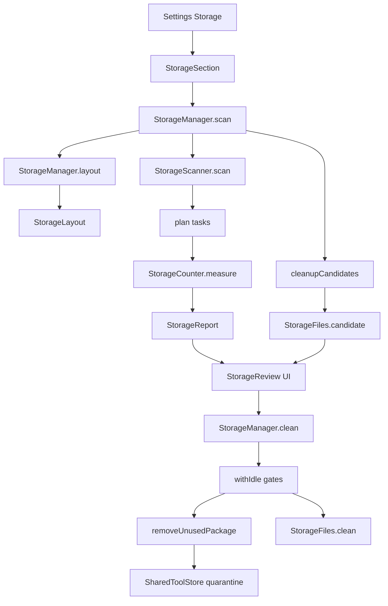

# Storage Inventory and Cleanup

> The disk inventory behind Settings, Storage: measured categories, shared-file accounting, Not measured states, rescan and cancel, and reviewed cleanup with package quarantine.

`StorageManager` builds a `StorageLayout`, runs `StorageScanner`, and adds cleanup candidates. `StorageScanner` plans one task per item, measures tasks in a fixed order, and lets `StorageCounter` claim each file identity once. `StorageReport` turns fixed role enums into groups and totals. `StorageSection` renders the inventory and the cleanup review. Shared Linux package removal goes through `SharedToolStore`, which quarantines files before committing.

## Module Responsibilities

- **`StorageManager`**: Resolves real paths for app data, plugins, skills, local models, Linux prefixes, caches, and workspaces. It produces `StorageInventory` with the report, managed tools, package protections, and cleanup candidates.
- **`StorageScanner`**: Declares every item and its roots or explicit file list. It measures them under a time budget and returns a `StorageReport`.
- **`StorageCounter`**: Walks trees without following links and counts a file only the first time its filesystem identity is seen.
- **`StorageFiles`**: Guards containment, snapshots exact trees with hashes, creates cleanup candidates, and deletes only reviewed stamps.
- **`StorageReport`**: Defines `StorageCategory`, `StorageRole`, `StorageGap`, `StorageItem`, groups, totals, largest items, and search matching.
- **`StorageSection`**: Shows the summary, category cards, Largest and Not measured views, item details, cleanup review, progress, Stop, and Rescan.
- **`StorageLabels`**: Maps a role to its title and explanation string, a gap to its reason, and a category to its name and icon.
- **`SharedToolStore`**: Owns managed package records, removal eligibility, the removal journal, and the `removing` quarantine directory.

## Architecture and Flow

`StorageManager.layout` starts from `container.workspace.projects`. An SSH workspace becomes `StorageGap.SSH_HOST`, a SAF workspace without a shell root becomes `SAF_FOLDER`, a missing folder becomes `MISSING`, and an unreadable folder becomes `PERMISSION_DENIED`. Only a readable local folder becomes a scan root. Paths inside the app data directory are canonicalized; other paths are only canonicalized through their parent, so a managed-folder symlink is not turned into a scan root.

`StorageScanner.plan` is the ordering contract. Shared package-manager caches are planned first: npm, pip, the shared cache root, Linux home caches, Gradle caches and wrapper distributions, apt cache, deb downloads, plugin previews, share cache, remote images, audio, TTS, and MCP logs. Then come local models and their partial files, plugins, user, project, and bundled skills, Linux package files, global npm and pip packages, CodeGraph, package records, staging, the shell tier copy, workspaces, other repositories, leftover Linux folders, and finally app data and leftover cache or data folders.

A `Task` can measure roots, an explicit file list, or neither. `optional` omits an item when nothing exists. `dropIfClaimed` omits an item when all of its files already belong to an earlier task. `fixed` skips measurement entirely. `group` combines several locations into one item and lists only the locations that exist.

`StorageCounter.measure` starts at a normalized root and refuses a symbolic link at the root. It walks iteratively with an `ArrayDeque`, skips symbolic links, and records a regular file only when `identities.add(a.fileKey() ?: path)` succeeds. That set is shared across every task in one scan, so a hard link, a file under two listed folders, or a nested workspace root is counted once. Directory entries beyond depth 64 set `truncated`. The counter also stops at a wall-clock deadline or entry limit.

`scan` creates one counter with `now() + budgetMillis * 1_000_000`, computes the union of every task root, and measures tasks in plan order. Each task passes `allRoots - own` as excluded paths, so a nested listed root is not walked twice by its parent. Progress is reported per task. If any item ends with `TIMED_OUT`, the report's `timedOut` flag is set. Workspaces are returned in the user's order after measurement.

## Invocation Chain

1. `SettingsScreen` opens `StoragePage.STORAGE` and calls `StorageSection(container)` (`ui/settings/SettingsScreen.kt:406`).
2. `StorageSection` runs `rescan()` on first composition. `rescan` refuses to start while another job is active, clears the stopped and error state, and launches `container.storage.scan` (`ui/settings/StorageSection.kt:90`).
3. `StorageManager.scan` calls `layout()`, then `StorageScanner(layout).scan`, then `cleanupCandidates` (`data/storage/StorageManager.kt:89`).
4. `StorageScanner.scan` clears and rebuilds tasks with `plan()`, creates a `StorageCounter`, and measures each task (`data/storage/StorageScanner.kt:316`).
5. `StorageCounter.measure` walks a root, calling `identities.add` per regular file and counting `alreadyCounted` for repeats (`data/storage/StorageFiles.kt:45`).
6. `measure` converts a result into the item's `bytes`, `files`, `partial`, or a gap such as `MISSING`, `PERMISSION_DENIED`, or `TIMED_OUT` (`data/storage/StorageScanner.kt:337`).
7. `StorageManager` appends package cleanup candidates, stale `.deb` files, npm and pip caches, and recognized Gradle build outputs, then publishes `StorageInventory` to `last` (`data/storage/StorageManager.kt:98`).
8. `StorageSection` renders `StorageSummary`, search, the view choice, and either category cards or item panels (`ui/settings/StorageSection.kt:135`).
9. Review cleanup filters `data.candidates` by selection, then the confirmation lists each exact path and size and calls `container.storage.clean(chosen)` (`ui/settings/StorageSection.kt:227`).
10. `StorageManager.clean` runs inside `runManager.withIdleStorage`, `backgroundProcesses.withIdleStorage`, `terminal.withClosedStorage`, and the package storage lock. Package candidates go to `env.removeUnusedPackage`; file candidates go to `StorageFiles.clean` (`data/storage/StorageManager.kt:147`).
11. `StorageFiles.clean` re-snapshots each candidate tree and deletes only files whose identity, size, and modified time still match the reviewed stamps (`data/storage/StorageFiles.kt:198`).
12. `SharedToolStore.remove` writes a removal journal, atomically moves each recorded file into the quarantine directory, commits the installed-package marker, then removes the quarantine (`data/storage/SharedToolStore.kt:79`).

## Key State and Data Structures

- **`StorageCategory`**: `APP_DATA`, `PLUGINS`, `SKILLS`, `WORKSPACES`, `LINUX_PACKAGES`, `LOCAL_MODELS`, `CACHES`, in display order (`data/storage/StorageReport.kt:4`).
- **`StorageRole`**: The concrete item kind and its category. `named = true` means the row shows the item's own name, such as a plugin, package, model, or workspace (`data/storage/StorageReport.kt:10`).
- **`StorageGap`**: `PERMISSION_DENIED`, `SAF_FOLDER`, `SSH_HOST`, `MISSING`, `TIMED_OUT`, `SCAN_ERROR`, `REGISTRY_UNREADABLE`, plus the included reasons `SAME_FOLDER`, `INSIDE_APP_PACKAGE`, and `UNTRACKED` (`data/storage/StorageReport.kt:73`).
- **`StorageItem`**: `role`, `key`, `name`, `path`, `morePaths`, `bytes`, `files`, `gap`, `partial`, `shared`, `scope`, `version`, `enabled`, `owners`, `countedIn`, `seenBytes`. `id` is `"${role.name}:$key"`. `measured` means `bytes != null`; `notMeasured` means no bytes and no included gap (`data/storage/StorageReport.kt:89`).
- **`StorageGroup`**: A category and its items. `bytes` sums measured bytes; `notMeasured` counts rows that will be shown as Not measured (`data/storage/StorageReport.kt:123`).
- **`StorageProgress`**: `done`, `total`, `category`, `current`. `fraction` is clamped to 0..1 and is 0 when total is 0 (`data/storage/StorageReport.kt:128`).
- **`StorageReport`**: `items`, `finishedAt`, `timedOut`. `total` sums only `bytes != null`; `notMeasured` filters the item predicate; `partial` counts items with unreadable children; `groups` and `largest` provide the two main views (`data/storage/StorageReport.kt:132`).
- **`StorageMeasure`**: `bytes`, `files`, `alreadyCounted`, `denied`, `errors`, `truncated`, `exists`, `rootDenied`. `partial` is true when any denial or error occurred (`data/storage/StorageFiles.kt:16`).
- **`StorageStamp`**: `path`, `size`, `modified`, `identity`, `directory`, `sha256`. A candidate is a capability for one exact tree, and `bytes` sums non-directory stamps (`data/storage/StorageFiles.kt:113`).
- **`StorageInventory`**: report, managed tools, protections, and candidates. `incomplete` is true when anything is Not measured or partial (`data/storage/StorageManager.kt:14`).

## Boundary Conditions

- **Each file is counted once.** `StorageCounter` keeps a `HashSet<Any>` of `BasicFileAttributes.fileKey()`, falling back to the normalized path when a filesystem has no stable key. This is the hard-link and overlapping-folder dedupe.
- **Overlapping roots are subtracted.** Every task passes the other task roots as excluded paths, and workspaces are planned deepest first. A workspace inside another workspace therefore contributes only its own bytes.
- **Symlinks are never followed or counted.** A root symlink returns an empty measure; a symlink inside a tree is skipped. `StorageFiles.contained` rejects any symlink at or below the anchor and verifies canonical containment.
- **Scanning is bounded.** The default budget is 120,000 ms. The counter defaults to 3,000,000 visited entries and a depth of 64. A budget or entry overrun sets `truncated`, which becomes `TIMED_OUT`. A timed-out item keeps `seenBytes` for display but those bytes are never added to any total.
- **Permission failures become Not measured.** A denied child increments `denied` and marks the item `partial`. A denied root returns `PERMISSION_DENIED`. A missing optional root omits the item; a missing non-optional root returns `MISSING`.
- **Unmeasurable workspaces are explicit.** SSH workspaces show `SSH_HOST`, SAF-only workspaces show `SAF_FOLDER`, a vanished folder shows `MISSING`, and an unreadable folder shows `PERMISSION_DENIED`. A second workspace that resolves to the same folder shows `SAME_FOLDER` and points at the first item through `countedIn`.
- **Included gaps are not Not measured.** `SAME_FOLDER`, `INSIDE_APP_PACKAGE`, and `UNTRACKED` have `included = true`. They appear as accounted elsewhere, usually with a "counted in" label, and do not inflate the Not measured view.
- **Shared package files have their own item.** `StorageInventoryRules.splitOwnership` separates paths owned by one installed package from paths claimed by several. Exclusive paths stay under their package; shared paths become `LINUX_SHARED_FILES` with the sorted owner list.
- **Shared caches are claimed first.** npm, pip, Gradle, apt, and other shared cache roots are planned before the folders that contain them. A later cache or home item therefore reports only unclaimed files.
- **Cleanup candidates require age and exactness.** `StorageFiles.candidate` refuses a tree with any file modified at or after the threshold, or with no non-empty regular file. It snaps metadata first, hashes second, and requires the metadata snapshots to match. Any exception returns null, so unknown ownership is never a candidate.
- **Cleanup does not recursively delete.** `StorageFiles.clean` re-snapshots and compares the full stamp list. It deletes each reviewed non-directory file only when containment holds and identity, size, and modified time still match. Directories are removed afterward only by `Files.delete`, which succeeds only when empty.
- **Cleanup waits for quiet state.** `StorageManager.clean` holds the run, background-process, and terminal gates plus the package lock. A queued task, background process, install, or open terminal cannot slip in between preview and deletion.
- **Build output cleanup is narrowly recognized.** Only a module with `build.gradle` or `build.gradle.kts` and a `build` folder containing `outputs` or `intermediates` is considered. Outputs, intermediates, and tmp older than seven days are candidates. A workspace nested inside another project's build tree protects that whole tree.
- **Cache and download cleanup is one day old.** npm `_cacache`, pip, and `.deb` downloads use a 24-hour threshold. The npm and pip roots are only scanned when `StorageFiles.contained` proves they live under the app files directory.
- **Package removal is quarantined.** `SharedToolStore.remove` refuses when requirements changed, files changed, the record is incomplete, or a previous journal exists. It moves every recorded file into `removing` with `ATOMIC_MOVE`, calls the commit callback to write the new installed list, then deletes the quarantine. A crash before commit leaves the journal, and `recover` moves files back.
- **Package eligibility is conservative.** `reason` blocks the app toolchain, unknown dependency states, incomplete ownership, any recorded requirement, installed dependents, and packages that share files with another installed package.
- **Stop discards an unfinished scan.** `StorageSection.stop` cancels the job, clears progress, and sets `stopped`. `StorageManager.scan` keeps nothing from a cancelled run; `_last` changes only after a complete scan.
- **The total is measured bytes only.** Not measured items are listed and excluded. `StorageSummary` shows the Not measured count as an error pill and states that the total excludes them. Partial items are shown separately.
- **Undo checkpoint storage is split.** The `UNDO_CHECKPOINTS` item measures `files/task-controls` (`data/storage/StorageScanner.kt:293`), which is `TaskControlStore`'s task record directory. The `checkpoints` Room table lives inside `harness.db` and is counted under the chat database item (`CHAT_DATABASE`).

## Extension Points

- **`StorageRole` and `StorageLabels.roleText`**: Add a role, then its category, title, note, and gap text. Named roles use the item name instead of the role title.
- **`StorageLayout`**: The data class is the full input to scanning. It can be constructed in a test with a temporary directory and explicit plugin, skill, model, and workspace lists.
- **`StorageScanner.plan`**: New items are added with `add`, `addGroup`, or a direct `Task`. `optional`, `dropIfClaimed`, `fixed`, and `group` cover omission, dedupe, static rows, and multi-path rows.
- **`StorageCounter`**: The deadline clock, entry limit, and root list are constructor or call parameters, so alternate budgets and fixtures are possible.
- **`StorageManager.cleanupCandidates`**: Adds provider-specific previews. Existing providers are package cleanup, interrupted `.deb` downloads, shared npm and pip caches, and recognized Gradle outputs.
- **`StorageFiles`**: `contained`, `snapshot`, `candidate`, and `clean` form a reusable reviewed-deletion primitive for any local tree.
- **`SharedToolStore`**: `preview`, `remove`, `recover`, and `reason` are the package lifecycle boundary used by `LinuxEnvironmentManager`.

Sources: [app/src/main/java/com/androidharness/app/data/storage/StorageScanner.kt](../app/src/main/java/com/androidharness/app/data/storage/StorageScanner.kt)#L130-L372), [app/src/main/java/com/androidharness/app/data/storage/StorageFiles.kt](../app/src/main/java/com/androidharness/app/data/storage/StorageFiles.kt)#L16-L226), [app/src/main/java/com/androidharness/app/data/storage/StorageReport.kt](../app/src/main/java/com/androidharness/app/data/storage/StorageReport.kt)#L4-L161), [app/src/main/java/com/androidharness/app/data/storage/StorageManager.kt](../app/src/main/java/com/androidharness/app/data/storage/StorageManager.kt)#L14-L162), [app/src/main/java/com/androidharness/app/ui/settings/StorageSection.kt](../app/src/main/java/com/androidharness/app/ui/settings/StorageSection.kt)#L69-L585)

## Source files

- `app/src/main/java/com/androidharness/app/data/storage/StorageScanner.kt`
- `app/src/main/java/com/androidharness/app/data/storage/StorageReport.kt`
- `app/src/main/java/com/androidharness/app/data/storage/StorageFiles.kt`
- `app/src/main/java/com/androidharness/app/data/storage/StorageManager.kt`
- `app/src/main/java/com/androidharness/app/data/storage/SharedToolStore.kt`
- `app/src/main/java/com/androidharness/app/ui/settings/StorageSection.kt`
- `app/src/main/java/com/androidharness/app/ui/settings/StorageLabels.kt`
- `app/src/main/java/com/androidharness/app/ui/settings/SettingsScreen.kt`
- `app/src/main/java/com/androidharness/app/data/env/LinuxEnvironment.kt`
- `app/src/main/java/com/androidharness/app/agent/TaskControl.kt`
