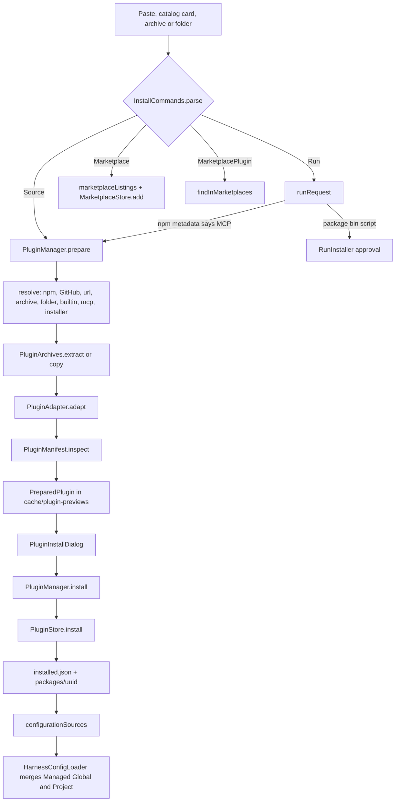

# Plugin Manager and Discovery

> Installs, enables, updates and removes plugin bundles, and presents featured, marketplace, GitHub, npm and MCP registry results with sort and filter controls.

The subsystem separates orchestration (`PluginManager`), the on-disk registry (`PluginStore`), pure catalog logic (`PluginCatalog`), network access (`PluginDownloads`), marketplace document parsing (`PluginMarketplaces`) and pasted-command parsing (`InstallCommands`). The settings UI lives in `PluginManagerSection.kt` and `PluginDiscover.kt`. It accepts bundles from several ecosystems, verifies a bundle before anything is stored or executed, and keeps installation state out of the user's project configuration.

## Module Responsibilities

- **`PluginManager`**: Owns the install pipeline. Parses a pasted request, resolves and downloads a source, extracts it, adapts foreign layouts, inspects the result, and exposes `prepare` and `install` as separate steps so the user can review metadata first.
- **`PluginStore`**: Serializes `InstalledPlugin` records to `filesDir/plugins/installed.json`, stores each payload under a UUID folder, verifies content digests, and exposes enabled plugins as configuration sources.
- **`PluginCatalog`**: Pure matching, identity, update detection, category extraction, filtering and sorting. No Android dependency, so the rules are testable without a device.
- **`PluginDownloads`**: HTTPS-only npm registry, GitHub API and MCP registry client. Resolves immutable revisions, downloads archives with size caps, and verifies npm integrity hashes.
- **`PluginMarketplaces` and `MarketplaceStore`**: Parses Claude Code `.claude-plugin/marketplace.json` documents into `PluginListing` rows and persists the user's marketplace list.
- **`InstallCommands`**: Turns pasted text (npm, npx, pnpm, yarn, bun, uvx, pipx, git clone, `claude` and `/plugin` forms, URLs and JSON) into an `InstallRequest`. It never runs anything.
- **`PluginStarters`**: Materializes two bundled starter bundles (`review-workflow`, `test-workflow`) when an origin of kind `builtin` reaches `prepare`.
- **UI (`PluginManagerSection`, `PluginDiscover`)**: Three tabs (Installed, Discover, Add), shared progress state, install review dialog, marketplace chooser, installer approval dialog, and catalog cards.

## Architecture and Flow

Preparation is staged through `PluginProgress`: `Resolving source`, `Downloading`, `Checking bundle`, `Reading archive` or `Reading folder`, `Installing runtime`, `Running installer`, and finally `Installing plugin`. `PluginManager.prepare` returns a `PreparedPlugin` that still lives in `cacheDir/plugin-previews/<uuid>`; it is deleted by `discard` when the review dialog is disposed or after a successful install. `MarketplaceChoices` and `InstallerNeeded` are control-flow exceptions: the first opens a chooser of listings, the second opens an approval dialog whose edited command becomes an `installer` origin.

Catalog discovery runs every source concurrently. `PluginManager.search` builds one `CatalogSection` per added marketplace plus three remote sections (`MCP registry`, `GitHub`, `npm`) and prepends `PluginMarketplaces.featured`. Each section catches its own failure, so a blocked or slow source reports `error` without emptying the screen. Remote sections use `withTimeout(20_000)`. After the first render, `withRepoStats` fills missing star counts and dates from GitHub for at most 24 repositories, so the catalog never waits on rate-limited calls.

## Invocation Chain

1. Settings selects `SettingsPage.PLUGINS`, which calls `PluginManagerSection(container)` (`SettingsScreen.kt:377`). The section also accepts `catalogSearch` and `workspaceOverride`, used by previews and tests.
2. `PluginManagerSection` reads `manager.revision` (`PluginManagerSection.kt:59`). `PluginStore` bumps that `MutableStateFlow` through the `onChanged` lambda passed at `PluginManager.kt:40`, so every registry write reloads the installed list.
3. The Installed tab loads `manager.store.list()` on `Dispatchers.IO` (`PluginManagerSection.kt:104-110`). A damaged registry sets `registryBroken` and offers `resetBrokenRegistry`.
4. Tapping a catalog card calls `prepare(entry.listing.origin)`, which calls `launch` (`PluginManagerSection.kt:143-158`) and then `PluginManager.prepare` (`PluginManager.kt:168`).
5. `prepare` calls `PluginDownloads.resolve` for npm, GitHub and URL origins (`PluginDownloads.kt:57-88`), downloads through `PluginArchives.copyLimited`, extracts with `PluginArchives.extract`, adapts with `PluginAdapter.adapt`, and inspects with `PluginManifest.inspect`.
6. `PluginInstallDialog` collects a scope and calls `PluginManager.install` (`PluginManager.kt:263-282`), which installs missing Linux runtimes, then calls `PluginStore.install` (`PluginStore.kt:75-94`).
7. `PluginStore.install` re-inspects, moves the preview folder into `packages/<uuid>`, writes `installed.json` atomically, and returns the record. On a write failure the destination is deleted so no partial record survives.
8. Configuration loading calls `PluginManager.configurationSources(workspace)` (`PluginManager.kt:55`), which maps `PluginStore.configurationSources` into `ConfigSource` objects. `HarnessConfigLoader` merges managed global sources, global files, managed project sources and project files in that order (`HarnessConfig.kt:180-198`).
9. `PluginHooks` and MCP startup then consume the merged config; they never read `installed.json` directly.

## Key State and Data Structures

- **`InstalledPlugin`** (`PluginModels.kt:19-34`): `id`, `name`, `version`, `description`, `origin`, `revision`, `scope`, `scopeLabel`, `directory`, `digest`, `enabled`, `installedAt`, `format`. Persisted in `installed.json` with `ignoreUnknownKeys = false`, so an unknown field makes the registry unreadable rather than silently dropped.
- **`PluginOrigin`** (`PluginModels.kt:15-17`): `kind` (`npm`, `github`, `url`, `archive`, `folder`, `builtin`, `mcp`, `installer`, `git`), `target`, `ref`, `subdirectory`, `entry`, `marketplace`, `name`. `entry` carries a marketplace entry's JSON when the marketplace itself describes the components.
- **`PluginListing`** (`PluginModels.kt:57-60`): Catalog row. `kind` is `plugin`, `skill` or `mcp`; `source` names the section that supplied it; `stars`, `downloads`, `updatedAt` and `createdAt` are nullable and only filled when the source reports them.
- **`PreparedPlugin`** (`PluginModels.kt:52-53`): Preview token, root folder, normalized origin, revision, inspected `PluginContents`, digest, and update fields (`replacing`, `previousDigest`).
- **`CatalogFilter`** (`PluginCatalog.kt:15-24`): Kind, `CatalogSource`, category, `CatalogStatus`, `CatalogSetup`, `CatalogSort`. `active` counts non-default facets and drives the Clear filters button.
- **`CatalogEntry`** (`PluginCatalog.kt:26-35`): Listing plus section, resolved source, matching installed records and an optional update record. `key` combines section, name, target and subdirectory for stable list keys.
- **`PluginProgress`** (`PluginManager.kt:17-18`): Stage, transferred bytes, optional total, detail text and an optional `PackageInstallStatus`.
- **`MarketplaceSource`** (`PluginMarketplaces.kt:9`): `repo`, `ref`, `name`, persisted as a JSON list.

Persistence and lifetime:

- `filesDir/plugins/installed.json` survives process death and is replaced with an `ATOMIC_MOVE` from a synced temporary file (`PluginStore.kt:37-46`).
- `filesDir/plugins/packages/<uuid>` holds each payload. Startup deletes folders not named by the registry (`PluginStore.kt:20-28`).
- `filesDir/plugins/marketplaces.json` holds added marketplaces; the three defaults apply while the file is absent (`PluginMarketplaces.kt:80-83`).
- `cacheDir/plugin-previews` holds reviews. Folders older than 24 hours are deleted when `PluginManager` is constructed (`PluginManager.kt:44`).
- Concurrency: `PluginStore` guards every registry operation with `synchronized(lock)`. `PluginManager` uses `ConcurrentHashMap` for catalog and repository-stat caches. The UI serializes operations through a single `busy` flag and one stored `Job`, so Cancel cancels the whole pipeline.

## Boundary Conditions

- At most 128 installations (`PluginStore.kt:38`), a registry file of at most 1 MiB, and UUID directory and record identifiers (`PluginStore.kt:29-36`).
- Installing the same name twice in one scope is refused with "already installed in this scope"; an update must keep the same plugin name and the same scope (`PluginStore.kt:75-85`).
- `PluginStore.checkedDirectory` rejects symbolic links, stops the walk after `MAX_FILES + 2` entries and rejects more than `MAX_FILES + 1`, and recomputes the SHA-256 digest when size or mtime signatures changed (`PluginStore.kt:53-64`). A plugin edited outside the manager is refused with instructions to disable or reinstall it.
- `hasUpdate` returns false for `archive`, `folder`, `builtin` and `installer` origins. npm and MCP compare dotted versions numerically; GitHub accepts a different pinned 40-hex commit, or a `pushed_at` newer than `installedAt + 60_000` when the listing is not pinned (`PluginCatalog.kt:76-92`).
- Marketplace entries are capped at 1000 per document and entry JSON at 64,000 characters (`PluginMarketplaces.kt:44-47,72`). At most 50 marketplaces can be added (`PluginMarketplaces.kt:87`).
- Search queries are capped at 160 characters in the UI and in each remote search (`PluginDownloads.kt:121,147,167`).
- Caches: marketplace 30 minutes, remote search 10 minutes, repository statistics 6 hours on success and 15 minutes on failure (`PluginManager.kt:102,123,143`).
- Download caps are 200 MiB per download, 512 MiB unpacked, 64 MiB per file and 20,000 files (`PluginArchives.kt:14-17`). `PluginDownloads.checked` requires HTTPS (or `127.0.0.1` when explicitly permitted) and rejects credentials embedded in URLs (`PluginDownloads.kt:29-32`).
- Cancel is cooperative: HTTP calls use `suspendCancellableCoroutine` and `invokeOnCancellation { call.cancel() }` (`PluginDownloads.kt:33-52`), and `prepare` calls `ensureActive()` before inspection (`PluginManager.kt:214`).
- A runtime failure does not roll back an installed plugin. `install` returns `Pair<InstalledPlugin, String?>` and the UI appends the runtime problem to the success notice (`PluginManager.kt:263-281`).

## Extension Points

- **New source kind**: extend `InstallCommands.parse`, handle the kind in `PluginManager.prepare`, and resolve it in `PluginDownloads.resolve`. Kinds `git` are intentionally refused with a message pointing at GitHub, npm or archive sources.
- **New catalog facet**: add a value to `CatalogSource`, `CatalogSort`, `CatalogStatus` or `CatalogSetup`, then extend `PluginCatalog.apply` and `DiscoverControls`.
- **New manifest field**: add it to `PluginManifest.known`, parse it in `inspect`, and persist it in `PluginAdapter.Plan.write`.
- **Runtime detection**: `PluginRuntimes.byCommand` and `byExtension` map commands and script extensions to Linux packages; new toolchains are added there.
- **Installer execution**: implement `PluginRuntime` (`PluginInstallers.kt:9-15`). The app implementation supplies `LinuxEnvironmentManager` package availability, installation and process creation (`HarnessApp.kt:87-101`).
- **Per-project plugin config**: `harness.json` `plugins.paths` and `plugins.npm` still load plugins without the manager, subject to the same manifest checks (`HarnessConfig.kt:325-343`).

## Known gaps

- `PluginStarters.listings` (`PluginManager.kt:291-294`) is defined but `PluginManager.search` never adds it to any `CatalogSection`. The two starter bundles are therefore only reachable if code supplies a `PluginOrigin(kind = "builtin")`; Discover does not show them.
- `PluginCatalog.setup` distinguishes only skills, remote MCP servers and local MCP servers. A plugin bundle's runtimes are unknown until `PluginManifest.inspect` runs, which is why the filter intentionally returns null for plugin listings (`PluginCatalog.kt:106-116`).

Sources: [app/src/main/java/com/androidharness/app/plugins/PluginManager.kt](../app/src/main/java/com/androidharness/app/plugins/PluginManager.kt)#L34-L287), [app/src/main/java/com/androidharness/app/plugins/PluginStore.kt](../app/src/main/java/com/androidharness/app/plugins/PluginStore.kt)#L14-L113), [app/src/main/java/com/androidharness/app/plugins/PluginCatalog.kt](../app/src/main/java/com/androidharness/app/plugins/PluginCatalog.kt)#L38-L153), [app/src/main/java/com/androidharness/app/plugins/PluginDownloads.kt](../app/src/main/java/com/androidharness/app/plugins/PluginDownloads.kt)#L18-L268), [app/src/main/java/com/androidharness/app/plugins/PluginMarketplaces.kt](../app/src/main/java/com/androidharness/app/plugins/PluginMarketplaces.kt)#L12-L97), [app/src/main/java/com/androidharness/app/ui/settings/PluginManagerSection.kt](../app/src/main/java/com/androidharness/app/ui/settings/PluginManagerSection.kt)#L52-L473), [app/src/main/java/com/androidharness/app/ui/settings/PluginDiscover.kt](../app/src/main/java/com/androidharness/app/ui/settings/PluginDiscover.kt)#L146-L317)

## Source files

- `app/src/main/java/com/androidharness/app/plugins/PluginManager.kt`
- `app/src/main/java/com/androidharness/app/plugins/PluginStore.kt`
- `app/src/main/java/com/androidharness/app/plugins/PluginCatalog.kt`
- `app/src/main/java/com/androidharness/app/plugins/PluginDownloads.kt`
- `app/src/main/java/com/androidharness/app/plugins/PluginMarketplaces.kt`
- `app/src/main/java/com/androidharness/app/plugins/PluginModels.kt`
- `app/src/main/java/com/androidharness/app/ui/settings/PluginManagerSection.kt`
- `app/src/main/java/com/androidharness/app/ui/settings/PluginDiscover.kt`
- `app/src/main/java/com/androidharness/app/config/HarnessConfig.kt`
- `app/src/main/java/com/androidharness/app/HarnessApp.kt`
