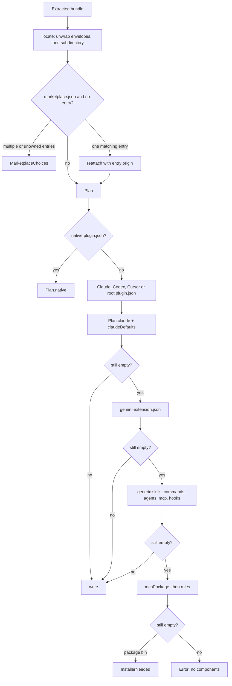

# Plugin Formats, Hooks and Sandbox

> Normalizes foreign plugin layouts into one `plugin.json` bundle, enforces archive and manifest safety limits, and runs plugin hooks in an isolated JavaScript sandbox or a restricted shell.

This page covers what happens after a bundle is downloaded and before its contents reach a run: layout detection, manifest inspection, archive extraction, component generation, MCP conversion, and hook execution. The main classes are `PluginAdapter`, `PluginManifest`, `PluginArchives`, `PluginMcp`, `PluginInstallers`, `PluginHooks` and `PluginMcpServersSection`. The goal is to accept Claude Code, Codex, Cursor, Gemini CLI, npm and plain skill layouts without executing publisher code, while preserving metadata for verification and updates.

## Module Responsibilities

- **`PluginManifest`**: Defines the canonical `plugin.json` schema, validates every declared path, inspects the bundle into `PluginContents`, and computes a SHA-256 digest over the whole tree.
- **`PluginAdapter`**: Detects the bundle layout, plans components, rewrites skills and commands when needed, and writes the normalized `plugin.json`. It also maps Claude, Gemini, VS Code and registry MCP entries through `PluginMcp`.
- **`PluginArchives`**: Extracts ZIP and tar.gz archives under byte, entry, depth and file caps; skips escaping, duplicate, special and oversized members; resolves only in-bundle links.
- **`PluginInstallers`**: Runs one approved installer command in a throwaway home, project and cache, with a hard timeout, then hands the produced files back to the adapter.
- **`PluginHooks`**: Executes pure JavaScript hooks inside `androidx.javascriptengine`, and command hooks through the Linux shell with a JSON stdin payload.
- **`PluginMcpServersSection`**: Shows plugin-supplied MCP servers, their scope, approval state and live connection status.

## Supported bundle formats

`PluginAdapter` handles these layouts (`PluginFormats.kt:11-16`):

- **AndroidHarness**: a root `plugin.json` with array component fields and no Claude-only keys, recognized by `isNative` (`PluginFormats.kt:107-110`).
- **Claude Code plugins**: `.claude-plugin/plugin.json`, plus `commands`, `agents`, `skills`, `hooks`, `mcpServers`, `outputStyles` and `lspServers` fields. Also root `plugin.json` with Claude keys.
- **Codex and Cursor plugins**: `.codex-plugin/plugin.json`, `.cursor-plugin/plugin.json`, and `.agents-plugin/plugin.json`, using the Claude shape.
- **Gemini CLI extensions**: `gemini-extension.json` with `mcpServers`, `contextFileName` (default `GEMINI.md`), `commands` and `excludeTools`.
- **Skill collections**: any tree of `SKILL.md` folders, found by `generic()`.
- **Slash commands**: `.claude/commands`, `.opencode/command`, `.opencode/commands`, `.gemini/commands`, or a manifest path. Each Markdown or TOML command becomes a generated skill.
- **Subagents**: `.claude/agents`, `.opencode/agent`, `.opencode/agents`, or a manifest path.
- **Editor rule files**: `AGENTS.md`, `CLAUDE.md`, `GEMINI.md`, `.cursorrules`, `.windsurfrules`, `.clinerules`, `.github/copilot-instructions.md`, and rule folders such as `.cursor/rules` or `.kiro/steering`.
- **MCP configuration**: `.mcp.json`, inline `mcpServers`, or a `package.json` whose `bin` plus MCP keywords or the SDK dependency makes it a server.
- **Marketplace entries**: a `.claude-plugin/marketplace.json` plus `origin.entry`.
- **Installer packages**: a `package.json` with `bin` and no components raises `InstallerNeeded("npx -y <name>")`.

## Architecture and Flow

`locate` unwraps up to four single-directory envelopes such as GitHub's `owner-repo-sha/` or npm's `package/`, ignoring `PluginArchives.SKIPPED` folders, and then applies the `origin.subdirectory` (`PluginFormats.kt:46-61`). A marketplace document with several entries becomes choices instead of a guess; one matching entry is applied recursively.

`PluginManifest.inspect` then enforces the canonical contract (`PluginModels.kt:97-170`):

- `known` fields are `name`, `version`, `description`, `author`, `homepage`, `entry`, `hooks`, `skills`, `instructions`, `mcp`, `agents`, `commandHooks`, `format`, `notes` (`PluginModels.kt:64-65`). Unknown fields become warnings.
- Hook events are `session.start`, `message.received`, `prompt.before`, `tool.before`, `tool.after`, `session.end` (`PluginModels.kt:66`).
- `name` must match `[a-z0-9][a-z0-9-]{0,63}`; `version` is at most 80 characters with no control characters; `description` is at most 4,000 characters.
- `instructions` allows at most 32 files, each at most 64 KiB, with a 64,000-byte total.
- Each skills path is either a skill folder containing `SKILL.md` or a folder of such folders, with at most 1,024 children. Duplicate skill names are refused.
- `hooks` must be a non-empty array of known events and requires an `entry` ending in `.js` no larger than 64 KiB.
- `commandHooks` allows at most 64 entries; each needs a known `event` and a non-blank command of at most 4,000 characters.
- `agents` is an object keyed by names matching `[a-zA-Z0-9_-]{1,48}`; each agent's instruction files are read and size-checked.
- `mcp` is validated through `ConfigValidation.validate` before acceptance.
- At least one of instructions, skills, MCP servers, hooks, command hooks or agents must exist.
- `notes` contributes at most 50 warnings.
- `PluginRuntimes.detect` maps MCP commands, command hooks and skill script extensions to Linux package names. `needsRuntime` is true when runtimes exist or any MCP server has a `command`.
- A `package.json` declaring `install`, `postinstall`, `preinstall` or `prepare` produces a warning that those scripts are never run.

## Invocation Chain

1. `PluginManager.prepare` extracts into `previews/<token>/files` and calls `PluginAdapter.adapt(files, origin, fallbackName)` (`PluginManager.kt:216`).
2. `adapt` normalizes the layout, calls `Plan.write`, and returns `Result(root, choices)`. `MarketplaceChoices` carries a non-empty choice list.
3. `PluginManifest.inspect(bundle)` reads and validates the generated `plugin.json`, returning `PluginContents` (`PluginModels.kt:97`).
4. `PluginManifest.digest(bundle)` hashes each file's relative path, a NUL separator, the bytes and a trailing NUL, sorted by path (`PluginModels.kt:172-184`).
5. `PluginManager.install` optionally installs runtimes, then `PluginStore.install` re-runs `inspect` and compares it to the reviewed `PluginContents` (`PluginStore.kt:84-85`).
6. Configuration loading reads every enabled payload: `PluginStore.checkedDirectory` re-verifies the digest before any file is exposed (`PluginStore.kt:53-64`).
7. `HarnessConfigLoader.plugin` parses `plugin.json` again for skills, instructions, agents, MCP servers, JS hooks and command hooks (`HarnessConfig.kt:266-324`).
8. At run time, `PluginHooks.invoke(plugins, hook, event)` runs JavaScript hooks first, then matching command hooks, and merges their instructions and deny decision (`PluginHooks.kt:31-37`).

## Key State and Data Structures

- **`PluginContents`** (`PluginModels.kt:36-50`): name, version, description, instruction paths, skill names, MCP server names, JS hook events, `needsRuntime`, warnings, agent names, command hooks, `format`, and detected runtimes.
- **`PluginAdapter.Plan`** (`PluginFormats.kt:112-384`): Mutable build state. `skills`, `instructions`, `mcp`, `agents`, `commandHooks`, `notes`, `hooks`, `entry`, and a `taken` set that prevents duplicate component names. Generated files go under `.harness/`.
- **`ConfigPlugin`** (`HarnessConfig.kt:15`): name, JS script, declared hook events, command hooks and the plugin folder. `ConfigCommandHook` (`HarnessConfig.kt:14`): event, command, matcher, timeout, original source event.
- **`ConfigServerSource`** (`HarnessConfig.kt:18`): server name, optional plugin name and configuration source, used by the MCP settings section to label ownership.
- **`HookResult`** (`PluginHooks.kt:151`): appended instructions and an optional deny reason.
- **`PluginRuntime`** (`PluginInstallers.kt:9-15`): the Linux environment contract used for installer commands.

Persistence:

- The normalized `plugin.json` is written into the bundle before it is moved into `packages/<uuid>`, so the digest covers the normalized form.
- When the source was not already `AndroidHarness`, an existing `plugin.json` is renamed to `plugin.original.json` (or `plugin.original.N.json`) before the new one is written (`PluginFormats.kt:377-382`). The original file therefore remains part of the bundle and the digest.
- Command hooks store both names: `source` keeps the original event (for example `PreToolUse`) and `event` uses the internal name (`tool.before`), so the stdin payload reports Claude's vocabulary.

Component generation details:

- **Commands become skills.** `addCommands` writes `.harness/commands/<name>/SKILL.md` with frontmatter and a preamble explaining `$ARGUMENTS`, `{{args}}`, `$1` and `$2`, lines beginning with `!` as shell commands, and `@path` as file reads (`PluginFormats.kt:256-277`). The generated `commands` folder is then added as a skills path, so the command is available as `/<name>`.
- **Agents become prompt files.** `addAgents` writes `.harness/agents/<agent>.md` and adds an entry with `description`, `instructions` and optional `tools` groups. `agentTools` denies `edit` and `delete` unless the agent lists `Write`/`Edit`/`MultiEdit`/`NotebookEdit`, denies `shell` without `Bash`, and denies `network` without `WebFetch`/`WebSearch` (`PluginFormats.kt:297-304`).
- **Rules become instructions or one skill.** If the combined rule text is at most 16,000 bytes, each file becomes an instruction; otherwise the text is folded into one `<plugin>-rules` skill (`PluginFormats.kt:338-358`).
- **Hooks are mapped by event name** (`PluginFormats.kt:23-25`): `SessionStart` to `session.start`, `UserPromptSubmit` and `BeforeAgent` to `message.received`, `PreToolUse` and `BeforeTool` to `tool.before`, `PostToolUse` and `AfterTool` to `tool.after`, `Stop`, `SubagentStop` and `SessionEnd` to `session.end`. Only `type: command` hooks are kept; other hook types produce a note. Timeouts are clamped to 1 through 600 seconds.
- **MCP conversion** (`PluginFormats.kt:411-448`): `url`, `httpUrl` or `serverUrl` produces an `http` or `sse` server; `command` plus `args` produces a stdio server. `bunx`, `bun x`, `pnpm dlx` and `yarn dlx` become `npx -y`. `docker` and `podman` servers are added disabled with a note. `${VAR}` and `$VAR` become `{env:VAR}`; root variables become `{plugin:root}`. `cwd` is ignored.

## Isolation, workspace approval and sandboxed hooks

**Bundle isolation.** Payloads live under the app's private `filesDir/plugins/packages`. `PluginStore.checkedDirectory` refuses symlinks and any tree larger than `MAX_FILES`, and re-verifies the digest when file size or mtime changes. A plugin that changes after installation is rejected until disabled or reinstalled.

**Configuration isolation.** Installed plugins are merged as `ConfigSource` objects whose IDs begin with `Managed/Global/` or `Managed/Project/`. `HarnessConfigLoader.load` merges managed global sources, global `home` config, managed project sources, then the project's own `harness.json` (`HarnessConfig.kt:191-195`). Shared `harness.json` files are never rewritten by install or uninstall.

**Plugin MCP wiring.** `HarnessConfigLoader.plugin` namespace-qualifies every server: `<plugin name, 10 chars>_<digest 4>_<server key, 8 chars>_<digest 6>` (`HarnessConfig.kt:291-296`). Name collisions are refused. Values containing `{plugin:root}` are replaced with the canonical payload folder and require a real folder, so a bundled MCP file cannot be installed without one. Each server records `ConfigServerSource(key, pluginName, configurationSource)` and `deviceLocal = true` for plugin sources (`HarnessConfig.kt:307-308,368`).

**Workspace approval.** Plugin MCP servers are treated as workspace configuration. `McpManager.isWorkspaceApproved` compares a key built from the workspace path and a SHA-256 of the workspace config text plus `trustPayload` and the serialized transports (`McpManager.kt:268-284`). When not approved, workspace servers and a marker for each plugin are returned by `unapprovedWorkspaceServers` (`McpManager.kt:287-292`), and `activeTools` records `blocked` instead of connecting (`McpManager.kt:319-340`). `PluginMcpServersSection` reflects the same state: `Plugin` servers are filtered from the resolved config, labeled with plugin and scope, and show "approval pending" until the workspace is approved.

**JavaScript hooks.** `PluginHooks.runScripts` requires `JavaScriptSandbox.isSupported()` and both `JS_FEATURE_ISOLATE_TERMINATION` and `JS_FEATURE_ISOLATE_MAX_HEAP_SIZE` (`PluginHooks.kt:98-106`). Each plugin gets an isolate with a 16 MiB heap, its script wrapped so `module.exports[hook]` must be a function, a 2,000 ms `withTimeout`, and an 8,192-character output cap. The isolate has no Android, filesystem or network bridge. A timeout or failure closes the sandbox so the next invocation starts clean, and the error message names only the plugin and hook, never the script arguments or secrets.

**Command hooks.** `PluginHooks.runCommands` starts the command through the supplied shell factory in the plugin root, sets `CLAUDE_PLUGIN_ROOT` and `PLUGIN_ROOT`, writes a JSON payload to stdin, reads at most 64 KiB of stdout and 16 KiB of stderr, and waits for the configured timeout (`PluginHooks.kt:61-96`). Exit code 2, `decision: block`, or `permissionDecision: deny` blocks a `tool.before` call. Other events append context, capped at 16,000 characters.

**Installer isolation.** `PluginInstallers.run` creates `project`, `home` and `cache` inside the preview folder, points `HOME`, `XDG_*`, npm, uv and pip caches at them, sets `CI=1` and disables npm update notices, funding and audit output (`PluginInstallers.kt:30-44`). The command has a 10-minute timeout; a non-zero exit includes the last 2,000 characters of output. Caches and common home caches are deleted afterwards, and only the workspace folder is copied.

## Boundary Conditions

- `PluginManifest.path` rejects blank paths, absolute paths, backslashes, drive colons, NUL bytes and any `..` segment, then requires the canonical target to stay under the canonical bundle root (`PluginModels.kt:69-75`). Component paths additionally reject `@`, `~/`, `!`, `*` and `?`.
- Archive extraction caps are 200 MiB download, 512 MiB unpacked, 64 MiB per file, 20,000 files, 200,000 entries and 32 path segments. A size overflow deletes the partial member; a whole-bundle overflow fails (`PluginArchives.kt:66-77`).
- Archive members whose path leaves the bundle, that duplicate an existing path case-insensitively, that conflict with a file or directory, or that are special files are skipped and the first 50 names are reported.
- Links are not followed during extraction. `resolveLinks` normalizes the target, rejects escapes and missing targets, and copies linked content as regular files (`PluginArchives.kt:79-98`).
- If extraction throws, the destination is deleted recursively, so a failed extraction cannot leave a half bundle.
- Installer commands are only reached after the user edits and approves the command. Each token is quoted by `PluginInstallers.quote`.
- The manifest requires an executable MCP shape: `ConfigValidation.validate` runs on `{"mcp": ...}` and a missing `command` or `url` is rejected by that validator rather than by `PluginMcp.convert`.

## Extension Points

- **New manifest keys**: add to `PluginManifest.known`, parse in `inspect`, generate in `Plan.write`, and read in `HarnessConfigLoader.plugin`.
- **New hook event**: add to `PluginManifest.hookNames`, `HarnessConfigLoader`'s `events` set and `PluginHooks` dispatch. The adapter also needs a `hookEvents` mapping if a foreign event should map to it.
- **New MCP dialect**: extend `PluginMcp.convert` and `PluginMcp.text`.
- **New command format**: `Plan.addCommands` already handles Markdown and Gemini TOML (`tomlCommand`, `PluginFormats.kt:401-407`).
- **Custom installer runtime**: implement `PluginRuntime` and pass it to `PluginManager` through the `runtime` lambda.
## Known gaps

- `prompt.before` is accepted by the manifest and config loader, but `PluginAdapter.hookEvents` has no foreign event mapping to it. Only a native `plugin.json` can declare it.
- `formatName` labels `.agents-plugin` as "Claude Code plugin", so that ecosystem is not preserved in the displayed format.

Sources: [app/src/main/java/com/androidharness/app/plugins/PluginFormats.kt](../app/src/main/java/com/androidharness/app/plugins/PluginFormats.kt)#L17-L448), [app/src/main/java/com/androidharness/app/plugins/PluginModels.kt](../app/src/main/java/com/androidharness/app/plugins/PluginModels.kt)#L62-L225), [app/src/main/java/com/androidharness/app/plugins/PluginArchives.kt](../app/src/main/java/com/androidharness/app/plugins/PluginArchives.kt)#L13-L175), [app/src/main/java/com/androidharness/app/plugins/PluginInstallers.kt](../app/src/main/java/com/androidharness/app/plugins/PluginInstallers.kt)#L21-L68), [app/src/main/java/com/androidharness/app/config/PluginHooks.kt](../app/src/main/java/com/androidharness/app/config/PluginHooks.kt)#L19-L151), [app/src/main/java/com/androidharness/app/config/HarnessConfig.kt](../app/src/main/java/com/androidharness/app/config/HarnessConfig.kt)#L266-L343), [app/src/main/java/com/androidharness/app/ui/settings/PluginMcpServersSection.kt](../app/src/main/java/com/androidharness/app/ui/settings/PluginMcpServersSection.kt)#L28-L87)

## Source files

- `app/src/main/java/com/androidharness/app/plugins/PluginFormats.kt`
- `app/src/main/java/com/androidharness/app/plugins/PluginModels.kt`
- `app/src/main/java/com/androidharness/app/plugins/PluginArchives.kt`
- `app/src/main/java/com/androidharness/app/plugins/PluginInstallers.kt`
- `app/src/main/java/com/androidharness/app/plugins/PluginCommands.kt`
- `app/src/main/java/com/androidharness/app/config/PluginHooks.kt`
- `app/src/main/java/com/androidharness/app/config/HarnessConfig.kt`
- `app/src/main/java/com/androidharness/app/tools/mcp/McpManager.kt`
- `app/src/main/java/com/androidharness/app/ui/settings/PluginMcpServersSection.kt`
