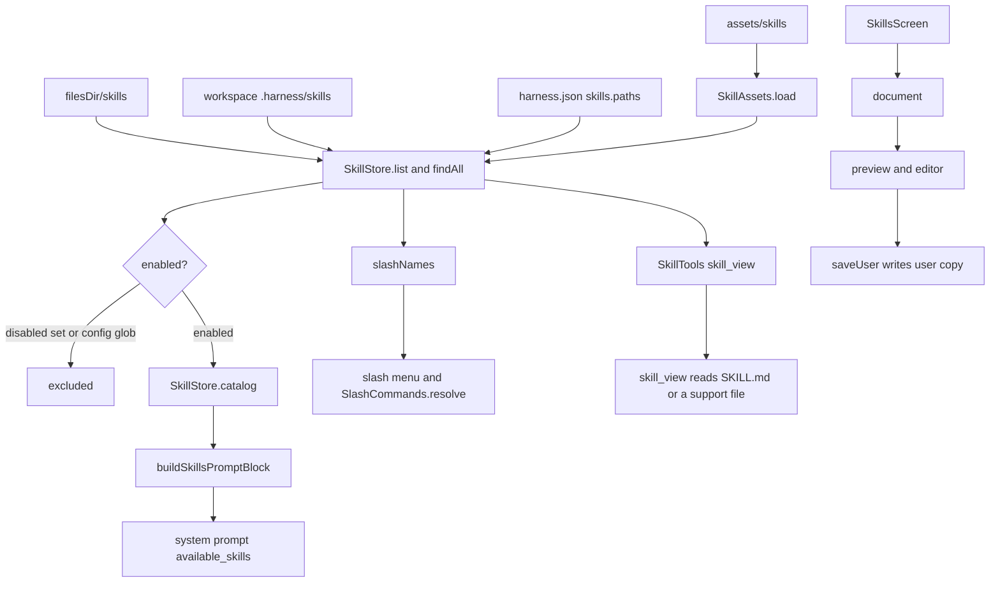

# Skills System and Manager

> Loads Markdown skills from three layers, injects an enabled catalog into every system prompt, and provides the settings manager for previewing, editing, enabling, disabling and deleting skills.

The subsystem is built from `SkillParser` (frontmatter and YAML handling), `SkillStore` (layer precedence, catalog, lookup, mutation), `SkillAssets` (bundled asset loading), `SkillTools` (the three agent tools) and `SkillsScreen` (the settings UI). It solves two problems: the model must know which skills exist without paying for every skill body, and users must be able to add or fix skills without rebuilding the APK. Skills stay as plain `SKILL.md` files on disk or in assets, so they remain readable and portable.

## Module Responsibilities

- **`SkillParser`**: Parses the `---` frontmatter block and body, validates names and required fields, and provides a small YAML mapping parser for scalar fields.
- **`SkillStore`**: Merges bundled, user, project and configured skills; resolves name precedence; builds the catalog prompt; serves full documents and support files; writes user skills and patches.
- **`SkillAssets`**: Reads `assets/skills/<folder>/SKILL.md` and its support folders into `BundledSkill` records at startup.
- **`SkillTools`**: Exposes `skill_view`, `skills_list` and `skill_manage` to the agent.
- **`SkillsScreen`**: Search, source and state filters, grouped list, multi-select bulk actions, detail sheet, full-screen editor and delete confirmation.
- **`buildSkillsPromptBlock`** and **`buildSlashSkillMessage`**: Shared prompt formatting for the catalog and for slash-invoked skills.

## Skill file format and frontmatter

A skill is a folder containing `SKILL.md` plus optional support folders named `references`, `templates`, `scripts` and `assets` (`SkillStore.kt:331`). `SkillParser.parse` (`SkillParser.kt:5-44`) applies these rules:

- Input is normalized by replacing CRLF with LF and stripping a leading BOM.
- The text must start with `---`, and the frontmatter must close with a line beginning `---`. Missing or unclosed frontmatter raises `SkillParseException`.
- `name` and `description` are required. `category` is optional and defaults to `general`.
- The body must be non-empty after trimming.
- `name` cannot contain `..`, `/` or `\`, must match `^[a-z0-9][a-z0-9-]{0,63}$`, and must be at most 64 characters (`Skill.kt:43-46`).
- The returned `ParsedSkill.raw` is the normalized text with a single trailing newline.

`parseSimpleYaml` (`SkillParser.kt:58-90`) handles only the top-level scalar shape skills use: `key: value`, quoted strings, block scalars introduced by `|` or `>` with optional chomping indicators, and plain values continued on more-indented lines. Nested maps and lists are ignored. A bundled example is `app/src/main/assets/skills/plan/SKILL.md`, whose frontmatter declares `name`, `description` and `category`.

`ParsedSkill.catalogDescription` truncates the description to 80 characters for the catalog (`Skill.kt:38-46`). `SkillParser.validateUserContent` rejects user content longer than `MAX_USER_CHARS` (20,000) before parsing (`SkillParser.kt:46-51`).

## Loading order and layer precedence

`SkillStore` receives `bundled`, `userDir`, a `projectDir` supplier, a `disabled` supplier, optional extra bundled skills, explicit configured skills and an optional `HarnessConfig`. The app wires it as:

- bundled: `SkillAssets.load(appContext.assets)`
- user: `filesDir/skills`
- project: the `projectSkillsDir` supplier, normally `.harness/skills` of the active workspace
- optional bundled: Caveman skills when that mode is installed
- configured: `harness.json` skills collected by `HarnessConfigLoader`

`list()` scans in this order (`SkillStore.kt:42-58`): bundled plus optional bundled, then the user folder, then the project folder, then `configuredSkills`. Later scans overwrite earlier records with the same name in the `byName` map, which produces the visible catalog order. `findAll` plus `pickWinner` implement the authoritative lookup precedence (`SkillStore.kt:192-222`):

1. If exactly one PROJECT match exists, it wins.
2. Otherwise, if exactly one USER match exists, it wins.
3. Otherwise, a single BUNDLED match wins.
4. More than one match in the winning layer returns null, which `view` reports as "Ambiguous skill name".

Because `list()` uses map overwrite and `view()` uses `pickWinner`, a duplicate name inside one layer shows the last-scanned entry in the list while `view()` refuses it as ambiguous. Frozen stores use `pickWinner` for the list too, so ambiguous names disappear from a frozen catalog.

`forProject(directory)` creates a store with a fixed project folder, used when one chat must keep its catalog independent of the currently selected workspace. `configured(config)` replaces the project folder with null and adds the config's skill map, but only when the config is present. `forWorkspace(workspace)` uses the workspace's shell root `.harness/skills`; if the store already has a configuration it returns itself. `freeze()` snapshots `list().flatMap { findAll(it.name) }` so a run's catalog does not change midway through a turn. `AgentEngine` calls `skills.forWorkspace(workspace).configured(projectConfig).freeze()` before a run (`AgentEngine.kt:305-308`).

## Architecture and Flow

The catalog is built by grouping enabled skills by category, sorting categories and names, and emitting `    - name: description` lines. `buildSkillsPromptBlock` wraps that index in a mandatory instruction block and an `<available_skills>` element (`SkillParser.kt:93-109`). `AgentEngine.systemPrompt` appends the block when it is non-empty (`AgentEngine.kt:2274-2277`). Project config `auto_load` patterns then inline matching skills before the run, with a 32,000-character cap summed across auto-loaded skills (`AgentEngine.kt:2285-2294`).

Slash invocation uses the same store. `SlashCommands.resolve` receives `chatSkills().slashNames()` and a content lookup, and `buildSlashSkillMessage` wraps the full skill text in an invocation header plus the user's trailing instruction (`SkillParser.kt:111-126`).

## Invocation Chain

1. `HarnessApp` constructs `SkillStore` once with the bundled map, `filesDir/skills`, the project supplier and the disabled-set supplier (`HarnessApp.kt:247-256`).
2. A run freezes and configures the store (`AgentEngine.kt:305-308`), and the resulting `SkillStore` travels in `ConfigRunContext` (`ConfigRunContext.kt:10`).
3. `ToolRegistry.default` registers `SkillViewTool`, `SkillsListTool` and `SkillManageTool` with that base store (`Tool.kt:147-149`).
4. Each tool resolves the run's store with `ctx.skills ?: store.forWorkspace(ctx.workspace)` (`SkillTools.kt:30,71`), so a configured run uses the frozen catalog.
5. `skill_view` calls `SkillStore.view` (`SkillStore.kt:79-138`), which rejects disabled and ambiguous names, optionally reads a support file, and prefixes a real folder path when the skill has one.
6. `skills_list` calls `list()` and optionally filters by exact category (`SkillTools.kt:69-95`).
7. `skill_manage` calls `saveUser`, `patchUserOrCopy` or `deleteUser` (`SkillTools.kt:119-150`).
8. Settings navigation opens `SkillsScreen` from `AppNav.kt:957`. The screen calls `container.skills.list()`, `document(name)`, `saveUser(content)` and `deleteUser(name)` directly.
9. Enable toggles write through `SettingsRepository.setSkillEnabled` or `setSkillsEnabled`, which edit the `disabled_skills` string-set preference (`SettingsRepository.kt:1008-1023`).

## Key State and Data Structures

- **`SkillSource`** (`Skill.kt:3`): `BUNDLED`, `USER`, `PROJECT`. It drives precedence, icons, colors, grouping and edit permissions.
- **`SkillMeta`** (`Skill.kt:5-12`): name, catalog description, category, source, relative directory and enabled flag. This is what the list and slash picker see.
- **`SkillDocument`** (`Skill.kt:15-20`): meta, raw `SKILL.md`, support file names and an optional real folder path. Used by the detail sheet and editor.
- **`SkillView`** (`Skill.kt:22-29`): the content returned by `skill_view`, plus source and linked files.
- **`ParsedSkill`** (`Skill.kt:31-48`): name, description, category, body and normalized raw text.
- **`BundledSkill`** (`SkillStore.kt:35-40`): asset relative directory, content, in-memory support files and optional real directory.
- **`SkillStore.Located`** (`SkillStore.kt:184-190`): internal record combining meta, content, linked files, in-memory support map and optional folder.

Persistence:

- User skills are written to `filesDir/skills/<parsed name>/SKILL.md`; the folder name follows the parsed frontmatter name, not necessarily the edit target (`SkillStore.kt:147-153`).
- Bundled skills are read-only assets. They are never rewritten; edits and patches produce a user copy.
- Project skills live in the workspace and survive independently of the app. They can also come from `harness.json` `skills.paths`, in which case `configuredSkills` supplies them in memory.
- Enable state lives in the settings preference `disabled_skills`. Config-level `skills.enable` and `skills.disable` globs are evaluated by `HarnessConfig.skillEnabled` (`HarnessConfig.kt:46-48`) and take effect in addition to the preference.
- `freeze()` keeps a per-run snapshot in memory only; the next run re-reads disk.

## Enable, disable, deletion and the manager UI

`SkillsScreen` groups visible skills in the fixed order USER, PROJECT, BUNDLED (`SkillsScreen.kt:74,112`). Search matches name, description and category for every whitespace-separated word. The status control filters all, on and off. Source chips show counts and can be toggled.

- **Toggle**: the row switch calls `setSkillEnabled`. A disabled skill stays on disk but drops out of `enabled()`, the catalog and `slashNames()`. `view()` returns a `SkillParseException` telling the user to enable it in Settings.
- **Bulk actions**: long press or the Select action enters selection mode. The toolbar offers turn on, turn off and delete. Enable and disable changes are posted as one preference write and a snackbar Undo reverses the whole set. Delete is offered only when at least one selected skill is a USER skill.
- **Deletion**: only USER skills can be deleted. `deleteUser` recursively deletes `filesDir/skills/<name>` and returns false when the folder is missing. The confirmation dialog lists the first eight names and the remainder count.
- **Detail sheet**: shows the skill name, source, category, parsed description, an enable switch, actions, a Preview/Markdown toggle, the support file list (first 40 then a count) and the real folder path when present.
- **Preview**: Preview renders `parsed.body` through `MarkdownText`; Markdown mode shows the raw text in a monospaced, selectable block (`SkillsScreen.kt:511-518`).
- **Full-screen editor**: `SkillEditor` is a full-size `Dialog` with a monospaced text field, live parsing on every change, a character counter against `MAX_USER_CHARS`, a Save button disabled while parsing fails, and a discard confirmation when the text changed (`SkillsScreen.kt:543-605`).
- **Copy on edit**: a USER skill opens its raw text and saves back to the user folder. A BUNDLED skill opens the same text with a visible note that saving creates a copy, and `onSave` calls `saveUser`, which writes a USER skill that then outranks the bundled one. A PROJECT skill has no edit action in the UI; the sheet shows a note that it belongs to the workspace.

## Boundary Conditions

- Frontmatter errors are hard failures with specific messages: missing opening marker, unclosed marker, empty body, missing name, missing description, invalid name, or name longer than 64 characters.
- Path traversal is rejected in three places: `view` refuses a name containing `..`, `readSupportFile` refuses a path containing `..`, and the canonical file must remain under the skill folder (`SkillStore.kt:79-83,297-309`).
- Support reads are capped at 256 KiB; a larger file returns a size message instead of content. Listing a real folder stops at 300 entries and skips dot directories, `node_modules` and `__pycache__`.
- `patchUserOrCopy` refuses identical old and new strings, a missing old string, and an old string that occurs more than once (`SkillStore.kt:161-182`).
- Saving validates the full 20,000-character limit before writing. An invalid save leaves the previous file untouched.
- `skill_manage create` reports that the new skill appears in the catalog on the next run, which matches the per-run freeze.
- Auto-loaded skills are bounded at 32,000 characters total; exceeding that fails the run's prompt construction with a message to load fewer skills.
- If the catalog is empty, `catalog()` returns an empty string and no skills block is appended.
- A frozen store deliberately ignores later disk changes, including deletions during the run.

## Extension Points

- **Bundled skills**: add `app/src/main/assets/skills/<folder>/SKILL.md` plus optional `references`, `templates`, `scripts` or `assets` subfolders. `SkillAssets.load` discovers them by directory name and parses the frontmatter.
- **Support folders**: extend `SkillStore.SUPPORT_DIRS` (`SkillStore.kt:331`). Both the asset loader and directory scanner use the same set.
- **Config-driven skills**: `harness.json` `skills.paths`, `skills.enable`, `skills.disable` and `skills.auto_load` are read by `HarnessConfigLoader` and enforced by `HarnessConfig.skillEnabled`.
- **Optional skill packs**: pass a map through `optionalBundled`, as the Caveman mode does (`HarnessApp.kt:252-255`).
- **New tools**: `SkillTools.kt` is a plain set of `Tool` implementations; any new skill operation should use `ctx.skills` when present so frozen runs stay consistent.
- **Template for new skills**: `skillTemplate()` in `SkillTools.kt:153-177` produces the frontmatter and section skeleton used by the New skill button.

## Known gaps

- `SkillsScreen` can create and edit only USER skills. PROJECT skills are listed and can be enabled, disabled or previewed, but the UI offers no editor and no workspace-scoped create action; those edits must be made in the workspace files.
- The manager does not export or import skills as files, so moving a skill between devices relies on the workspace or on copying `filesDir/skills`.

Sources: [app/src/main/java/com/androidharness/app/skills/SkillStore.kt](../app/src/main/java/com/androidharness/app/skills/SkillStore.kt)#L9-L370), [app/src/main/java/com/androidharness/app/skills/SkillParser.kt](../app/src/main/java/com/androidharness/app/skills/SkillParser.kt)#L3-L142), [app/src/main/java/com/androidharness/app/skills/Skill.kt](../app/src/main/java/com/androidharness/app/skills/Skill.kt)#L3-L50), [app/src/main/java/com/androidharness/app/skills/SkillAssets.kt](../app/src/main/java/com/androidharness/app/skills/SkillAssets.kt)#L5-L39), [app/src/main/java/com/androidharness/app/tools/SkillTools.kt](../app/src/main/java/com/androidharness/app/tools/SkillTools.kt)#L8-L177), [app/src/main/java/com/androidharness/app/ui/settings/SkillsScreen.kt](../app/src/main/java/com/androidharness/app/ui/settings/SkillsScreen.kt)#L78-L605), [app/src/main/java/com/androidharness/app/agent/AgentEngine.kt](../app/src/main/java/com/androidharness/app/agent/AgentEngine.kt)#L2274-L2294)

## Source files

- `app/src/main/java/com/androidharness/app/skills/Skill.kt`
- `app/src/main/java/com/androidharness/app/skills/SkillParser.kt`
- `app/src/main/java/com/androidharness/app/skills/SkillStore.kt`
- `app/src/main/java/com/androidharness/app/skills/SkillAssets.kt`
- `app/src/main/java/com/androidharness/app/tools/SkillTools.kt`
- `app/src/main/java/com/androidharness/app/tools/Tool.kt`
- `app/src/main/java/com/androidharness/app/ui/settings/SkillsScreen.kt`
- `app/src/main/java/com/androidharness/app/data/SettingsRepository.kt`
- `app/src/main/java/com/androidharness/app/HarnessApp.kt`
- `app/src/main/assets/skills/plan/SKILL.md`
