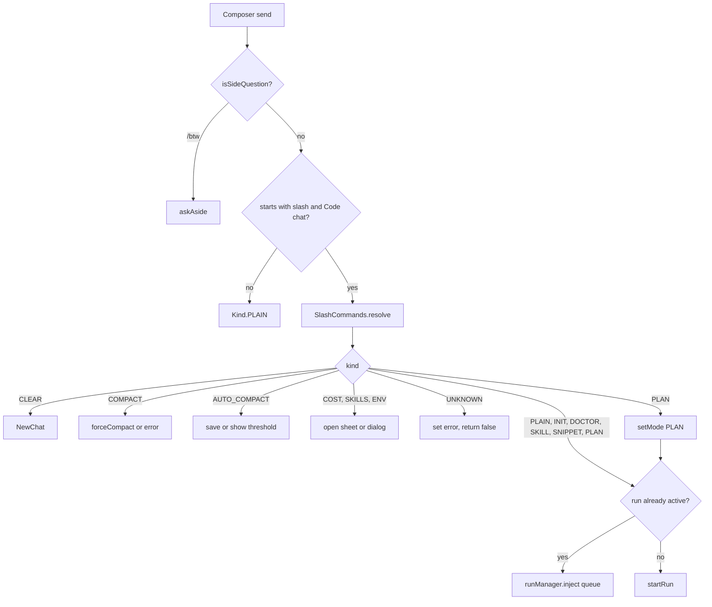

# Slash Commands, Snippets and Prompts

> Resolves composer text into local actions, agent prompts, skills or saved snippets, and decides whether the result starts, queues or never reaches an agent run.

`SlashCommands` is a pure resolver kept out of `ChatViewModel` so the send path can be tested without Android. `ChatViewModel.send` applies the result, `StatusBars` builds the `/` menu, `SnippetRepository` stores user prompts, and `Steering` plus `SideQuestion` define what happens to text that arrives while a run is already working. The subsystem exists so that local commands such as `/cost` stay instant and safe, while expanded prompts such as `/doctor` and `/plan` enter the same run pipeline as typed messages.

## Module Responsibilities

- **`SlashCommands`**: Defines `Kind`, `Dispatch`, `Result`, `Pick` and `Target`; resolves input against built-ins, skill names and snippet bodies; provides the doctor, init and plan prompts; decides menu tap behavior and final send composition.
- **`ChatViewModel`**: Executes each resolved kind, enforces busy and attachment guards, flips Plan mode for `/plan`, and queues agent text when a run is active.
- **`StatusBars.SlashSuggestions`**: Builds the filtered `/` menu from built-ins, enabled skills and snippets.
- **`SnippetRepository`**: Adds and deletes rows in the `snippets` table; exposes a `Flow` observed by the chat state.
- **`Steering`**: Marks and wraps messages the user sends mid-run so the model treats them as course corrections.
- **`SideQuestions` and `SideQuestion`**: Define the `/btw` context, tool allowlist, prompt wrapper and bounded cold transcript.

## Command parsing and expansion

`resolve` (`SlashCommands.kt:139-196`) works as follows:

1. Trim the input. Empty or non-slash text becomes `Kind.PLAIN` with the trimmed text as `agentText`, or a null `agentText` when empty.
2. Split on the first whitespace run into command and argument. The command is lowercased; the argument keeps its remaining text.
3. Match built-ins exactly.
4. Otherwise strip the leading `/`, look for a skill with that name, then for a snippet whose name matches case-insensitively. A skill wins over a snippet with the same name.
5. If nothing matches, return `Kind.UNKNOWN` with `Unknown command: /name`.

| Command | Kind | Expansion or effect |
| :--- | :--- | :--- |
| `/clear` | `CLEAR` | Emits `NavEvent.NewChat`; no agent text. |
| `/compact` | `COMPACT` | Runs `forceCompact`; refused while busy or while a run is starting. |
| `/autocompact`, `/auto-compact`, `/auto_compact`, `/auto compact` | `AUTO_COMPACT` | Blank shows the threshold; `default` or `reset` clears the per-chat override; otherwise `AutoCompaction.parse` must return a token count. |
| `/cost` | `COST` | Opens the cost dialog. |
| `/doctor` | `DOCTOR` | `agentText` is `DOCTOR_PROMPT`, a 16-section self-test covering files, sandbox, patches, shell, background, git, web, subagents, memory, skills, symlinks and regressions. |
| `/init` | `INIT` | `agentText` is `INIT_PROMPT`: explore the workspace and write or improve `AGENTS.md`. |
| `/plan` | `PLAN` | The `plan` skill body wrapped by `buildSlashSkillMessage` via `planPrompt`, or `PLAN_SKILL_FALLBACK` when missing. The view model also sets `AgentMode.PLAN` before starting. |
| `/skills` | `SKILLS` | Opens the skills sheet with `chatSkills().list()`. |
| `/env` | `ENV` | Opens the Linux environment sheet. |
| `/btw` | `BTW` | Carries `sideQuestion`; answered aside and never queued or saved. |
| `/<skill>` | `SKILL` | `agentText` is `buildSlashSkillMessage(name, content, argument)`. |
| `/<snippet>` | `SNIPPET` | `agentText` is the snippet body; a non-blank argument replaces the literal `$ARG`. |
| anything else beginning `/` | `UNKNOWN` | Error text, and `send` returns false so the draft stays. |

`planPrompt` (`SlashCommands.kt:123-128`) looks up the `plan` skill through the `skillContent` callback, so `/plan` stays consistent with the installed skill. The fallback (`SlashCommands.kt:130-137`) tells the model to research, restate the goal, present a numbered plan with files and verification, and stop for approval.

Input that does not begin with `/` is `PLAIN`; when the conversation is a Chat (not Code), the view model skips `resolve` entirely and treats all text as plain (`ChatViewModel.kt:828-837`). `/btw` is the exception: `isSideQuestion` is checked before the slash branch and works in both modes.

## Architecture and Flow

The send path (`ChatViewModel.kt:816-940`) checks compaction and attachment readiness before resolving. Local kinds return immediately and therefore keep working while a run is active. Agent kinds fall through to one decision: if the session is running, the expanded text is queued with `runManager.inject`; otherwise `startRun` begins a turn. `SlashCommands.dispatchTarget` expresses the same rule with `Dispatch.START` or `Dispatch.QUEUE`, and `ChatViewModel` calls it only on the running branch.

## Invocation Chain

1. The composer calls `viewModel.send(text)`; `ChatScreen` first composes any attached skill with `SlashCommands.composeSend` (`ChatScreen.kt:2528-2535`).
2. `send` checks `SlashCommands.isSideQuestion` and calls `askAside` for `/btw` (`ChatViewModel.kt:818`).
3. It refuses while compaction is active, then checks `attachmentBlockReason()`.
4. For Code conversations beginning with `/`, it calls `SlashCommands.resolve` with `chatSkills().slashNames()`, `_state.value.snippets.associate { it.name to it.body }` and a `chatSkills().view(name)` content lookup (`ChatViewModel.kt:829-833`).
5. Local kinds are handled in the `when` and return. `UNKNOWN` stores the error and returns false.
6. `/plan` calls `setMode(AgentMode.PLAN)` (`ChatViewModel.kt:916-919`).
7. If `agentText` is null, send fails. Otherwise a running session receives the text through `runManager.inject`; a stopped session receives it through `startRun`.
8. `StatusBars.SlashSuggestions` calls `SlashCommands.pickAction` on a menu tap (`ChatScreen.kt:2373-2389`), which either attaches a skill, inserts text, or sends.
9. Snippets are added and removed through `SnippetRepository.add` and `delete`, called from `SlashCommandsSection` in Settings and from `ChatViewModel.addSnippet` and `deleteSnippet`.

## Key State and Data Structures

- **`SlashCommands.Kind`** (`SlashCommands.kt:11-13`): `CLEAR`, `COMPACT`, `AUTO_COMPACT`, `COST`, `DOCTOR`, `INIT`, `SKILLS`, `SKILL`, `SNIPPET`, `UNKNOWN`, `PLAIN`, `PLAN`, `ENV`, `BTW`.
- **`Result`** (`SlashCommands.kt:17-26`): kind, optional `agentText`, optional `error`, optional `sideQuestion`, optional `autoCompactArgument`. `startsAgent` is true exactly when `agentText` is non-null.
- **`Pick`** (`SlashCommands.kt:30-34`): `Send(text)`, `Insert(text)`, `AttachSkill(name, leftover)`. Skills become a composer badge; `/plan`, `/btw` and `/autocompact` insert their command for further typing; snippets with an argument send immediately; other entries send.
- **`Target`** (`SlashCommands.kt:28`): dispatch mode plus text.
- **`SnippetEntity`** (`Database.kt:152-157`): table `snippets` with `id`, `name`, `body`. `SnippetRepository` assigns a random UUID and trims both fields on add (`SnippetRepository.kt:12-14`).
- **`SideContext`** (`SideQuestions.kt:19-37`): the exact request prefix captured from the main loop: session and turn ids, provider config, API key, system prompt, tool schemas, messages, options, tool registry, workspace, sandbox flag, permission mode, run context and a `warm` flag. `SideContexts` is a four-entry access-ordered map guarded by `@Synchronized`.
- **`SideEvent`** (`SideQuestions.kt:51-63`): text, thinking, thinking progress, committed assistant message, tool start and finish, usage, retry, provider change, failure and finish.
- **`Steering`** (`Steering.kt:15-34`): `ID_PREFIX = "steer-"`, `messageId(promptId)`, `isSteering`, and `forModel`, which wraps the text in `<steering_message>` exactly once.

Persistence:

- Snippets are the only persisted data in this page's scope. They live in the Room `snippets` table and are observed as a flow (`HarnessApp.kt:170`, `ChatViewModel.kt:454-458`).
- Side questions and their answers are never written to the chat. Usage is written under a `btw:` turn id (`RunManager.kt:1450-1460`), so it counts toward cost without altering a main turn.
- Steering messages are saved to the chat by `SteeringInbox.take()` before they leave the queue (`RunManager.kt:1180-1194`). The saved id lets `dropDeliveredSteering` remove the queue copy without losing the message.

## Snippets and prompt templates

Snippets are user-saved prompts exposed as slash commands. Management lives in Settings → Chat, `SlashCommandsSection` (`SettingsScreen.kt:3158-3203`): a name field, a body field, and a list of existing `/name` rows with delete buttons.

Resolution treats snippets as a fallback after skills. The snippet body is inserted as the entire `agentText`, with `$ARG` replaced by the trailing argument when one is present. No other placeholder is expanded.

The `/` menu orders entries as built-ins first, then enabled skills except `plan` (to avoid listing `/plan` twice), then snippets. Each row has a command, title and subtitle, and filtering matches all three. The menu shows at most eight matching entries.

## Attaching a skill to a message

There are two ways to attach a skill:

- Pick it from the `/` menu. `pickAction` returns `AttachSkill(name, leftover)` when the entry kind is `SKILL`; `ChatScreen` stores it in `attachedSkill`, clears the composer and closes the menu (`ChatScreen.kt:2373-2377`).
- Pick it from the skills sheet. `SkillsPickerSheet` assigns the same `attachedSkill` (`ChatScreen.kt:796-804`).

The composer shows the skill as a removable badge (`MessageComposer.kt:293-317`) and allows sending when the text is blank as long as a skill is attached (`MessageComposer.kt:218`). On send, `composeSend` produces `/<skill> <note>` or just `/<skill>` when there is no note. `send` then resolves that as `Kind.SKILL` and loads the full skill body through `chatSkills().view(name)`, so the agent receives the invocation header, the body and the typed note. Clearing the badge sets `attachedSkill = null`; scheduling and `/btw` are disabled while a skill, concept or response is attached (`ChatScreen.kt:2558-2566`).

## `/btw`, side questions and steering

**Side questions.** `askAside` (`ChatViewModel.kt:1087-1137`) requires a session; without one it reports that a side question needs a chat. An empty question opens `SideQuestionUi()` with no request. A non-empty question cancels the previous side job, increments a generation counter so stale streams cannot update the sheet, obtains `runManager.sideContext(sid)` or builds a cold context, and collects `runManager.askAside` through an unlimited channel. Events are reduced and republished at most every 32 ms.

`SideQuestion` enforces:

- At most 6 model rounds (`SideQuestions.kt:67`). The final round appends `ROUND_LIMIT_NOTE` and forbids further tool calls.
- Only read-only tools, excluding `ask_user`, `create_artifact`, `offer_code_handoff`, `visual_guide`, `doctor`, `http_request`, `github_api`, `codegraph_sync`, `task`, `todo_write`, `subagent_status`, `subagent_wait` and `subagent_stop`, plus every `browser_` and `mcp__` tool (`SideQuestions.kt:77-84`).
- `closePendingCalls` gives still-running main-task tool calls a `PENDING_RESULT` so the request is valid without changing the cached prefix (`SideQuestions.kt:107-118`).
- A warm context appends a new user message. A cold context merges the prompt into the last user message to avoid an extra message (`SideQuestions.kt:120-127`).
- A cold fallback uses one bounded plain-text transcript, built from 16,000-character chunks and kept under the caller's character limit (`SideQuestions.kt:130-151`).

`RunManager.askAside` refuses a side question on a local model while the main task is running, then streams the engine's answer and records usage under `btw:<uuid>`. Nothing about the exchange is appended to the session.

**Steering.** Messages sent while a run is active go through `runManager.inject` instead of `startRun`. The `SteeringInbox` returned by `RunManager.steeringInbox` (`RunManager.kt:1180-1194`) reads queued prompts only when the chat's `steeringMode` is `AH_AUTO`; otherwise it returns nothing and the messages wait for the next turn. Each delivered prompt is saved with id `steer-<prompt id>` and the current turn id before being handed to the engine. `AgentEngine` calls `takeSteering` at iteration boundaries and when no tool calls remain (`AgentEngine.kt:397-401,430,768`), and applies `Steering.forModel` so the model sees a course-correction wrapper. `dropDeliveredSteering` later removes the queue records that are already saved.

## Boundary Conditions

- Slash commands are Code-only. In a Chat conversation, everything except `/btw` is plain text.
- `/clear` and the other local commands work while a run is active. `/compact` is the exception and is refused while busy or starting.
- `/autocompact` with an unparsable argument returns an error and does not change the override. With no argument it only reports the current threshold.
- `/plan` always expands through the skill when available; a missing skill does not fail the command because of the fallback prompt.
- An unknown slash command sets an error and leaves the composer text intact.
- `pickAction` sends a snippet immediately only when the user already typed something after the command; otherwise it inserts `/name ` for further editing.
- Skills win name collisions with snippets. Duplicate snippet names are not prevented by the repository; the first entry in state order wins during resolution.
- A side question needs a session and is refused on a running local model. The previous side question is cancelled when a new one starts.
- Side questions never persist, never enter the main transcript, and cannot use mutating, browser or MCP tools.
- Steering is applied only when `steeringMode` is `AH_AUTO`; otherwise the queued text starts the next turn.

## Extension Points

- **New built-in command**: add a `Kind`, a branch in `resolve`, a handler in `ChatViewModel.send`, and an entry in `SlashSuggestions`.
- **New expansion prompt**: follow `DOCTOR_PROMPT` or `INIT_PROMPT` and return it as `agentText`; no view-model change is needed.
- **Snippet placeholders**: `resolve` currently replaces only `$ARG`; additional placeholders would be added there.
- **Side-question tool policy**: extend or narrow `SideQuestion.excluded` and `allows`; Live Mode already passes its own `allows` and `intercept` to `streamAside`.
- **Steering policy**: the `steeringMode` setting decides whether `steeringInbox` returns messages; a new mode would be handled in that method rather than in `Steering`.

## Known gaps

- Snippets have no editing flow, only add and delete (`SlashCommandsSection`), and `SnippetRepository` performs no name uniqueness or length validation beyond non-blank trimmed values.
- `/auto compact` is accepted as an alias but is not listed in the `/` menu or `FEATURES.md`; the documented spelling is `/autocompact`.

Sources: [app/src/main/java/com/androidharness/app/ui/chat/SlashCommands.kt](../app/src/main/java/com/androidharness/app/ui/chat/SlashCommands.kt)#L11-L244), [app/src/main/java/com/androidharness/app/ui/chat/ChatViewModel.kt](../app/src/main/java/com/androidharness/app/ui/chat/ChatViewModel.kt)#L816-L940), [app/src/main/java/com/androidharness/app/ui/chat/ChatViewModel.kt](../app/src/main/java/com/androidharness/app/ui/chat/ChatViewModel.kt)#L1087-L1137), [app/src/main/java/com/androidharness/app/ui/chat/components/StatusBars.kt](../app/src/main/java/com/androidharness/app/ui/chat/components/StatusBars.kt)#L314-L356), [app/src/main/java/com/androidharness/app/data/SnippetRepository.kt](../app/src/main/java/com/androidharness/app/data/SnippetRepository.kt)#L9-L19), [app/src/main/java/com/androidharness/app/agent/Steering.kt](../app/src/main/java/com/androidharness/app/agent/Steering.kt)#L11-L34), [app/src/main/java/com/androidharness/app/agent/SideQuestions.kt](../app/src/main/java/com/androidharness/app/agent/SideQuestions.kt)#L65-L152), [app/src/main/java/com/androidharness/app/agent/RunManager.kt](../app/src/main/java/com/androidharness/app/agent/RunManager.kt)#L1180-L1206)

## Source files

- `app/src/main/java/com/androidharness/app/ui/chat/SlashCommands.kt`
- `app/src/main/java/com/androidharness/app/ui/chat/ChatViewModel.kt`
- `app/src/main/java/com/androidharness/app/ui/chat/ChatScreen.kt`
- `app/src/main/java/com/androidharness/app/ui/chat/components/StatusBars.kt`
- `app/src/main/java/com/androidharness/app/ui/chat/components/MessageComposer.kt`
- `app/src/main/java/com/androidharness/app/data/SnippetRepository.kt`
- `app/src/main/java/com/androidharness/app/data/db/Database.kt`
- `app/src/main/java/com/androidharness/app/agent/Steering.kt`
- `app/src/main/java/com/androidharness/app/agent/SideQuestions.kt`
- `app/src/main/java/com/androidharness/app/agent/RunManager.kt`
- `app/src/main/java/com/androidharness/app/ui/settings/SettingsScreen.kt`
