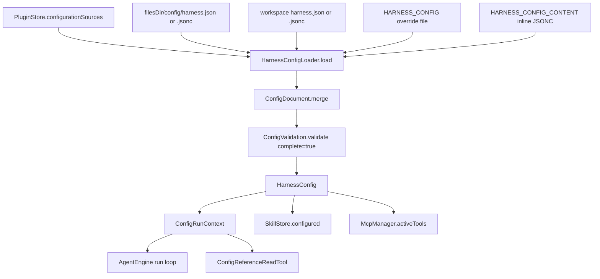

# Workspace Configuration

> Discovers, merges, validates and applies `harness.json` / `harness.jsonc` so a Code run gets instructions, references, skills, agent profiles, memory paths, MCP servers and plugin hooks.

The package `com.androidharness.app.config` implements a small layered configuration system. `HarnessConfigLoader` reads files from the global app home and the active workspace, merges them through `ConfigDocument`, validates the result with `ConfigValidation`, and returns an immutable `HarnessConfig`. `HarnessConfigRepository` owns the app-private bindings (connected folders, variables, secrets) and the read/save API used by Settings. `ConfigRunContext` carries the resolved config through a run as a coroutine context element so tools, subagents and hooks can read it.

The subsystem never executes shell commands, performs network calls or installs packages while loading. `{secret:...}` reads the encrypted store, `{file:...}` reads a bounded UTF-8 file, and everything else is parsing.

## Module Responsibilities

- **Discovery and merge**: find `harness.json` or `harness.jsonc` in the global home and the project root, plus managed plugin layers, an override file and inline JSONC, then merge in priority order.
- **Parsing**: a bounded lexical JSON/JSONC reader that keeps source offsets so errors report file, line and column, and so relative paths keep the meaning of the document that declared them.
- **Path resolution**: `~/` maps to the app configuration home, `@name/...` maps to a connected Android document folder, everything else is workspace-relative with `..` and absolute paths refused.
- **Validation**: per-layer structural checks while loading, then a complete check of the merged document (cross-field rules and `default_agent` existence).
- **Bindings**: variables and encrypted secrets are app-owned and stored off the project file (`config-bindings.json` plus `KeyStoreManager`).
- **Run integration**: `ConfigRunContext` exposes tool denials, permission mapping, hooks, reference reads, memory paths and the prompt block to `AgentEngine`.

## Architecture and Flow

The loader applies six layers in this exact order (`HarnessConfig.kt:180-L211`):

1. Managed plugin sources whose id starts with `Managed/Global/`.
2. The app home `config/harness.json` or `config/harness.jsonc`, labelled `Global`.
3. Managed plugin sources whose id starts with `Managed/Project/`.
4. The primary workspace `harness.json` or `harness.jsonc`, labelled `Project`.
5. `HARNESS_CONFIG`, resolved relative to the primary workspace (also accepts `@folder` and `~/`).
6. `HARNESS_CONFIG_CONTENT`, inline JSONC with the pseudo-source id `HARNESS_CONFIG_CONTENT`.

`HarnessConfigRepository.load` supplies the material: `draft(home, globalDraft)`, `folders()` as `ConfigDocumentFs` instances, `appHome = FileFs(File(context.filesDir, "config/home"))`, `managedPlugins = plugins.configurationSources(workspace)`, `environment` from the variables map then `System.getenv`, and `secret` from `keys.localSecret("harness_config_$it")` (`HarnessConfigRepository.kt:64-L90`). The two draft parameters exist so the Settings editor can validate unsaved text without writing it.

Merge semantics live in `ConfigDocument.merge` (`ConfigDocument.kt:23-L35`). Objects merge recursively, arrays concatenate in layer order, any other value is replaced by the later layer, and `null` replaces the earlier value. `ConfigValue.get` treats a JSON null as absent, so `null` effectively clears an inherited key. Every layer is validated with `complete = false` as it is discovered, so a syntactically bad lower layer fails even when a higher layer overrides it.

If both `harness.json` and `harness.jsonc` exist in one location, JSON wins and the loader appends the warning `"<label>: harness.json takes precedence over harness.jsonc."` (`HarnessConfig.kt:116-L123`). The JSONC file is never merged in that case.

## Invocation Chain

1. `HarnessApp` constructs `HarnessConfigRepository(appContext, keys, pluginManager, configurationRevision)` (`HarnessApp.kt:103`) and `McpManager(appContext, linuxEnv, keys, codeGraph, configuration)` (`HarnessApp.kt:274`).
2. `AgentEngine` is given `resolveConfiguration = { configuration.load(it) }` (`HarnessApp.kt:308`).
3. A Code turn enters `RunManager` and resolves `projectConfiguration` through `mcp?.configuration(runWorkspace) ?: engine.configuration(runWorkspace)`; Chat turns get an empty `HarnessConfig()` (`RunManager.kt:586-L588`).
4. `RunManager` passes `projectConfiguration` and `pluginsApproved = mcp.isWorkspaceApproved(...)` into `engine.run` (`RunManager.kt:617-L619`).
5. `AgentEngine.run` copies the config and strips `plugins` when the workspace is not approved, builds the configured skill store, and installs a `ConfigRunContext` with `withContext(runContext)` (`AgentEngine.kt:302-L309`).
6. `systemPrompt` appends `projectConfig.prompt(runConfig.agent)` and each auto-loaded skill (`AgentEngine.kt:2282-L2296`).
7. Tool rounds filter the registry by `runContext.denies(tool)` and `ConfigToolPolicy.permission(...) != "deny"` (`AgentEngine.kt:457-L459`).
8. Each tool call runs `tool.before`, applies the `"ask"` gate when configured, then `tool.after`, with instructions queued on `runContext.pendingInstructions` and drained before the next request (`AgentEngine.kt:1133-L1151`, `AgentEngine.kt:480-L482`).
9. `task(agent=...)` calls `runConfig.child(name)`, which requires a declared profile and accumulates parent denials (`AgentEngine.kt:1236`).
10. The Settings UI calls the same repository: `ConfigurationSection` loads a snapshot, renders counts and warnings, and gates approval on `container.mcp.approvalFingerprint` (`ConfigurationSection.kt:72-L88`, `ConfigurationSection.kt:178-L190`).

## Key State and Data Structures

- **`HarnessConfig`** (`HarnessConfig.kt:20-L64`): `sources`, `instructions`, `references`, `skills`, `enabledSkills`/`disabledSkills`/`autoLoad`, `servers`, `permissions`, `agents`, `defaultAgent`, `memory`, `plugins`, `warnings`, `trustPayload`, `sensitiveValues`, `serverSources`. `present` is true when any source loaded. `fingerprint` hashes `trustPayload` plus the serialized server list.
- **`ConfigValue`** (`ConfigDocument.kt:6-L11`): wraps a `JsonElement` with `source` and byte `offset`, plus prebuilt `fields` and `items`. All reads go through it, which is why a merged value still knows which document declared it.
- **`ConfigSource` / `ConfigFile` / `ConfigReference` / `ConfigAgent` / `ConfigPlugin` / `ConfigMemory` / `ConfigServerSource`** (`HarnessConfig.kt:9-L18`): the loaded forms. `ConfigMemory` defaults to `.harness/memory.md`, `.harness/memory`, `autoRecall = true`, `maxLines = 120`.
- **`HarnessConfigException`** (`ConfigDocument.kt:13-L14`): `document:line:column: detail`, produced for both parse and validation failures.
- **`ConfigRunContext`** (`ConfigRunContext.kt:10-L23`): coroutine context key holding `config`, `skills`, `hooks`, `agent` and `parentDenials`, with a concurrent queue for pending instructions and `redact()` delegated to the config.
- **`ConfigToolPolicy`** (`ConfigRunContext.kt:25-L50`): maps a `Tool` to permission categories (`write`/`edit`, `delete`, `read`, `network`, `shell`) and resolves `allow`/`ask`/`deny`. Shell and MCP tools are opaque, so they join the restrictive categories rather than being inspected.
- **Bindings file** (`HarnessConfigRepository.kt:18-L31`): `filesDir/config-bindings.json` with `folders`, `variables` and `secrets` arrays, written through `android.util.AtomicFile`, capped at 512 KiB. Secrets themselves live in `EncryptedSharedPreferences` under `harness_config_<NAME>`.

Supported root keys, enforced by `ConfigValidation.validate` (`ConfigValidation.kt:24`) and mirrored in `docs/harness.schema.json`:

| Key | Type | Behavior |
| --- | --- | --- |
| `$schema` | string | Ignored at runtime, editor hint only. |
| `instructions` | string array | Globs and `!` excludes; `AGENTS.md` and `HARNESS.md` are added automatically when a config is present. |
| `references` | array of `{title, path, glob}` | Not injected into the prompt; listed in the reference catalog. |
| `skills` | `{paths, enable, disable, auto_load}` | Additional skill folders, glob filters, and up to 32 auto-loaded patterns. |
| `plugins` | `{paths, npm, enable, disable}` | File-based bundles under a config folder; `npm` names already-installed packages. |
| `mcp` | object | Server definitions, validated and normalized into `McpServerConfig`. |
| `permissions` | object | `shell`, `edit`, `delete`, `network`, `outside_workspace`, each `allow`, `ask` or `deny`. |
| `agents` | object | Named Code agent profiles with `description`, `instructions`, `tools`. |
| `default_agent` | string | Must name `default` or a declared profile once merged. |
| `memory` | object | `file`, `topics_dir`, `auto_recall`, `max_core_lines` (1 to 500). |

Unknown properties are errors at every level, including inside `references`, `skills`, `plugins`, `mcp` entries, `permissions`, `agents` and `memory`.

Path handling is centralized in `HarnessConfigLoader.path` and `relative` (`HarnessConfig.kt:124-L139`). `~/` resolves against `appHome` (`filesDir/config/home`), `@name/rest` resolves against a connected folder alias, and anything starting with `/` is rejected with "use workspace-relative paths, ~/ for app home, or a connected @folder". `ConfigDocumentFs` is read-only by construction (`ConfigDocumentFs.kt:40-L47`), and `configFileAccess` re-checks canonical paths so a symlink cannot leave a granted root (`ConfigDocumentFs.kt:52-L61`).

Globbing is `ConfigGlob.matches` (`ConfigDocument.kt:124-L138`): `**/` matches zero or more directories, `**` crosses directories, `*` stays within one segment, `?` matches one character, case-sensitive. Directory scans skip `.git`, `node_modules`, `build` and `.gradle`.

## Boundary Conditions

- **Document size**: 256 KiB per document (`ConfigDocument.MAX_BYTES`), enforced by the reader and by `HarnessConfigRepository.document`/`save`.
- **Total read budget**: the loader tracks `readBytes` and refuses more than 8 MiB across all configuration dependencies (`HarnessConfig.kt:107`).
- **Nesting and arrays**: 32 levels, 1024 array entries, duplicate keys rejected, trailing commas only in `.jsonc`.
- **Globs**: maximum 24 directory levels and 4096 scanned entries; an unmatched pattern becomes a warning, not an error.
- **Instructions**: 64 KiB per file and 64,000 characters combined for project plus plugin instructions.
- **References**: at most 256 entries; `reference_read` refuses files over 512 KiB and truncates output at 100,000 characters.
- **Skills**: a skills directory may hold at most 1024 entries; support files are scanned to depth 8 with at most 128 files of 64 KiB each.
- **Plugins**: at most 32 plugins with hooks, unique names, and at most 32 entries per plugin folder. Hook events are limited to `session.start`, `message.received`, `prompt.before`, `tool.before`, `tool.after`, `session.end`; command hooks clamp `timeout` to 1 to 600 seconds.
- **MCP**: names must match `[A-Za-z0-9][A-Za-z0-9_-]{0,31}`, must not collide after lowercasing and dash-to-underscore normalization, cannot set both `command` and `url`, and remote URLs must be `http://` or `https://` after substitution.
- **Save conflicts**: `save` compares the current text and a fingerprint with the values the editor started from and throws "This file changed outside the editor. Reload before saving." when they differ (`HarnessConfigRepository.kt:117-L120`).
- **Bindings**: at most 32 connected folders, 64 secrets, 1 to 32 character folder aliases, and 16 KiB per variable except `HARNESS_CONFIG_CONTENT`, which may use the full 256 KiB.
- **Approval binding**: `McpManager.workspaceConfigText` combines the legacy `.harness/mcp.json`, `trustPayload` and a hash of the resolved transports, so editing a secret, a header or a plugin script invalidates workspace approval (`McpManager.kt:271-L278`).

## Extension Points

- **New configuration key**: add it to the `obj(root, setOf(...))` allow list, validate its type in `ConfigValidation`, read it in `HarnessConfigLoader.load`, add a field to `HarnessConfig`, and mirror it in `docs/harness.schema.json`. Missing any of these makes a valid file fail validation or silently ignore the key.
- **New permission category**: extend `ConfigToolPolicy.matches` and `permission`, then add the key to the `permissions` allow list and schema.
- **New binding kind**: `HarnessConfigRepository` exposes `addFolder`, `removeFolder`, `putVariable`, `removeVariable`; the Settings screen wires them to an `OpenDocumentTree` picker and a value dialog (`ConfigurationSection.kt:64-L70`, `ConfigurationSection.kt:239-L241`).
- **New injected tool**: `ConfigReferenceReadTool` is appended to the run registry only when references exist (`AgentEngine.kt:374`). The same pattern applies to any config-scoped tool.
- **Hooks**: `PluginHooks.invoke` receives the plugin list, the event name and a JSON object; adding an event means adding it to the loader's `events` set and calling `hook(name, event)` from the engine.

## Known gaps

- `docs/configuration/README.md` states a 2 MiB total configuration dependency limit, while the loader enforces 8 MiB at `HarnessConfig.kt:107`. The code is authoritative.
- The JSON Schema advertises `local` and `remote` MCP types. `ConfigValidation` accepts them, but the loader normalizes any entry with a `url` to `http` (or `sse` when explicitly typed) and everything else to `stdio` (`HarnessConfig.kt:365`), so `local` and `remote` are accepted but not preserved.
- `ConfigRunContext.pendingInstructions` is drained by the engine but the queue is populated only by hook results; no other code path adds to it.

Sources: [app/src/main/java/com/androidharness/app/config/HarnessConfig.kt](../app/src/main/java/com/androidharness/app/config/HarnessConfig.kt)#L180-L211), [app/src/main/java/com/androidharness/app/config/ConfigValidation.kt](../app/src/main/java/com/androidharness/app/config/ConfigValidation.kt)#L7-L91), [app/src/main/java/com/androidharness/app/config/ConfigDocument.kt](../app/src/main/java/com/androidharness/app/config/ConfigDocument.kt)#L17-L35), [docs/harness.schema.json](../docs/harness.schema.json)#L1-L6), [app/src/main/java/com/androidharness/app/ui/settings/ConfigurationSection.kt](../app/src/main/java/com/androidharness/app/ui/settings/ConfigurationSection.kt)#L41-L88)

## Source files

- `app/src/main/java/com/androidharness/app/config/HarnessConfig.kt`
- `app/src/main/java/com/androidharness/app/config/HarnessConfigRepository.kt`
- `app/src/main/java/com/androidharness/app/config/ConfigValidation.kt`
- `app/src/main/java/com/androidharness/app/config/ConfigDocument.kt`
- `app/src/main/java/com/androidharness/app/config/ConfigDocumentFs.kt`
- `app/src/main/java/com/androidharness/app/config/ConfigRunContext.kt`
- `app/src/main/java/com/androidharness/app/config/PluginHooks.kt`
- `app/src/main/java/com/androidharness/app/ui/settings/ConfigurationSection.kt`
- `docs/harness.schema.json`
- `docs/configuration/README.md`
