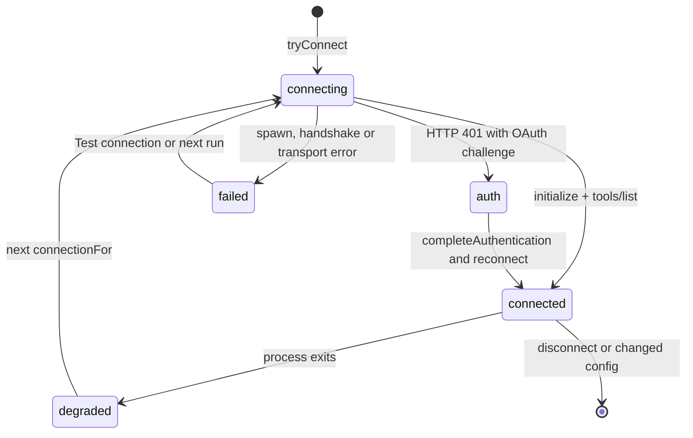

# MCP Client Manager

> Owns the MCP server registry, connection lifecycle, workspace approval gate, OAuth sign-in entry points and the per-run tool list.

`McpManager` is the single owner of Model Context Protocol server state in the app. It persists a global server list to `filesDir/mcp-servers.json`, verifies that file with an HMAC sidecar, connects servers lazily per run, exposes a `StateFlow` of `McpServerStatus`, and merges servers declared by the workspace configuration (`harness.json` `mcp` block or the legacy `.harness/mcp.json`) behind an explicit approval gate. `McpConfigParser` converts pasted Claude Desktop / Claude Code configuration and `claude mcp add` command lines into `McpServerConfig` entries. `McpConnection`, `McpTransport`, `McpOAuth` and `McpToolAdapter` are covered in the next page.

Chat conversations never use MCP: `RunManager` passes an empty `HarnessConfig` and empty `extraTools` for `conversation.isChat` or a `ChatWorkspaceFs` (`RunManager.kt:586-L588`, `RunManager.kt:617`).

## Module Responsibilities

- **Registry**: a `MutableStateFlow<List<McpServerConfig>>` loaded from disk, plus `MutableStateFlow<Map<String, McpServerStatus>>` for live state.
- **Integrity**: every save writes a `.hmac` sidecar keyed by a non-exportable `AndroidKeyStore` key. A mismatch deletes both files, refuses the contents and sets `configTampered`.
- **Connection pooling**: one `McpConnection` per connection identity, guarded by a per-server `Mutex` and a `synchronized(connections)` monitor.
- **Workspace approval**: project-supplied servers stay blocked until the user approves the exact workspace config content (legacy file, resolved transports and trust payload).
- **Startup reconnect**: enabled app-side servers that connected before are retried at process start, with stdio waiting for the Linux toolchain.
- **Import and portability**: paste parsing, `claude mcp add` parsing, and settings-backup restore that renames and disables restored entries.
- **OAuth entry points**: `startAuthentication` returns a browser URL, `completeAuthentication` consumes the redirect. Token machinery lives in `McpOAuth`.

## Architecture and Flow

`activeTools` is the main entry point for a run (`McpManager.kt:319-L377`):

1. Read enabled global servers from `_servers`.
2. Read workspace servers via `workspaceConfigs`, which parses `.harness/mcp.json` and filters any legacy entry whose name is overridden by the resolved `HarnessConfig.servers` (`McpManager.kt:246-L250`).
3. Drop workspace servers whose name collides case-insensitively with a global server, since the Settings-saved entry keeps authority.
4. If `isWorkspaceApproved` is false, stamp each pending workspace server as `blocked` with "Project tools need approval in chat or Configuration settings before they can run." and exclude them.
5. Evaluate a synthetic startup `Tool` (`shell` for stdio, `http_request` for remote) against `ConfigToolPolicy.permission` and the default agent's `tools` rules. A denied startup becomes `blocked` with "Project configuration blocks this server's startup."
6. Add code graph tools when the permission mode is `FULL_ACCESS` or no permission is `ask` or `deny`, tolerating failures.
7. For each remaining server, compute a connection identity, take a lease when it is a project server, connect through `connectionFor`, and wrap each advertised tool in `McpToolAdapter(original.name, info, conn)`. The adapter resets the connection through `onDead = { disconnect(config.name) }`.

Connection identity is `config.name` for app-side servers, or `name + "_ws_" + sha256(workspace.displayPath + deviceLocal + serialized config).take(12)` for workspace-derived ones (`McpManager.kt:252-L253`). That keeps two workspaces with the same server name on separate processes and statuses.

`connectionFor` (`McpManager.kt:380-L398`) takes a per-server mutex, reuses a live connection, closes a dead one, then tries `tryConnect` twice for stdio and once for SSH-backed remote servers. The retry exists because cold-start server binaries sometimes crash once.

## Invocation Chain

1. `HarnessApp` builds `McpManager(appContext, linuxEnv, keys, codeGraph, configuration)` (`HarnessApp.kt:274`) and passes it to `RunManager` (`HarnessApp.kt:348`).
2. `RunManager` resolves `projectConfiguration` with `mcp?.configuration(runWorkspace) ?: engine.configuration(runWorkspace)`, computes `projectToolsApproved`, and calls `mcp.activeTools(runWorkspace, projectConfiguration, permissionMode, "$sid:$turnId")` (`RunManager.kt:586-L588`, `RunManager.kt:617`).
3. In `finally`, `RunManager` calls `mcp.releaseWorkspaceTools("$sid:$turnId")` under `NonCancellable`, which decrements the refcount and closes project connections that no run still holds (`RunManager.kt:657-L658`, `McpManager.kt:67-L79`).
4. Settings → MCP collects `servers`, `statuses` and `configTampered`, renders a dot per state, and wires Test, Edit, Remove, the Enable switch and the Authenticate button (`SettingsScreen.kt:1747-L1891`).
5. Add flow: `McpAddDialog` calls `McpConfigParser.parsePaste` on every keystroke and `addServer` per parsed entry (`SettingsScreen.kt:1899-L1995`). Manual entry opens `McpServerDialog`, which builds a `McpServerConfig` from segmented transport choice and calls `addServer` (`SettingsScreen.kt:1998-L2142`).
6. Chat gate: `ChatViewModel` loads the workspace config, computes `approvalFingerprint`, and if `unapprovedWorkspaceServers` is non-empty shows the approve/decline prompt instead of starting the run (`ChatViewModel.kt:1535-L1547`). `approveWorkspaceMcp` re-checks the fingerprint before calling `approveWorkspace` (`ChatViewModel.kt:337-L359`).
7. Configuration screen: the Project tab reloads `container.configuration.load(fs)`, checks `isWorkspaceApproved` and `approvalFingerprint`, and offers Approve only when the fingerprint still matches (`ConfigurationSection.kt:80-L83`, `ConfigurationSection.kt:178-L190`).
8. Plugin servers: `PluginMcpServersSection` resolves the same config, keeps only servers with a `serverSources` plugin name, and shows plugin, scope, approval and live status (`PluginMcpServersSection.kt:40-L79`).
9. Browser callback: `MainActivity.handleMcpOAuth` accepts `androidharness://mcp?code=...&state=...` on launch and on `onNewIntent`, then calls `completeAuthentication` (`MainActivity.kt:94-L95`, `MainActivity.kt:293-L326`).
10. Headless callers refuse to run with unapproved workspace tools: `TelegramAgentBridge` and `AutomationManager` check `unapprovedWorkspaceServers(...).isEmpty()` (`TelegramAgentBridge.kt:94`, `AutomationManager.kt:228`).

## Key State and Data Structures

- **`McpServerConfig`** (`McpModels.kt:19-L37`): `name`, `command`, `args`, `env`, `enabled`, `type` (`stdio`, `http`, `sse`), `url`, `headers`, and `@Transient deviceLocal` which marks plugin-supplied servers so their working directory is `filesDir` instead of the workspace. `isRemote` is true for `http` and `sse`.
- **`McpToolInfo`** (`McpModels.kt:39-L44`): `name`, `description`, `inputSchema`.
- **`McpServerStatus`** (`McpModels.kt:46-L53`): `state` (`connecting`, `connected`, `failed`, `auth`, plus `blocked` written by `activeTools`), `toolCount`, `error`, `needsAuth`.
- **`McpStoredStatus`** (`McpReconnectPolicy.kt:15-L19`): `toolCount` and `connectedAtMs`, persisted in `mcp-status.json`.
- **`McpNames`** (`McpModels.kt:55-L73`): `WORKSPACE_CONFIG = ".harness/mcp.json"` and `toolName(server, tool) = "mcp__<server>__<tool>"` with components sanitized to `[a-z0-9_]`, server truncated to 32 and tool to 64 characters.
- **`McpConfigParser`** (`McpModels.kt:83-L248`): `parse` is strict JSON only; `parsePaste` tries JSON then a `claude mcp add` line; `parseJson` accepts a `mcpServers` wrapper, a single server object, or an array; `entry` maps `disabled` to the inverse of `enabled`, defaults URL entries to `http`, and reads `args`, `env` and `headers`; `parseClaudeCommand` handles `--transport`, `--env K=V`, `--header "K: V"`, `--` and infers `http` when the target starts with `http`; `tokenizeCli` honors single and double quotes with backslash escapes.
- **Persisted files**: `filesDir/mcp-servers.json`, `filesDir/mcp-servers.json.hmac`, `filesDir/mcp-status.json`, `filesDir/mcp-approvals.json` (workspace key to epoch millis), and `cacheDir/mcp/<sanitized-name>.log` for stdio stderr.

`approvalKey` is `"<workspace absolute path or displayPath>:<sha256(configText)>"` (`McpManager.kt:268-L269`). `workspaceConfigText` returns the legacy file when no `HarnessConfig` is present, otherwise `legacy + "\nHarness configuration\n" + trustPayload + "\n" + sha256(serialized resolved transports)` (`McpManager.kt:271-L278`). Because `trustPayload` includes every source text and plugin script, and the transport hash includes substituted secrets and headers, any edit invalidates approval without a separate version counter.

## Boundary Conditions

- **Integrity failure**: on HMAC mismatch the manager deletes both files, sets `configTampered = true`, and returns an empty list. The Settings screen shows "the MCP server list was modified outside the app" (`SettingsScreen.kt:1763-L1770`). If the Keystore key cannot be created, `computeConfigHmac` returns null and verification degrades to accept rather than locking the user out (`McpManager.kt:166-L184`).
- **First run after the HMAC change**: when a file exists without a sidecar, the current HMAC is adopted (`McpManager.kt:133-L136`).
- **Changing a server**: `persist` disconnects every entry in the old list that is not equal to its replacement, so editing a command or URL closes the old process (`McpManager.kt:141`). An app-side save also clears `configTampered`.
- **Removing a server**: `removeServer` disconnects, deletes the stored OAuth state, rewrites the list, and drops the reconnect marker (`McpManager.kt:217-L223`).
- **Restore from backup**: `importDisabledServers` renames collisions to `"<name> (restored)"`, then `"<name> (restored 2)"`, forces `enabled = false`, writes atomically and requires a non-null HMAC (`McpManager.kt:186-L212`).
- **Reconnect scope**: `recordConnected` refuses names absent from `_servers`, so workspace and plugin servers never earn startup auto-reconnect. `McpReconnectPolicy.candidates` returns only enabled servers present in the stored map (`McpManager.kt:405-L409`, `McpReconnectPolicy.kt:33-L36`).
- **Startup ordering**: remote servers reconnect immediately; stdio servers wait for `EnvState.Ready` from `linuxEnv.state` (`McpManager.kt:419-L432`).
- **Stdio prerequisites**: `spawnStdio` throws `ToolFailure` when `linuxEnv.bashExecutable()` is null, and appends stderr to the cache log (`McpManager.kt:493-L509`).
- **SSH workspaces**: for an `SshFs` workspace and a non-remote, non-`deviceLocal` server, the command runs on the SSH host with `env` entries shell-quoted; connection failure does not retry (`McpManager.kt:364`, `McpManager.kt:434-L447`).
- **Approval scope**: global servers are never gated; only workspace files, `harness.json` `mcp` entries and plugin-supplied servers are. Refusing approval leaves the run usable with normal tools.
- **Leases**: `retainWorkspaceTool` increments a refcount per `leaseId`; `releaseWorkspaceTools` closes a connection only when the count reaches zero, so overlapping runs in one workspace share processes (`McpManager.kt:67-L85`).

## Extension Points

- **New transport type**: add the value to `McpServerConfig.type`, to `McpConnection.connect`, to the validation enum, and to the segmented button list in `McpServerDialog` (`SettingsScreen.kt:2043-L2052`).
- **New import format**: extend `McpConfigParser.parsePaste`; both the paste dialog and any external caller get it automatically.
- **New status source**: write into `_statuses` with a state string; the Settings dot and `TroubleshootingSection` already handle unknown states through their `else` branches (`TroubleshootingSection.kt:112-L120`).
- **Programmatic registration**: `addServer`, `setServerEnabled`, `removeServer` and `importDisabledServers` are the public mutation surface. `SettingsBackup` uses `mcp.servers.value` for export and `importDisabledServers` for restore (`SettingsBackup.kt:226`, `SettingsBackup.kt:285`).

## Known gaps

- The `blocked` state is written into `_statuses` but `McpServerStatus` documents only four states (`McpModels.kt:46-L53`). Consumers treat it as a failure string.
- `unapprovedWorkspaceServers` appends a synthetic `Plugin: <name>` entry for every plugin when the workspace is unapproved (`McpManager.kt:289-L290`), so the chat prompt can list names that are not real servers.
- `workspaceUsers` is a plain `HashMap` keyed by connection name while `connections` is guarded by `synchronized(connections)`; the two use the same monitor, which is correct but easy to break in a refactor.

Sources: [app/src/main/java/com/androidharness/app/tools/mcp/McpManager.kt](../app/src/main/java/com/androidharness/app/tools/mcp/McpManager.kt)#L319-L377), [app/src/main/java/com/androidharness/app/tools/mcp/McpModels.kt](../app/src/main/java/com/androidharness/app/tools/mcp/McpModels.kt)#L83-L211), [app/src/main/java/com/androidharness/app/ui/settings/SettingsScreen.kt](../app/src/main/java/com/androidharness/app/ui/settings/SettingsScreen.kt)#L1747-L1891), [app/src/main/java/com/androidharness/app/agent/RunManager.kt](../app/src/main/java/com/androidharness/app/agent/RunManager.kt)#L586-L619)

## Source files

- `app/src/main/java/com/androidharness/app/tools/mcp/McpManager.kt`
- `app/src/main/java/com/androidharness/app/tools/mcp/McpModels.kt`
- `app/src/main/java/com/androidharness/app/tools/mcp/McpReconnectPolicy.kt`
- `app/src/main/java/com/androidharness/app/ui/settings/SettingsScreen.kt`
- `app/src/main/java/com/androidharness/app/ui/settings/PluginMcpServersSection.kt`
- `app/src/main/java/com/androidharness/app/ui/settings/TroubleshootingSection.kt`
- `app/src/main/java/com/androidharness/app/ui/chat/ChatViewModel.kt`
- `app/src/main/java/com/androidharness/app/agent/RunManager.kt`
- `app/src/main/java/com/androidharness/app/data/SettingsBackup.kt`
