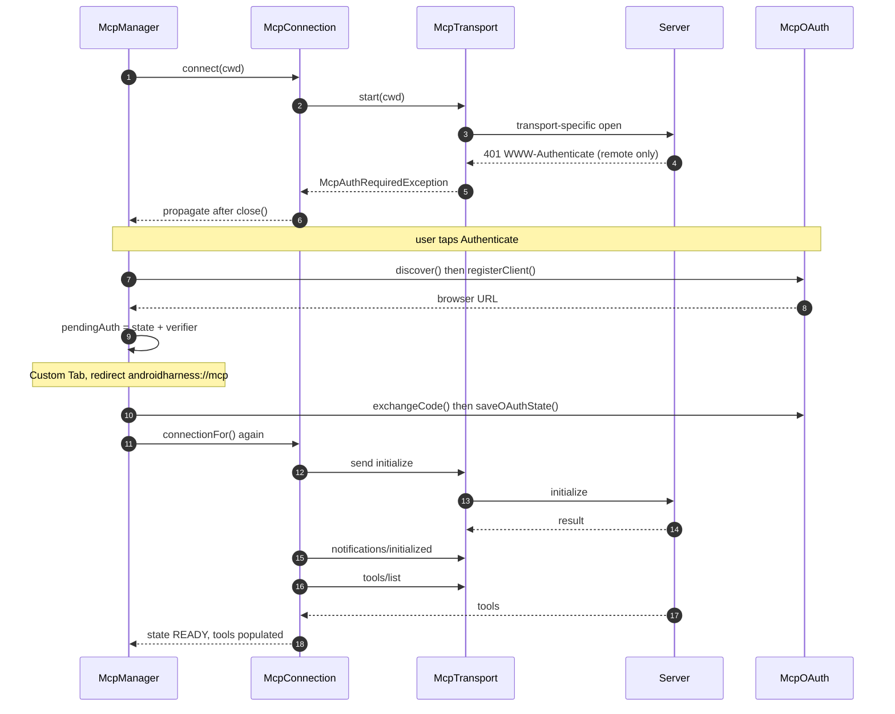

# MCP Transports, OAuth and Tool Adapters

> Implements the JSON-RPC 2.0 client for one MCP server: stdio, Streamable HTTP and legacy HTTP+SSE transports, OAuth discovery with PKCE and Custom Tabs, token refresh, and the `Tool` bridge the agent loop calls.

`McpConnection` is the protocol core. It opens a transport, sends `initialize`, `notifications/initialized` and `tools/list`, then serves `tools/call` requests correlated by JSON-RPC id. `McpTransport` has three implementations in `McpTransport.kt`: `StdioTransport` (newline-delimited JSON over a child process), `StreamableHttpTransport` (one POST per message) and `SseLegacyTransport` (a persistent GET stream plus a POST endpoint). `McpOAuth` performs RFC 9728 protected-resource discovery, RFC 8414 authorization-server discovery, RFC 7591 dynamic client registration and OAuth 2.1 PKCE. `McpToolAdapter` turns each advertised tool into the harness `Tool` contract.

## Module Responsibilities

- **Framing**: stdio uses one JSON object per line in both directions. Remote transports reuse the same `McpTransport.send(String)` and `incoming: Channel<String>` contract, so `McpConnection` stays transport-agnostic.
- **Handshake**: version negotiation, capability advertisement, client identity, and tool discovery with a single 15 second budget.
- **Request correlation**: `AtomicInteger` ids, a `ConcurrentHashMap<Int, CompletableDeferred<JsonObject>>`, and a `Mutex` that serializes writes.
- **HTTP details**: `Mcp-Protocol-Version`, `Accept: application/json, text/event-stream`, `Mcp-Session-Id` capture and replay, bearer authorization plus static headers.
- **OAuth**: discovery, registration, authorize URL, code exchange, refresh, and persistence in encrypted preferences.
- **Adaptation**: tool name rewriting, schema normalization, availability checks, and error translation into `ToolResult`.

## Architecture and Flow

### Connection and handshake

`connect(cwd)` chooses the transport from `config.type` (`McpConnection.kt:78-L92`). It launches a collector on the connection scope that feeds every inbound line into `handleLine`, starts the transport, then issues `initialize` with `protocolVersion` equal to `McpProtocol.REMOTE_VERSION` (`2025-06-18`) for remote servers or `2024-11-05` for stdio, empty `capabilities`, and `clientInfo` name `AndroidHarness` version `0.4-alpha` (`McpConnection.kt:104-L118`). It sends `notifications/initialized`, calls `tools/list`, parses the result into `McpToolInfo` objects, and only then sets `ConnectionState.READY`.

`handleLine` ignores any message that carries a `method`, which means server-initiated requests and notifications (sampling, roots, elicitation, progress, logging) are dropped rather than answered. Responses are matched by integer `id` into `pending` (`McpConnection.kt:218-L225`).

### Request and response path

`rpc` assigns the next id, registers a deferred, writes under `writeMutex`, awaits with `withTimeout(timeoutMs)`, converts a JSON-RPC `error` object into `ToolFailure`, and always removes the pending entry in `finally` (`McpConnection.kt:181-L205`). `callTool` sends `{name, arguments}` with a default 60 second timeout and returns the concatenated content text plus the `isError` flag (`McpConnection.kt:146-L169`). `contentToText` joins text parts with newlines, falls back to the raw object for non-text parts, and returns `"(empty response)"` for null (`McpConnection.kt:240-L248`).

### Transports

**stdio** (`StdioTransport`, `McpTransport.kt:56-L109`). `processFactory(cwd)` supplies the process; `McpManager.spawnStdio` builds it through `linuxEnv.shellProcessBuilder` so `npx` and `python3` resolve. A reader coroutine pulls `readLine()` until EOF, sends non-blank lines, then closes `incoming`. `send` writes the message plus a newline and flushes on `Dispatchers.IO`. `close` destroys the process and closes the channel. The channel is `Channel.UNLIMITED`.

**Streamable HTTP** (`StreamableHttpTransport`, `McpTransport.kt:122-L176`). `start` does nothing; every message is an independent POST to the configured URL. Headers are `Accept: application/json, text/event-stream`, `MCP-Protocol-Version: 2025-06-18`, the remembered `Mcp-Session-Id`, the OAuth bearer token from `authHeader()`, and the static `headers` map. A 401 throws `McpAuthRequiredException` carrying the `resource_metadata` value parsed from `WWW-Authenticate`; any other non-2xx becomes `ToolFailure`. A response header `Mcp-Session-Id` replaces the stored session id. An empty body is treated as `202 Accepted` for notifications. A `text/event-stream` body is parsed by `sseEvents` and each data block is forwarded to `incoming`; otherwise the trimmed JSON body is forwarded.

**HTTP+SSE** (`SseLegacyTransport`, `McpTransport.kt:186-L307`). `start` opens a GET with `Accept: text/event-stream` on a cloned client with `readTimeout(0)` so the stream can stay open. The first `endpoint` event resolves the POST target against the original URL and completes `endpointReady`; any other event is a server message. `start` waits at most 15 seconds for the endpoint before the handshake proceeds (`McpTransport.kt:264`). `send` posts JSON to the announced endpoint with the protocol version and auth headers and expects the actual response to arrive on the stream. `close` cancels the call and closes the channel.

`sseEvents` (`McpTransport.kt:310-L331`) is the shared body parser: it normalizes CRLF, splits on blank lines into blocks, records `event:` names, concatenates multiple `data:` lines with newlines, strips one leading space, and keeps unnamed events.

The shared client is `mcpHttpClient()`: 15 second connect timeout, 5 minute read timeout, no call timeout (`McpTransport.kt:334-L338`).

### OAuth

`McpManager.tryConnect` catches `McpAuthRequiredException`, calls `recordAuth` to store the challenge URL in `authChallenges` and set status `auth` with `needsAuth = true` (`McpManager.kt:476-L485`). `startAuthentication(name)` (`McpManager.kt:554-L576`) then runs:

1. `McpOAuth.discover(httpClient, challenge, url)`. Candidate protected-resource metadata URLs are the challenge URL, then the server origin with `/.well-known/oauth-protected-resource<path>`, then the origin root with `/.well-known/oauth-protected-resource`. The first document containing `authorization_servers` wins.
2. The issuer is the first `authorization_servers` entry. Authorization-server metadata is fetched from `$issuer/.well-known/oauth-authorization-server` and from the same string with the issuer path appended.
3. `authorization_endpoint` and `token_endpoint` are required; `registration_endpoint` is optional. Scopes come from `scopes_supported` in the resource metadata; `resource` comes from the metadata `resource` field or the server URL.
4. `McpOAuth.registerClient` posts `client_name`, `redirect_uris: ["androidharness://mcp/oauth"]`, `grant_types: ["authorization_code", "refresh_token"]`, `response_types: ["code"]`, `token_endpoint_auth_method: "none"` and an optional scope, then stores `client_id` and `client_secret`.
5. `createState()` and `createVerifier()` each produce 48 random bytes as base64url without padding; `codeChallenge` is the SHA-256 of the verifier, also base64url.
6. `authorizationUrl` adds `response_type=code`, `client_id`, `redirect_uri`, `state`, `code_challenge`, `code_challenge_method=S256`, `resource` and optional `scope`, with every value URL-encoded (`McpOAuth.kt:191-L208`).

The verifier and state live in `pendingAuth`, a single `@Volatile` `PendingAuth` field, so only one server can be mid-authentication and the state is lost on process death (`McpManager.kt:107-L113`). The redirect is declared in the manifest as scheme `androidharness`, host `mcp` (`AndroidManifest.xml:117-L123`) and handled by `MainActivity.handleMcpOAuth`, which passes `state` and `code` to `completeAuthentication` (`MainActivity.kt:313-L326`). That method rejects a missing pending attempt, a state mismatch and a blank code, exchanges the code with the verifier, saves the tokens, clears `pendingAuth`, disconnects and reconnects the server (`McpManager.kt:583-L614`).

Refresh (`authHeaderFor`, `McpManager.kt:620-L639`) returns the stored bearer token when `accessTokenValid()` is true, treating a token as expired 30 seconds early (`McpOAuth.kt:37-L38`). Otherwise it takes a per-server mutex, re-reads the state, calls `refreshTokens`, keeps the old refresh token when the provider omits a new one, saves the updated blob and returns the new bearer.

All token requests share `tokenRequest`, which applies a 30 second `callTimeout`, surfaces `error_description` or `error` from a failed response, and rejects an unreadable body or a missing `access_token` (`McpOAuth.kt:245-L281`). `expires_in` becomes an absolute epoch millisecond timestamp only when positive.

### Persistence

| Data | Storage | Survives process death |
| --- | --- | --- |
| OAuth context and tokens | `KeyStoreManager` slot `mcp_oauth_<sanitized name>` in `EncryptedSharedPreferences`, JSON `McpOAuthState` | Yes |
| Pending PKCE verifier and state | `pendingAuth` field in `McpManager` | No |
| Streamable HTTP session id | `sessionId` field in the transport | No, a reconnect starts a new session |
| SSE POST endpoint | `postUrl` field in the transport | No, re-announced on connect |
| Per-server status | `mcp-status.json` through `McpReconnectPolicy` | Yes |

`KeyStoreManager` backs the preferences with an `AndroidKeyStore` AES256_GCM master key, `AES256_SIV` for keys and `AES256_GCM` for values (`KeyStoreManager.kt:36-L42`). `removeServer` deletes the slot. The slot name is sanitized by `McpServerNameSanitizer`, which lowercases and replaces any run of non `[a-z0-9_]` characters with `_` (`KeyStoreManager.kt:256-L260`).

### Tool adaptation

`McpToolAdapter` (`McpToolAdapter.kt:18-L55`) exposes the sanitized name from `McpNames.toolName`, a description prefixed with `[MCP server: <name>]`, the normalized input schema, and `isReadOnly = false` so every call passes through normal approval. `isAvailable` is `connection.isAlive`: state must be `READY` and, for stdio, the child process must still be alive (`McpConnection.kt:69-L74`). `execute` checks liveness first, calls `callTool` with the original tool name (not the sanitized one), and maps the result to `ToolResult(!isError, text)`. Both `ToolFailure` and any other exception become `ToolResult(false, message)`, and `onDead()` is invoked when the connection is no longer alive so `McpManager` can drop it.

`normalizeMcpSchema` guarantees a root object: an empty schema becomes `{"type":"object","properties":{}}`, a schema that already has `type` is unchanged, and anything else is wrapped with `"type": "object"` while keeping its keys (`McpToolAdapter.kt:58-L68`).

## Invocation Chain

1. `McpManager.connectionFor` calls `tryConnect`, which constructs `McpConnection(serverName, config, processFactory, authHeader, httpClient)` and calls `connect(cwd)` (`McpManager.kt:434-L453`).
2. `McpConnection.connect` selects `StreamableHttpTransport`, `SseLegacyTransport` or `StdioTransport` and starts the inbound collector (`McpConnection.kt:77-L140`).
3. `rpc("initialize", ...)` writes through the transport, then `rpc("tools/list", ...)` populates `tools`.
4. `McpManager.activeTools` wraps each `McpToolInfo` in `McpToolAdapter(original.name, info, conn) { disconnect(config.name) }` (`McpManager.kt:372-L374`).
5. `AgentEngine` receives those tools as `extraTools`, runs them like any other `Tool`, and resolves permissions through `ConfigToolPolicy`.
6. On failure the adapter returns a text result; the model sees the message, and the manager removes the connection on the next run or immediately through `onDead`.
7. OAuth: Settings calls `startAuthentication`, `openOAuthBrowser` launches a Custom Tab (`OAuthBrowser.kt:16-L22`), the manifest routes the redirect to `MainActivity`, and `completeAuthentication` stores tokens and reconnects.

## Key State and Data Structures

- **`ConnectionState`** (`McpConnection.kt:33`): `CONNECTING`, `READY`, `DEAD`.
- **`McpTransport`** (`McpTransport.kt:44-L49`): `incoming: Channel<String>`, `start(cwd)`, `send(message)`, `close()`.
- **`McpProtocol`** (`McpTransport.kt:27-L35`): `REMOTE_VERSION = "2025-06-18"`, `HEADER = "MCP-Protocol-Version"`, and `resourceMetadataFromChallenge` which extracts `resource_metadata="..."` with a regex.
- **`McpAuthRequiredException`** (`McpTransport.kt:21-L25`): carries the optional `resourceMetadataUrl`.
- **`McpOAuthState`** (`McpOAuth.kt:29-L39`): `context`, `accessToken`, `refreshToken`, `expiresAtMs`.
- **`McpOAuthContext`** (`McpOAuth.kt:42-L53`): `resource`, `authorizationEndpoint`, `tokenEndpoint`, `registrationEndpoint`, `clientId`, `clientSecret`, `scopes`, `resourceMetadataUrl`.
- **`McpOAuthTokens`** (`McpOAuth.kt:55-L60`): the transient exchange result.
- **`McpOAuthException`** (`McpOAuth.kt:305`): used for every post-discovery OAuth failure so the message can be shown verbatim.

## Boundary Conditions

| Condition | Where | Surface |
| --- | --- | --- |
| HTTP 401 | `StreamableHttpTransport.send`, `SseLegacyTransport.start`/`send` | `McpAuthRequiredException`, then status `auth` |
| Non-2xx | both HTTP transports | `ToolFailure("MCP endpoint returned HTTP ...")` or the SSE variant |
| IO failure | both HTTP transports | `ToolFailure("MCP endpoint unreachable: ...")` |
| JSON-RPC error object | `McpConnection.rpc` | `ToolFailure("MCP <method> failed: <message>")` |
| Initialize over 15 seconds | `McpConnection.connect` | `ToolFailure` naming the handshake budget and the stderr log |
| `tools/call` over 60 seconds | `McpConnection.callTool` | `ToolFailure` naming tool, server and millis |
| Startup exception | `McpConnection.connect` | `ToolFailure("MCP server '<name>' failed during startup: ...")` |
| Missing URL or command | `McpConnection.connect` | `ToolFailure` before any transport starts |
| Tool returns `isError` | `McpConnection.callTool` | `ToolResult(ok = false)` with the text, no exception |
| Connection died mid-call | `McpToolAdapter.execute` | `ToolResult(false, ...)` plus `onDead()` |

- **Timeouts**: handshake 15 seconds, tool call 60 seconds, SSE endpoint announcement 15 seconds, OAuth token calls 30 seconds (each configurable only by editing the constants or constructor defaults).
- **Buffering**: every transport uses `Channel.UNLIMITED`, so a chatty server grows memory without backpressure.
- **Writes**: serialized by `writeMutex` per connection, so concurrent tool calls cannot interleave frames.
- **Threading**: transport reader coroutines, the connection scope and the manager scope all use `SupervisorJob` plus `Dispatchers.IO`. `pending` and `nextId` are concurrency-safe; `connections` and `connectLocks` are guarded by `synchronized`.
- **Close semantics**: `McpConnection.close` sets `DEAD`, closes the transport, nulls it, and cancels the scope. `isAlive` then returns false for stdio even if the process object lingers.
- **SSE stream lifetime**: the legacy GET client has no read timeout, so a silently dead network connection can hang until the socket fails. `close` cancels the call.

## Extension Points

- **New transport**: implement `McpTransport`, add the branch in `McpConnection.connect`, and add the type to validation and the settings segmented control.
- **New OAuth provider shape**: the discovery chain is four HTTP fetches in `McpOAuth.discover`; providers that omit `registration_endpoint` are supported but require a preconfigured `clientId`, and the current code never persists one from configuration.
- **Header or token injection**: `authHeader` is a suspend supplier passed to every remote transport, so a different token source can replace `authHeaderFor` without touching the transports.
- **Schema policy**: `normalizeMcpSchema` is the single place to reshape provider-specific JSON Schema quirks.

## Known gaps

- Server-initiated requests are ignored (`McpConnection.handleLine` returns early on any message with `method`), so sampling, roots, elicitation and progress are not implemented despite advertising empty capabilities.
- Streamable HTTP does not open the optional GET SSE stream, so out-of-band server messages are unreachable; only bodies returned from a POST are read.
- `McpOAuth.discover` builds its second authorization-server metadata candidate by appending the issuer path after the well-known suffix, which does not match RFC 8414 path insertion for issuers with a path component.
- `McpManager.startAuthentication` searches only the app-side `_servers` list, so a server that exists only in `harness.json` or a plugin cannot use the Authenticate button.
- The OAuth access token is only used for `http` and `sse` transports; stdio servers have no token path.

Sources: [app/src/main/java/com/androidharness/app/tools/mcp/McpTransport.kt](../app/src/main/java/com/androidharness/app/tools/mcp/McpTransport.kt)#L122-L176), [app/src/main/java/com/androidharness/app/tools/mcp/McpConnection.kt](../app/src/main/java/com/androidharness/app/tools/mcp/McpConnection.kt)#L77-L169), [app/src/main/java/com/androidharness/app/tools/mcp/McpOAuth.kt](../app/src/main/java/com/androidharness/app/tools/mcp/McpOAuth.kt)#L92-L133), [app/src/main/java/com/androidharness/app/tools/mcp/McpToolAdapter.kt](../app/src/main/java/com/androidharness/app/tools/mcp/McpToolAdapter.kt)#L18-L68)

## Source files

- `app/src/main/java/com/androidharness/app/tools/mcp/McpTransport.kt`
- `app/src/main/java/com/androidharness/app/tools/mcp/McpConnection.kt`
- `app/src/main/java/com/androidharness/app/tools/mcp/McpOAuth.kt`
- `app/src/main/java/com/androidharness/app/tools/mcp/McpToolAdapter.kt`
- `app/src/main/java/com/androidharness/app/tools/mcp/McpModels.kt`
- `app/src/main/java/com/androidharness/app/tools/mcp/McpManager.kt`
- `app/src/main/java/com/androidharness/app/ui/common/OAuthBrowser.kt`
- `app/src/main/java/com/androidharness/app/MainActivity.kt`
- `app/src/main/java/com/androidharness/app/data/KeyStoreManager.kt`
- `app/src/main/AndroidManifest.xml`
