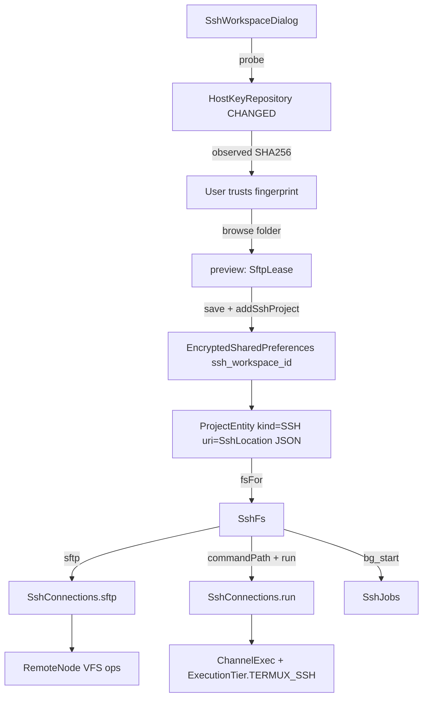

# SSH Remote Development

> Turns a saved SSH profile into a first-class workspace whose files are read over SFTP and whose shell commands run on the remote host.

`SshConnections` owns the JSch client, the credential store and the live session map. `SshFs` adapts that remote session to the `WorkspaceFs` interface so the file tools, agent context and diff viewer work without knowing the tree is remote. `SshJobs` implements background jobs on the remote host, and `SshWorkspaceDialog` plus `SshWorkspaceBar` provide the profile editor and the always-visible connection strip. The subsystem exists so an Android phone can drive a Linux desktop, a server, or a local Termux install with the same tools that operate on local folders, while keeping remote credentials out of project metadata and backups.

## Module Responsibilities

- **`SshConnection`**: Serializable profile with `id`, `host`, `port`, `username`, `password`, `privateKey`, `passphrase`, `fingerprint` and `termux` (`SshConnections.kt:18-38`). `toString` redacts credentials and `validate` checks host characters, port range, username, password-or-key presence and the `SHA256:` fingerprint prefix.
- **`SshLocation`**: The project-facing pointer, a `connectionId` plus remote `root` (`SshConnections.kt:40-41`). It is serialized into the project row's `uri` column, so project metadata never contains secrets.
- **`SshStatus`**: `connected`, `message` and `uncertain` state published per connection (`SshConnections.kt:42`).
- **`SshConnections`**: Session and credential manager. Holds `sessions: ConcurrentHashMap<String, Session>`, `paused: ConcurrentHashMap.newKeySet<String>()` and `statuses: MutableStateFlow<Map<String, SshStatus>>` (`SshConnections.kt:46-50`).
- **`SshFs`**: `WorkspaceFs` implementation over SFTP with a deliberately null `shellRoot` (`SshFs.kt:12-16`).
- **`SshJobs`**: Remote background job facade writing under `.harness/ssh-jobs/<id>` (`SshJobs.kt:6-40`).
- **`SshWorkspaceDialog` and `SshWorkspaceBar`**: Profile editor, folder browser and status strip (`SshWorkspaceDialog.kt:20`; `SshWorkspaceBar.kt:19`).
- **`TermuxSsh.kt` helpers**: `TermuxSshConfig`, `termuxSharedPath`, `termuxCommand`, `sshFingerprint`, `FingerprintRepository` and `LimitedSshOutput` (`TermuxSsh.kt:13-79`).

## Architecture and Flow

The flow separates three concerns. Trust is established once through `probe`, the profile is persisted separately from the project row, and every later file or command operation resolves the project back into an `SshFs` whose calls land on a cached `Session`.

## Invocation Chain

1. `AddWorkspaceDialog` or the workspace menu calls `SshWorkspaceDialog` (`AddWorkspaceDialog.kt:49`).
2. The Connect button calls `container.sshConnections.probe(config)` on `Dispatchers.IO` (`SshWorkspaceDialog.kt:131`). `probe` validates without requiring a pin, then `connect` with an anonymous `HostKeyRepository` that returns `HostKeyRepository.CHANGED` while recording `sshFingerprint(key)` (`SshConnections.kt:94-111`).
3. Once the fingerprint matches the stored one, or the user presses Trust & continue, `browse` runs `sshConnections.preview(config)` which opens a temporary `SftpLease`, resolves `realpath`, checks `stat(absolute).isDir` and lists subfolders (`SshWorkspaceDialog.kt:36-55`; `SshConnections.kt:113-124`).
4. Confirm calls `container.workspace.addSshProject(config, folder, activateWorkspace)` for a new profile or `sshConnections.save(config)` for an existing one, then `sshConnections.reconnect(config.id)` (`SshWorkspaceDialog.kt:115-119`).
5. `WorkspaceManager.addSshProject` encodes an `SshLocation`, calls `sshConnections.save`, reuses an identical `kind == KIND_SSH` project, otherwise inserts a `ProjectEntity` labelled `<folder> · SSH` or `<folder> · Termux SSH` (`WorkspaceManager.kt:292-308`).
6. `SshConnections.save` validates, disconnects the old session, writes the JSON profile through `KeyStoreManager.putLocalSecret("ssh_workspace_<id>", ...)` and clears the paused flag (`SshConnections.kt:54-59`).
7. On first use `WorkspaceManager.fsFor` decodes the `uri` into `SshLocation` and constructs `SshFs(sshConnections, location)` (`WorkspaceManager.kt:167-169`).
8. Agent shell calls reach `ShellTierRouter.runWorkspace`, which detects `SshFs` and calls `workspace.run(command, timeoutMs, maxOutput)` (`ShellTierRouter.kt:136-140`). `SshFs.run` forwards to `SshConnections.run(location.connectionId, command, cwd, ...)` (`SshFs.kt:32-33`).
9. File tools call `SshFs.resolve` and then `RemoteNode` methods, all of which open a fresh SFTP channel through `SshConnections.sftp(id)` (`SshFs.kt:22-31`, `52-136`).

## Authentication and Host Key Verification

`connect` builds a `JSch`, installs the supplied `HostKeyRepository`, and adds the private key identity when `privateKey` is non-blank, using `passphrase` if present (`SshConnections.kt:71-77`). It then sets `StrictHostKeyChecking=yes` and picks `PreferredAuthentications` as `publickey` when a key exists, otherwise `password` with `session.setPassword` (`SshConnections.kt:80-85`). Keepalive is 15 s with 2 missed replies, and both the connect timeout and read timeout are 15 s (`SshConnections.kt:86-89`). Any failure disconnects the session before rethrowing.

`FingerprintRepository.check` compares the SHA-256 of the server key against the pinned string using `MessageDigest.isEqual` and returns `OK` or `CHANGED`, so an unverified or rotated key stops authentication rather than silently trusting a new host (`TermuxSsh.kt:55-58`). `probe` is the only path that accepts an unknown key, and it never authenticates with credentials because the repository returns `CHANGED` before the auth exchange (`SshConnections.kt:93-112`).

Ed25519 support comes from the bundled JSch 2.28.7 and Bouncy Castle provider dependency (`app/build.gradle.kts:232-235`). ProGuard keeps both packages (`app/proguard-rules.pro:20-21`). No `Security.addProvider` call exists in app code; the dependency is present for Android versions whose platform provider cannot handle Ed25519.

## SshFs VFS Behavior

`commandPath` normalizes relative paths against `root` and requires the result to equal `root`, sit under `root/`, or have `root == "/"` (`SshFs.kt:17-21`). Lexical checks alone are not enough, so `checked` resolves the deepest existing ancestor with `realpath` and rejects a symlink that escapes the workspace (`SshFs.kt:38-44`). `mkdir` calls `checked`, confirms an existing path is a directory, then creates parents recursively (`SshFs.kt:45-51`).

`RemoteNode` is an inner class carrying a mutable `SftpATTRS` snapshot. Each connection-scoped operation calls `connections.sftp(id) { ... }`, so a node holds no channel between calls and a stale snapshot is invalidated after writes (`SshFs.kt:52-58`, `99`). Directory listings filter `.` and `..` and build child nodes with the parent's attributes (`SshFs.kt:63-68`).

Reads are capped at 32 MiB by `MAX_TRANSFER`; a larger file raises an instruction to use the SSH terminal instead (`SshFs.kt:69-84`, `137`). Writes are transactional: the bytes go to `<path>.harness-upload-<uuid>`, the previous permission bits are copied with `chmod(permissions and 511)`, then `rename` replaces the target, and a failed upload removes the temp file (`SshFs.kt:87-102`). Overwriting a symlink or directory is refused. `delete` recurses through directories and removes them with `rmdir`, refusing the workspace root (`SshFs.kt:104-116`). `renameTo` stays in the same parent, rejects separators and dot names, and refuses an existing destination (`SshFs.kt:117-124`).

`walk` yields the root and descends only into directories that pass `WorkspaceIgnore.shouldSkip`, so remote traversal honors the same ignore rules as local trees (`SshFs.kt:23-31`).

## Remote Command Routing

`SshConnections.process` exists for callers that need a `java.io.Process`. It opens an `exec` channel, wraps the command as `cd -- <quoted cwd> && exec sh -c <quoted command>`, drains stderr into a 16 KB `LimitedSshOutput`, and returns a `Process` whose `waitFor` polls the channel in 25 ms steps (`SshConnections.kt:157-178`).

`run` is the coroutine path used by tools. It opens an `exec` channel with separate `LimitedSshOutput` buffers for stdout and stderr, connects with a 10 s timeout, and polls `channel.isClosed` every 25 ms against a monotonic deadline (`SshConnections.kt:180-201`). A timeout marks the connection `uncertain` and returns exit code -1 with the note that the remote outcome must not be repeated automatically. A channel that closes without an exit status does the same (`SshConnections.kt:202`). Cancellation marks the connection uncertain when the command was already submitted and rethrows. Results carry `ExecutionTier.TERMUX_SSH`, and `ShellTierRouter` refuses to route a `TERMUX_SSH` path through local tiers with `error("SSH requires a captured workspace")` (`ShellTierRouter.kt:128`).

Git, package managers and build tools branch on `SshFs` rather than shelling out locally. `AgentEngine` tells the model that commands, Git, packages and builds run on that host and that local root, Shizuku and Linux paths do not apply (`AgentEngine.kt:2368`).

## Background Jobs

`SshJobs.start` generates a positive numeric id, writes `.harness/ssh-jobs/<id>/run.sh`, records `$$` in `pid`, runs the command under `nohup setsid` with output redirected to `output.log`, and writes the exit code to `exit` (`SshJobs.kt:7-17`). It first requires both `setsid` and `nohup` on the host and fails with an install instruction otherwise. `list` iterates the job directories, prints `exited <code>`, `running` or `unknown or stopped`, and appends the last 2000 bytes of the log (`SshJobs.kt:19-27`). `stop` rejects a non-positive id, refuses an already-exited job, validates that the pid is numeric, checks `ps -p <pid> -o args=` still contains `run.sh` to prevent PID reuse, then sends `TERM` to the process group (`SshJobs.kt:28-39`). `BgShell` routes `shell_background`, `bg_list` and `bg_kill` into these calls whenever the workspace is `SshFs` (`BgShell.kt:41`, `99`, `148`).

## Reconnect and Status Bar

`disconnect` adds the id to `paused`, removes and disconnects the session, and publishes `Disconnected. Reconnect to continue.` (`SshConnections.kt:61-65`). `session` is `@Synchronized` and throws `SSH disconnected. Tap Reconnect before continuing.` while paused, returns a live cached session, otherwise loads the profile and calls `connect` with the pinned fingerprint (`SshConnections.kt:125-138`). `reconnect` removes the paused flag before calling `session`, and `acknowledge` clears `uncertain` without changing the connection (`SshConnections.kt:66-70`).

`sftp` marks the connection uncertain when the session is gone or the exception is a `JSchException`, an `IOException`, or a connection-lost SFTP error (`SshConnections.kt:142-156`). The message says to check remote files before retrying changes.

`SshWorkspaceBar` renders on chat, files, terminal and build screens (`AppNav.kt:629`; `ProjectsScreen.kt:216-221`). It shows Connected or Disconnected, a Reconnect button, a menu with Connection settings, Disconnect and Forget credentials, and an uncertain banner with **Check command status** and **I checked the outcome**. The status check runs `git status --short --branch; git log -1 --oneline; ps -u "$(id -u)"` capped at 8000 characters (`SshWorkspaceBar.kt:58-70`). The dialog is reused with `existing` set for editing and is blocked while agent runs or a busy terminal exist (`SshWorkspaceDialog.kt:114`).

Settings diagnostics summarize the same flow: not checked when no statuses exist, issue when any is uncertain, ready when any is connected (`TroubleshootingSection.kt:122-124`, `203`).

## Boundary Conditions

- A profile must pass `validate` with a `SHA256:` fingerprint before `openTransfer`, `sftp` or `session` will run (`SshConnections.kt:36`, `117`, `133`).
- Connection and channel timeouts are fixed at 15 s for sessions and 10 s for SFTP and exec channels; there is no user setting.
- Output buffers are capped by `LimitedSshOutput`, which appends `[output truncated]` when full (`TermuxSsh.kt:67-79`).
- Read errors on SFTP files above 32 MiB fail rather than stream, by design.
- Deleting the last project that references a connection calls `sshConnections.forget(id)` and removes the encrypted secret (`WorkspaceManager.kt:269-276`), after `deleteProjectAndChats` has removed app metadata.
- If the keystore is reset, `KeyStoreManager` recreates empty encrypted preferences, which means every saved SSH profile becomes unreadable and `load` raises `SSH credentials are missing` (`KeyStoreManager.kt:23-32`; `SshConnections.kt:51-53`).

## Extension Points

- **Profiles**: stored under `local_secret:ssh_workspace_<id>` through `KeyStoreManager.localSecret`, `putLocalSecret` and `removeLocalSecret` (`KeyStoreManager.kt:51-56`).
- **Workspace kind**: `WorkspaceManager.KIND_SSH` (`WorkspaceManager.kt:396`), with deduplication key `SSH:<uri>` (`WorkspaceManager.kt:429`).
- **Shell routing**: `ShellTierRouter.runWorkspace` is the single hook that sends commands to a remote host; other tools can call `SshFs.run` directly.
- **Fingerprint pinning**: `FingerprintRepository` is a generic `HostKeyRepository` that can be reused for any host with a stored SHA-256 pin.
- **Ignore rules**: `SshFs.walk` delegates to `WorkspaceIgnore`, so workspace ignore settings also apply to remote listing.

## Known gaps

- `TermuxSshConfig`, `termuxSharedPath` and `termuxCommand` are declared in `data/env/TermuxSsh.kt` but have no call sites in `app/src/main/java`; the Termux option in the dialog is implemented by connecting to `127.0.0.1:8022` with the normal SSH path (`SshWorkspaceDialog.kt:64`).
- Ed25519 is claimed by the build dependency and ProGuard comment, but no explicit provider registration or Ed25519 test exists in app code.

Sources: [workspace/SshConnections.kt](../app/src/main/java/com/androidharness/app/workspace/SshConnections.kt)#L18-L217), [workspace/SshFs.kt](../app/src/main/java/com/androidharness/app/workspace/SshFs.kt)#L11-L138), [workspace/SshJobs.kt](../app/src/main/java/com/androidharness/app/workspace/SshJobs.kt)#L6-L40), [data/env/TermuxSsh.kt](../app/src/main/java/com/androidharness/app/data/env/TermuxSsh.kt)#L13-L79), [ui/common/SshWorkspaceDialog.kt](../app/src/main/java/com/androidharness/app/ui/common/SshWorkspaceDialog.kt)#L20-L144), [ui/common/SshWorkspaceBar.kt](../app/src/main/java/com/androidharness/app/ui/common/SshWorkspaceBar.kt)#L19-L79)

## Source files

- `app/src/main/java/com/androidharness/app/workspace/SshConnections.kt`
- `app/src/main/java/com/androidharness/app/workspace/SshFs.kt`
- `app/src/main/java/com/androidharness/app/workspace/SshJobs.kt`
- `app/src/main/java/com/androidharness/app/data/env/TermuxSsh.kt`
- `app/src/main/java/com/androidharness/app/ui/common/SshWorkspaceDialog.kt`
- `app/src/main/java/com/androidharness/app/ui/common/SshWorkspaceBar.kt`
- `app/src/main/java/com/androidharness/app/workspace/WorkspaceManager.kt`
- `app/src/main/java/com/androidharness/app/data/KeyStoreManager.kt`
- `app/src/main/java/com/androidharness/app/data/env/ShellTierRouter.kt`
- `app/src/main/java/com/androidharness/app/tools/BgShell.kt`
- `app/src/main/java/com/androidharness/app/ui/settings/TroubleshootingSection.kt`
- `app/src/main/java/com/androidharness/app/ui/AppNav.kt`
- `app/src/main/java/com/androidharness/app/ui/projects/ProjectsScreen.kt`
- `app/build.gradle.kts`
- `app/proguard-rules.pro`
