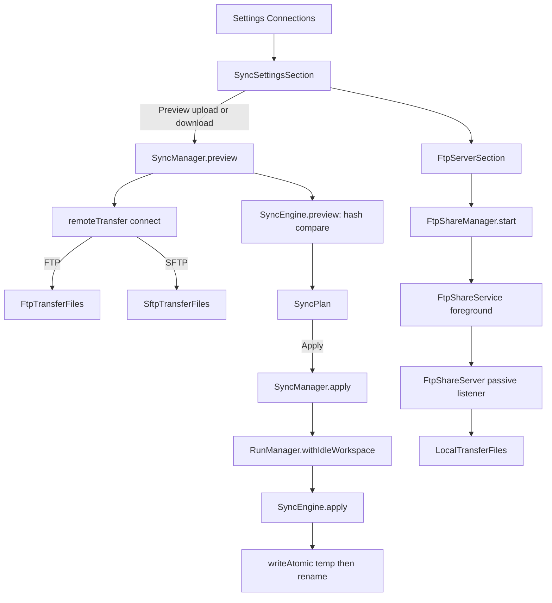

# FTP and SFTP Transfers

> Moves files between a local workspace and a remote FTP or SFTP folder with an explicit preview, and optionally serves a local workspace as a read-only or writable FTP share.

`SyncManager` runs preview and apply jobs over `SyncEngine`, which compares SHA-256 hashes and stages every upload or download into a temporary file before publishing it. `SyncProfiles` stores connection profiles in encrypted preferences, and `remoteTransfer` selects `FtpTransferFiles` or `SftpTransferFiles`. In the other direction, `FtpShareManager` starts `FtpShareService`, which brings up `FtpShareServer`, a passive-only FTP server over `LocalTransferFiles`. Together they cover both "pull files from a server" and "let a desktop push files to this phone", with the same safety rules about limits, symlinks and atomic replacement.

## Module Responsibilities

- **`SyncProfile`**: Serializable connection record with `id`, `name`, `protocol` (`FTP` or `SFTP`), `host`, `port`, `username`, `password`, `remoteFolder`, `fingerprint`, `privateKey` and `passphrase` (`SyncConnections.kt:18-24`). `validate` enforces a safe id, a host without URL syntax, port range, username, a password without CR/LF/NUL, an absolute `remoteFolder`, and, for SFTP, delegates to `SshConnection.validate` through `ssh()` (`SyncConnections.kt:25-35`).
- **`SyncProfiles`**: Loads and saves the list under the encrypted slot `sync_profiles`, capped at 30 entries (`SyncConnections.kt:38-48`).
- **`RemoteTransferFiles`**: `TransferFiles` plus `connect()`; `remoteTransfer` picks the FTP or SFTP implementation (`SyncConnections.kt:50-52`).
- **`FtpTransferFiles`**: Apache Commons Net `FTPClient` with EPSV enabled for IPv4 and passive mode forced (`SyncConnections.kt:54-125`).
- **`SftpTransferFiles`**: Reuses `SshConnections.openTransfer` with the pinned host fingerprint and a `TransferSockets` socket factory (`SyncConnections.kt:127-187`).
- **`SyncManager`**: Owns `SyncState`, the running `Job`, the cancel handle and the `pending` plan (`SyncManager.kt:12-75`).
- **`SyncEngine` and `TransferPaths`**: Planning, hashing, skip rules, path validation and the `SyncPlan` data model (`TransferFiles.kt:16-184`).
- **`FtpShareManager`**: Validates share requests, starts the service and publishes `FtpShareState` (`FtpShareManager.kt:14-59`).
- **`FtpShareServer`**: The FTP protocol implementation (`FtpShareServer.kt:16-214`).
- **`FtpShareService`**: Foreground service and notification (`FtpShareService.kt:10-31`).
- **`TransferSockets`**: Tracks live sockets so cancel interrupts blocked reads and writes (`TransferSockets.kt:9-29`).

## Architecture and Flow

The sync half always runs preview, then apply, and the plan is held in `pending` between them. The FTP server half is a separate life cycle: the user starts it from settings, a foreground service keeps it alive, and the manager opens the socket only when the service starts.

## Invocation Chain

1. `SyncSettingsSection` loads profiles with `manager.profiles.all()` on `Dispatchers.IO` and resolves the local `fs` from the selected project (`TransferSettings.kt:39-59`).
2. **Preview upload** calls `manager.preview(fs, profile, SyncDirection.UPLOAD)`, and **Preview download** uses `DOWNLOAD` (`TransferSettings.kt:83-84`).
3. `SyncManager.preview` refuses to start while the previous job is active, validates the profile, requires `fs.shellRoot`, clears `pending`, sets `SyncState(true, "Scanning")` and launches on a `SupervisorJob() + Dispatchers.IO` scope (`SyncManager.kt:25-31`).
4. Inside `runInterruptible`, it calls `remote.connect()`, then `SyncEngine.preview(LocalTransferFiles(folder), remote, direction, progress)` (`SyncManager.kt:32-37`). The progress callback rewrites `SyncState` with the current path.
5. On success it stores `Pending(fs, profile, plan)` and publishes `SyncState(plan = plan)`. The final block closes the remote connection and clears `active` (`SyncManager.kt:38-44`).
6. The UI renders the direction, counts of new files, replacements and unchanged files, the first 30 paths, and a replace toggle only when replacements exist (`TransferSettings.kt:92-101`).
7. **Apply** calls `manager.apply(replace)` (`TransferSettings.kt:99`). `SyncManager.apply` requires `pending`, clears it, sets phase `Transferring`, and wraps the whole operation in `guard(selected.fs) { ... }` (`SyncManager.kt:46-54`).
8. The guard is `RunManager.withIdleWorkspace`, which takes `workspaceGuard` and fails with "Stop running tasks in this workspace before syncing files." when a run is active there (`HarnessApp.kt:197-199`; `RunManager.kt:126-133`).
9. `SyncEngine.apply` creates directories, skips replacements unless `replace` is true, re-hashes the destination before each write, streams the source through a `DigestInputStream`, and calls `target.writeAtomic` with a `beforeCommit` callback that verifies both the source digest and the destination hash (`TransferFiles.kt:162-183`).
10. The result message reports `Copied N files; skipped M replacements. No files were deleted.` (`SyncManager.kt:62`).

## Preview and Conflict Policy

`SyncEngine.preview` performs a breadth-first walk using an `ArrayDeque<String>` starting at `""`. The source is local for uploads and remote for downloads. For each entry it applies `TransferPaths.skip`, counts entries, rejects paths deeper than 32 separators, records directories, and checks that the target path is not a file where a directory is expected (`TransferFiles.kt:138-152`).

Files are hashed on both sides. If the hashes match, the entry increments `unchanged`. Otherwise a `SyncChange` stores the path, size, source hash and the previous target hash, where a null target hash means a new file (`TransferFiles.kt:153-157`). `SyncPlan.replacements` counts changes with a non-null target hash and `bytes` sums the sizes (`TransferFiles.kt:131-133`).

Apply never deletes. A target that exists is either skipped (when the replace toggle is off) or replaced. Hash equality is not trusted from preview time: the destination is re-hashed before the write and again inside `beforeCommit`, and the source digest is compared with the planned hash after streaming. Any mismatch throws `Destination changed: ... Preview again.` or `Source changed: ... Preview again.` and `SyncManager` surfaces that exact message (`SyncManager.kt:66`).

## Limits and Skip Rules

| Limit | Value | Enforced in |
| :--- | :--- | :--- |
| Maximum file size | 512 MiB (`MAX_TRANSFER_FILE`) | `copyTransfer`, `LimitedTransferInput`, `hash` |
| Maximum total per sync | 1 GiB (`MAX_TRANSFER_TOTAL`) | `SyncEngine.preview` |
| Maximum entries | 10,000 (`MAX_TRANSFER_ENTRIES`) | local list, remote list, preview |
| Maximum path depth | 32 separators | `SyncEngine.preview` |
| Maximum path length | 4096 characters, 255 per segment | `TransferPaths.relative` |
| Saved sync profiles | 30 | `SyncProfiles.save` |

`TransferPaths.relative` rejects absolute paths, backslashes, control characters, empty segments, `.` and `..` (`TransferFiles.kt:17-21`). `TransferPaths.ftp` resolves a server-supplied path against the session `cwd` and refuses to climb above the root (`TransferFiles.kt:22-31`). `TransferPaths.skip` excludes any path segment named `.git`, `.gradle`, `node_modules`, `build` or `.idea`, plus names starting with `.harness-transfer-` or `.harness-sync-` (`TransferFiles.kt:32`). Symbolic links and special files are filtered by both `LocalTransferFiles.list` and the remote listings, so sync never follows a link out of the selected tree.

## FTP and SFTP Transport Details

`FtpTransferFiles.connect` installs `TransferSockets` as the socket factory, sets UTF-8 control encoding, 15 s connect and default timeouts, a 15 s data timeout, disables trusting the address in a PASV response and enables EPSV for IPv4. It checks the greeting and login, sets `soTimeout` to 15 s, enters passive mode, requires binary file type, and `changeWorkingDirectory(remoteFolder)` with the message "Create it on the server first" (`SyncConnections.kt:59-73`). `stat` prefers `mlistFile` and falls back to listing the parent when the server replies 550 (`SyncConnections.kt:75-90`). Uploads use `storeFile` to `.harness-sync-<uuid>` then `rename`, and report "Existing file was kept" when the server refuses to publish (`SyncConnections.kt:114-123`). Reads require `completePendingCommand` on close (`SyncConnections.kt:101-104`).

`SftpTransferFiles.connect` calls `ssh.openTransfer(profile.ssh())` with an `onConnecting` callback that installs the `TransferSockets` factory and aborts if cancel arrived during the handshake. It then stores the `SftpLease`, resolves `realpath(remoteFolder)` and requires it to be a directory (`SyncConnections.kt:134-152`). Writes preserve the existing permission bits with `chmod` before `rename` (`SyncConnections.kt:175-185`). Close disconnects the underlying session and closes every tracked socket (`SyncConnections.kt:186`).

`TransferSockets` records every socket in a concurrent set, refuses new sockets after close, and closes all of them on `close()`. Because `copyTransfer` checks `Thread.currentThread().isInterrupted` on every 64 KiB block, `SyncManager.cancel` interrupts the job, which both trips the loop and closes the network sockets (`TransferSockets.kt:12-28`; `TransferFiles.kt:94-103`).

## FTP Share Server

**Start.** `FtpServerSection` defaults to port 2121, username `androidharness`, a random 12-byte hex password, LAN off and read-only on (`TransferSettings.kt:191-196`). Start is enabled only when the workspace has a `shellRoot`, the password has at least 8 characters, the username is non-blank and the port is in 1024..65535 (`TransferSettings.kt:227`).

**Manager.** `FtpShareManager.start` checks `runtimePolicy.state.value.canRun`, refuses to stack servers, requires a local `shellRoot`, validates the port and credentials, stores a `Request`, sets `starting`, and calls `ContextCompat.startForegroundService` (`FtpShareManager.kt:24-33`).

**Service.** `FtpShareService` creates the channel `ftp-sharing`, handles the `STOP` action by calling `manager.stop()` and `stopSelf`, and otherwise calls `startForeground` with notification id 1407, an Open activity intent and a Stop action (`FtpShareService.kt:13-26`). It calls `manager.open()` and stops immediately if the runtime policy blocks running or open fails. It returns `START_NOT_STICKY`, stops on `onTimeout`, and calls `manager.stop(manager.state.value.error)` in `onDestroy` (`FtpShareService.kt:25-29`). The manifest declares it `exported="false"` with `foregroundServiceType="dataSync"` (`AndroidManifest.xml:80`).

**Server.** `FtpShareServer.start` binds `0.0.0.0` when LAN sharing is enabled, otherwise `127.0.0.1`, with backlog 4 (`FtpShareServer.kt:35-40`). The accept loop drops non-loopback, non-site-local peers when LAN is on, drops connections when the 4-slot semaphore is exhausted, and serves each socket on a 4-thread daemon pool (`FtpShareServer.kt:42-54`). Each `Session` has a 60 s control timeout and an 8 KiB command length limit (`FtpShareServer.kt:71-83`).

**Protocol.** Only passive data connections are offered: `PORT` and `EPRT` reply `502 Use passive mode` (`FtpShareServer.kt:114`). `PASV` requires an IPv4 local address and `EPSV` works for IPv6 (`FtpShareServer.kt:163-174`). The data accept requires the same peer address as the control connection and has a 15 s timeout (`FtpShareServer.kt:175-191`). Authentication compares `USER` and `PASS` with `MessageDigest.isEqual` and closes the session after 3 failed passwords (`FtpShareServer.kt:94-98`). Supported commands are `FEAT`, `SYST`, `OPTS`, `NOOP`, `PWD`, `TYPE`, `CWD`, `CDUP`, `EPSV`, `PASV`, `LIST`, `NLST`, `MLSD`, `MLST`, `SIZE`, `MDTM`, `RETR`, `STOR`, `MKD`, `DELE`, `RMD`, `RNFR` and `RNTO`; anything else gets `502 Command not supported` (`FtpShareServer.kt:99-153`).

**Writes.** Every mutating command goes through `writable`, which fails when `readOnly` is set and otherwise runs the configured `writeGuard`. `FtpShareManager` supplies a guard that calls `RunManager.withIdleWorkspace` with "Stop running tasks in this workspace before changing shared files." (`FtpShareManager.kt:40-42`; `HarnessApp.kt:200-202`). Uploads go through `files.writeAtomic` to a temp file and an atomic move (`FtpShareServer.kt:127-131`). `DELE` and `RMD` call `LocalTransferFiles.file`, which rejects symlinks and paths outside the root, so deletes cannot escape the share (`FtpShareServer.kt:133-140`; `TransferFiles.kt:49-58`).

## Key State and Persistence

- **`SyncState`**: `working`, `phase`, `path`, `plan` and `message`; an in-memory `StateFlow`, lost on process death (`SyncManager.kt:12`).
- **`pending`**: The plan awaiting apply; cleared on cancel and on apply (`SyncManager.kt:24`, `48`, `72`).
- **`SyncProfile` list**: Stored as JSON in `KeyStoreManager` slot `sync_profiles`, so it survives restart and is excluded from project metadata (`SyncConnections.kt:40-47`).
- **`FtpShareState`**: `starting`, `running`, `project`, `username`, `addresses`, `readOnly`, `clients` and `error` (`FtpShareManager.kt:14-15`).
- **`activePassword`**: Kept in memory for display in the running panel; cleared by `stop` and never persisted (`FtpShareManager.kt:20-21`, `56`).
- **`RemoteTransferFiles` active**: An `AtomicReference` closed by cancel so a stuck connect is torn down (`SyncManager.kt:22`, `43`, `72`).

## Boundary Conditions

- Preview and apply are mutually exclusive through `job?.isCompleted == false` and `@Synchronized`; the UI also disables controls while `state.working` or a plan exists (`TransferSettings.kt:52`).
- Cancel reports "Sync cancelled. Completed files may already have been saved." in every path, because writes are atomic per file but not transactional across the run (`SyncManager.kt:41`, `64`, `73`).
- A preview is invalidated by any source or destination change, forcing a fresh preview rather than a blind retry.
- An FTP connection without a reachable `remoteFolder` fails at connect rather than creating it; `mkdir` only runs for paths inside a sync plan.
- The FTP server never offers anonymous login, active mode, shell commands or symlinks.
- The server stops when the app runtime policy forbids background execution, when the foreground service times out, and when the service is destroyed (`FtpShareService.kt:25-29`).
- `TransferPaths.relative` and `LocalTransferFiles.file` are the single choke points for path traversal in both sync and share directions.

## Extension Points

- **Protocol selection**: `SyncProtocol` has `FTP` and `SFTP`; adding a protocol requires a new `RemoteTransferFiles` implementation in `remoteTransfer` (`SyncConnections.kt:18`, `51-52`).
- **Guard hook**: Both `SyncManager` and `FtpShareManager` take a `guard` lambda from `AppContainer`, so any new mutual-exclusion policy can be injected without touching the transfer code (`SyncManager.kt:13-16`; `FtpShareManager.kt:16`).
- **Skip rules**: `TransferPaths.skip` is the only skip list, shared by preview and both listings.
- **Settings placement**: `SettingsPage.SYNC` and `SettingsPage.FTP_SERVER` live in the Connections group and are searchable through `SettingsSearchCatalog` (`SettingsNavigation.kt:220-227`; `SettingsSearchCatalog.kt:531-544`).

## Known gaps

- `SyncManager.preview` requires `fs.shellRoot`, so SAF-only workspaces cannot sync even though the UI shows a "local workspace required" warning; this is stated in `FEATURES.md:97` only indirectly.
- The FTP server reports a client count through `clientsChanged`, but the count is incremented per accepted socket, not per authenticated session (`FtpShareServer.kt:49-51`).

Sources: [data/transfer/SyncConnections.kt](../app/src/main/java/com/androidharness/app/data/transfer/SyncConnections.kt)#L18-L187), [data/transfer/SyncManager.kt](../app/src/main/java/com/androidharness/app/data/transfer/SyncManager.kt)#L12-L75), [data/transfer/TransferFiles.kt](../app/src/main/java/com/androidharness/app/data/transfer/TransferFiles.kt)#L11-L184), [data/transfer/FtpShareManager.kt](../app/src/main/java/com/androidharness/app/data/transfer/FtpShareManager.kt)#L14-L59), [data/transfer/FtpShareServer.kt](../app/src/main/java/com/androidharness/app/data/transfer/FtpShareServer.kt)#L16-L214), [data/transfer/FtpShareService.kt](../app/src/main/java/com/androidharness/app/data/transfer/FtpShareService.kt)#L10-L31), [ui/transfer/TransferSettings.kt](../app/src/main/java/com/androidharness/app/ui/transfer/TransferSettings.kt)#L39-L239)

## Source files

- `app/src/main/java/com/androidharness/app/data/transfer/SyncConnections.kt`
- `app/src/main/java/com/androidharness/app/data/transfer/SyncManager.kt`
- `app/src/main/java/com/androidharness/app/data/transfer/TransferFiles.kt`
- `app/src/main/java/com/androidharness/app/data/transfer/TransferSockets.kt`
- `app/src/main/java/com/androidharness/app/data/transfer/TransferSockets.kt`
- `app/src/main/java/com/androidharness/app/data/transfer/FtpShareManager.kt`
- `app/src/main/java/com/androidharness/app/data/transfer/FtpShareServer.kt`
- `app/src/main/java/com/androidharness/app/data/transfer/FtpShareService.kt`
- `app/src/main/java/com/androidharness/app/ui/transfer/TransferSettings.kt`
- `app/src/main/java/com/androidharness/app/agent/RunManager.kt`
- `app/src/main/java/com/androidharness/app/HarnessApp.kt`
- `app/src/main/AndroidManifest.xml`
