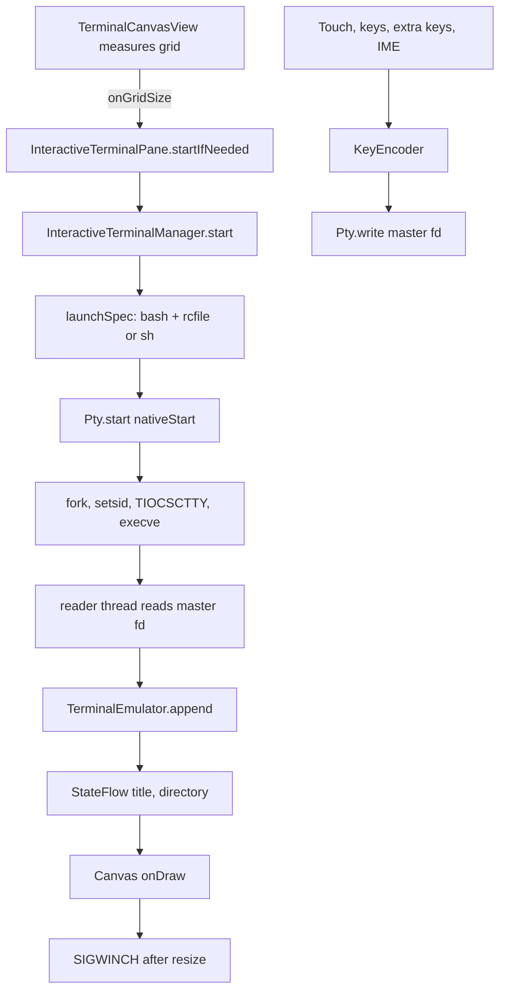

# Interactive Terminal

> Runs a real shell on a pseudo-terminal for local workspaces, with an xterm-compatible screen model, and keeps a line-based command shell for SSH and privileged modes.

Two backends share the screen. `InteractiveTerminalManager` starts one `TerminalSession` per local workspace, and each session owns a `Pty` child process and a `TerminalEmulator` screen. `TerminalManager` is command mode: it runs one command at a time, prints lines into a list, and works for SSH, Shizuku, wireless ADB and the app-tier shell. `TerminalScreen` chooses between them. A remote host has no local PTY and privileged execution is per-command, while local development needs a real terminal for `nano`, `top`, REPLs and interactive Git modes.

## Module Responsibilities

- **`Pty`**: Owns the master file descriptor and child pid. Exposes `write`, `resize`, `waitFor`, `foregroundGroup`, `signal` and `close`, with native methods loaded from `libharness_pty` (`Pty.kt:11-79`).
- **`TerminalSession`**: A running program plus its screen. Holds the emulator, an exit-code flow, a title flow, a working-directory flow, a reader thread and a wait thread (`TerminalSession.kt:15-106`).
- **`TerminalEmulator`**: The xterm screen model: grid, scrollback, cursor, modes, parser and replies (`TerminalEmulator.kt:61-908`).
- **`TerminalRow` and `CellStyle`**: One screen row as parallel `IntArray` code points and `LongArray` packed styles (`TerminalEmulator.kt:4-48`; `CellStyle.kt:11-38`).
- **`WcWidth`**: Zero, one or two cell widths from Unicode tables (`WcWidth.kt:4-73`).
- **`KeyEncoder`**: Converts `TermKey` and modifier state into xterm byte sequences (`KeyEncoder.kt:19-101`).
- **`InteractiveTerminalManager`**: Owns `StateFlow<Map<String, TerminalSession>>` keyed by workspace `displayPath`, plus the user's `preferInteractive` choice and shared `fontSizeSp` (`InteractiveTerminalManager.kt:16-122`).
- **`TerminalManager`**: Command-mode state machine with `TerminalState`, a marker protocol, output batching and per-tier send paths (`TerminalManager.kt:30-457`).
- **`TerminalScreen`**, **`InteractiveTerminalPane`**, **`TerminalCanvasView`**: Compose screen, extra-keys row and a custom `View` that draws the screen and handles input (`TerminalScreen.kt:77-391`; `InteractiveTerminalPane.kt:155-274`; `TerminalCanvasView.kt:75-583`).

## Architecture and Flow

The grid size is the trigger. The view measures cells, reports rows and columns, and only then does the manager start the shell, so the first prompt has the right width. Output flows through a reader thread into the emulator under its lock, and the view redraws on a listener callback. Input from touch, hardware keys, the soft keyboard or the extra-keys row goes through `KeyEncoder` into the master fd.

## Invocation Chain

1. `TerminalScreen` computes `ptyKey = workspace.displayPath` and chooses interactive or command mode (`TerminalScreen.kt:113-121`).
2. `TerminalCanvasView.reportGrid` measures the grid and calls `onGridSize` (`TerminalCanvasView.kt:177-189`).
3. `InteractiveTerminalPane.startIfNeeded` calls `manager.start(key, cwd, rows, cols)` on `Dispatchers.IO` (`InteractiveTerminalPane.kt:176-185`).
4. `InteractiveTerminalManager.start` builds `launchSpec`, calls `Pty.start`, acquires the keepalive and constructs `TerminalSession` (`InteractiveTerminalManager.kt:49-60`).
5. `Pty.start` calls `nativeStart`, which forks, calls `setsid` and execs the shell (`Pty.kt:70-77`; `pty.cpp:78-145`).
6. The reader thread feeds `TerminalEmulator.append`; the wait thread stores the exit code and calls `onExit`.
7. `TerminalCanvasView.sendKey` or `sendChar` encodes input and calls `Pty.write` (`TerminalCanvasView.kt:496-513`).

## PTY Creation

`InteractiveTerminalManager.start` returns an existing running session for the key, checks that storage maintenance is off, builds a `Launch`, chooses the cwd when it is a directory, and calls `Pty.start` with rows and columns (`InteractiveTerminalManager.kt:49-60`). It then calls `runManager.acquireKeepalive()` and registers an `onExit` callback that releases the keepalive.

`launchSpec` copies `linuxEnv.processEnv()`, sets `TERM=xterm-256color`, `COLORTERM=truecolor` and `HARNESS_TERMINAL=interactive`, points `TERMINFO` at the Linux prefix when it exists, and creates `HOME` and `TMPDIR` (`InteractiveTerminalManager.kt:72-80`). With a Linux bash it calls `linuxEnv.ensureShims()`, writes the rc file, sets `SHELL`, and starts `bash --rcfile <rc> -i`, using the Linux linker as the executable when one is needed. Without a Linux environment it falls back to `/system/bin/sh -i`, resets `PATH` to the system directories and removes `LD_PRELOAD` and `LD_LIBRARY_PATH` (`InteractiveTerminalManager.kt:81-97`).

`writeRcFile` writes `etc/harness-terminal.bashrc` under the Linux prefix. It sources the shims, sets history options, `checkwinsize`, a colored `PS1`, and an OSC 7 `PROMPT_COMMAND` that reports the working directory (`InteractiveTerminalManager.kt:99-119`).

`nativeStart` opens `/dev/ptmx`, calls `grantpt`, `unlockpt` and `ptsname_r`, enables `IUTF8`, disables `IXON` and `IXOFF` so Ctrl+S reaches programs, and sets the initial window size. It forks; the child unblocks signals, restores default handlers, calls `setsid`, opens the slave, sets it via `TIOCSCTTY`, duplicates it onto stdin, stdout and stderr, closes inherited descriptors, changes directory and calls `execve` (`pty.cpp:88-139`). A failed exec writes `failed to start shell` and exits 127. The parent stores the pid and returns the master fd (`pty.cpp:141-145`).

`Pty.available` is false when `libharness_pty` cannot be loaded, which disables interactive mode for builds without the NDK (`Pty.kt:66-68`). The library is declared for every ABI in `CMakeLists.txt` (`app/src/main/cpp/CMakeLists.txt:12-15`).

## Session Model

`TerminalSession` creates `TerminalEmulator(rows, cols, maxHistory = 3_000)` and starts two daemon threads (`TerminalSession.kt:25`, `43-66`). The reader thread reads up to 16 KiB, appends under `synchronized(emulator)`, and notifies listeners. The wait thread blocks in `pty.waitFor()`, sends `SIGHUP` so leftover jobs hang up, stores the exit code, notifies listeners, and calls `onExit`. `resize` only calls `pty.resize` when the grid changed. `terminate` sends `SIGHUP`, then `SIGKILL` after 1.5 seconds if still running (`TerminalSession.kt:89-96`). `paste` consults bracketed-paste mode.

Manager methods are `@Synchronized`, and `TerminalScreen` passes `fs.displayPath` as the key, so switching screens for one workspace reuses the shell. `close` terminates; `hasRunning` and `beginStorageMaintenance` block cleanup while a session lives (`InteractiveTerminalManager.kt:33-46`).

## Emulator and ANSI Handling

The emulator keeps two `Screen` objects, `main` and `alt`, plus an `ArrayDeque<TerminalRow>` history (`TerminalEmulator.kt:85-91`). `append(bytes, offset, length)` decodes UTF-8 incrementally, replaces invalid or surrogate code points with U+FFFD, and feeds a state machine with `GROUND`, `ESCAPE`, `ESCAPE_INTERMEDIATE`, `CSI`, `CSI_IGNORE`, `OSC`, `OSC_ESCAPE`, `STRING` and `STRING_ESCAPE` states (`TerminalEmulator.kt:191-266`).

- **Control characters**: BEL calls `onBell`, backspace moves left, tab advances to the next stop, LF/VT/FF call `index`, CR sets column 0, SO and SI switch the GL charset (`TerminalEmulator.kt:268-280`).
- **Printing**: `WcWidth` decides one or two cells, wide tails use `WIDE_TAIL`, and pending wrap and insert mode apply (`TerminalEmulator.kt:288-322`).
- **CSI**: cursor movement, erase in line and display, insert and delete cells, insert and delete lines, scroll up and down, tab forward and backward, repeat, device attributes, cursor position report, scroll region and mode set/reset are all handled in `csiDispatch` (`TerminalEmulator.kt:503-584`).
- **SGR**: `selectGraphicRendition` supports bold, dim, italic, underline, blink, inverse, invisible, strike, 16 colors, 256 colors and true color in both colon and semicolon forms (`TerminalEmulator.kt:720-785`).
- **Modes**: application cursor keys, reverse video, origin mode, auto-wrap, cursor shape and visibility, mouse modes, focus reporting, bracketed paste, and alternate-screen sequences 47, 1047 and 1049 (`TerminalEmulator.kt:655-693`).
- **OSC and replies**: 0 and 2 set the title, 7 sets `workingDirectory`, 10 and 11 answer color queries, and cursor, attribute and size queries reply through `onReply`, wired to `pty.write` (`TerminalEmulator.kt:787-804`, `553-582`; `TerminalSession.kt:38`).

Scroll regions are `top` and `bottom`; `scrollUp` pushes the top row into history only when the region starts at row 0 and the screen keeps history, which excludes the alternate screen (`TerminalEmulator.kt:373-395`). `maxHistory` defaults to 2000 in the class and is set to 3000 by `TerminalSession`; older rows are dropped from the front.

## Input Encoding

`KeyEncoder` produces xterm sequences. Arrows, Home and End use `ESC[A` style, switching to `ESCO` in application cursor mode, and add `ESC[1;<mod>` when modifiers are held. Insert, Delete, Page Up, Page Down and F5 to F12 use tilde codes, while F1 to F4 use SS3 (`KeyEncoder.kt:22-71`). `char` folds Ctrl through `controlCode`, where `a` to `z` become 1 to 26, `[` becomes 27, `\` becomes 28, `]` becomes 29, `^` becomes 30, `_` becomes 31, `?` becomes 127, and space, `@` and `2` become NUL; Alt prefixes ESC (`KeyEncoder.kt:73-93`). `paste` converts newlines to CR, strips a literal bracketed-paste end marker when bracketed mode is on, and wraps the text in `ESC[200~` and `ESC[201~` (`KeyEncoder.kt:95-100`).

`TerminalCanvasView` implements the other half. It sets the input type to visible password with no suggestions so keyboards do not autocorrect or compose, and it overrides `commitText`, `finishComposingText` and `deleteSurroundingText` so soft-keyboard deletions become Backspace or Delete (`TerminalCanvasView.kt:451-494`). Hardware keys map to `TermKey` values, function keys map by offset, Ctrl+Shift+V and Ctrl+Shift+C become paste and copy, and printable characters go through `sendChar` (`TerminalCanvasView.kt:528-577`). Latched Ctrl and Alt are merged in before encoding (`TerminalCanvasView.kt:496-513`).

## Resize and Scrollback

`TerminalCanvasView.reportGrid` computes columns from `(width - 2 * padding) / cellWidth` and rows from height, with minimums of 4 columns and 2 rows, and reports the pixel size as well (`TerminalCanvasView.kt:177-189`). `InteractiveTerminalPane` passes that to `session.resize`, which forwards to `pty.resize` only if the grid changed (`InteractiveTerminalPane.kt:211-215`; `TerminalSession.kt:85-92`). `nativeResize` writes `ws_row`, `ws_col`, `ws_xpixel` and `ws_ypixel` with `TIOCSWINSZ`, which also delivers `SIGWINCH` (`pty.cpp:147-156`).

`TerminalEmulator.resize` never re-wraps existing lines. Rows that no longer fit are removed from the bottom if they are blank below the cursor, then from the top into history; growing pulls rows back from history, then appends blanks (`TerminalEmulator.kt:847-908`). `TerminalRow.resize` truncates or pads each row and clears a wide tail that lands in the last column.

Scrolling has three modes. Mouse reporting turns a scroll into wheel button 64 or 65 reports at the cursor cell. The alternate screen without mouse turns it into Up or Down arrows per step. Otherwise `scrollOffset` moves through history, `onDraw` compensates for new `historyPushes`, and a scrollbar appears on the right (`TerminalCanvasView.kt:193-215`, `327-336`, `394-416`). Any key jumps back to the live screen (`TerminalCanvasView.kt:515-520`). Pinch scaling sets `fontSizeSp` between 7 and 30, and pointer wheel events scroll three lines (`TerminalCanvasView.kt:366-392`, `579-582`).

## Extra Keys

`ExtraKeysBar` renders two rows plus a collapsible function row (`InteractiveTerminalPane.kt:310-361`). The first row has Esc, Ctrl, Alt, Tab, Home, Up, End and Page Up. The second has Fn, Ctrl+C, `/`, `-`, Left, Down, Right and Page Down. The Fn row shows F1 to F12, Insert, Delete and common symbols. `KeyCap` repeats after 420 ms and then every 50 ms while held, for Delete, arrows and paging (`InteractiveTerminalPane.kt:363-429`). Ctrl and Alt use three-state latches: off, once, locked; a one-shot latch clears after the next key (`InteractiveTerminalPane.kt:89-113`, `431-460`). Fn toggles the function row rather than acting as a modifier.

The pane menu holds the clipboard and font actions: Paste calls `session.paste`, Copy output writes `transcript()`, Reset font restores 13sp, and Restart shell closes the session so the pane starts a new one (`TerminalScreen.kt:201-229`; `InteractiveTerminalPane.kt:269-273`).

## App-Level Session Persistence

`HarnessApp` constructs `interactiveTerminal` and `terminal` once for the process (`HarnessApp.kt:357-358`). The session map and PTY live on that object, so navigating away or rotating does not kill the shell, and `TerminalScreen`'s `DisposableEffect` does nothing on dispose (`TerminalScreen.kt:147-152`). Closing is explicit through Restart shell or `InteractiveTerminalManager.close`. Each session holds `RunManager`'s keepalive, wired to `AgentService.acquireKeepalive` and `releaseKeepalive` (`RunManager.kt:194-200`).

State does not survive process death: sessions, scrollback, exit codes and title are memory only. `withClosedStorage` refuses while command mode is busy and asks `InteractiveTerminalManager.beginStorageMaintenance` so an interactive shell blocks cleanup too (`TerminalManager.kt:86-100`).

## Command Mode and the Switch

`TerminalScreen` treats interactive mode as available only when `pty.supported`, a workspace exists and the workspace is not `SshFs` (`TerminalScreen.kt:113-118`). `preferInteractive` is a manager-level `MutableStateFlow` initialized to true, so the last choice is per process, not per workspace, and the toggle button is shown only when interactive mode is available (`TerminalScreen.kt:186-196`).

When interactive is off, the screen uses `TerminalManager`. `send` trims the command, refuses while busy or stopping, rebinds the workspace, calls `ensureStarted`, sets `busy`, echoes the command, and routes to `sendSsh`, `sendDevice`, `sendPrivileged` or `sendAppTier` (`TerminalManager.kt:243-267`). Every tier uses the marker `__HCTERM_DONE__`; app tier writes `echo "__HCTERM_DONE__:$?:$PWD"` after the command, SSH and device tiers use `eval` plus `printf`, and the privileged tier writes it from inside a script (`TerminalManager.kt:310-399`). `handleLine` parses the marker into an exit code and current directory (`TerminalManager.kt:194-214`). Output is queued and flushed every 66 ms into `TerminalState.lines`, capped at 1500 lines (`TerminalManager.kt:62-72`, `216-234`). SSH uses a fresh exec channel per command, so variables do not persist and `cwd` is tracked from the marker (`TerminalManager.kt:310-329`).

## Boundary Conditions

- A failed start shows `TerminalNotice` with a Try again action (`InteractiveTerminalPane.kt:176-185`, `220-228`).
- A non-zero exit shows an Exited overlay with Restart, which starts a new session at the last measured grid (`InteractiveTerminalPane.kt:237-244`).
- `Pty.write` swallows `IOException` because the child may have exited; the reader notices and publishes the exit (`Pty.kt:27-37`). `terminate` escalates from `SIGHUP` to `SIGKILL` after 1.5 seconds (`TerminalSession.kt:89-96`).
- Command-mode `interrupt` cancels the job, kills the process tree by walking `/proc/<pid>/status` `PPid`, and sets exit code -130 (`TerminalManager.kt:407-421`, `430-455`).
- Back, volume and power keys pass through (`TerminalCanvasView.kt:528-533`).

## Extension Points

- **Shell choice**: `launchSpec` is the single place that decides between Linux bash, the Linux linker and Android `sh` (`InteractiveTerminalManager.kt:72-97`).
- **Command tiers**: `TerminalManager.send` branches on `remoteWorkspace`, `deviceAccess`, `privileged` and app tier, so a new transport needs no screen change.
- **Lifecycle hooks**: `preferInteractive`, `fontSizeSp` and `withClosedStorage` are manager-level settings.

## Known gaps

- `app/src/main/java/com/androidharness/app/ui/chat/components/SidePaneTerminalPane.kt` does not exist at HEAD, and no `SidePane` terminal component is referenced from the chat UI. The Terminal is reached through `TerminalScreen` only.
- Interactive mode is intentionally unavailable for SSH, Shizuku, wireless ADB and root workspaces; those keep command mode, so programs that need a PTY cannot run through them (`TerminalScreen.kt:113-116`).

Sources: [terminal/Pty.kt](../app/src/main/java/com/androidharness/app/terminal/Pty.kt)#L11-L79), [terminal/TerminalSession.kt](../app/src/main/java/com/androidharness/app/terminal/TerminalSession.kt)#L15-L106), [terminal/InteractiveTerminalManager.kt](../app/src/main/java/com/androidharness/app/terminal/InteractiveTerminalManager.kt)#L16-L122), [terminal/TerminalEmulator.kt](../app/src/main/java/com/androidharness/app/terminal/TerminalEmulator.kt)#L61-L908), [terminal/KeyEncoder.kt](../app/src/main/java/com/androidharness/app/terminal/KeyEncoder.kt)#L19-L101), [data/TerminalManager.kt](../app/src/main/java/com/androidharness/app/data/TerminalManager.kt)#L30-L457), [ui/terminal/TerminalScreen.kt](../app/src/main/java/com/androidharness/app/ui/terminal/TerminalScreen.kt)#L77-L391), [ui/terminal/InteractiveTerminalPane.kt](../app/src/main/java/com/androidharness/app/ui/terminal/InteractiveTerminalPane.kt)#L89-L460), [ui/terminal/TerminalCanvasView.kt](../app/src/main/java/com/androidharness/app/ui/terminal/TerminalCanvasView.kt)#L75-L583), [app/src/main/cpp/pty.cpp](../app/src/main/cpp/pty.cpp)#L88-L175)

## Source files

- `app/src/main/java/com/androidharness/app/terminal/Pty.kt`
- `app/src/main/java/com/androidharness/app/terminal/TerminalSession.kt`
- `app/src/main/java/com/androidharness/app/terminal/TerminalEmulator.kt`
- `app/src/main/java/com/androidharness/app/terminal/CellStyle.kt`
- `app/src/main/java/com/androidharness/app/terminal/WcWidth.kt`
- `app/src/main/java/com/androidharness/app/terminal/KeyEncoder.kt`
- `app/src/main/java/com/androidharness/app/terminal/InteractiveTerminalManager.kt`
- `app/src/main/java/com/androidharness/app/data/TerminalManager.kt`
- `app/src/main/java/com/androidharness/app/ui/terminal/TerminalScreen.kt`
- `app/src/main/java/com/androidharness/app/ui/terminal/InteractiveTerminalPane.kt`
- `app/src/main/java/com/androidharness/app/ui/terminal/TerminalCanvasView.kt`
- `app/src/main/cpp/pty.cpp`
- `app/src/main/cpp/CMakeLists.txt`
