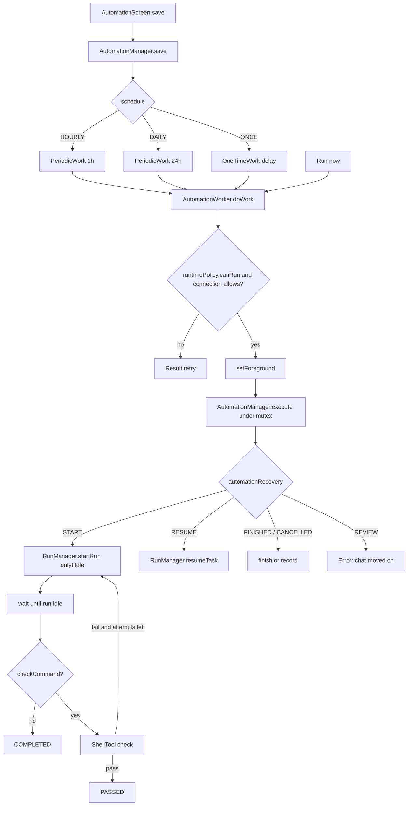

# Scheduled Automations

> Runs an agent prompt, a GitHub push preset, or a saved verification command on a schedule, once, hourly, daily, or manually, with occurrence-safe worker retries.

`AutomationManager` validates and persists `AutomationTask` records, registers WorkManager jobs, and executes one occurrence at a time under a mutex. `AutomationWorker` is the `CoroutineWorker` bridge that promotes itself to a foreground service, observes connectivity, and returns `retry` when the moment is not right. `AutomationRepository` stores tasks and run history in `SharedPreferences`, and `AutomationAiPlanner` turns a plain English request into a draft task. The design target is that a worker retry, an interrupted run, or an app restart never sends the same occurrence twice and never fights a user who has taken over the chat.

## Module Responsibilities

- **`AutomationTask`**: The schedule record: identity, prompt, project, provider and model, optional `checkCommand`, `maxAttempts`, `schedule`, `scheduledAt`, `hour`, `minute`, `enabled`, `nextRunAt`, last status and message, `githubPush`, `targetSessionId`, `unmeteredOnly`, `activeRun` and `lastFinishedOccurrence` (`AutomationRepository.kt:17-44`).
- **`AutomationRun`**: The persisted in-flight occurrence: `id`, `historyId`, `occurrence`, `sessionId`, `startedAt`, `attempt`, `agentStarted`, `checking` and `feedback` (`AutomationRepository.kt:46-58`).
- **`AutomationHistoryEntry`**: One row per run with status, model, session, timestamps and message (`AutomationRepository.kt:60-72`).
- **`AutomationRepository`**: JSON persistence for tasks and history, `StateFlow` accessors, and 200-entry history trimming (`AutomationRepository.kt:74-134`).
- **`AutomationManager`**: `save`, `runNow`, `pause`, `resumeSchedule`, `cancel`, `delete`, `execute`, and the `nextHourly` / `nextDaily` helpers (`AutomationManager.kt:18-363`).
- **`AutomationWorker`**: `CoroutineWorker` that reads `KEY_TASK_ID` and `KEY_OCCURRENCE`, checks runtime policy and network, and calls `execute` (`AutomationWorker.kt:17-74`).
- **`AutomationNetwork`**: A `ConnectivityManager` default-network observer exposed as a `StateFlow<AutomationConnection>` (`AutomationNetwork.kt:10-39`).
- **`automationRecovery`**: Maps a persisted `AutomationRun` plus the chat's `TaskRecord` to `START`, `RESUME`, `FINISHED`, `CANCELLED` or `REVIEW` (`AutomationRecovery.kt:5-13`).
- **`AutomationAiPlanner`**: Streams a planning reply and parses it into `AutomationAiReply.Question` or `AutomationAiReply.Draft` (`AutomationAiPlanner.kt:22-201`).
- **`AutomationScreen`, `ScheduleMessageSheet`, `ScheduledMessageRow`**: The Automations screen, the schedule editor used from the composer and the project screen, and the chat banner above the composer (`AutomationScreen.kt:70`; `ScheduleMessageSheet.kt:52`; `ScheduledMessageRow.kt:35`).

## Schedule Model and Repeat Rules

`AutomationSchedule` has exactly four values: `MANUAL`, `ONCE`, `HOURLY` and `DAILY` (`AutomationRepository.kt:11-12`). There is no cron expression and no arbitrary interval; the "cron-like" wording in the feature list maps to these four modes.

`AutomationManager.save` rejects a blank title or prompt, an out-of-range hour or minute, a task with neither a model nor a GitHub push preset, a push preset whose URL is not a GitHub repository or whose branch or commit message is blank, and an enabled `ONCE` task whose `scheduledAt` is not in the future (`AutomationManager.kt:27-40`). When an old record has an `activeRun`, edits are allowed only if the prompt, project, target chat, provider and model are unchanged, otherwise the user must cancel the unfinished run first (`AutomationManager.kt:41-49`).

The work name is `automation-schedule-<id>`. The table below shows what `save` enqueues.

| Schedule | Work type | Repeat | Next time source |
| :--- | :--- | :--- | :--- |
| `HOURLY` | `PeriodicWorkRequest` | 1 hour | `nextHourly()` = now plus one hour |
| `DAILY` | `PeriodicWorkRequest` | 24 hours | `nextDaily(hour, minute)` = today at hour:minute, or tomorrow when that has passed |
| `ONCE` | `OneTimeWorkRequest` | none | `scheduledAt`, applied as an initial delay |
| `MANUAL` or disabled | none | none | unique work is cancelled and `nextRunAt` is cleared |

Periodic work uses `ExistingPeriodicWorkPolicy.UPDATE` and `setNextScheduleTimeOverride(next)`, so an edit replaces the same worker rather than stacking a second one (`AutomationManager.kt:50-71`). One-time work uses `ExistingWorkPolicy.REPLACE` (`AutomationManager.kt:72-82`). `runNow` uses a separate name `automation-run-<id>` with `ExistingWorkPolicy.KEEP`, so tapping Run now twice does not enqueue twice (`AutomationManager.kt:90-101`).

`nextHourly` and `nextDaily` use `ZonedDateTime` in the device zone (`AutomationManager.kt:352-362`). A daily task therefore follows local time and is not converted to UTC.

## Architecture and Flow

## Invocation Chain

1. `AutomationScreen` or `ScheduleMessageSheet` builds an `AutomationTask` and calls `container.automation.save` (`AutomationScreen.kt:262-283`; `ScheduleMessageSheet.kt:107-125`).
2. `AutomationManager.save` validates, merges protected fields, and enqueues unique WorkManager work (`AutomationManager.kt:27-88`).
3. WorkManager runs `AutomationWorker.doWork`, which checks the runtime policy and `AutomationNetwork` (`AutomationWorker.kt:18-39`).
4. `AutomationManager.execute` takes `mutex`, resolves the project, workspace and target chat, and creates or reuses an `AutomationRun` (`AutomationManager.kt:144-215`).
5. `automationRecovery` selects `START` or `RESUME`, and `RunManager.startRun` runs the prompt with `automationRunId` (`AutomationManager.kt:251-261`).
6. On completion `ShellTool` runs `checkCommand`, then status updates the task, history and notification (`AutomationManager.kt:296-310`).

## WorkManager Worker

`doWork` returns `Result.failure()` when `KEY_TASK_ID` is missing or the application is not `HarnessApp`, `Result.retry()` when `runtimePolicy.canRun()` is false or the connection does not allow the task, and `Result.success()` when the task no longer exists or a scheduled occurrence is disabled (`AutomationWorker.kt:18-26`). It calls `setForeground` with a `dataSync` `ForegroundInfo`, a low-importance `automations` channel, and a Pause action (`AutomationWorker.kt:28`, `55-69`).

Inside `runtimePolicy.whileAllowed`, a `connectionGuard` coroutine waits for `manager.connection` to stop allowing the task and then throws `AutomationConnectionLost`, which the worker turns into `retry` (`AutomationWorker.kt:29-43`). Any other exception records `BLOCKED` with "Could not start in the background. Open the app and retry." and returns `Result.failure` with an error payload (`AutomationWorker.kt:46-51`). The worker is declared with `foregroundServiceType="dataSync"` on WorkManager's merged system service, and the pause receiver is `AutomationActionReceiver`, exported false (`AndroidManifest.xml:171`, `182`).

`AutomationActionReceiver` receives `pause-<worker id>` plus the task id, calls `AutomationManager.pause` on `Dispatchers.IO` and finishes the broadcast (`AutomationActionReceiver.kt:12-21`).

## Occurrence Safety and Idempotency

`execute` takes `mutex.withLock`, so only one occurrence of any automation runs per process (`AutomationManager.kt:144`). It returns early in four cases: a scheduled occurrence whose task is disabled, an occurrence equal to `lastFinishedOccurrence`, a scheduled occurrence whose `nextRunAt` is still in the future with no active run, and an active run whose `occurrence` differs from the incoming one (`AutomationManager.kt:145-150`).

The occurrence key is a millisecond timestamp for timed work, a UUID for Run now, and `task.activeRun.occurrence` when one exists (`AutomationManager.kt:57-59`, `96-98`). The worker falls back to `KEY_OCCURRENCE`, then the active run's occurrence, then `nextRunAt`, then the WorkManager id (`AutomationWorker.kt:35-36`).

`AutomationRun` is written to the task before any agent call. `saveRun` refuses to proceed if the task has been cancelled, and copies `lastSessionId` (`AutomationManager.kt:190-196`). A history entry with `id = historyId` is inserted once, guarded by a check that no entry with that id exists (`AutomationManager.kt:210-214`). Because `historyId` defaults to the initial run id and survives the attempt increment copy, all attempts of one occurrence share one history row.

`automationRecovery` decides how to continue after a restart. `RESUME` requires the chat's `automationRunId` to still equal the run id and the record to be resumable. `FINISHED` and `CANCELLED` require the same id and an idle record. If the run says `agentStarted` but the chat no longer points at it, the outcome is `REVIEW` and execution stops with "This chat has moved on. Open it to review the interrupted schedule." (`AutomationManager.kt:251-268`). If the user starts their own run in that chat, `automationRunId` no longer matches and the automation stops instead of competing.

`RunManager.startRun` is called with `onlyIfIdle = true` and `automationRunId = active.id`, and `finishScheduledRun` later verifies the id before releasing the automation ownership and sending the next queued user message (`AutomationManager.kt:252-259`; `RunManager.kt:1238-1257`).

## Verification Loop

If `checkCommand` is blank, the loop runs once and marks `COMPLETED` (`AutomationManager.kt:244`, `289-292`). Otherwise `maxAttempts` is coerced to 1..20 and each attempt runs the command through `ShellTool` with a 600 second timeout, traced by `deviceAccess.traceTool` (`AutomationManager.kt:296-300`). A pass marks `PASSED` with the tail of the output. A failure on the last attempt raises an error that the outer catch turns into `BLOCKED` with the last 3500 characters. A failure with attempts left creates a new `AutomationRun` id, increments `attempt`, clears `agentStarted` and `checking`, and stores the last 12000 characters as `feedback` for the next prompt (`AutomationManager.kt:307-310`).

## Network Constraints

`Constraints` are `UNMETERED` when `task.unmeteredOnly` is true, otherwise `CONNECTED` (`AutomationManager.kt:24-25`). `AutomationNetwork` registers a default-network callback and considers the network usable only when it has both `NET_CAPABILITY_INTERNET` and `NET_CAPABILITY_VALIDATED`; `unmetered` comes from `NET_CAPABILITY_NOT_METERED` (`AutomationNetwork.kt:22-38`). `allows(task)` is `connected && (!unmeteredOnly || unmetered)`, and the waiting message is "Waiting for unmetered internet" or "Waiting for internet" (`AutomationNetwork.kt:10-14`).

The app-level check matters because WorkManager constraints can lag behind a VPN change. The worker re-checks at start, `execute` before creating a run, and the guard aborts an in-flight run when the network drops.

## Run History and Status

`AutomationHistoryEntry` rows are prepended and capped at 200 (`AutomationRepository.kt:109-113`). `updateHistory` mutates status, message and `finishedAt`. Status values are `IDLE`, `QUEUED`, `RUNNING`, `COMPLETED`, `PASSED`, `FAILED`, `BLOCKED`, `CANCELLED` and `PAUSED` (`AutomationRepository.kt:15`). In practice `FAILED` is never assigned; failures become `BLOCKED`. `COMPLETED` means the agent finished with no check command, `PASSED` means a GitHub push finished or the check passed, `BLOCKED` means a model, workspace or approval problem, and `CANCELLED` means the user stopped it.

When an occurrence finishes, `RunResultNotifications.post` sends a notification titled "Scheduled task done" for `COMPLETED` or `PASSED` and "Scheduled task needs attention" otherwise (`AutomationManager.kt:178-188`). Deleting a chat detaches its session id from history (`AutomationRepository.kt:115-119`).

The UI splits Tasks and History with a segmented control, filters both by project, and shows a summary card with task count, scheduled count and run count (`AutomationScreen.kt:70-171`). A task card shows status, schedule, next run, network mode, target chat and the last message, with Run now, Edit, Pause or Resume, Cancel, Open latest run and Delete (`AutomationScreen.kt:459-654`). Cancel and delete ask for confirmation; cancel stops future runs and any active run but leaves chat history (`AutomationScreen.kt:472-487`).

## AI Planner

`AutomationAiPlanner.reply` resolves the planning provider and model, using execution settings when `planningModelsEnabled` is on, otherwise the active provider and model. It requires credentials, streams with `maxOutputTokens = 2048` and `ThinkingLevel.OFF`, and concatenates text deltas (`AutomationAiPlanner.kt:51-96`). The system prompt includes the workspace name, current local time and zone, the four supported schedules, natural-time examples, and a strict JSON contract with `type: question` or `type: draft` (`AutomationAiPlanner.kt:101-142`).

`parse` strips markdown fences, takes the outermost JSON object, validates that a question message is non-blank, and for a draft requires a title and prompt, a known schedule name, an hour in 0..23 and a minute in 0..59. For `ONCE` it parses `date` as `YYYY-MM-DD`, combines it with hour and minute in the device zone, and rejects a time that has passed (`AutomationAiPlanner.kt:147-199`).

The editor has two modes. Ask AI keeps a turn list and needs a draft before Save. Manual mode requires a title, prompt, a future time for `ONCE`, and a valid time for `DAILY`. Both require a provider and model (`AutomationScreen.kt:973-980`). The AI path saves the draft fields; manual saving trims fields and passes `scheduledAt` only for `ONCE` (`AutomationScreen.kt:1077-1093`).

## Entry Points

- The Automations screen is routed at `automation` and at `project/{projectId}/automation?taskId={taskId}&create={create}` (`AppNav.kt:842-843`, `889-894`).
- The composer actions menu opens `ScheduleMessageSheet` with a default `ONCE` time one hour ahead, and the sheet writes through `container.automation.save` (`ChatScreen.kt:2544-2548`; `ScheduleMessageSheet.kt:76-78`, `107-125`).
- `ScheduleMessageSheet` also selects the target chat, workspace and model, and persists the unmetered choice under `schedule_preferences` key `unmetered` (`ScheduleMessageSheet.kt:70-78`, `119`).
- `ScheduledMessageRow` summarizes the chat's schedules above the composer (`ChatScreen.kt:2486`; `ScheduledMessageRow.kt:35-52`).

## Boundary Conditions

- A task needs an existing workspace and, for a model run, provider credentials; otherwise execution fails as `BLOCKED` with a message to edit the schedule (`AutomationManager.kt:199-200`, `230-235`).
- Unapproved MCP servers for the workspace block a run (`AutomationManager.kt:228`).
- A busy destination chat retries with "Waiting for this chat to finish" instead of starting a second run (`AutomationManager.kt:157-161`).
- A GitHub push preset marks `agentStarted = true` before calling GitHub; a restart therefore requires review instead of repeating a push that may have landed (`AutomationManager.kt:217-226`).
- Cancellation is handled in `NonCancellable`: it stops and joins the agent run, marks the chat `interrupted`, and sets the task to `QUEUED` or `PAUSED` (`AutomationManager.kt:315-332`).
- `withIdleAutomations` uses `tryLock` and fails with "Wait for the running automation to finish before deleting a project", so project deletion cannot race a worker (`AutomationManager.kt:120-123`; `ProjectDeletion.kt:39`).
- After a finished scheduled daily or hourly run, `save` is called again to recompute `nextRunAt` (`AutomationManager.kt:346-348`).

## Extension Points

- **Schedule kinds**: add a value to `AutomationSchedule` and a branch in `AutomationManager.save`; the worker and repository need no change.
- **Task kinds**: `githubPush` short-circuits the agent path, so another non-AI action can follow the same shape.
- **Planner**: `AutomationAiPlanner.parse` is pure and separately testable; the model and provider are injected per call.
- **Network policy**: `AutomationConnection.allows` is the single predicate used by the worker, the manager and the UI.
- **Status surface**: `AutomationStatus` and `AutomationHistoryEntry` drive both the screen and notifications.

## Known gaps

- `AutomationStatus.FAILED` is defined and rendered as a problem state, but no code path assigns it; verification exhaustion and exceptions use `BLOCKED` (`AutomationRepository.kt:15`; `AutomationManager.kt:307`, `338`).
- `FEATURES.md:65` describes a "cron-like schedule", but the implementation supports only manual, once, hourly and daily (`AutomationRepository.kt:11-12`).

Sources: [automation/AutomationRepository.kt](../app/src/main/java/com/androidharness/app/automation/AutomationRepository.kt)#L11-L134), [automation/AutomationManager.kt](../app/src/main/java/com/androidharness/app/automation/AutomationManager.kt)#L18-L363), [automation/AutomationWorker.kt](../app/src/main/java/com/androidharness/app/automation/AutomationWorker.kt)#L17-L74), [automation/AutomationNetwork.kt](../app/src/main/java/com/androidharness/app/automation/AutomationNetwork.kt)#L10-L42), [automation/AutomationRecovery.kt](../app/src/main/java/com/androidharness/app/automation/AutomationRecovery.kt)#L5-L13), [automation/AutomationAiPlanner.kt](../app/src/main/java/com/androidharness/app/automation/AutomationAiPlanner.kt)#L22-L201), [ui/automation/AutomationScreen.kt](../app/src/main/java/com/androidharness/app/ui/automation/AutomationScreen.kt)#L70-L654)

## Source files

- `app/src/main/java/com/androidharness/app/automation/AutomationRepository.kt`
- `app/src/main/java/com/androidharness/app/automation/AutomationManager.kt`
- `app/src/main/java/com/androidharness/app/automation/AutomationWorker.kt`
- `app/src/main/java/com/androidharness/app/automation/AutomationNetwork.kt`
- `app/src/main/java/com/androidharness/app/automation/AutomationRecovery.kt`
- `app/src/main/java/com/androidharness/app/automation/AutomationAiPlanner.kt`
- `app/src/main/java/com/androidharness/app/automation/AutomationActionReceiver.kt`
- `app/src/main/java/com/androidharness/app/ui/automation/AutomationScreen.kt`
- `app/src/main/java/com/androidharness/app/ui/automation/ScheduleMessageSheet.kt`
- `app/src/main/java/com/androidharness/app/ui/automation/ScheduledMessageRow.kt`
- `app/src/main/java/com/androidharness/app/agent/RunManager.kt`
- `app/src/main/java/com/androidharness/app/workspace/ProjectDeletion.kt`
- `app/src/main/java/com/androidharness/app/ui/AppNav.kt`
- `app/src/main/java/com/androidharness/app/ui/chat/ChatScreen.kt`
- `app/src/main/AndroidManifest.xml`
