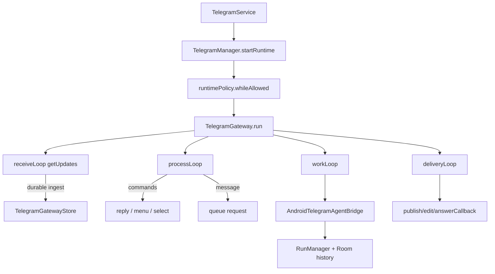

# Telegram Remote Control

> Pairs a private Telegram bot with one account so the agent, its chats and its tool approvals can be driven from a phone chat while AndroidHarness runs in the background.

`TelegramSetupRepository` stores the bot token and owner identity, `TelegramManager` starts and pauses the runtime, and `TelegramGateway` owns four loops: polling, command processing, agent work and reply delivery. `TelegramGatewayStore` makes requests and replies durable in one JSON file, and `AndroidTelegramAgentBridge` connects the gateway to the same `RunManager`, Room history, model settings and approval prompts as the app UI. The service is single-owner: only the paired private chat can issue commands, and the bot token is never sent to a model or shown in a log.

## Module Responsibilities

- **`TelegramConnection`**: Encrypted record with token, bot identity, owner ids, selection, offset, enabled and mode (`TelegramSetupRepository.kt:12-27`). `toString` prints only the bot id.
- **`TelegramSetupRepository`**: Validates the token, calls `getMe`, runs pairing, persists selection and mode, and exposes `TelegramSetupState` (`TelegramSetupRepository.kt:44-167`).
- **`TelegramManager`**: Lifecycle facade owning the runtime, pairing and expiry jobs, an `edits` mutex and the `error` flow (`TelegramManager.kt:14-179`).
- **`TelegramGateway`**: The protocol and execution engine (`TelegramGateway.kt:19-433`).
- **`TelegramGatewayStore`**: Durable record of requests, deliveries, actions, binding and update offset (`TelegramGatewayStore.kt:53-145`).
- **`TelegramBotClient`**: OkHttp transport for the Bot API (`TelegramBotClient.kt:55-171`).
- **`TelegramAgentBridge`** and **`AndroidTelegramAgentBridge`**: The seam between Telegram and the app's run system (`TelegramAgentBridge.kt:21-156`).
- **`TelegramService`** and **`TelegramBootReceiver`**: Foreground service, notification controls and boot restore (`TelegramService.kt:19-98`).
- **`TelegramSection`**: Settings UI for token, pairing, project and chat, model, mode and saved work (`TelegramSection.kt:66-334`).

## Bot Pairing and Token Storage

`validTelegramToken` accepts `<1-20 digits>:<20-200 base64url characters>` (`TelegramBotClient.kt:51-52`). `connect` validates the format, calls `getMe`, requires `is_bot`, a positive id and a 5 to 32 character username, then saves through the injected writer (`TelegramSetupRepository.kt:69-83`; `TelegramBotClient.kt:62-72`). If the same bot id is reused, the previous owner and offset survive; a different bot clears both.

The writer is `KeyStoreManager.putTelegramConnection`, which stores the whole setup as one encrypted preference under `telegram_connection` and is excluded from portable backups (`KeyStoreManager.kt:247-253`). On load, the record is accepted only when either the token is valid and the bot id is positive, or every field is empty, and the owner chat must equal the owner id when an owner exists (`TelegramSetupRepository.kt:51-53`).

Pairing starts with `beginPairing`, which creates a 16-hex-character code from 8 `SecureRandom` bytes with a ten-minute expiry (`TelegramSetupRepository.kt:85-91`, `169`). `awaitPairing` polls `getUpdates` for a private `/pair <code>` or `/start pair_<code>` message, advancing the offset, and returns the matching `TelegramAccount` (`TelegramSetupRepository.kt:93-113`). `confirmPairing` requires `chatId == userId` and a positive id, stores the owner and sets `enabled = false` (`TelegramSetupRepository.kt:122-128`). `TelegramBootReceiver` and `restoreIfEnabled` restart the service only when `enabled` is still true (`TelegramService.kt:93-98`; `TelegramManager.kt:91-97`).

Changing the token calls `connect` after pausing the runtime and cancelling pairing; if the new token fails, the previous enabled state is restored (`TelegramManager.kt:49-58`). `unpair` clears the owner but keeps the bot; `disconnect` removes the whole record (`TelegramSetupRepository.kt:133-138`).

## Architecture and Flow

`run` binds the store to the current bot, recovers interrupted `SENDING` deliveries, rejects a bot with an active webhook, registers commands best effort, then launches the four loops and awaits cancellation (`TelegramGateway.kt:44-62`). Every loop calls `current()`, which throws `CancellationException("Telegram paused")` when the connection is disabled and fails with "Telegram account changed" when the binding differs (`TelegramGateway.kt:35-39`).

**receiveLoop** calls `getUpdates(offset)`, ingests the batch durably, advances the saved offset, marks the runtime connected, and resets the failure count. A `RECEIVER_CONFLICT` or `TOKEN_REJECTED` propagates and stops the gateway; other setup errors set `Reconnecting` and wait for `retry_after` or an exponential backoff (`TelegramGateway.kt:64-86`). Backoff is `1s << attempt` capped at 30 seconds (`TelegramGateway.kt:429-431`).

**processLoop** takes the oldest `RECEIVED` request, dispatches it to `handleCallback` when it carries a callback, otherwise to `handleMessage`, and marks any exception as `FAILED` with a reply (`TelegramGateway.kt:88-102`).

**workLoop** picks the active request or the oldest `QUEUED` request, asks the bridge for a snapshot, and moves through `STARTING`, `RUNNING`, `COMPLETED`, `CANCELLED`, `INTERRUPTED` and `FAILED`. It waits while the chat is busy with something that is not this request, and records a retry action when a task moves on (`TelegramGateway.kt:315-347`).

**deliveryLoop** selects the highest-priority pending delivery whose `retryAt` has passed, marks it `SENDING`, sends or edits one message, records `SENT`, and sleeps 1100 ms to stay under Telegram's rate limit (`TelegramGateway.kt:397-428`).

## Invocation Chain

1. The Settings switch calls `manager.enable()` (`TelegramSection.kt:134-139`).
2. `enable` validates policy, pairing and the store, selects a destination, binds the store, sets `enabled = true` and starts `TelegramService` (`TelegramManager.kt:74-90`).
3. `TelegramService.onStartCommand` calls `manager.startRuntime`, which runs `gateway.run` inside `runtimePolicy.whileAllowed` (`TelegramService.kt:57`; `TelegramManager.kt:103-116`).
4. `run` launches the receive, process, work and delivery loops (`TelegramGateway.kt:44-62`).
5. `receiveLoop` calls `getUpdates`, then `store.ingest` commits requests and the offset together (`TelegramGateway.kt:64-86`).
6. `processLoop` handles a command or queues a prompt; `workLoop` calls `bridge.start` (`TelegramGateway.kt:88-102`, `315-347`).
7. `AndroidTelegramAgentBridge.start` calls `RunManager.startRun` with the prompt id (`TelegramAgentBridge.kt:89-115`).
8. `deliveryLoop` publishes or edits messages for the owner chat (`TelegramGateway.kt:397-428`).

## Commands and Menus

`handleMessage` splits the first token from the arguments. Commands are `/start`, `/help`, `/status`, `/projects`, `/chats`, `/model`, `/new`, `/mode`, `/stop`, `/retry`, `/resume`, `/pause`, `/pair`, `/ask`, `/answer`, and any other slash command gets "Unknown command" (`TelegramGateway.kt:112-201`).

- `/new` creates and selects a chat.
- `/mode` accepts only `ACT` or `PLAN`.
- `/model` selects an argument directly or opens a provider menu.
- `/stop` calls `stopCurrent`, which stops the chat's run and cancels queued requests for that chat.
- `/retry` and `/resume` take an id or the latest retryable request.
- `/pause` replies first, marks the request complete, waits 600 ms for the acknowledgement, then pauses the service.
- A plain message becomes a queued prompt; `/ask` does the same explicitly.

Menus page 12 choices at a time and add a `More…` button. Each button action expires after ten minutes and carries a 20-character random id, sent as `tg:<id>` callback data, which must stay within Telegram's 64-byte limit (`TelegramGateway.kt:215-225`; `TelegramGatewayStore.kt:31-37`). `HELP` documents the user-facing command set (`TelegramGateway.kt:431`).

## Request and Reply Durability

`TelegramGatewayStore` serializes one `TelegramGatewayRecord` to `filesDir/telegram/gateway.json`. `change` requires `offset >= 0`, writes the encoded record to `<name>.tmp`, calls `FileDescriptor.sync`, then renames over the original, and only then publishes the new `StateFlow` (`TelegramGatewayStore.kt:53-81`). A decode failure sets `loadError`, which stops the gateway and is shown in Settings instead of silently discarding saved work (`TelegramGatewayStore.kt:61-62`; `TelegramGateway.kt:48`).

Ingest is the commit point for inbound messages. It filters updates by offset, owner ids and known ids, requires text or a callback, rejects text over 12,000 characters and prompt overflow at 100 queued prompts, and writes the requests and advanced offset in one atomic change (`TelegramGatewayStore.kt:88-108`). Because the offset moves with the request rows, an update cannot be acknowledged without being durable locally. `advanceOffset` mirrors the gateway offset for the setup screen (`TelegramSetupRepository.kt:156-159`).

Request lifecycle is `RECEIVED`, `QUEUED`, `STARTING`, `RUNNING`, then `COMPLETED`, `FAILED`, `INTERRUPTED` or `CANCELLED` (`TelegramGatewayStore.kt:11`). `pruneRequests` keeps the last 200 terminal rows and every non-terminal row (`TelegramGatewayStore.kt:139-144`).

Delivery lifecycle is `PENDING`, `SENDING`, `SENT`, `FAILED`, `UNCERTAIN` (`TelegramGatewayStore.kt:12`). `delivered` records the Telegram message id, binds button action ids to that message, and stores a progress message id so later updates edit the same message (`TelegramGatewayStore.kt:131-138`). `SENT` rows are trimmed to the last 200; unsent rows are kept (`TelegramGatewayStore.kt:113-118`). On startup, `SENDING` becomes `PENDING` when the message id is known and `UNCERTAIN` when it is not, with "Delivery was interrupted. Check Telegram before resending." (`TelegramGatewayStore.kt:63-73`, `69-73`). `resend` only accepts `FAILED` or `UNCERTAIN`, and never reruns the model (`TelegramGateway.kt:302-307`).

Final output and its chunks commit in one `change` call: unsent progress is dropped, keys are deduplicated, and the request becomes `COMPLETED` (`TelegramGateway.kt:355-369`). Replies are split at 3000 characters on line boundaries without breaking a surrogate pair, and HTML rendering escapes text, turns fenced blocks into `<pre>`, and converts `**bold**` to `<b>` (`TelegramFormatting.kt:13-40`).

## Approvals and Agent Work

The bridge is the only place Telegram touches the run system. `start` verifies that the chat still belongs to the request's project, that MCP workspace tools are approved, and that the provider has credentials. It sets `queuedPromptId` to `telegram-<binding>-<requestId>`, refuses to start when a message with that id already exists, refuses when the chat is resumable, and calls `RunManager.startRun` with `onlyIfIdle = true` and `allowModelFallback = false` (`TelegramAgentBridge.kt:89-115`). A resume path requires `initialPromptId == promptId` and a resumable record, so a retry resumes the same saved task instead of posting the prompt twice (`TelegramAgentBridge.kt:101-106`).

`snapshot` reports project mismatch, running state, streamed text, progress text, completed output and the pending decision. A decision is an approval, a question or an environment request. Each carries a fingerprint from `RemotePromptIdentity` so a stale button cannot answer a different prompt (`TelegramAgentBridge.kt:116-144`).

`publishDecision` turns the decision into buttons: approve once or deny for tools, install or skip for Linux tools, and up to 12 options for questions. It skips a decision already present as an unconsumed action with the same session, turn, call, kind and fingerprint (`TelegramGateway.kt:381-395`). Callback handling calls `store.consumeAction`, which atomically marks the action consumed and checks the message id and expiry, so a replayed button gets "This button expired or was already used" (`TelegramGatewayStore.kt:122-130`; `TelegramGateway.kt:227-235`). `agent.decide` maps to `respondToRemoteApproval`, `respondToRemoteQuestion` and `respondToRemoteEnvironment` (`TelegramAgentBridge.kt:150-155`). Telegram cannot create a new approval or raise permissions; it can only answer a prompt the run already produced.

A normal message while a question is pending becomes the answer (`TelegramGateway.kt:178-198`; `TelegramGateway.kt:292-301`).

## Foreground Service and Pause or Stop

`TelegramService` is a `specialUse` foreground service (`AndroidManifest.xml:172-177`). It creates the `telegram_remote` channel, starts foreground with notification id 9140, and takes a non-reference-counted `PARTIAL_WAKE_LOCK` for ten minutes, renewing it every nine minutes (`TelegramService.kt:23-34`). The notification shows the current label and offers Pause and Stop task. Opening it lands in Settings, Telegram via `EXTRA_SETTINGS` (`TelegramService.kt:70-81`).

The label combines setup, runtime and pairing state: pairing candidate, waiting for pairing, Paused, the runtime label, or Connecting. It stops itself when the connection is disabled and no pairing is active (`TelegramService.kt:35-48`). `onStartCommand` handles Pause and Stop, refuses to run when the runtime policy says the app may not run, and returns `START_STICKY` otherwise (`TelegramService.kt:50-59`). `onDestroy` calls `manager.serviceDestroyed(this)`, which cancels the runtime only if this service instance owns it (`TelegramService.kt:61-69`; `TelegramManager.kt:123-126`).

`TelegramManager.enable` requires the runtime policy, no active pairing, a readable store, a paired connection and a project, then starts the service. A service start failure disables the connection and reports "Could not start Telegram" (`TelegramManager.kt:74-90`). `pause` sets `enabled = false`, stops the runtime and the service, but leaves the store intact so requests can resume (`TelegramManager.kt:118-122`). `stopAndPause` also stops the current task and cancels pairing (`TelegramManager.kt:127-130`). When the app goes to the background and background execution is not allowed, `HarnessApp` calls `telegram.suspendForBackground()` (`HarnessApp.kt:373-384`).

## What Is and Is Not Exposed

**Exposed to the paired account:**

- Chat text up to 12,000 characters, queued at 100 prompts.
- `/projects`, `/chats`, `/new`, `/model`, `/mode`, `/status`, `/stop`, `/retry`, `/resume`, `/help` and `/pause`.
- Progress, final text, approval buttons, agent questions and environment prompts.
- Retry and resend from Settings.

**Not exposed:**

- No direct shell, file browser, upload or download. `TelegramBotApi` has only text, buttons and callbacks (`TelegramBotClient.kt:37-49`).
- No group, channel or multi-user access: ingest requires a private chat where `chatId == userId` (`TelegramGatewayStore.kt:91-92`; `TelegramBotClient.kt:189-191`).
- No permission escalation: the agent keeps the app permission mode, and approvals only answer prompts the run already raised (`TelegramAgentBridge.kt:109-114`, `150-155`).
- No token exposure: errors omit URLs and tokens, and `SecretRedactor` plus the GitHub token are applied before sending (`TelegramBotClient.kt:54-59`; `TelegramManager.kt:37-42`).
- No webhook mode: a bot with a webhook is refused (`TelegramGateway.kt:53`).

## Boundary Conditions

- Pairing expires after ten minutes and re-checks the challenge, token and bot id, so a token change cancels it (`TelegramSetupRepository.kt:115-120`).
- Changes require an idle queue: `idle()` rejects active, queued or unprocessed text requests (`TelegramManager.kt:43-48`).
- A receiver conflict is fatal because two pollers would steal updates (`TelegramGateway.kt:76-77`).
- A long message saves `FAILED` and a rejection reply (`TelegramGatewayStore.kt:97-107`).
- A store read failure blocks the gateway to avoid losing requests.
- Updates from another owner or chat are dropped.
- Progress messages edit an existing message when one is known, avoiding a flood.

## Extension Points

- **Transport**: implement `TelegramBotApi` and pass it through `TelegramManager(api = ...)` or `TelegramGateway(api = ...)` (`TelegramBotClient.kt:37-49`; `TelegramManager.kt:16`).
- **Agent surface**: implement `TelegramAgentBridge` to attach Telegram to a different run system (`TelegramAgentBridge.kt:21-34`).
- **Commands**: extend the `when (command)` block in `handleMessage`; add a matching entry to `HELP` and `registerCommands`.
- **Actions**: new action kinds in `TelegramGateway.handleCallback` reuse the same one-shot `TelegramAction` model.
- **Redaction**: the `redact` lambda and `safe()` are the single points where outgoing text is sanitized.

## Known gaps

- There is no attachment, image or voice message support in either direction; Telegram is text, buttons and callback queries only.
- The runtime label is derived from text matching on `action` ("approval", "answer"), not from a typed enum (`TelegramGateway.kt:13-15`).

Sources: [telegram/TelegramGateway.kt](../app/src/main/java/com/androidharness/app/telegram/TelegramGateway.kt)#L19-L433), [telegram/TelegramGatewayStore.kt](../app/src/main/java/com/androidharness/app/telegram/TelegramGatewayStore.kt)#L53-L145), [telegram/TelegramManager.kt](../app/src/main/java/com/androidharness/app/telegram/TelegramManager.kt)#L14-L179), [telegram/TelegramSetupRepository.kt](../app/src/main/java/com/androidharness/app/telegram/TelegramSetupRepository.kt)#L12-L169), [telegram/TelegramBotClient.kt](../app/src/main/java/com/androidharness/app/telegram/TelegramBotClient.kt)#L37-L171), [telegram/TelegramAgentBridge.kt](../app/src/main/java/com/androidharness/app/telegram/TelegramAgentBridge.kt)#L21-L156), [telegram/TelegramService.kt](../app/src/main/java/com/androidharness/app/telegram/TelegramService.kt)#L19-L98), [ui/settings/TelegramSection.kt](../app/src/main/java/com/androidharness/app/ui/settings/TelegramSection.kt)#L66-L334)

## Source files

- `app/src/main/java/com/androidharness/app/telegram/TelegramGateway.kt`
- `app/src/main/java/com/androidharness/app/telegram/TelegramGatewayStore.kt`
- `app/src/main/java/com/androidharness/app/telegram/TelegramManager.kt`
- `app/src/main/java/com/androidharness/app/telegram/TelegramSetupRepository.kt`
- `app/src/main/java/com/androidharness/app/telegram/TelegramBotClient.kt`
- `app/src/main/java/com/androidharness/app/telegram/TelegramAgentBridge.kt`
- `app/src/main/java/com/androidharness/app/telegram/TelegramService.kt`
- `app/src/main/java/com/androidharness/app/telegram/TelegramFormatting.kt`
- `app/src/main/java/com/androidharness/app/ui/settings/TelegramSection.kt`
- `app/src/main/java/com/androidharness/app/data/KeyStoreManager.kt`
- `app/src/main/AndroidManifest.xml`
