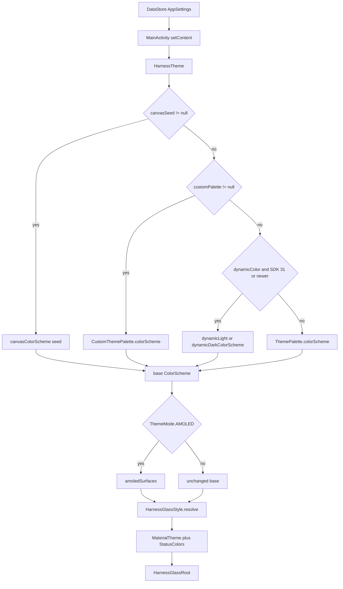

# Theme Palettes and Harness Canvas

> Resolves the app color scheme from theme mode, wallpaper colors, preset palettes, custom palettes, or a user image, then persists every appearance choice.

`HarnessTheme` is the single composition root for color. It receives the stored `AppSettings` from `MainActivity`, picks one color source, applies AMOLED surface overrides and the optional glass style, and provides `MaterialTheme` to the rest of the UI. `ThemePalette` and `CustomThemePalette` describe selectable color seeds, `PaletteColors.kt` stores pre-generated Material schemes, and `HarnessCanvasStore` owns the imported image file and its extracted color seed. The Appearance page exposes these through `ThemeColorSection`, `CustomPaletteSection`, and `HarnessCanvasSection`.

## Module Responsibilities

- **Theme composition**: `HarnessTheme` in `ui/theme/Theme.kt` maps `ThemeMode` to a light or dark boolean, chooses the active base scheme, applies AMOLED overrides, and installs typography, shapes, motion, status colors, and the glass root.
- **Static presets**: `ThemePalette` is a serializable enum of twelve choices (`BLUE`, `OCEAN`, `INDIGO`, `LAVENDER`, `ORCHID`, `ROSE`, `CORAL`, `AMBER`, `LIME`, `FOREST`, `TEAL`, `SLATE`). `PaletteColors.kt` holds a full light and dark `ColorScheme` for all except `BLUE`.
- **Fallback scheme**: `Color.kt` defines `LightColors` and `DarkColors`, a Google-blue seeded Material 3 palette with a deliberately neutral tertiary ramp, plus `amoledSurfaces()` and the only hardcoded status hues in the app.
- **Custom palettes**: `CustomThemePalette` stores a name and up to three ARGB seeds. `PersonalColors.kt` generates light and dark schemes at runtime with `materialkolor` (`com.materialkolor:material-kolor:5.0.1`), including per-role secondary and tertiary seeds when supplied.
- **Canvas image**: `HarnessCanvasStore` copies a picked image into app storage, decodes and downsamples it, extracts a wallpaper-style seed with Material quantizer and scoring classes, then records the file id and seed in settings.
- **Canvas rendering**: `HarnessCanvasBackdrop` decodes the stored file, crossfades it behind Chat or Code, applies dimming, registers a glass capture scene, and publishes `LocalHarnessCanvasVisible`.
- **Appearance settings UI**: `ThemeColorSection` handles wallpaper and preset selection, `CustomPaletteSection` handles create, edit, select, and delete, and `HarnessCanvasSection` handles import, removal, Chat/Code switches, dimming, and color matching.

## Architecture and Flow

- **Mode to darkness**: `ThemeMode.SYSTEM` calls `isSystemInDarkTheme()`, `LIGHT` forces false, and `DARK` or `AMOLED` force true. AMOLED therefore always starts from a dark scheme.
- **Personal source resolution inside the theme**: `HarnessTheme` first builds `personal` from `canvasSeed` or `customPalette`. `canvasSeed` wins when both are non-null.
- **Caller-side gating**: `MainActivity` passes `customPalette` only when it is the active id and neither `dynamicColor` nor `harnessCanvas.adaptColors` is set. It passes `canvasSeed` only when `adaptColors` is true and `HarnessCanvasStore.image(...)` still finds the file on disk. This prevents stale ids from overriding wallpaper colors.
- **Base selection**: a personal scheme wins; otherwise Android 12+ wallpaper dynamic color is used when `dynamicColor` is true; otherwise the selected `ThemePalette` scheme is used.
- **AMOLED**: `amoledSurfaces()` replaces background and surface container roles with near-black values while leaving accent and content roles intact, so a wallpaper-derived primary survives the switch to true black.
- **Glass handoff**: `HarnessGlassStyle.resolve` receives the glass switches and the SDK level. When glass is active, `MaterialTheme` gets transparent background and surface roles, and `HarnessGlassRoot` paints the actual surface and glow behind the content.
- **Canvas layering**: `HarnessCanvasBackdrop` wraps screen content in a `Box` painted with `MaterialTheme.colorScheme.surface`, draws the image in a `Crossfade`, records it for glass, and then invokes the screen content inside a `CompositionLocalProvider`.

## Invocation Chain

1. `MainActivity.onCreate` collects `container.settings.settings` and calls `HarnessTheme` with `themeMode`, `dynamicColor`, `progressBarStyle`, `colorPalette`, the active `CustomThemePalette`, the canvas seed, and the three glass fields.
2. `HarnessTheme` computes `dark`, `personal`, `base`, `colorScheme`, and `glass`, then provides `LocalStatusColors` and `LocalProgressBarStyle` and enters `MaterialTheme`.
3. `ThemePalette.colorScheme(dark)` returns `LightColors` or `DarkColors` for `BLUE` and otherwise looks up `paletteSchemes`. `CustomThemePalette.colorScheme(dark)` and `canvasColorScheme(seed, dark)` call materialkolor's `dynamicColorScheme`.
4. `ChatScreen` wraps its content in `HarnessCanvasBackdrop(appearance.harnessCanvas, conversation.conversation.isChat, Modifier.fillMaxSize())`.
5. Inside `HarnessCanvasBackdrop`, `HarnessCanvasStore.image` resolves the file, `produceState` decodes it on `Dispatchers.IO`, and `Crossfade` fades between null and the bitmap.
6. The Appearance page calls `ThemeColorSection`, `CustomPaletteSection`, and `HarnessCanvasSection`, which write through `SettingsRepository` setters.
7. `HarnessCanvasSection` creates a `HarnessCanvasStore(context, repository)`, launches the system photo picker, and calls `store.import(uri)` or `store.remove()` in a coroutine.

## Key State and Data Structures

- **`ThemeMode`** (`data/SettingsRepository.kt`, line 20): `SYSTEM`, `LIGHT`, `DARK`, `AMOLED`. Stored as the enum name under `theme_mode`. Unknown values fall back to `SYSTEM` in the settings flow.
- **`ThemePalette`** (`data/ThemePalette.kt`): serializable enum with `fromStored(value: String?)`, which matches `name` exactly and defaults to `BLUE`. The enum order drives the grid in `ThemeColorSection`.
- **`CustomThemePalette`** (`data/PersonalTheme.kt`): `id`, `name`, `primary`, optional `secondary`, optional `tertiary`, all colors as 32-bit `Long` values. `valid()` requires an id of 1 to 100 characters, a non-blank name of at most 40 characters, and every present color in `0xFF000000..0xFFFFFFFF`.
- **`HarnessCanvasSettings`**: `imageId`, `seed`, `enabled`, `chat`, `code`, `dim`, `adaptColors`. Defaults are no image, no seed, enabled, both surfaces on, `dim = .65f`, and color adaptation off.
- **`canvasImageIdPattern`**: `canvas-[a-fA-F0-9-]{36}\.(jpg|png)`. It is the allowlist for both file lookup and backup validation.
- **`ThemePalette.colorScheme`** and `paletteSchemes`: the private map holds `Pair(lightColorScheme, darkColorScheme)` for eleven presets. The map is initialized once, so palette changes cost no runtime color generation.
- **`HarnessGlassStyle`** (`ui/theme/HarnessGlass.kt`): `mode`, `surface`, `transparency`, constructed in `HarnessTheme` from the resolved mode and the active scheme's `surface`.
- **Persistence keys** (`SettingsRepository.Keys`): `theme_mode`, `dynamic_color`, `color_palette`, `custom_palettes`, `active_custom_palette`, `harness_canvas`, `harness_glass_enabled`, `harness_liquid_glass`, `harness_glass_transparency`, `progress_bar_style`. Custom palettes and canvas settings are JSON strings in Preferences DataStore.
- **Setters**: `setThemeMode`, `setDynamicColor`, `setColorPalette`, `saveCustomPalette`, `selectCustomPalette`, `removeCustomPalette`, `updateHarnessCanvas`, and the three glass setters. `updateHarnessCanvas` also normalizes `dim` to a finite value in `0f..1f`.
- **Status colors**: `StatusColors(success, warning)` with `StatusLight`, `StatusDark`, and `LocalStatusColors`. These are intentionally independent of dynamic accent color.

## Boundary Conditions

- **Dynamic color availability**: wallpaper colors require `Build.VERSION.SDK_INT >= S` (API 31). `ThemeColorSection` disables the wallpaper row and shows `theme_wallpaper_unavailable` on older devices. The theme itself also checks the SDK before calling `dynamicLightColorScheme` or `dynamicDarkColorScheme`.
- **Palette collisions**: selecting a preset calls `setColorPalette`, which stores the name, sets `dynamic_color` to false, removes `active_custom_palette`, and turns off canvas `adaptColors`. Saving or selecting a custom palette also sets `dynamic_color` to false. Turning dynamic color on turns canvas `adaptColors` off.
- **Residual ids**: selecting a custom palette does not clear `harness_canvas.adaptColors`, and enabling canvas color matching does not clear `active_custom_palette`. The render precedence in `HarnessTheme`, plus the `takeUnless` gate in `MainActivity`, resolves the ambiguity, but the stored ids remain.
- **Custom palette limit**: the UI disables the add button at 24 palettes and shows `theme_custom_limit`. `saveCustomPalette` enforces the same limit and requires `palette.valid()`. Each saved palette gets a random UUID when created. Deleting the active palette returns to the preset because the active id is removed.
- **Hex parsing**: `parseThemeHex` accepts exactly six hex digits after an optional `#`, returns null for invalid input, and ORs in a fully opaque alpha. The editor restricts input to seven characters and shows `theme_custom_invalid_hex` while parsing fails.
- **Import limits**: `HarnessCanvasStore.import` streams at most 32 MB and fails with `Image is too large` beyond that. `decode` caps the longest edge at 1920 pixels, uses `ImageDecoder` with the software allocator on API 28+, and otherwise samples with `BitmapFactory` and applies EXIF orientation.
- **Import atomicity**: a static `Mutex` serializes imports and removals. The settings update runs inside `withContext(NonCancellable)`, so a cancellation cannot leave the DataStore pointing at a half-written file. The old image is deleted only after the new id is saved. Temp and orphan files are removed in `finally` blocks.
- **Seed extraction**: the importer scales to 96 by 96, keeps pixels with alpha of at least 128, forces them opaque, quantizes with `QuantizerCelebi` to 64 colors, and takes the first `Score` result. Only the low 32 bits are stored in `seed`.
- **Canvas visibility**: the backdrop is visible only when the file exists, `enabled` is true, and the current surface is allowed by `chat` or `code`. The settings preview forces `enabled = true`, `chat = true` and uses the in-progress dim value.
- **Dim normalisation**: the renderer treats a non-finite dim as `.65f` and coerces the result into `0f..1f`. The image alpha is `1f - dim`, so a dim of 1 hides the image.
- **File ownership and removal**: files live in `filesDir/harness-canvas`. `remove()` clears `imageId`, `seed`, and `adaptColors` and deletes every file matching `canvasImageIdPattern`. `HarnessCanvasStore.image` refuses ids that do not match the pattern, so a tampered backup cannot point at an arbitrary path.
- **Backup validation**: `SettingsBackupValidation.validate` raises `SettingsBackupProblem.APPEARANCE` when there are more than 24 palettes, any palette is invalid, ids are duplicated, the active id is missing, the canvas dim is non-finite or outside `0f..1f`, the image id does not match the pattern, or the seed is outside the ARGB range.
- **Backup contents**: settings backups serialize `AppSettings`, so they carry palette definitions and the canvas `imageId`, `seed`, and switches. They do not carry the JPEG or PNG bytes. On another device the id passes validation but `HarnessCanvasStore.image` returns null, so the backdrop silently does not render until a new image is picked.

## Extension Points

- **Add a preset palette**: add an enum entry to `ThemePalette`, add a `Pair(light, dark)` entry to `paletteSchemes`, and add a `theme_palette_*` string. The grid uses `ThemePalette.entries` and `labelRes()`, so no other UI change is needed.
- **Add a custom color role**: extend `CustomThemePalette` and `PersonalColors.colorScheme`. The dialog already treats a null secondary or tertiary as "automatic", and the "Reset accent colors" action clears both.
- **Change AMOLED roles**: edit `ColorScheme.amoledSurfaces()`. It applies after both static and dynamic schemes.
- **Change the canvas seed algorithm**: replace the 96 by 96 sampling and `Score` call in `HarnessCanvasStore.import`. The stored contract is a 32-bit ARGB `Long` in `seed`.
- **Add canvas surface switches**: `HarnessCanvasSettings` currently has `chat` and `code`. A new boolean needs a renderer branch in `HarnessCanvasBackdrop` and a control in `HarnessCanvasSection`.
- **Backup schema changes**: extend the `APPEARANCE` checks in `SettingsBackupValidation` and `restorePortable`, which already writes every appearance key.

## Known gaps

- `FEATURES.md` says removing the Canvas restores the previous theme. `HarnessCanvasStore.remove()` clears `adaptColors` but does not restore a prior `dynamic_color` value, and enabling `adaptColors` had set `dynamic_color` to false. After removal the app stays on preset or custom colors, not wallpaper colors.
- `FEATURES.md` says each appearance choice releases the others. Stored flags can overlap (active custom id plus canvas adaptation); only the render precedence and the `MainActivity` gate make the result exclusive. Code that reads the raw settings sees both.
- Settings backup validation accepts a valid-looking `imageId` whose file is absent, because the validator cannot see the other device's filesystem. This is handled by a null image at render time, not by a validation error.
- `ThemePalette.fromStored` silently maps unknown stored values to `BLUE`; there is no diagnostics surface for a downgraded or corrupted palette name.

Sources: [app/src/main/java/com/androidharness/app/ui/theme/Theme.kt](../app/src/main/java/com/androidharness/app/ui/theme/Theme.kt)#L32-L85)

## Source files

- `app/src/main/java/com/androidharness/app/ui/theme/Theme.kt`
- `app/src/main/java/com/androidharness/app/ui/theme/Color.kt`
- `app/src/main/java/com/androidharness/app/ui/theme/PaletteColors.kt`
- `app/src/main/java/com/androidharness/app/ui/theme/PersonalColors.kt`
- `app/src/main/java/com/androidharness/app/ui/theme/Type.kt`
- `app/src/main/java/com/androidharness/app/ui/theme/Shape.kt`
- `app/src/main/java/com/androidharness/app/ui/theme/HarnessCanvas.kt`
- `app/src/main/java/com/androidharness/app/data/ThemePalette.kt`
- `app/src/main/java/com/androidharness/app/data/PersonalTheme.kt`
- `app/src/main/java/com/androidharness/app/data/HarnessCanvasStore.kt`
- `app/src/main/java/com/androidharness/app/data/SettingsRepository.kt`
- `app/src/main/java/com/androidharness/app/data/SettingsBackup.kt`
- `app/src/main/java/com/androidharness/app/ui/settings/ThemeColorSection.kt`
- `app/src/main/java/com/androidharness/app/ui/settings/CustomPaletteSection.kt`
- `app/src/main/java/com/androidharness/app/ui/settings/HarnessCanvasSection.kt`
- `app/src/main/java/com/androidharness/app/MainActivity.kt`
- `app/src/main/java/com/androidharness/app/ui/chat/ChatScreen.kt`
- `app/src/main/res/values/theme_color_strings.xml`
- `app/src/main/res/values/personal_theme_strings.xml`
