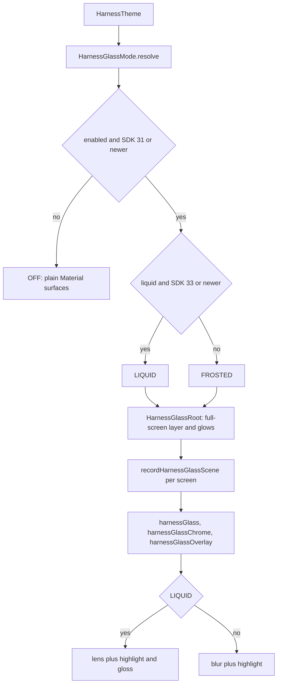
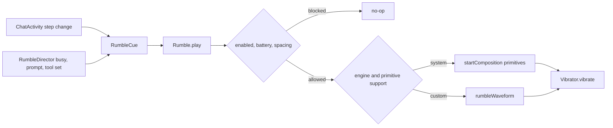

# Motion, Glass, and Haptics

> Supplies the app's shared spring and tween specs, expressive press feedback, the experimental glass renderer, and the AH Rumble haptic engine.

Three visual systems share one theme root. `ui/theme/Motion.kt` defines the app-wide animation specs and the per-control expressive variants; `ui/common/ExpressiveButtons.kt` and `ExpressiveMenu.kt` apply shape morph and press feedback without changing call-site sizing; `HarnessGlass` records the content behind a surface into a graphics layer and redraws it through blur or lens effects. `Rumble` turns conversation state into vibration effects through system primitives or a generated waveform, with capability, battery, and spacing guards.

## Module Responsibilities

- **Motion vocabulary**: `defaultSpatialSpec`, `fastSpatialSpec`, `slowSpatialSpec`, `defaultEffectsSpec`, `fastEffectsSpec`, and `slowEffectsSpec` are the stable helpers every animation site reads. `expressiveSpatialSpec` and `expressiveEffectsSpec` opt a single control into the Material 3 expressive scheme.
- **Expressive press and morph**: the wrapper buttons in `ExpressiveButtons.kt` swap the app-wide standard motion scheme for `MotionScheme.expressive()` inside the control only, and pass pressed shapes to Material 3. `Modifier.expressivePressFeedback` scales menu rows to `0.985f` on press with paint-only feedback.
- **Glass mode gating**: `HarnessGlassMode.resolve` chooses `OFF`, `FROSTED`, or `LIQUID` from the enable switch, the liquid switch, and the SDK level.
- **Glass capture**: `HarnessGlassScene`, `recordHarnessGlassScene`, `HarnessGlassRoot`, and the `harnessGlass*` modifiers rasterize content once per scene and reuse the layer for every lens and blur.
- **Haptic model**: `RumblePattern`, `RumbleEngine`, `RumbleCue`, `RumbleCueConfig`, the five built-in combos, and the JSON override codec. `RumbleStyle` projects `AppSettings` into the player.
- **Haptic playback**: `Rumble.play`, `Rumble.breathe`, `rumbleWaveform`, `systemSteps`, and the capability probes decide between `VibrationEffect.startComposition()` primitives and a custom waveform.
- **Event mapping**: `RumbleDirector` covers turn end, waiting prompt, and tool start or finish. `ChatActivity` emits thinking, writing, and tool-failed steps through its `onStep` callback. `ChatScreen` gates cues and continuous flow by Chat versus Code.
- **Settings**: `HarnessGlassSection` previews glass and controls transparency. `RumbleSection` controls placement, strength, feel, engine, per-cue patterns, spacing, battery saver, and reset.

## Architecture and Flow

- **Mode resolution**: `!enabled || sdk < 31` returns `OFF`; `liquid && sdk >= 33` returns `LIQUID`; every other supported combination returns `FROSTED`. The resolved style also carries the active scheme's `surface` color and the stored transparency.
- **Root capture**: `HarnessGlassRoot` creates a `rememberLayerBackdrop()` for ambient content and a demand-driven `HarnessGlassScene` for popup content. It paints the surface color plus two radial glows, from `primary` at 27 percent alpha and `tertiary` at 21 percent, then provides the glass composition locals.
- **Scene recording**: `recordHarnessGlassScene` positions a graphics layer, records its content once into `scene.layer`, and replays that layer. The comment at lines 112 to 115 explains the reason: replaying WebView content into extra Vulkan targets can crash the render thread, and re-recording on every drawer animation frame would re-rasterize every table and WebView.
- **Lens drawing**: `Modifier.harnessGlass` calls `drawBackdrop` with a shape outline. Frosted uses `blur`, default 20 dp. Liquid calls `lens` with depth effect, a corner radius capped at 16 or 20 dp and at 35 percent of the shortest side, and a refraction cap at 65 percent of the shortest side. Chromatic aberration is enabled only when the surface is 44 dp or smaller.
- **Readability**: the tint fill keeps enough of a colored control's fill for its semantic foreground. Liquid surfaces add a vertical center tint so text has a calmer backing, and a gloss gradient from white at 10 percent to black at 6 percent. Overlay surfaces add a 12 dp shadow.
- **Haptic path**: `Rumble.play` resolves a `RumbleCueConfig`, applies the global strength and per-cue level, then calls `effectFor`. `effectFor` uses `systemSteps` when the engine allows system haptics and the device supports every primitive; otherwise it builds `rumbleWaveform` and passes it to `VibrationEffect.createWaveform`.
- **Flow path**: `Rumble.breathe` emits one slow breath of either a built-in primitive composition or the fallback waveform and returns the wait until the next breath. `RumbleDirector` loops that call while the screen is started.

## Invocation Chain

1. `HarnessTheme` calls `HarnessGlassStyle.resolve(glassEnabled && FeatureAvailability.HARNESS_GLASS, liquidGlass, Build.VERSION.SDK_INT)` and passes the resulting style to `HarnessGlassRoot`.
2. `HarnessGlassRoot` installs `LocalHarnessGlass`, `LocalHarnessGlassBackdrop`, `LocalHarnessGlassScene`, `LocalHarnessGlassOverlayBackdrop`, and the optional chrome backdrop.
3. Screen and component code calls `Modifier.harnessGlass`, `harnessGlassBar`, `harnessGlassChrome`, `harnessGlassOverlay`, `harnessGlassControl`, or `HarnessGlassSurface`. `HarnessGlassSheets`, `HarnessGlassDialogs`, and `HarnessGlassSwitch` are the shared component adapters.
4. `ThemeColorSection` and every other expressive control calls the wrappers from `ui/common/ExpressiveButtons.kt`, which enter `ExpressiveMotion` and then the Material 3 button with pressed shapes.
5. `ChatScreen` collects settings, builds `rumblePlayer = rememberRumble(appSettings.rumbleStyle)` and `rumbleBreath = rememberRumbleFlow(...)`, and wraps the player with a Chat or Code scope check.
6. `ChatScreen` passes `busy`, `failed`, `waitingPrompt`, `runningCalls`, `codeTools`, `play`, `flow`, and `breathe` to `RumbleDirector`.
7. `RumbleDirector` calls `play(cue)` on state transitions and loops `delay(breathe(flow))` while a flow phase is active.
8. `Rumble.play` calls `effectFor`, then `vibrate`, which uses `VibrationAttributes.USAGE_TOUCH` on API 33+ and a sonification `AudioAttributes` below that.

## Key State and Data Structures

- **Animation specs** (`Motion.kt`): spatial springs use damping 0.86 and stiffness 700 for default, 0.9 and 1100 for fast, 0.9 and 380 for slow. Effects tweens use `FastOutSlowInEasing` at 220 ms, 150 ms, and 350 ms. Expressive helpers delegate to `MotionScheme.expressive().fastSpatialSpec()` and `.fastEffectsSpec()`.
- **Shapes** (`Shape.kt`): `HarnessShapes` sets extraSmall 6 dp, small 8 dp, medium 12 dp, large 16 dp, and extraLarge 24 dp.
- **`HarnessGlassMode`**: `OFF`, `FROSTED`, `LIQUID`, with the `resolve` companion.
- **`HarnessGlassStyle`**: immutable `mode`, `surface`, `transparency`. The default is `OFF`, black, and `0.5f`.
- **`HarnessGlassScene`**: wraps a `LayerBackdrop`, stores screen `coordinates` and an optional `background`, counts capture readers, and exposes `captureRequired` and `retainCapture()`. Coordinate-dependent drawing translates by the difference between the source and target screen positions.
- **`liquidGlassOpacity`**: maps the transparency slider onto the base opacity while preserving the material at the midpoint. Values below 0.5 interpolate toward 1, values above 0.5 toward 0.
- **`RumblePattern`**: `OFF`, `SOFT_TICK`, `TICK`, `CLICK`, `DOUBLE_CLICK`, `TRIPLE_TICK`, `THUD`, `SWELL`, `RISE`.
- **`RumbleEngine`**: `AUTO`, `SYSTEM`, `CUSTOM`. `AUTO` and `SYSTEM` use system primitives when supported; `CUSTOM` always builds the waveform.
- **`RumbleCue`**: `THINK`, `TOOL_START`, `TOOL_DONE`, `TOOL_FAILED`, `WRITE`, `ANSWER_DONE`, `APPROVAL`. The enum order is the order used by every combo list.
- **`RumbleCueConfig`**: `pattern` plus `level` from 0 to 100, where level is a percentage of the global strength.
- **Defaults and bounds**: strength 65, smoothness 35, spacing 150 ms, minimum spacing 30 ms, maximum spacing 1000 ms, five combos, default combo index 0.
- **`RumbleStyle`**: `enabled`, `strength`, `smoothness`, `engine`, `spacingMs`, `skipOnBatterySaver`, `cues`, `combo`. `AppSettings.rumbleStyle` builds it directly from the settings flow, so a change applies to the next pulse.
- **`RumbleWaveform` and `PulseSpec`**: waveform timings and amplitudes, plus the pulse count, gap, weight, length, and bell or rising envelope used to build each pattern.
- **`FlowSpec`**: primitive steps, period, fallback pattern, fallback period, and level. Writing uses 1400 ms system or 1100 ms fallback at level 70. Visual uses 2200 ms system or 1800 ms fallback at level 65.
- **Persistence keys**: `rumble_enabled`, `rumble_strength`, `rumble_smoothness`, `rumble_engine`, `rumble_in_chat`, `rumble_in_code`, `rumble_flow`, `rumble_spacing_ms`, `rumble_skip_on_battery_saver`, `rumble_cues`, `rumble_combo`, plus the three glass keys.
- **Override codec**: `encodeRumbleCues` and `decodeRumbleCues` store only cues the user changed, ignore unknown keys, reject unknown cue names, and coerce levels to 0 through 100. Saving a cue equal to its combo default removes the override.

## Boundary Conditions

- **Glass capability**: SDK below 31 is unsupported and shows `glass_unsupported`. SDK 31 and 32 get frosted glass only and show `glass_liquid_unsupported`. Liquid requires SDK 33 or newer and an enabled frosted layer. `HarnessGlassSection` disables the liquid switch until glass is enabled on such a device.
- **Build flag**: `FeatureAvailability.HARNESS_GLASS` is `false`. `SettingsScreen` hides the entire glass section, and `HarnessTheme` ANDs the user setting with this constant, so a restored `harness_glass_enabled = true` still resolves to `OFF`.
- **Transparency bounds**: `setHarnessGlassTransparency` ignores non-finite values and coerces the rest into `0f..1f`; the settings flow and `liquidGlassOpacity` do the same.
- **Capture ownership**: the drawer provides a capture flag that is false while it is fully closed, so a hidden drawer does not keep a full-screen popup capture alive. `GlassCaptureElement` attaches the retain count only while its menu surface exists, including its exit animation. Ambient wallpaper and popup captures stay separate: liquid mode combines them at 0.26 strength, frosted mode uses the popup capture alone.
- **Lens sizing**: lens radii are capped against the shortest side, and chromatic aberration is limited to surfaces of 44 dp or less, which keeps small controls readable and avoids over-refracting large cards.
- **No motor**: `deviceHasVibrator` returns false on tablets, emulators, and some TVs. `RumbleSection` disables the main switch and shows `rumble_unsupported` rather than failing silently.
- **Primitive support**: `deviceSupportsSystemHaptics` requires API 30 or newer and all of `PRIMITIVE_CLICK`, `THUD`, `QUICK_RISE`, `QUICK_FALL`, `TICK`, and `LOW_TICK`. `deviceSupportsFlowHaptics` requires `SLOW_RISE`, `QUICK_FALL`, and `LOW_TICK`. A missing primitive falls back to the generated waveform.
- **Play guards**: `play` returns when the vibrator is absent or has no motor, the pattern is `OFF`, the cue level is 0 or less, or the global strength is 0 or less. Non-preview calls also stop when Rumble is disabled, battery saver is on and skipping is enabled, or less than `spacingMs` has elapsed since the last pulse. Previews pass `preview = true` and skip all three of those checks.
- **Strength composition**: the final strength is `style.strength * config.level / 100f`, rounded and clamped to 1 through 100.
- **Waveform shaping**: smoothness controls step count and total length. Swelling patterns get at least 0.75 smoothness. Total length is `(12 + 98 * smoothness) * length` milliseconds, each step is at least 6 ms, and amplitudes use a sine envelope with a floor of 14 when force is above zero.
- **Amplitude control**: `waveformEffect` uses real amplitudes when `hasAmplitudeControl()` is true; otherwise every non-zero step becomes `DEFAULT_AMPLITUDE`, so the effect becomes on and off timing only.
- **Spacing scope**: `lastPlayed` lives on each `Rumble` instance, so the settings preview and the chat player do not share a spacing clock.
- **Flow guards**: `breathe` returns the wait even when silent, so callers can loop without special cases. It stops for a missing motor, zero strength, disabled Rumble, or battery saver, and never applies the spacing guard.
- **Flow window**: `RumbleDirector` waits 500 ms before the first breath, enforces a minimum 400 ms wait, and only breathes while the lifecycle is at least `STARTED`.
- **Chat versus Code**: `ChatScreen` gates pulses through `rumbleInChat` or `rumbleInCode`. Continuous flow is Chat only and requires `rumbleFlow`, `busy`, no committed stream, and non-blank streaming text.
- **State-change deduplication**: `RumbleDirector` remembers the prior busy value, prompt identity, and tool id set; `ChatActivity` remembers the previous step pair, so a row that scrolls into view stays silent.
- **Reset and first run**: `resetRumble` removes the user keys, clears cue overrides, and picks a new random combo. `ensureRumbleCombo` assigns a random combo once on first app start, then keeps it.

## Extension Points

- **New haptic pattern**: add a `RumblePattern` entry, a `PulseSpec` in `specFor`, and a `systemSteps` branch. The settings chip row iterates `RumblePattern.entries`, so the new pattern appears automatically once a label string exists.
- **New cue moment**: add a `RumbleCue` entry, append a config to each of the five combos (the lists are positional), add label and description strings, and call `play` from the producer. Corrupt or missing overrides fall back to the combo.
- **New engine policy**: extend `RumbleEngine` and the `useSystem` checks in `effectFor` and `breathe`. `AUTO` and `SYSTEM` currently behave identically when primitives are supported.
- **New glass surface**: wrap the component in `HarnessGlassSurface`, or apply `harnessGlassOverlay` to popups and `harnessGlassChrome` to bars and navigation chrome. Plain `harnessGlass` is for in-place surfaces.
- **Retune motion globally**: edit `Motion.kt`. Non-expressive sites read these helpers directly; expressive buttons intentionally use Material's scheme inside the control only. `expressivePressFeedback` hardcodes its `0.985f` press scale, while the button wrappers rely on Material's pressed shapes.

## Known gaps

- `FeatureAvailability.HARNESS_GLASS = false` means the glass feature is reachable only by changing source. There is no runtime toggle, and Appearance hides it even when stored settings enable it.
- The battery guard checks only `PowerManager.isPowerSaveMode`; it does not read battery percentage or battery optimization exemption.
- Spacing is tracked per player instance, not process-wide, so the settings preview and the chat get independent `lastPlayed` clocks.
- The flow waits are fixed by `FlowSpec`; spacing affects discrete cues only.

Sources: [app/src/main/java/com/androidharness/app/ui/theme/HarnessGlass.kt](../app/src/main/java/com/androidharness/app/ui/theme/HarnessGlass.kt)#L44-L281)

## Source files

- `app/src/main/java/com/androidharness/app/ui/theme/Motion.kt`
- `app/src/main/java/com/androidharness/app/ui/theme/Shape.kt`
- `app/src/main/java/com/androidharness/app/ui/theme/HarnessGlass.kt`
- `app/src/main/java/com/androidharness/app/ui/theme/HarnessGlassDialogs.kt`
- `app/src/main/java/com/androidharness/app/ui/theme/HarnessGlassSheets.kt`
- `app/src/main/java/com/androidharness/app/ui/theme/HarnessGlassSwitch.kt`
- `app/src/main/java/com/androidharness/app/ui/common/ExpressiveButtons.kt`
- `app/src/main/java/com/androidharness/app/ui/common/ExpressiveMenu.kt`
- `app/src/main/java/com/androidharness/app/ui/common/ExpressiveControls.kt`
- `app/src/main/java/com/androidharness/app/ui/settings/HarnessGlassSection.kt`
- `app/src/main/java/com/androidharness/app/data/Rumble.kt`
- `app/src/main/java/com/androidharness/app/ui/common/Rumble.kt`
- `app/src/main/java/com/androidharness/app/ui/chat/RumbleDirector.kt`
- `app/src/main/java/com/androidharness/app/ui/settings/RumbleSection.kt`
- `app/src/main/java/com/androidharness/app/ui/chat/ChatScreen.kt`
- `app/src/main/java/com/androidharness/app/ui/chat/components/ChatActivity.kt`
- `app/src/main/java/com/androidharness/app/data/SettingsRepository.kt`
- `app/src/main/java/com/androidharness/app/data/FeatureAvailability.kt`
- `app/src/main/res/values/chat_rumble_strings.xml`
