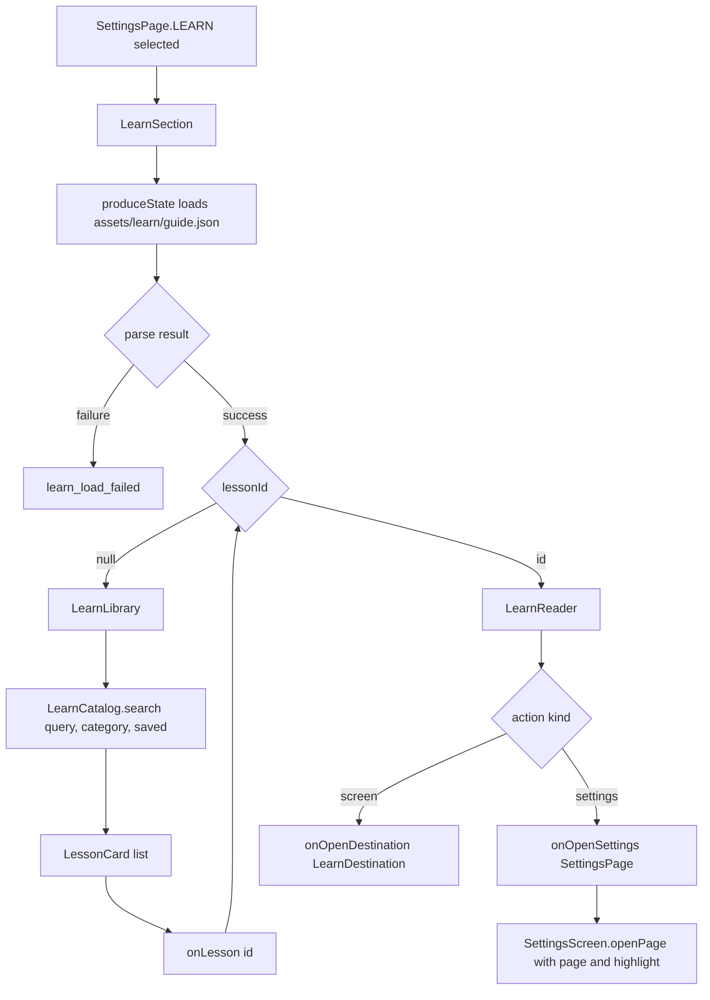

# Learn, Tips, and What's New

> Loads the bundled learning guide, rotates short in-run tips, and shows a one-time post-update summary.

The Learn page is a fully offline guide shipped as a JSON asset. `LearnCatalog` parses categories and lessons, `LearnSection` renders a searchable library and a lesson reader, and lesson actions deep link into Settings pages or app screens. Separately, `RunTips` defines short tips that `RunTipHost` shows while a run is working, and `WhatsNewDialog` shows a curated release summary once per install on Play builds. The first two systems are preference-driven; the third is a static, build-gated dialog.

## Module Responsibilities

- **Lesson model**: `LearnCatalog`, `LearnCategory`, `LearnLesson`, `LearnStep`, `LearnFix`, `LearnAction`, and `LearnLink` define the JSON schema. `LearnCatalog.search` performs the filtering, and `LearnLesson.searchText` builds the text index.
- **Guide loading**: `LearnSection` reads `assets/learn/guide.json` on `Dispatchers.IO` inside `produceState`, parses it with `LearnCatalog.parse`, and renders a loading or failure state before the library.
- **Library and reader**: `LearnLibrary` owns the search field, category chips, Saved filter, featured lessons, progress card, and grouped lesson list. `LearnReader` renders location, prerequisites, steps, example, outcome, limits, fixes, actions, official links, completion, and related lessons.
- **Local progress**: completed and saved lesson ids live in the `learn_guide` `SharedPreferences` file as two string sets. The reader toggles them and the library reflects them.
- **Deep links**: `LearnAction.kind` is `settings` or `screen`. `settings` resolves against `SettingsPage.entries` and calls `onOpenSettings`; `screen` resolves against `LearnDestination.entries` and calls `onOpenDestination`.
- **Tip catalog**: `RunTips.all` is an ordered list of 46 `RunTip` entries. Each tip has a string resource, a `TipScope`, an optional `SettingsPage`, an optional anchor resource, and a relevance predicate over `AppSettings`.
- **Tip scheduling**: `RunTips.next` returns the next in-scope and relevant tip plus the next cursor. `RunTipHost` enforces the delay, cooldown, linger, dismissal, and turn-off behavior.
- **Tip settings**: `AgentBehaviorSection` renders the `runTipsEnabled` switch, and `AgentSettingsCatalog` exposes the same toggle to the agent settings index. `ChatScreen` persists the cursor and opens the anchored setting.
- **What's New**: `WhatsNewStore` is a one-boolean `SharedPreferences` flag. `WhatsNewDialog` renders fixed Added, Improved, and Fixed lists. `MainActivity` shows it only when `BuildConfig.PLAY_DISTRIBUTION` is true.

## Architecture and Flow

- **Asset load**: the asset is read once per `LearnSection` composition. The result is a `Result<LearnCatalog>`; a failure is not retried automatically, the page shows the failure text and requires leaving and reopening Settings.
- **Search**: `search` lowercases the query with `Locale.ROOT`, splits on whitespace, and requires every term to appear in the lesson's `searchText`. Category and saved-set filters are applied first. Empty terms do not filter.
- **Reader switching**: `LearnSection` keeps a `SaveableStateHolder` and keys it by lesson id or the literal `library`, so scroll and field state survive moving between the library and a lesson.
- **Lesson actions**: `LearnReader` iterates `lesson.actions` in order. An unknown `target` produces no navigation because the lookup uses `firstOrNull`. The button is only rendered when `actions` is non-empty.
- **Tip deep link**: `ChatScreen` calls `settingsTarget(tip.page, tip.anchor)`, which formats `page:<SettingsPage name>:<anchor resource or 0>`, and writes it to `container.pendingSettingsScroll`. `SettingsScreen` consumes that flow in a `LaunchedEffect(Unit)`, parses the target back into a page and highlight anchor, and clears the flow.
- **Screen deep link**: `AppNav` maps `LearnDestination.CHAT` and `CODE` to new conversations, `PROJECTS` to the projects list, `FILES`, `TERMINAL`, and `BUILD_TEST` to routes carrying the current project id, `AUTOMATION` to the automation screen, and `PROVIDERS` to the providers screen.
- **Tip rotation**: `RunTips.next` starts at the saved cursor and scans forward with `Math.floorMod`, wrapping once. The first tip that matches scope and relevance wins, and the cursor advances past it.
- **Tip display**: `RunTipHost` waits `DELAY_MS`, checks the process-wide cooldown, records `lastTipShownAt`, sets the tip id, and persists the new cursor. When the run ends, an unexpanded tip lingers for `LINGER_MS` before fading; an expanded tip stays so the user can finish reading.
- **What's New gating**: after `AppNav` is composed, `MainActivity` checks `BuildConfig.PLAY_DISTRIBUTION` and `WhatsNewStore.seen`. Dismissing the dialog writes `seen = true`, so it never appears again for that install.

## Invocation Chain

1. The user opens Settings and selects `SettingsPage.LEARN`, from the home entry card, the desktop navigation card, or settings search.
2. `SettingsScreen` renders `learnState.SaveableStateProvider("guide") { LearnSection(...) }` with the saved lesson id, query, category, and Saved flag.
3. `LearnSection` loads and parses the asset, then calls `LearnLibrary` or `LearnReader`.
4. `LearnLibrary` calls `catalog.search(query, category, saved.takeIf { savedOnly })` and groups the results by `catalog.categories`.
5. Selecting a lesson calls `onLesson(id)`. `SettingsScreen` pushes the previous id onto `learnLessonHistory` and sets `learnLessonId`. `goBack` pops that history.
6. In the reader, an action calls `onOpenSettings(SettingsPage)` or `onOpenDestination(LearnDestination)`. This ultimately reaches `SettingsScreen.openPage` or the `AppNav` mapping.
7. For tips, `ChatScreen` calls `RunTipHost(busy, isChat, settings, onShown, onOpen, onTurnOff)` next to the task progress card.
8. `RunTipHost` calls `RunTips.next`, then `onShown(cursor)` which invokes `setRunTipCursor`. `onOpen` writes `settingsTarget` and opens Settings. `onTurnOff` calls `setRunTipsEnabled(false)`.
9. `MainActivity` composes `WhatsNewDialog` after `AppNav` when the Play build flag is set and the store has not recorded a view.

## Key State and Data Structures

- **`LearnCatalog`**: `categories` and `lessons`. `lesson(id)` returns the first match or null. `search(query, category, saved)` filters by category, saved membership, and all query terms.
- **`LearnCategory`**: `id`, `title`, `description`. The bundled asset has 12 categories: `start`, `providers`, `chat`, `local`, `code`, `github`, `extensions`, `device`, `automation`, `personal`, `data`, and `help`.
- **`LearnLesson`**: `id`, `category`, `title`, `summary`, `location`, `before`, `steps`, `outcome`, `limits`, `fixes`, `related`, `actions`, `links`, `example`, `keywords`, and `sources`. `searchText` includes the visible teaching fields plus keywords and action labels, but excludes `sources`, `related`, and `links`.
- **`LearnAction`**: `label`, `kind`, `target`. The asset uses only the `settings` and `screen` kinds.
- **`LearnDestination`**: `CHAT`, `CODE`, `PROJECTS`, `FILES`, `TERMINAL`, `BUILD_TEST`, `AUTOMATION`, `PROVIDERS`. This enum is the allowlist for screen actions.
- **Bundled content**: `assets/learn/guide.json` contains 97 lessons. Category counts are 18 code, 14 chat, 13 providers, 9 extensions, 7 local, 7 github, 7 device, 6 data, 5 personal, 4 automation, 4 help, and 3 start.
- **Progress storage**: `context.getSharedPreferences("learn_guide", MODE_PRIVATE)` with keys `completed` and `saved`, each a `StringSet`. Both are read once into Compose state and written on every toggle.
- **`RunTip`**: `id`, `text` string resource, `scope`, `page`, optional `anchor`, and `relevant`. The default relevance predicate is always true.
- **`TipScope`**: `CHAT`, `CODE`, `BOTH`. Scope matching is `BOTH` or an exact match with the current conversation kind.
- **Tip timing constants**: `DELAY_MS = 6_000L`, `COOLDOWN_MS = 3 * 60_000L`, `LINGER_MS = 8_000L`.
- **Tip settings**: `run_tips_enabled` defaults to true; `run_tip_cursor` defaults to 0 and stores the index after the last shown tip.
- **What's New store**: file `whats-new`, boolean key `seen`, default false. The dialog lists 10 Added, 3 Improved, and 3 Fixed string resources from `whats_new_strings.xml`.

## Boundary Conditions

- **Asset failure**: a missing or malformed `guide.json`, or a JSON schema mismatch, produces `Result.failure` and the page shows `learn_load_failed`. There is no fallback catalog and no retry button.
- **Empty results**: if no lesson matches, the library shows an empty state with different copy for an empty Saved list and an empty search, plus a reset button that clears query, category, and Saved.
- **Filter changes**: `LearnLibrary` scrolls to the first item whenever the query, category, or Saved flag changes, using the saved previous filter triple to detect a real change.
- **Invalid action targets**: unknown settings page names or screen names are ignored at click time. Only `SettingsPage.entries` and `LearnDestination.entries` names can navigate, so guide content cannot open arbitrary screens.
- **Link failures**: `OfficialLink` catches activity launch failures, shows `learn_link_failed`, and offers a copy action for the URL. There is no in-app browser fallback.
- **Clipboard**: copying an example or a failed link uses `ClipboardManager.setPrimaryClip` and a short toast.
- **Lesson state is local**: completed and saved ids are not part of `AppSettings`, not exported in settings backups, and not synchronized between devices. Clearing app data resets progress.
- **Tip suppression**: a tip is hidden when `runTipsEnabled` is false, when its scope does not match, or when its relevance predicate is false. Eighteen tips have predicates that hide them once the relevant feature is already configured, for example Rumble, background runs, TTS, memory, app lock, and live updates.
- **Tip cooldown**: `lastTipShownAt` is a private top-level variable, so the gap is process-wide across conversations but resets when the process dies.
- **Tip lifecycle**: the delay and linger effects are keyed on `busy`, `isChat`, and `expanded`. A run that ends during the delay cancels the effect before a tip appears. Dismissing sets the id to null but keeps `shown` so the exit animation still has content.
- **Tip expansion**: only the first two lines of the tip text are shown while collapsed. Expanding reveals the full text and the Open setting and Turn off tips actions. Open setting is only offered when the tip has a `page`.
- **Tip persistence**: the cursor is global, not per conversation. `onShown` fires before the user reads or dismisses, so a killed process can skip a tip permanently.
- **What's New scope**: the dialog is compiled only for Play builds. It is gated on one install-wide boolean, not on the installed version code. Once dismissed, later updates never show it again.
- **What's New content**: the three lists are hand-maintained resource arrays, not generated from `CHANGELOG.md` or the version. The `wn_workspace_learn` string says 96 Learn lessons while the current asset has 97.

## Extension Points

- **Add a lesson**: append an object to `guide.json` with the required fields, choose an existing category id, and optionally add `settings` or `screen` actions and `related` ids. `sources` is review metadata and is never rendered.
- **Add a category**: add an entry to `categories` and give `categoryIcon` a matching branch. Unknown category ids fall back to `Icons.AutoMirrored.Outlined.HelpOutline`, and the current map has no branch for `help`.
- **Add a screen deep link**: add a `LearnDestination` entry, then add the matching route branch in `AppNav`. The reader resolves the enum by name automatically.
- **Add a settings action**: use an exact `SettingsPage` enum name as the target. Learn actions carry no anchor; anchors are used by run tips through `settingsTarget` and `settingsRevealFor`.
- **Add a tip**: append a `RunTip` with a new string resource. Give it a page or anchor if it should offer navigation, and a relevance predicate if it becomes obsolete once configured.
- **Change tip cadence**: edit the three constants in `RunTips` or the matching guard in `RunTipHost`. There is no settings control for delay or cooldown.
- **Change What's New content**: edit `ADDED`, `IMPROVED`, and `FIXED` in `WhatsNewDialog.kt` and add the corresponding `wn_*` strings. To show it again per version, add a stored version code and compare it in `MainActivity`.

## Known gaps

- `FEATURES.md` describes deep links that open the exact screen each lesson talks about. These are internal Compose callbacks into Settings and app routes, not external URI or intent links. There is no public URL scheme for a lesson id.
- What's New is documented as a summary of everything since the last uploaded store version, but the implementation shows it at most once per install and never compares versions. The list content is curated by hand.
- Guide content is English only even though the rest of the interface is translated into 21 languages; `guide.json` has no locale variants.
- The `sources` field in each lesson is present in the asset and used for review, but no UI exposes it.
- Learn progress is stored outside `SettingsRepository`, so it does not travel with settings backups.

Sources: [app/src/main/java/com/androidharness/app/ui/learn/LearnSection.kt](../app/src/main/java/com/androidharness/app/ui/learn/LearnSection.kt)#L77-L121)

## Source files

- `app/src/main/java/com/androidharness/app/ui/learn/LearnCatalog.kt`
- `app/src/main/java/com/androidharness/app/ui/learn/LearnSection.kt`
- `app/src/main/java/com/androidharness/app/ui/chat/RunTips.kt`
- `app/src/main/java/com/androidharness/app/ui/chat/components/RunTipCard.kt`
- `app/src/main/java/com/androidharness/app/ui/whatsnew/WhatsNewDialog.kt`
- `app/src/main/java/com/androidharness/app/ui/whatsnew/WhatsNewStore.kt`
- `app/src/main/java/com/androidharness/app/ui/settings/SettingsScreen.kt`
- `app/src/main/java/com/androidharness/app/ui/settings/SettingsNavigation.kt`
- `app/src/main/java/com/androidharness/app/ui/settings/SettingsHome.kt`
- `app/src/main/java/com/androidharness/app/ui/settings/AgentBehaviorSection.kt`
- `app/src/main/java/com/androidharness/app/ui/settings/AgentSettingsCatalog.kt`
- `app/src/main/java/com/androidharness/app/ui/AppNav.kt`
- `app/src/main/java/com/androidharness/app/ui/chat/ChatScreen.kt`
- `app/src/main/java/com/androidharness/app/data/SettingsRepository.kt`
- `app/src/main/java/com/androidharness/app/MainActivity.kt`
- `app/src/main/assets/learn/guide.json`
- `app/src/main/res/values/learn_strings.xml`
- `app/src/main/res/values/tips_strings.xml`
- `app/src/main/res/values/whats_new_strings.xml`
