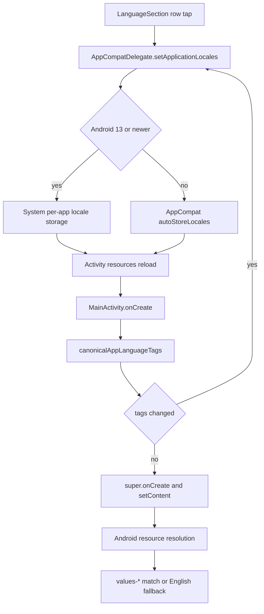

# Localization

> Resolves the app locale, applies per-app language selection, ships 21 translations, and keeps technical content readable in right-to-left layouts.

The app ships English as the default resource set plus 21 translated resource directories. `AppLanguage.kt` normalizes legacy and regional locale tags, `LanguageSection` drives `AppCompatDelegate` per-app locales, and `resources/xml/locales_config.xml` exposes the same list to Android 13 and newer. Around the translated UI, code, diffs, terminals, diffs, and agent output stay left-to-right, and a small set of technical keys and content stays English by design.

## Module Responsibilities

- **Base resources**: `res/values` holds 39 XML files, 37 of which declare strings. Together they declare 4,411 string keys and 25 plural resources. `strings.xml` is the largest file, with 1,009 strings, and feature files such as `learn_strings.xml`, `tips_strings.xml`, `whats_new_strings.xml`, and `chat_rumble_strings.xml` keep the rest grouped by area.
- **Translations**: 21 `values-*` directories mirror the same 37 string files. Each contains 4,406 translated string keys and 25 plural resources. The five key difference is intentional and covered below.
- **Picker**: `LanguageSection` renders 23 radio rows: System default plus 22 language tags. It stores the selection through `AppCompatDelegate.setApplicationLocales`.
- **Tag normalization**: `canonicalAppLanguageTags` rewrites Tagalog to Filipino. `selectedAppLanguageTag` maps a current `Locale` back to the nearest picker tag.
- **Locale declaration**: `res/xml/locales_config.xml` lists English first and then the 21 translations. `AndroidManifest.xml` attaches it with `android:localeConfig` and sets `android:supportsRtl="true"`.
- **Persistence**: `AppLocalesMetadataHolderService` with `autoStoreLocales = true` persists the override on Android 12 and earlier. On Android 13 and newer the same preference is shared with the system per-app language UI.
- **RTL support**: the app inherits RTL layout from the locale. A few components invert direction manually, and technical surfaces opt back into LTR with `LeftToRightContent`.
- **Plurals**: 25 `plurals` resources use CLDR quantity names. Translators supply the categories their language needs.
- **Environment helper**: `LocaleCommand` writes a minimal `locale` shell stub for the Linux environment. It is unrelated to interface translation.

## Architecture and Flow

- **Immediate application**: the picker does not write a bespoke preference. It calls `AppCompatDelegate.setApplicationLocales(LocaleListCompat.forLanguageTags(tag))`, and AppCompat applies the locale to the running app. An empty tag means System default.
- **Canonicalization before startup**: `MainActivity.onCreate` reads `getApplicationLocales().toLanguageTags()` and runs `canonicalAppLanguageTags` before `super.onCreate`. If the canonical form differs, it calls `setApplicationLocales` first. This prevents Android from preferring English over legacy Tagalog when both are requested for Filipino.
- **Resource resolution**: Android picks the best `values-*` directory for the current locale. Untranslated or missing keys fall back to `res/values`. The five missing translated keys are all marked `translatable="false"` in the default set, so this fallback is the intended value.
- **System picker integration**: `localeConfig` makes the 22 languages appear in Android Settings, Apps, AndroidHarness, Language. Because AppCompat shares the same storage, a change in either place is reflected in the other.
- **Back to picker state**: `LanguageSection` reads `AppCompatDelegate.getApplicationLocales()[0]` and passes it through `selectedAppLanguageTag`. A null locale becomes an empty string, which selects the System default row.

## Invocation Chain

1. The user opens Settings, Personalize, App language, which renders `SettingsPage.LANGUAGE` and calls `LanguageSection()`.
2. `LanguageSection` reads the current `LocaleListCompat`, resolves the selected tag, and renders the 23-row list.
3. Tapping a different row calls `AppCompatDelegate.setApplicationLocales(LocaleListCompat.forLanguageTags(tag))`.
4. AppCompat persists the choice through the metadata holder service on older releases and through the platform on Android 13 and newer.
5. On the next activity creation, `MainActivity.onCreate` canonicalizes the stored tag list and, if needed, writes the canonical tag back before `super.onCreate`.
6. Resource lookups then resolve through the matching `values-*` directory, with `res/values` as the final fallback.
7. Settings search builds its index in the active language and, when that is not English, builds a second index from an English `Configuration` context so English queries still match.

## Key State and Data Structures

- **Picker tags**: the ordered list in `LanguageSection` is `""` (System default), `en`, `zh-CN`, `zh-Hant`, `ru`, `ar`, `fa`, `pt-BR`, `de`, `es`, `ja`, `id`, `si`, `vi`, `tr`, `ms`, `th`, `fr`, `hi`, `ko`, `ta`, `bn`, `fil`.
- **Resource qualifier mapping**: `zh-CN` uses `values-zh-rCN`, `zh-Hant` uses `values-b+zh+Hant`, `pt-BR` uses `values-pt-rBR`, `fil` uses `values-b+fil` because it is not a two-letter language code, and Indonesian uses the legacy `values-in` qualifier while the picker and locale config use the modern `id` tag.
- **`TRANSLATION_PROJECT_URL`**: `https://poeditor.com/join/project/ZPbHNa9WWc`, opened from the contribution panel with a toast fallback on failure.
- **`locales_config.xml`**: 22 locale entries, English first: `en`, `zh-CN`, `zh-Hant`, `ru`, `ar`, `fa`, `pt-BR`, `de`, `es`, `ja`, `id`, `si`, `vi`, `tr`, `ms`, `th`, `fr`, `hi`, `ko`, `ta`, `bn`, `fil`.
- **`canonicalAppLanguageTags`**: splits a comma-separated tag list and rewrites any locale whose language is `tl` to `fil`, preserving the rest of the locale through `Locale.Builder`.
- **`selectedAppLanguageTag`**: maps `zh` by script first (`Hant` to `zh-Hant`, `Hans` to `zh-CN`), then by country (`TW`, `HK`, `MO` to `zh-Hant`, otherwise `zh-CN`). It maps all `pt` to `pt-BR`, `id` and `in` to `id`, `fil` and `tl` to `fil`, and the remaining supported languages to themselves. Anything else maps to `en`.
- **Default strings**: 4,411 keys across 37 files. Five keys are non-translatable: `app_name` (`AndroidHarness`), `rumble_percent` (`%1$d%%`), `rumble_spacing_ms` (`%1$d ms`), `settings_language_english` (`English`), and `settings_language_chinese` (`简体中文`). That is why each locale has 4,406 rather than 4,411 keys.
- **Language labels**: labels such as `settings_language_russian` through `settings_language_filipino` are endonyms (`Русский`, `日本語`, `Filipino`) repeated in each locale's strings file, so the picker always shows each language in its own script. English and Simplified Chinese are non-translatable endonyms as well.
- **Plural resources**: 25 in the base set. Examples include `storage_items`, `ui_model_count`, `settings_accounts_models_available`, `harness_free_retry_seconds`, and `harness_free_retry_minutes`. Consumers use `pluralStringResource` or `Resources.getQuantityString` with the actual count as the quantity.
- **`LocaleCommand`**: writes `bin/locale` when no real locale binary is installed, and refreshes an older AndroidHarness stub. The script supports no arguments, `-a`, `-m`, `charmap`, `-k charmap`, and `--help`, reports `C`, `C.UTF-8`, `en_US.UTF-8`, and `POSIX`, and rejects other charmap values. It does not generate locale data or translate UI.

## Boundary Conditions

- **Unknown locale**: `selectedAppLanguageTag` returns `en` for any language outside the supported list, so a device set to an unsupported language shows English selected rather than nothing.
- **Legacy codes**: Tagalog (`tl`) is rewritten to Filipino (`fil`) on startup. Indonesian accepts both `id` and the legacy `in`. Chinese regional locales collapse to Simplified unless the script is Traditional or the country is Taiwan, Hong Kong, or Macao.
- **Script precedence**: a Chinese locale with an explicit `Hant` script wins over its country, so `zh-Hans-TW` resolves to `zh-CN` because the script check runs first.
- **Regional variants**: `fr-CA`, `es-MX`, `pt-PT`, and similar locales map to the base supported language or to `pt-BR`. There is no `fr-CA` resource set.
- **Missing translations**: any key absent from a locale falls back to English at runtime. The current gap is limited to the five keys listed above and is deliberate.
- **Right-to-left**: Arabic and Persian are the two RTL translations. Compose mirrors padding, rows, and navigation from `LocalLayoutDirection`. `HarnessGlassSwitch` inverts drag delta when RTL so a rightward drag still means on. `AppNav.sectionMotion` multiplies the Chat/Code transition direction by minus one in RTL. `PullRequestUi` swaps its arrow glyph.
- **Technical text stays LTR**: `LeftToRightContent` forces `LayoutDirection.Ltr` and an LTR text direction and left alignment. It wraps the terminal, the code editor, Markdown code blocks, live code cards, and the visual diff viewer.
- **Plural categories**: the base file supplies `one` and `other`. Translations supply what their language requires. Russian uses `one`, `few`, `many`, and `other`. Arabic uses `zero`, `one`, `two`, `few`, `many`, and `other`. French uses `one`, `many`, and `other`. Japanese uses only `other`. A category missing for the current quantity falls back to `other`.
- **Formatting locale**: numeric and date helpers are mixed. User-facing sizes and dates often use `Locale.getDefault()` (`StorageSection`, `UiFormat`, live mode timing), while technical values such as model sizes, timestamps, and download identifiers use `Locale.US` (`LocalModelsSection`, `HuggingFaceSearch`, `SettingsScreen` export filename). This keeps decimal points and file names stable in technical output.
- **Settings search**: `settingsSearchIndex` indexes the active language and adds an English index when the active language is not English. A query typed in English still finds a translated page, and a query typed in the active language uses the translated labels.
- **Search keywords**: `SettingsPage.keywords` includes English terms and native-script variants for languages such as Russian, Arabic, Persian, Japanese, and Chinese. These keywords are search-only and are not displayed.

## Extension Points

- **Add a language**: add a `values-*` directory with the same 37 file names, add the locale to `locales_config.xml`, add a row to the `languages` list in `LanguageSection`, add a `settings_language_*` label, and extend `selectedAppLanguageTag` so the saved locale maps back to the new tag.
- **Change tag normalization**: edit `canonicalAppLanguageTags` or the `when` in `selectedAppLanguageTag`. The function is the single mapping point between platform locales and picker tags.
- **Add a plural**: declare it in the base resource file with at least `one` and `other`, then add the categories each translation needs. Use `pluralStringResource` or `getQuantityString` with a real count.
- **Keep technical text LTR**: wrap the composable in `LeftToRightContent`. This is the shared helper for code, diffs, terminals, and inline technical cards.
- **Offer another translation channel**: the POEditor URL is a single constant in `LanguageSection`. Replace it to point at a different project.
- **Translate bundled content**: the Learn guide is an asset, not a resource. Supporting translated guides would need locale-specific asset paths and a loader change in `LearnSection`.

## What Stays English

- **Model and provider names**: catalog model ids, provider names, and model display names come from provider data and are not translated.
- **Tool descriptions and agent prompts**: tool definitions and the system prompts, including the main `You are AndroidHarness...` prompt, are written in English. `FEATURES.md` documents this explicitly.
- **Shell output and logs**: terminal output, command results, and logcat lines are shown verbatim.
- **Learn guide content**: `assets/learn/guide.json` is English only. Lesson chrome such as buttons and section headings is translated through `learn_strings.xml`, but titles, steps, limits, and fixes are English.
- **Technical units and identifiers**: `app_name`, `rumble_percent`, `rumble_spacing_ms`, language endonyms for English and Simplified Chinese, package names, file names, URLs, and code snippets.
- **What's New items**: the `wn_*` strings are translated, but the underlying release summary is curated in English and has no separate localized source.

## Known gaps

- The Learn guide has no localized variants, so a fully translated interface still opens English lesson bodies.
- `LocaleCommand` can look like a localization feature but is only a compatibility stub for the bundled Linux toolchain. It reports a fixed locale set and never installs locale data.
- There is no automated check that every locale has the same key set. The current 5-key gap is intentional because those keys are non-translatable, but a future untranslated key would fall back silently.
- The picker has no search or grouping. It is a flat list of 23 rows, and the contribution link is the only path for adding a language.

Sources: [app/src/main/java/com/androidharness/app/ui/settings/LanguageSection.kt](../app/src/main/java/com/androidharness/app/ui/settings/LanguageSection.kt)#L26-L121)

## Source files

- `app/src/main/res/values/strings.xml`
- `app/src/main/res/values/learn_strings.xml`
- `app/src/main/res/values/tips_strings.xml`
- `app/src/main/res/values/whats_new_strings.xml`
- `app/src/main/res/values/chat_rumble_strings.xml`
- `app/src/main/res/values/ui_strings.xml`
- `app/src/main/res/values/ui_extra_strings.xml`
- `app/src/main/res/xml/locales_config.xml`
- `app/src/main/AndroidManifest.xml`
- `app/src/main/java/com/androidharness/app/ui/settings/AppLanguage.kt`
- `app/src/main/java/com/androidharness/app/ui/settings/LanguageSection.kt`
- `app/src/main/java/com/androidharness/app/ui/settings/SettingsNavigation.kt`
- `app/src/main/java/com/androidharness/app/MainActivity.kt`
- `app/src/main/java/com/androidharness/app/ui/common/LeftToRightContent.kt`
- `app/src/main/java/com/androidharness/app/ui/theme/HarnessGlassSwitch.kt`
- `app/src/main/java/com/androidharness/app/ui/AppNav.kt`
- `app/src/main/java/com/androidharness/app/data/env/LocaleCommand.kt`
- `app/src/main/assets/learn/guide.json`
