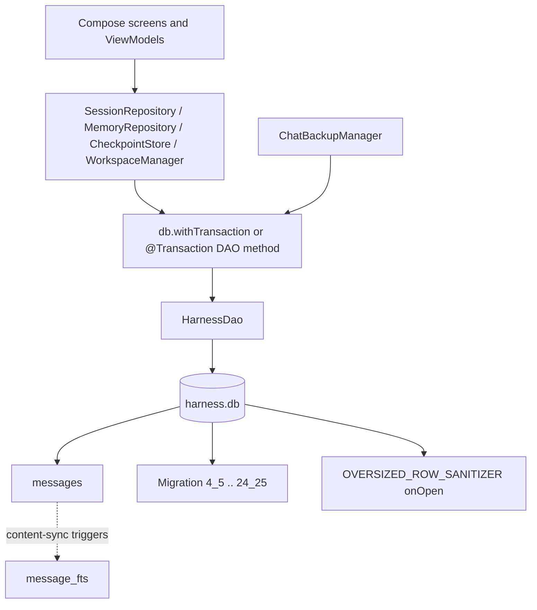

# Database and Persistence

> Room database `harness.db` holds chat history, workspaces, memories, undo checkpoints, usage and code-change stats, saved answers, and the FTS search index.

All persistent chat state lives in one Room database defined in `app/src/main/java/com/androidharness/app/data/db/Database.kt`. There are no separate per-feature databases. `AppDatabase` declares 13 entities, `HarnessDao` exposes the queries, and `HarnessApp` builds the singleton with every migration. Feature repositories (`SessionRepository`, `MemoryRepository`, `CheckpointStore`, `WorkspaceManager`, `ChatBackupManager`) call the DAO and own the transaction boundaries that span more than one statement.

## Module Responsibilities

- **Schema ownership**: `AppDatabase` (`Database.kt:759`) defines the entity list, schema version 25, and the migration objects.
- **Query surface**: `HarnessDao` (`Database.kt:280`) is one large DAO for every table, including FTS search.
- **Connection lifecycle**: `HarnessApp` (`HarnessApp.kt:138-148`) builds `harness.db` with `Room.databaseBuilder`, registers 21 migrations, attaches `OVERSIZED_ROW_SANITIZER`, and enables destructive fallback for pre-v4 databases.
- **Write orchestration**: repositories group related DAO calls. For example `SessionRepository.recordFileEdit` writes `file_edits` and `code_activity` in one transaction (`SessionRepository.kt:643-672`).
- **Search**: `ChatSearch` builds safe MATCH and LIKE expressions; the DAO runs them against `message_fts` and `messages` (`ChatSearch.kt:21-41`).

## Architecture and Flow

Room owns the connection and applies pending migrations before the first query. `OVERSIZED_ROW_SANITIZER` then runs on every open, before normal reads, and trims pathological rows. Reads and writes are suspend functions or `Flow`s, so UI collectors stay reactive without polling.

## Invocation Chain

1. A screen calls a repository method, for example `SessionRepository.addMessage` (`SessionRepository.kt:261`).
2. The repository opens `db.withTransaction` and calls `HarnessDao.insertMessage` (`Database.kt:443`).
3. SQLite writes `messages`; Room's generated content-sync triggers update `message_fts` for that row.
4. `messagesFlow(sessionId)` (`Database.kt:403-404`) emits the new list; ordering is `createdAt ASC, rowid ASC`.
5. On app start, `HarnessApp` builds the database (`HarnessApp.kt:138`), Room runs migrations in ascending order, `OVERSIZED_ROW_SANITIZER` runs (`Database.kt:862-880`), and `HarnessDao.sessionsFlow()` (`Database.kt:289-290`) drives the sidebar.
6. Chat search calls `SessionRepository.search`, which passes `ChatSearch.ftsMatchQuery` to `searchFts` (`Database.kt:500-504`); an empty result falls back to `searchLike` with an escaped `LIKE` pattern (`Database.kt:506-507`, `SessionRepository.kt:536-539`).

## Key State and Data Structures

| Entity | Table | Primary key | Purpose | Key columns and indexes |
|---|---|---|---|---|
| `SessionEntity` | `sessions` | `id` | One chat or Code conversation, its token totals, compaction state, pending plan, model and workspace selections | `projectId`, `pendingPlan`, `modelSelectionJson`, `workspaceSelectionJson`, `conversationJson`; no explicit index besides the primary key |
| `MessageEntity` | `messages` | `id` | Every user, assistant, tool and system message, including thinking, timings, images, artifacts and generation stats | index on `sessionId`; `turnId` used for turn grouping, `rowid` used for stable ordering |
| `ChatAnswerVersionEntity` | `chat_answer_versions` | `id` | Archived tail of a Chat answer so retry and version switching can restore it | index on `sessionId`; `groupKey` ties versions of the same answer |
| `SavedAnswerEntity` | `saved_answers` | `messageId` | Bookmarked answer text, copied out of the live message so it survives edit, rewind or delete | indexes on `sessionId` and `savedAt` |
| `MessageFtsEntity` | `message_fts` | FTS rowid | External-content FTS4 index over message `text`, tokenizer `unicode61` | content table `messages`; rebuilt by migration 8_9 |
| `ProjectEntity` | `projects` | `id` | Workspace row: app workspace, SAF folder or SSH host | `kind` is `"APP"` or `"SAF"`; `uri`; `lastUsedAt` |
| `MemoryEntity` | `memories` | `id` | Long-term fact, digest or summary, owned by a section and optionally a project or agent | indexes on `scope`, `projectId`, `enabled`; `section`, `consolidatedInto`, `isSummary`, `agentId` |
| `CheckpointEntity` | `checkpoints` | `id` | Base64 copy of a file before a turn edits it, used by undo and rewind | index on `sessionId`; `turnId`, `relPath`, `existedBefore`, `wasDirectory` |
| `SnippetEntity` | `snippets` | `id` | Saved prompt snippet exposed as a custom slash command | `name`, `body`; sorted by name |
| `UsageEventEntity` | `usage_events` | `rowId` autoincrement | One model request's token counts, prices and cache attribution | index on `sessionId`; `providerName`, `model`, `turnId`, `cacheReported`, price columns |
| `FileEditEntity` | `file_edits` | `rowId` autoincrement | Per-call added and removed line counts for chat chips | indexes on `sessionId` and `turnId` |
| `CodeActivityEntity` | `code_activity` | `id` | Historical edit totals keyed by a hashed session and path, so activity survives chat deletion | index on `createdAt`; `fileKey`, `added`, `removed` |
| `SessionFileChangeEntity` | `session_file_changes` | composite `(sessionId, relPath)` | Cumulative per-file change for the "Files changed" view, with a gzipped baseline | index on `updatedAt`; `added`, `removed`, `isNew`, `isDeleted`, `baseGzip`, `hasBase` |

Helper rows are projection types, not tables: `SavedAnswerRow` (bounded 1200-character excerpt, `Database.kt:88-94`), `MessagePosition` (`Database.kt:97`), `TurnFirstPojo`, `StatsUsagePojo`, `ModelUsagePojo`, `CodeActivityTotals`.

## Relationships

No entity declares a Room `@ForeignKey`. Relationships are enforced by query shape and by repository code:

- `messages.sessionId`, `chat_answer_versions.sessionId`, `saved_answers.sessionId`, `checkpoints.sessionId`, `usage_events.sessionId`, `file_edits.sessionId`, and `session_file_changes.sessionId` all point at `sessions.id` logically. Indexes exist on each of these columns except the composite key table, where `sessionId` is the leading key column.
- `sessions.projectId` points at `projects.id` and is nullable for an unbound chat. `projectSessionCount` and `projectSessions` also match chats whose `workspaceSelectionJson` mentions the project id (`Database.kt:334-338`).
- `memories.projectId` points at `projects.id` only when `scope = 'PROJECT'`; `agentId` optionally points at a Chat agent profile.
- `code_activity` deliberately has no session column. It stores a hashed `fileKey` from `CodeFilePolicy.fileKey` so totals outlive chat deletion and undo.
- `message_fts` is an external-content index: `f.docid = messages.rowid` in every search query (`Database.kt:500-513`).

Deletes are manual. `SessionRepository.deleteSessions` removes answer versions, saved answers, messages, checkpoints, usage events, file edits and session file changes, then the session itself, all inside one transaction (`SessionRepository.kt:876-895`). `HarnessDao.deleteProjectAndChats` repeats that cascade for every chat of a project plus the project row, guarded by `@androidx.room.Transaction` (`Database.kt:340-361`).

## Transaction Boundaries

- **DAO-level transactions**: `saveChatWorkspaces` (`Database.kt:317-329`) re-qualifies legacy paths into `@workspaces/<projectId>/...` and refuses paths that are absolute, contain `..`, or already start with `@workspaces/`. `deleteProjectAndChats` (`Database.kt:340-361`) checks that the expected chat set still matches before deleting.
- **Repository-level transactions**: `SessionRepository` wraps session creation, message insertion, compaction snapshots, model selection, file edit plus code activity, chat answer archive and selection, truncation, and deletion (`SessionRepository.kt:126`, `183`, `191`, `208`, `215`, `220`, `231`, `237`, `243`, `261`, `316`, `329`, `350`, `628`, `643`, `825`, `840`, `868`, `881`).
- **Import transaction**: `ChatBackupManager.importPrepared` runs session insertion, message batch insertion, memory upserts and snippet insertion inside one `db.withTransaction` (`ChatBackup.kt:246-315`).
- **Memory transactions**: `MemoryRepository` wraps save, add, update and consolidation so duplicate checks and writes are atomic (`MemoryRepository.kt:173`, `208`, `230`, `242`).
- **Checkpoints** are written per file and per turn without an outer transaction; `CheckpointStore.snapshot` keeps the earliest snapshot for `(turnId, relPath)` (`CheckpointStore.kt:20-49`).

## Migrations and Version History

Current version is 25, `exportSchema = false` (`Database.kt:740-758`). Migrations are registered in ascending order in `HarnessApp.kt:139-143`.

| Migration | Change |
|---|---|
| `MIGRATION_4_5` | Adds `sessions.totalCacheWriteTokens` |
| `MIGRATION_5_6` | Creates `usage_events` and its `sessionId` index |
| `MIGRATION_6_7` | Adds `messages.thinkingMs`; creates `file_edits` with two indexes |
| `MIGRATION_7_8` | Creates `session_file_changes` with composite primary key |
| `MIGRATION_8_9` | Creates the FTS4 virtual table `message_fts` and rebuilds it from existing messages |
| `MIGRATION_9_10` | Adds `sessions.pendingPlan` |
| `MIGRATION_10_11` | Adds `messages.outputTokens` and `generationMs` |
| `MIGRATION_11_12` | Adds `usage_events.turnId` and `cacheReported` |
| `MIGRATION_12_13` | Adds the three price columns to `usage_events` |
| `MIGRATION_13_14` | Adds `messages.firstTokenMs` and `streamMs` |
| `MIGRATION_14_15` | Adds `sessions.modelSelectionJson` |
| `MIGRATION_15_16` | Adds `sessions.workspaceSelectionJson` |
| `MIGRATION_16_17` | Adds `messages.artifactJson` |
| `MIGRATION_17_18` | Adds `messages.generationJson` |
| `MIGRATION_18_19` | Creates `code_activity` and backfills it from `file_edits`, filtering paths through `CodeFilePolicy.counts` |
| `MIGRATION_19_20` | Adds `sessions.conversationJson` |
| `MIGRATION_20_21` | Creates `memories` with three indexes |
| `MIGRATION_21_22` | Creates `chat_answer_versions` with a `sessionId` index |
| `MIGRATION_22_23` | Adds `memories.section`, `consolidatedInto`, `isSummary` |
| `MIGRATION_23_24` | Adds `memories.agentId` |
| `MIGRATION_24_25` | Creates `saved_answers` with `sessionId` and `savedAt` indexes |

There is no migration below 4 to 5. `fallbackToDestructiveMigration(true)` handles a database older than v4 by recreating it (`HarnessApp.kt:145-147`). The FTS column list and options in `MIGRATION_8_9` must stay byte-identical to Room's generated `CREATE` statement, because Room validates the schema on open (`Database.kt:979-992`).

## Retention and Cleanup

There is no time-based row expiry. Rows live until a user or feature deletes them:

- Deleting a chat cascades through seven child tables and then deletes the session (`SessionRepository.kt:876-895`). Image originals referenced only by the deleted chats are removed afterwards, and only when reference checking succeeds for every remaining session (`SessionRepository.kt:897-922`).
- Deleting a project refuses `kind = "APP"`, refuses when chats in another project still use the workspace, and requires the exact expected chat id set (`Database.kt:340-361`).
- `clearMessages` drops messages, answer versions, checkpoints and the compaction summary; `truncateFrom` drops later messages and the summary but keeps checkpoints (`SessionRepository.kt:852-871`).
- `code_activity` is intentionally never deleted with a chat, which is why it uses a digest instead of a readable path.
- Unenabled or consolidated memories are hidden by queries, not deleted; `clearAll` calls `deleteAllMemories` (`MemoryRepository.kt:278`, `Database.kt:702-703`).
- Physical file cleanup is separate. `StorageManager.cleanupCandidates` only proposes package downloads, npm and pip caches, and recognized Gradle build output older than 7 days (`StorageManager.kt:98-140`). It lists `harness.db`, `-wal`, `-shm` and `-journal` in the inventory but does not delete them.

## Boundary Conditions

- `OVERSIZED_ROW_SANITIZER` truncates `messages.text` and `messages.thinking` above 250000 characters to 100000 characters plus a marker, and replaces `toolCallsJson` above 250000 characters with `[]`. This prevents the 2 MB CursorWindow crash (`Database.kt:857-880`).
- Restored chats use `insertImportedMessages` with `OnConflictStrategy.IGNORE`, so one colliding message id cannot abort the whole import (`Database.kt:531-533`).
- `saveAnswer` and `upsertMemory` use `REPLACE`; `insertChatAnswerVersion`, `insertCodeActivity` and snippet duplicates use `IGNORE` or are filtered before insert.
- Message ordering always adds `rowid` as a tiebreaker so several messages in one millisecond keep insertion order (`Database.kt:403`, `406-419`).
- `deleteMessagesFrom` deletes by `createdAt` and `rowid` comparison against the target message, not by id list (`Database.kt:491-497`).
- `ChatBackupManager.importPrepared` re-checks that remapped workspaces still exist and validates each `ChatWorkspaceSelection` before inserting (`ChatBackup.kt:246-256`).
- `UsageEventEntity` price columns are nullable because older rows have no recorded price; the peak-window SQL uses UTC only, so device timezone never changes totals (`Database.kt:271-278`).

## Extension Points

- Add an entity to the `@Database` list, bump `version`, write a `Migration`, and register it in `HarnessApp.addMigrations`. Room rejects a missing path at open time.
- Add queries to `HarnessDao`; both suspend functions and `Flow` return types are used. `@Insert(onConflict = ...)` choices are per call site.
- FTS behavior is controlled by `ChatSearch` (`ChatSearch.kt`). Word mode uses quoted prefix tokens, fuzzy mode escapes `%`, `_` and `\` for `LIKE ... ESCAPE '\'`.
- `CodeFilePolicy` decides which paths count toward code activity and how `fileKey` is hashed, so it changes what survives chat deletion.
- `SessionFileChangeEntity.baseGzip` and `hasBase` define whether a chat's "Files changed" view can render a baseline diff; new files get an empty baseline, oversized files get `hasBase = false`.

## Known gaps

- `exportSchema = false` means no schema JSON is checked in, so schema drift is caught only by Room's runtime validation and by tests, not by a generated artifact.
- No `@ForeignKey` constraints exist, so any code path that deletes a session without going through `SessionRepository.deleteSessions` or `HarnessDao.deleteProjectAndChats` can leave orphaned rows. There is no database-level cascade to catch that.
- `truncateFrom` keeps checkpoints for removed turns. It does not prune them by turn id.
- There is no retention policy for `usage_events` or `code_activity`; both grow for the life of the install unless the user clears app data.

Sources: [data/db/Database.kt](../app/src/main/java/com/androidharness/app/data/db/Database.kt)#L18-L1001), [HarnessApp.kt](../app/src/main/java/com/androidharness/app/HarnessApp.kt)#L138-L148), [data/SessionRepository.kt](../app/src/main/java/com/androidharness/app/data/SessionRepository.kt)#L876-L922), [data/CheckpointStore.kt](../app/src/main/java/com/androidharness/app/data/CheckpointStore.kt)#L13-L49), [data/db/ChatSearch.kt](../app/src/main/java/com/androidharness/app/data/db/ChatSearch.kt)#L12-L41)

## Source files

- `app/src/main/java/com/androidharness/app/data/db/Database.kt`
- `app/src/main/java/com/androidharness/app/data/db/ChatSearch.kt`
- `app/src/main/java/com/androidharness/app/data/SessionRepository.kt`
- `app/src/main/java/com/androidharness/app/data/CheckpointStore.kt`
- `app/src/main/java/com/androidharness/app/data/MemoryRepository.kt`
- `app/src/main/java/com/androidharness/app/data/ChatBackup.kt`
- `app/src/main/java/com/androidharness/app/data/storage/StorageManager.kt`
- `app/src/main/java/com/androidharness/app/HarnessApp.kt`
