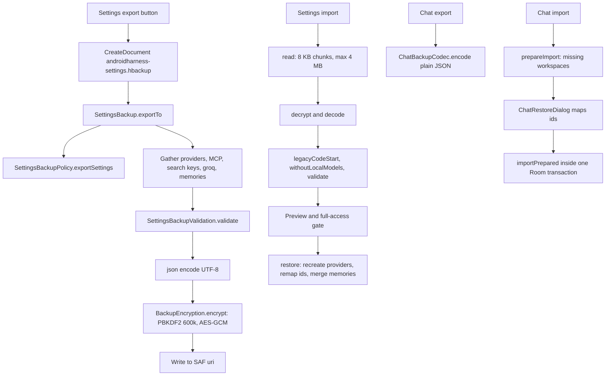

# Backups and Encryption

> Two independent backup paths: a password-encrypted settings file and a plain JSON chat archive with workspace reconnection.

`SettingsBackup` writes and reads the encrypted settings file. `ChatBackupManager` writes and reads the chat archive. `BackupEncryption` implements the password-based envelope for the settings file. `MemoryBackup` defines the portable memory and snippet forms shared by both. The UI lives in `SettingsBackupSection` and `ChatRestoreDialog`. The split is deliberate: the settings file carries credentials and machine configuration, so it is encrypted and narrow; the chat archive carries conversation text, so it is readable JSON and never includes keys or app settings.

## Module Responsibilities

- **`SettingsBackup`**: builds `SettingsBackupFile` from live settings, providers, MCP servers, search keys, Groq key and memories, validates it, encrypts it, and on restore remaps provider ids and merges memories (`SettingsBackup.kt:205-304`).
- **`BackupEncryption`**: PBKDF2-HMAC-SHA256 key derivation plus AES-GCM, with a fixed-size binary header (`BackupEncryption.kt:10-50`).
- **`SettingsBackupPolicy`**: decides which providers are portable, strips device-specific selections, and removes local models from older files (`SettingsBackup.kt:42-92`).
- **`ChatBackupManager`**: exports every session with its messages, workspaces, memories and snippets to one JSON file, and imports with id-based skip and workspace mapping (`ChatBackup.kt:154-318`).
- **`ChatBackupCodec`**: pure encode, decode and format/version checks, with no Android types (`ChatBackup.kt:111-134`).
- **`SettingsBackupSection`**: file pickers, password entry, include-keys switch, restore preview, and the full-access biometric gate before restoring (`SettingsBackupSection.kt:42-219`).
- **`ChatRestoreDialog`**: one mapping row per missing workspace, with an option to add a folder first (`ChatRestoreDialog.kt:23-83`).

## Architecture and Flow

## Invocation Chain

1. `SettingsBackupSection` launches `CreateDocument("application/octet-stream")` with the suggested name `androidharness-settings.hbackup` (`SettingsBackupSection.kt:58-60`, `79`).
2. The dialog collects a password, a confirmation, and the `includeKeys` checkbox; confirm is disabled unless the password is at least 6 characters and both entries match (`SettingsBackupSection.kt:129-156`).
3. `SettingsBackup.exportTo(uri, chars, includeKeys)` reads current settings and providers, filters through `SettingsBackupPolicy.canExport`, builds each `BackupProvider`, then validates (`SettingsBackup.kt:211-234`).
4. The file is serialized with `encodeDefaults = true`, encrypted, and written with mode `"wt"` (`SettingsBackup.kt:235-239`).
5. Import runs `SettingsBackup.read`, which caps the read at `BackupEncryption.MAX_BYTES`, decrypts, decodes, applies `legacyCodeStart`, strips local models, and validates (`SettingsBackup.kt:242-264`).
6. The preview dialog shows provider, server and memory counts. Restore refuses while any run is active, recreates providers as `<name> (restored)`, remaps ids, imports MCP servers disabled, fills only missing search keys, and merges memories (`SettingsBackup.kt:266-303`).
7. If the restored settings request `PermissionMode.FULL_ACCESS`, confirm first calls `BiometricAuth.requireFullAccessApproval`; otherwise it restores directly (`SettingsBackupSection.kt:188-214`).

## Chat Export and Import Format

`ChatBackupFile` has `format = "androidharness-chats"`, `version = 5`, `exportedAt`, `sessions`, `workspaces`, `memories`, and `snippets` (`ChatBackup.kt:25-33`, `113-114`). `BackupSession` mirrors the `sessions` row including token totals, `projectId`, compaction fields, `modelSelectionJson`, `workspaceSelectionJson` and `conversationJson` (`ChatBackup.kt:68-87`). `BackupMessage` mirrors `messages`, including `toolCallsJson`, `imagesJson`, `artifactJson` and `generationJson` (`ChatBackup.kt:89-109`). Those JSON strings ride along exactly as stored, so a later app version that changes their shape still restores older chats losslessly.

The export writes no API keys, provider configuration, MCP servers, settings, checkpoints, file history or saved answers (`ChatBackup.kt:17-23`, `162-219`). Memories and snippets are included because they are user content, not credentials. The file is plain UTF-8 JSON, so anyone holding it can read the chats.

Decode rules are strict on identity and lenient on unknown fields: `ignoreUnknownKeys = true`, a wrong or missing `format` throws `ChatBackupException("Not a chat backup file")`, and `version > 5` throws `"This backup was written by a newer version of the app"` (`ChatBackup.kt:116-133`).

Import is idempotent by session id. `ChatBackupMerge.plan` filters incoming sessions whose id already exists and reports the rest as `skipped` (`ChatBackup.kt:140-147`). `prepareImport` also lists workspaces referenced by sessions or by project-scoped memories that are missing on this device, with display names derived from the backup, the chat title, or `"Chats without a workspace"` for the sentinel `legacy-unassigned-workspace` (`ChatBackup.kt:221-235`, `47-49`).

`ChatRestoreMapping.referenced` decodes `workspaceSelectionJson` and requires `selection.primaryId == session.projectId`, otherwise it throws `"A restored chat has inconsistent workspace access."` (`ChatBackup.kt:48-55`). `remap` rewrites the primary id and every grant id, re-encodes through `ChatWorkspaceSelection.encode(...validated())`, and leaves unmapped ids untouched (`ChatBackup.kt:56-65`). `ChatRestoreDialog` requires a project for each missing workspace before enabling Restore, and its Add workspace button opens `AddWorkspaceDialog` or a SAF folder picker (`ChatRestoreDialog.kt:50-82`).

`importPrepared` refuses to run when a mapping value is blank, re-checks that every referenced workspace still exists, validates each selection through `workspace.validateSelection`, and inserts sessions, messages, memories and snippets in one transaction (`ChatBackup.kt:239-318`). Memory and snippet merge policies are shared with the settings backup: `MemoryBackupMerge` skips duplicate ids and duplicate normalized facts, demotes a project memory to global when its project is missing, and drops a `consolidatedInto` pointer that does not resolve to a summary; `SnippetBackupMerge` skips duplicate ids and duplicate names because the name is the slash command (`MemoryBackup.kt:53-145`).

## Settings Backup Contents and Exclusions

`SettingsBackupFile` version 4 contains `settings`, `providers`, `servers`, `searchKeys`, `searchKeyPools`, `groqKey`, `memories` and `providerProxy` (`SettingsBackup.kt:17-34`). `BackupProvider` carries the provider config, custom model ids, an optional API key, headers, a key pool and a proxy (`SettingsBackup.kt:36-40`).

`SettingsBackupPolicy.exportSettings` always removes device-specific state: `pinnedSessions` and `archivedSessions` become empty, `lastActiveSessionId` becomes null, `lastConversationKind` becomes `CODE`, `permissionMode` becomes `CONFIRM_RISKY`, `biometricLockEnabled` becomes false, `biometricLockTimeoutMinutes` becomes 0, `allowScreenshots` becomes false, `localModelExperimental` becomes false, and `liveMode` resets to defaults (`SettingsBackup.kt:71-81`). Provider selections, chat agent models, provider order, disabled ids and fallback targets are filtered to the exported provider set.

Two provider classes are never portable:

- Local models, detected by `LocalModelCatalog.isLocal(id)` or a `local://` base URL (`SettingsBackup.kt:43-48`). `canExport` returns false for them.
- ChatGPT accounts, detected by `ChatGptProtocol.isProvider(id)` (`SettingsBackup.kt:47-48`). Their sign-ins stay on the device.

`withoutLocalModels` repeats the strip for older v1 files before preview and restore, including provider references inside selections (`SettingsBackup.kt:83-91`). Validation independently rejects a local provider id and a ChatGPT provider id in any provider entry (`SettingsBackup.kt:163-165`).

With `includeKeys = false`, the export contains provider configs without API keys, empty headers, key pools with `keys = emptyList()`, no MCP servers, no search keys, no Groq key, and proxies without credentials (`SettingsBackup.kt:216-233`). With `includeKeys = true`, provider keys, headers, key pools, search key pools, the Groq key and MCP servers are included; MCP servers are saved with `enabled = false` so a restore never starts a connection automatically (`SettingsBackup.kt:226`). GitHub, Telegram, ChatGPT sign-ins and MCP OAuth state are never read here, so they are never in the file (`KeyStoreManager.kt:118-155`, `222-254`).

Restore never overwrites an existing credential. Search key pools, single search keys and the Groq key are written only when the device slot is empty (`SettingsBackup.kt:286-288`). Memories merge and are never replaced; a project id that does not exist on this device is dropped to a global memory (`SettingsBackup.kt:299-302`, `MemoryBackup.kt:86-95`).

## Password KDF and Encryption

The envelope is a 33-byte header followed by AES-GCM ciphertext and tag (`BackupEncryption.kt:14-26`):

- 5 magic bytes `72 65 72 62 01` (`"HARB"` plus format byte 1).
- 16 random salt bytes from `SecureRandom`.
- 12 random nonce bytes.
- PBKDF2WithHmacSHA256, salt from bytes 5 to 21, `ITERATIONS = 600_000`, 256-bit derived key, password cleared with `PBEKeySpec.clearPassword` (`BackupEncryption.kt:39-42`).
- AES/GCM/NoPadding with a 128-bit tag, nonce from bytes 21 to 33, and the entire header as AAD (`BackupEncryption.kt:43-47`).
- The derived key byte array is zeroed in a `finally` block; the plaintext buffer is zeroed after encryption and after decode (`BackupEncryption.kt:48`, `SettingsBackup.kt:236`, `262`).

Decrypt validates the total size (`HEADER_SIZE + 16` to `MAX_BYTES`), the magic, and the password length before touching the cipher, then maps any `GeneralSecurityException` to `"Incorrect password or damaged backup."` (`BackupEncryption.kt:28-37`).

Limits: password 6 to 1024 characters, plaintext at most `MAX_BYTES - HEADER_SIZE - 16` (about 4 MB) on encrypt, file at most 4 MB on decrypt (`BackupEncryption.kt:11-13`, `19-20`, `29`). The read loop enforces the cap while streaming, so an oversized picker file fails before full buffering (`SettingsBackup.kt:244-253`).

## Validation

`SettingsBackupValidation.validate` is a flat list of guards, each mapped to a `SettingsBackupProblem` whose `hint` is user-facing (`SettingsBackup.kt:128-193`). The checks cover:

- Version range 1 to 4; at most 100 providers and 100 MCP servers.
- At most 1000 disabled skills of at most 500 characters; model ids at most 500 characters; fallback policy validity.
- Allowed voice models, providers, search providers, voice engines, and memory scopes, categories and sections.
- Unique provider ids, unique MCP server names, unique palette ids and unique memory ids.
- Provider names 1 to 200 characters, custom models at most 1000 entries of 1 to 500 characters each.
- Provider URLs parsed with `toHttpUrlOrNull` and `java.net.URI`, requiring scheme `http` or `https`, a non-blank authority, and no embedded user info or credentials (`SettingsBackup.kt:166-172`).
- Provider headers, key pools and proxies must pass their own `error()` checks.
- Numeric bounds: `autoCompactTokens` is 0 or at least 1024, `maxContextTokens` 8192 to 2000000, `maxOutputTokens` 1 to 1000000, `maxIterations` 0 to 10000, resume prompt bounded by `RunRecovery.MAX_PROMPT_CHARS`.
- Memory text non-blank, ids at most 200 characters, project ids at most 500, `consolidatedInto` not self, agent-bound memories use section `CHAT`, counts non-negative.

Export and unlock errors are mapped, never passed through raw. `settingsBackupExportError` returns fixed strings for validation, credential-read, security, IO, crypto and argument failures, because provider URLs and file-provider errors may contain secrets (`SettingsBackup.kt:94-103`). Import failures collapse to `"Could not unlock backup. Check the password."`; restore failures collapse to the restore-failed string (`SettingsBackupSection.kt:151-154`, `196-200`).

## Boundary Conditions

- Restore requires no running tasks: `require(c.runManager.runningSessionIds.value.isEmpty()) { "Stop running tasks before restoring settings." }` (`SettingsBackup.kt:269`).
- Providers are recreated, not overwritten. Every restored provider gets a new local id and a ` (restored)` suffix, and every reference is remapped through the `ids` map (`SettingsBackup.kt:270-298`).
- The built-in `HarnessProvider.ID` is not recreated; its custom models and proxy are applied to the existing provider (`SettingsBackup.kt:278-284`).
- The file picker uses `"wt"` for truncate-write, so a shorter file cannot leave stale bytes behind (`SettingsBackup.kt:237`).
- Import requires every missing workspace to be mapped; otherwise it throws `"Choose a workspace for each restored project before importing."` (`ChatBackup.kt:240-242`).
- If a chosen workspace disappears between preview and import, the transaction aborts with `"A chosen workspace is no longer available. Review the restored projects again."` (`ChatBackup.kt:251-253`).
- Chat import counts skipped sessions twice in the result: already-present ids and sessions re-filtered inside the transaction (`ChatBackup.kt:316-317`).

## Extension Points

- Bump `SettingsBackupFile.VERSION` and add validation plus a default value for any new field. `ignoreUnknownKeys = true` keeps old readers tolerant; the validator is the compatibility gate.
- Bump `ChatBackupCodec.VERSION` for a format change. Older apps reject newer files by design; new apps accept older versions because only `version > VERSION` is rejected.
- Add a new portable provider kind by relaxing `SettingsBackupPolicy.canExport` and the two validation checks that reject local and ChatGPT providers.
- `SettingsBackupProblem` is the place to add a specific, actionable failure hint instead of a generic export error.
- `MemoryBackupMerge.normalize` and `SnippetBackupMerge.normalize` are the shared acceptance rules for both backup files. Changing them changes both import paths.

## Known gaps

- The chat archive is unencrypted JSON. FEATURES.md says the file holds chats only and is safe to keep, but it does not claim confidentiality at rest.
- Chat export does not include `saved_answers`, `chat_answer_versions`, checkpoints or `session_file_changes`. Restored chats keep their messages but lose bookmarked answers, answer branches and undo history.
- The settings backup does not include chat history, and the chat backup does not include settings. Moving a full install requires both files.
- `SettingsBackup.restore` imports MCP servers with `enabled = false`; the user must re-enable each one after restore (`SettingsBackup.kt:285`).

Sources: [data/SettingsBackup.kt](../app/src/main/java/com/androidharness/app/data/SettingsBackup.kt)#L17-L304), [data/BackupEncryption.kt](../app/src/main/java/com/androidharness/app/data/BackupEncryption.kt)#L10-L50), [data/ChatBackup.kt](../app/src/main/java/com/androidharness/app/data/ChatBackup.kt)#L24-L318), [data/MemoryBackup.kt](../app/src/main/java/com/androidharness/app/data/MemoryBackup.kt)#L7-L145), [ui/settings/SettingsBackupSection.kt](../app/src/main/java/com/androidharness/app/ui/settings/SettingsBackupSection.kt)#L42-L219), [ui/settings/ChatRestoreDialog.kt](../app/src/main/java/com/androidharness/app/ui/settings/ChatRestoreDialog.kt)#L23-L83)

## Source files

- `app/src/main/java/com/androidharness/app/data/SettingsBackup.kt`
- `app/src/main/java/com/androidharness/app/data/BackupEncryption.kt`
- `app/src/main/java/com/androidharness/app/data/ChatBackup.kt`
- `app/src/main/java/com/androidharness/app/data/MemoryBackup.kt`
- `app/src/main/java/com/androidharness/app/data/KeyStoreManager.kt`
- `app/src/main/java/com/androidharness/app/ui/settings/SettingsBackupSection.kt`
- `app/src/main/java/com/androidharness/app/ui/settings/ChatRestoreDialog.kt`
- `app/src/main/java/com/androidharness/app/ui/settings/SettingsScreen.kt`
