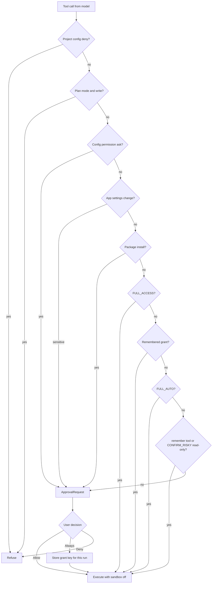

# Security Model and Approvals

> The app's trust boundaries: what the model may do without asking, what requires a user decision, what only the device owner can enable, and what never leaves the device.

Security is layered rather than centralized. `AgentEngine` decides whether a tool call needs approval, `RunManager` owns the pending approval and remembered grants, `ShellPolicy` maintains a hard denylist, the workspace layer enforces path containment, and `MainActivity` plus `ScreenshotPolicy` control window privacy. Device credentials sit behind `KeyStoreManager`. File backup rules, the biometric gate on full access, the artifact sandbox and the public-address guard cover the remaining boundaries.

## Module Responsibilities

- **`PermissionMode`**: four modes, `CONFIRM_ALL`, `CONFIRM_RISKY`, `FULL_AUTO`, `FULL_ACCESS` (`AgentEngine.kt:42-49`).
- **`ApprovalRequest` and `QuestionRequest`**: suspend the run on a `CompletableDeferred<Boolean>` or `CompletableDeferred<String>` until the user answers (`AgentEngine.kt:51-68`).
- **`RunManager`**: publishes `pendingApproval`, resolves approve or deny by session, turn and call id, and owns the per-run grant store (`RunManager.kt:1017-1040`).
- **`RememberedGrants`**: in-memory "Always" grants keyed by session, workspace path and grant key (`RememberedGrants.kt:7-42`).
- **`ShellPolicy`**: command denylist and grant signatures that survive every mode except full access (`ShellPolicy.kt:8-47`, `583-596`).
- **`BiometricAuth`**: the device-owner gate for enabling full access and for restoring a backup that requests it (`BiometricAuth.kt:12-103`).
- **`KeyStoreManager`**: encrypted preference storage for provider keys, headers, proxies, GitHub, Groq, search and MCP OAuth (`KeyStoreManager.kt:9-42`).
- **`ScreenshotPolicy` plus `SecureScreenEffect`**: decide and apply `FLAG_SECURE` for the activity window and for dialog windows (`ScreenshotPolicy.kt:6-45`, `SecureScreenEffect.kt:11-40`).
- **Manifest and XML rules**: backup exclusions plus cleartext and permission declarations (`AndroidManifest.xml:66-78`, `res/xml/backup_rules.xml`, `res/xml/data_extraction_rules.xml`).

## Architecture and Flow

## Invocation Chain

1. `AgentEngine.executeTool` resolves the tool, applies project config `deny`, rejects writes in `AgentMode.PLAN`, and builds a `ToolContext` whose `sandboxOff` is true only for `FULL_ACCESS` outside Chat (`AgentEngine.kt:1187-1214`, `1196-1200`).
2. Outside `FULL_ACCESS`, `ShellPolicy.denyReason` can refuse the command before approval (`AgentEngine.kt:1324-1332`).
3. The grant key is `ShellPolicy.grantKey(call.name, command)`, which for shell tools is `"<tool>#<first two tokens>"`; a routed workspace adds a `"workspace:<id>:"` prefix (`AgentEngine.kt:1333-1334`, `ShellPolicy.kt:575-590`).
4. The `when` block decides: project config `ask`, app settings change, package install, full access, remembered grant, full auto, the `remember` tool, read-only under `CONFIRM_RISKY`, or an approval card (`AgentEngine.kt:1337-1379`).
5. `emitEvent(AgentEvent.ApprovalNeeded(request))` reaches the ViewModel; `ChatScreen` renders `ApprovalCard` at the end of the message list (`ChatScreen.kt:2284-2292`, `ActionCards.kt:108-190`).
6. `ApprovalCard` offers Deny, Always and Allow. Package install has Deny and Allow only plus a warning banner; pull requests get a dedicated summary (`ActionCards.kt:113-190`).
7. `RunManager.approve(sessionId, rememberForSession)` or `deny` calls `resolveApproval`, which compares the live turn and call id, clears the pending entry with a compare-and-set, and on "Always" calls `grantStore.remember` (`RunManager.kt:1017-1040`).
8. After approval, `AgentEngine` snapshots targets for undo, executes the tool, and records the result (`AgentEngine.kt:1390-1434`).

## Policy Model

| Mode | Shell denylist | Unremembered write or command | Read-only tool | Package install | Path containment |
|---|---|---|---|---|---|
| `CONFIRM_ALL` | Enforced | Approval | Approval, because config permission `"ask"` is treated as a denial path only after approval | Approval | Workspace root |
| `CONFIRM_RISKY` | Enforced | Approval | Allowed without asking | Approval | Workspace root |
| `FULL_AUTO` | Enforced | Allowed | Allowed | Approval | Workspace root |
| `FULL_ACCESS` | Skipped | Allowed | Allowed | Approval | Lifted for local workspaces |

`CONFIRM_ALL` has no dedicated branch in the approval `when`, so every call that reaches the final `else` asks, including read-only tools (`AgentEngine.kt:1372-1378`). Side reads used by side questions never ask: that path refuses any tool whose config permission is not `"allow"` or when the mode is `CONFIRM_ALL`, returning a message that side questions answer from existing context (`AgentEngine.kt:1019-1026`).

Hard rules that no mode overrides:

- Project configuration `deny` refuses the tool before anything else (`AgentEngine.kt:1190-1192`).
- `pkg_install` and `android_sdk_install` always ask, explicitly including `FULL_ACCESS` and `FULL_AUTO` (`AgentEngine.kt:1353-1364`).
- Plan mode rejects every non-read-only tool except `AppSettingsChangeTool` (`AgentEngine.kt:1209-1214`).
- Read-only workspace grants refuse edits and, when any selected workspace is read-only, commands and Git are unavailable (`WorkspaceToolRouting.kt:20-65`).
- Full access does not lift selected-workspace grants; both the system prompt and the workspace instructions say so (`AgentEngine.kt:2354-2356`, `WorkspaceToolRouting.kt:80`).

The mode is read once per model round, so a switch during a run applies at the next round (`AgentEngine.kt:436-442`).

## Remembered Grants

`RememberedGrants` stores `Grant(sessionId, workspacePath, key)` in a `MutableStateFlow` derived from a map of active runs (`RememberedGrants.kt:7-42`). `start` creates a concurrent key set when a run begins (`RunManager.kt:485`), `remember` adds a key, `revoke` removes one, and `finish` drops the whole session on run completion (`RunManager.kt:711`). Grants live only in memory: process death, a new run, or Stop clears them. The settings UI lists only grants for the currently selected workspace and offers Revoke per row; it raises `FLAG_SECURE` while the list is non-empty because grant keys can contain command text (`RememberedPermissionsSection.kt:18-45`).

Shell grants are command prefixes, not exact commands. `ShellPolicy.signature` takes the first two whitespace-separated tokens, so approving `npm install foo` also approves `npm install bar`. `SECURITY.md` records this limitation; the denylist and path checks still run under every non-full-access mode.

Remote approvals use the same mechanism with stricter identity. `respondToRemoteApproval` requires the exact session, turn, call id and a `RemotePromptIdentity.approval` fingerprint before completing the deferred, so a stale Telegram button cannot approve a different action (`RunManager.kt:1023-1040`).

## Full-Access Biometric Gate

`BiometricAuth.AUTHENTICATORS` combines `BIOMETRIC_STRONG`, `BIOMETRIC_WEAK` and `DEVICE_CREDENTIAL`, so a lock-screen PIN, pattern or password is accepted (`BiometricAuth.kt:14-17`). `requireFullAccessApproval` finds the hosting `FragmentActivity` with `findFragmentActivity`; if there is none, it shows the unsupported toast and returns without calling `onApproved`, failing closed (`BiometricAuth.kt:87-113`). Cancellation and errors also leave the previous mode in place because `onApproved` is the only path that applies the change.

The gate is applied at every entry point that can enable `FULL_ACCESS`:

- Settings, Agent behavior permission picker (`AgentBehaviorSection.kt:344-356`).
- The chat and workspace header access menu (`ChatWorkspaceScreen.kt:270-283`).
- Restoring a settings backup whose `permissionMode` is `FULL_ACCESS` (`SettingsBackupSection.kt:203-214`).

The app lock is a separate gate. `MainActivity` prompts on start when `biometricLockEnabled` is true and re-locks after the configured timeout in `onResume` (`MainActivity.kt:116-122`, `243-283`). If biometrics are unavailable or unenrolled, the unlock callback sets `isUnlocked = true`, a deliberate lockout fallback. Full access has no such fallback.

## Window Privacy

`ScreenshotPolicy.blocked(allowScreenshots, credentialScreenVisible)` returns true unless screenshots are allowed and no credential screen is active (`ScreenshotPolicy.kt:41-44`). `MainActivity` applies `FLAG_SECURE` to the activity window whenever that returns true (`MainActivity.kt:124-135`). `SecureScreenEffect` increments a counter while a secret-bearing screen is composed, so overlapping navigation transitions cannot clear the flag early. `SecureDialogEffect` applies the flag to a dialog's own window, because an activity-level flag does not cover Compose dialog windows (`SecureScreenEffect.kt:26-40`). Call sites include settings backup, provider keys, GitHub tokens, SSH dialogs, transfer settings and the remembered permissions list.

## Credential Storage

`KeyStoreManager` opens `EncryptedSharedPreferences` named `api_keys` with an AndroidKeyStore master key using `AES256_GCM`; preference keys use `AES256_SIV` and values `AES256_GCM` (`KeyStoreManager.kt:27-42`). If the file becomes undecryptable after a keystore reset or a restore onto another install, it deletes the preferences file once and starts empty instead of crash-looping. The secrets are gone either way.

Slots include `provider_keys:<id>`, `provider_proxy:<id>`, `global_provider_proxy`, `provider_headers:<id>`, `github_connection`, `github_pat`, `github_login`, `search_api_key_<provider>`, `search_keys:<provider>`, `groq_api_key`, `mcp_oauth_<server>`, `telegram_connection` and `local_secret:<slot>` (`KeyStoreManager.kt:44-268`). Provider control writes validate `ProviderKeyPool.error()` and `ProviderProxy.error()` before committing, and use `commit()` rather than `apply()` for anything security-relevant.

## Backup Rules and Data Extraction

`allowBackup` is true, so the OS backup system is enabled (`AndroidManifest.xml:69-71`). The exclusion sets in `backup_rules.xml` (Android 9 to 11) and `data_extraction_rules.xml` (Android 12+, both `cloud-backup` and `device-transfer`) are identical:

- `sharedpref/api_keys.xml`, `model-shortcuts.xml`, `wireless_adb.xml`
- `file/mcp-servers.json` and its `.hmac`
- `file/linux` and `external/linux-deploy`
- `file/datastore` and `file/telegram`

The comments state the reasons: the keystore-wrapped credentials, plaintext MCP tokens, and the Linux prefix that materializes the GitHub PAT in `.gh-token`, `gh hosts.yml` and `etc/gitconfig`. DataStore is excluded because provider names and URLs fingerprint the AI stack and restore nothing usable without the keys. The Linux tree is also excluded to stay inside the 25 MB cloud backup quota.

## Artifact, Browser, Path and Network Boundaries

- **Artifacts**: generated HTML is loaded in an `iframe sandbox="allow-scripts"` inside a trusted outer document, with CSP `default-src 'none'`, `script-src 'unsafe-inline'`, `img-src data: blob:`, `connect-src 'none'`, `frame-src 'none'`, `base-uri 'none'`, `form-action 'none'` (`ArtifactSandbox.kt:5-22`). The frame origin is `https://concept-<id>-<revision>.invalid/`, so generated code has an opaque, non-routable origin. `ArtifactWebView` enables JavaScript but disables DOM storage, database, file access, content access, universal file URL access, network loads, mixed content, geolocation, multiple windows and file chooser, denies permission and JavaScript dialogs, cancels SSL errors, and intercepts every request except `data:`, `blob:`, `about:blank` and `about:srcdoc` (`ArtifactWebView.kt:25-96`).
- **Browser preview**: workspace pages are served to WebViews through `WebViewAssetLoader` on a dedicated host, with request interception instead of sockets, and only HTML files inside the workspace are accepted; file access is disabled and only the loader's host is handled (`BrowserController.kt:214-249`, `1686-1697`). `evalUser` builds an isolated function that stages promises and returns a structured `{ok, value}` or `{ok:false, error}` result with a 10 second default await (`BrowserController.kt:1100-1105`, `1711-1725`).
- **Path containment**: `FileFs.resolve` canonicalizes the root and target and rejects a resolved path that does not start with the root, with `"Path is outside the workspace and was blocked: <path>"` (`WorkspaceFs.kt:95-108`). `SafFs.resolve` rejects any `..` segment (`WorkspaceFs.kt:318-328`). `UnboundedFileFs`, used only in full access, resolves relative paths against the root but allows absolute paths and `../` escapes (`WorkspaceFs.kt:262-292`). `normalizeRelPath` canonicalizes separators and prefixes but does not itself reject traversal (`WorkspaceFs.kt:492-506`). `ChatWorkspaceSelection.validated` requires at least one grant, unique project ids, and a primary id among them, so a malformed selection cannot widen access (`ChatWorkspaces.kt:14-30`).
- **Network guard**: `PublicHttpAddresses.isPublic` rejects loopback, link-local, site-local, multicast, CGNAT, documentation and other non-global ranges for IPv4 and IPv6 (`PublicHttpAddresses.kt:7-38`). `http_request` resolves the host, validates every address, pins that DNS answer, disables proxy and redirects, and validates any additional hostname it looks up (`NetTools.kt:341-353`). The manifest keeps `usesCleartextTraffic="true"` because local model and gateway endpoints may be plain HTTP, so cleartext is a declared property of the app, not an accidental one (`AndroidManifest.xml:76`).

## Boundary Conditions

- A missing or unknown tool returns `"Unknown tool: <name>"` before any approval logic (`AgentEngine.kt:1187-1188`).
- Invalid JSON arguments are refused before approval, so the user never approves an unparseable call (`AgentEngine.kt:1194-1195`).
- A denied tool returns `"The user denied permission to run <tool>."` and the run continues (`AgentEngine.kt:1380-1382`).
- Approval resolution refuses if the session, turn, call id or remote fingerprint changed while the user was deciding (`RunManager.kt:1030-1040`).
- Grant revocation only removes the key when the grant's workspace path still matches the active run (`RememberedGrants.kt:30-33`).
- The app lock can be bypassed only by the explicit no-authenticator fallback; cancelling the prompt leaves the lock screen in place because `isUnlocked` is set only in `onSuccess`.
- Full access refuses to enable when no `FragmentActivity` hosts the prompt, so a background service or a non-activity context cannot enable it.
- Artifact network access is blocked twice: `blockNetworkLoads = true` in the WebView and `connect-src 'none'` plus request interception in the document.

## Extension Points

- Add a permission mode by extending `PermissionMode` and the `when` in `AgentEngine.executeTool`; the label is user-facing and also used by the settings search catalog.
- Add an approval-required tool by returning `"ask"` from `ConfigToolPolicy.permission` for a project config, or by handling it in the approval `when`.
- Add a remembered grant namespace by choosing a `grantKey` prefix, as settings changes use `"app_settings:<call id>"` and project config uses `"config:<fingerprint>:<grantKey>"`.
- Add a secret screen by calling `SecureScreenEffect(container)` or `SecureDialogEffect()` inside the surface.
- Add backup exclusions in both XML files; Android 12+ uses `data_extraction_rules` and ignores `fullBackupContent` for cloud and transfer.

## Known gaps

- `usesCleartextTraffic="true"` applies app-wide, not just to local provider endpoints. Any HTTP client in the app can use plaintext unless it applies its own check.
- Remembered grants are memory-only and shell grants are two-token prefixes. Approving one command with a given prefix approves every later command with the same first two tokens for that run and workspace.
- The app lock falls back to unlocked when the device has no enrolled biometric or credential. That is intentional lockout protection, but it means the lock is not a hard boundary on a device with no screen lock.
- The manifest declares `MANAGE_EXTERNAL_STORAGE`, Shizuku, install-packages and local-network permissions. The app's runtime behaviour is gated by user actions, but the platform permission surface is broad by design.

Sources: [agent/AgentEngine.kt](../app/src/main/java/com/androidharness/app/agent/AgentEngine.kt)#L42-L68), [agent/AgentEngine.kt](../app/src/main/java/com/androidharness/app/agent/AgentEngine.kt)#L1187-L1382), [agent/RunManager.kt](../app/src/main/java/com/androidharness/app/agent/RunManager.kt)#L1017-L1040), [agent/RememberedGrants.kt](../app/src/main/java/com/androidharness/app/agent/RememberedGrants.kt)#L7-L42), [tools/ShellPolicy.kt](../app/src/main/java/com/androidharness/app/tools/ShellPolicy.kt)#L8-L47), [ui/common/BiometricAuth.kt](../app/src/main/java/com/androidharness/app/ui/common/BiometricAuth.kt)#L12-L113), [data/KeyStoreManager.kt](../app/src/main/java/com/androidharness/app/data/KeyStoreManager.kt)#L9-L42), [data/ScreenshotPolicy.kt](../app/src/main/java/com/androidharness/app/data/ScreenshotPolicy.kt)#L6-L45), [MainActivity.kt](../app/src/main/java/com/androidharness/app/MainActivity.kt)#L116-L283), [AndroidManifest.xml](../app/src/main/AndroidManifest.xml)#L66-L78), [res/xml/backup_rules.xml](../app/src/main/res/xml/backup_rules.xml)#L1-L20), [res/xml/data_extraction_rules.xml](../app/src/main/res/xml/data_extraction_rules.xml)#L1-L38), [artifacts/ArtifactSandbox.kt](../app/src/main/java/com/androidharness/app/artifacts/ArtifactSandbox.kt)#L5-L44), [artifacts/ArtifactWebView.kt](../app/src/main/java/com/androidharness/app/artifacts/ArtifactWebView.kt)#L25-L96), [workspace/WorkspaceFs.kt](../app/src/main/java/com/androidharness/app/workspace/WorkspaceFs.kt)#L95-L108), [tools/PublicHttpAddresses.kt](../app/src/main/java/com/androidharness/app/tools/PublicHttpAddresses.kt)#L7-L38)

## Source files

- `app/src/main/java/com/androidharness/app/agent/AgentEngine.kt`
- `app/src/main/java/com/androidharness/app/agent/RunManager.kt`
- `app/src/main/java/com/androidharness/app/agent/RememberedGrants.kt`
- `app/src/main/java/com/androidharness/app/tools/ShellPolicy.kt`
- `app/src/main/java/com/androidharness/app/tools/InteractiveTools.kt`
- `app/src/main/java/com/androidharness/app/tools/WorkspaceToolRouting.kt`
- `app/src/main/java/com/androidharness/app/tools/PublicHttpAddresses.kt`
- `app/src/main/java/com/androidharness/app/tools/NetTools.kt`
- `app/src/main/java/com/androidharness/app/ui/common/BiometricAuth.kt`
- `app/src/main/java/com/androidharness/app/ui/common/SecureScreenEffect.kt`
- `app/src/main/java/com/androidharness/app/ui/settings/AgentBehaviorSection.kt`
- `app/src/main/java/com/androidharness/app/ui/settings/RememberedPermissionsSection.kt`
- `app/src/main/java/com/androidharness/app/ui/settings/SettingsBackupSection.kt`
- `app/src/main/java/com/androidharness/app/ui/ChatWorkspaceScreen.kt`
- `app/src/main/java/com/androidharness/app/ui/chat/components/ActionCards.kt`
- `app/src/main/java/com/androidharness/app/data/KeyStoreManager.kt`
- `app/src/main/java/com/androidharness/app/data/ScreenshotPolicy.kt`
- `app/src/main/java/com/androidharness/app/workspace/WorkspaceFs.kt`
- `app/src/main/java/com/androidharness/app/workspace/ChatWorkspaces.kt`
- `app/src/main/java/com/androidharness/app/artifacts/ArtifactSandbox.kt`
- `app/src/main/java/com/androidharness/app/artifacts/ArtifactWebView.kt`
- `app/src/main/java/com/androidharness/app/browser/BrowserController.kt`
- `app/src/main/java/com/androidharness/app/MainActivity.kt`
- `app/src/main/AndroidManifest.xml`
- `app/src/main/res/xml/backup_rules.xml`
- `app/src/main/res/xml/data_extraction_rules.xml`
