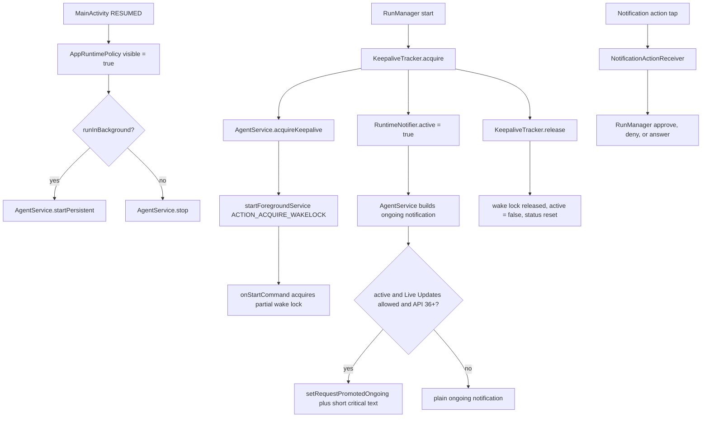

# Background Reliability and Live Activities

> Keeps the agent alive when the app is not visible, and projects its state into Android notifications, including Android 16 Live Updates.

`AgentService` is a `specialUse` foreground service. It owns the wake lock, the three notification channels, the ongoing status notification, answerable alerts, and the promotion request that turns the ongoing notification into a Live Update. `RuntimeNotifier` is the process-wide state bus the service mirrors. `AppRuntimePolicy` decides whether background execution is allowed at all. `KeepaliveTracker` reference-counts active work so overlapping runs and terminals do not fight over the wake lease.

## Module Responsibilities

- **`AgentService`**: foreground lifecycle, notification posting, wake lock, alert actions, Live Update promotion, and the process kill behind the notification Stop button.
- **`RuntimeNotifier`**: `status`, `active`, `pendingPrompts`, and `results` flows. `active` is true only while real task work holds the lease, so passive holders are never promoted.
- **`AppRuntimePolicy` and `AppRuntimeState`**: track every started Activity, combine that with the saved `runInBackground` and `notificationsEnabled` settings, and start or stop the service.
- **`AppNotifications`**: one switch for every optional app alert. It posts only when notifications are enabled and cancels non-foreground notifications when the user turns alerts off.
- **`KeepaliveTracker`**: counts active tasks and background holders, then calls acquire once on the first holder and release once on the last.
- **`RunResultNotifications`**: posts a completed-run notification even when the service has already stopped.
- **`NotificationActionReceiver`**: resolves approve, deny, always-allow, environment install, environment skip, question option, and RemoteInput answers.
- **Settings surfaces**: `BackgroundSettingsSection`, `LiveUpdatesSetting`, `LiveUpdateSettings`, and `SettingsRepository`.

## Architecture and Flow

The policy gate is `AppRuntimeState.canRun = ready && (visible || runInBackground)`. `start` collects the DataStore settings flow and the visibility flow, calls `AppNotifications.applyPreference`, and on a transition into background mode either acquires keepalive (if a task is active) or starts the service only while visible. If background running is switched off, it tears down Telegram, FTP sharing, terminals, background processes, and the service.

## Invocation Chain

1. `MainActivity.onCreate` loads the container; `HarnessApp.init` calls `runtimePolicy.start` ([HarnessApp.kt:373](../app/src/main/java/com/androidharness/app/HarnessApp.kt)#L373-L383)).
2. A run starts in `RunManager`, which calls `keepalive.acquire()` through `acquireKeepalive` ([RunManager.kt:1561](../app/src/main/java/com/androidharness/app/agent/RunManager.kt)#L1561-L1563)).
3. `KeepaliveTracker.acquire` calls `onAcquire` only on the transition from zero holders, and `onActiveChanged(true)` only for active tasks ([KeepaliveTracker.kt:12](../app/src/main/java/com/androidharness/app/agent/KeepaliveTracker.kt)#L12-L18)).
4. `AgentService.acquireKeepalive` calls `ContextCompat.startForegroundService` with `ACTION_ACQUIRE_WAKELOCK`, guarded by `runInBackground` ([AgentService.kt:558](../app/src/main/java/com/androidharness/app/AgentService.kt)#L558-L564)).
5. `onStartCommand` acquires the wake lock or releases it for the matching action ([AgentService.kt:246](../app/src/main/java/com/androidharness/app/AgentService.kt)#L246-L261)).
6. Status changes flow through `RuntimeNotifier.update`, are collected in `onCreate`, and repost notification 9101 ([AgentService.kt:199](../app/src/main/java/com/androidharness/app/AgentService.kt)#L199-L227)).
7. Notification buttons broadcast to `NotificationActionReceiver`, which cancels the alert and calls the same `RunManager` methods the in-app cards use ([NotificationActionReceiver.kt:17](../app/src/main/java/com/androidharness/app/agent/NotificationActionReceiver.kt)#L17-L44)).
8. On the last release, `KeepaliveTracker` calls `onRelease` and `onActiveChanged(false)`, which resets the status to `Running in background` and removes promotion ([RunManager.kt:193](../app/src/main/java/com/androidharness/app/agent/RunManager.kt)#L193-L199)).

## Service Lifecycle and Idle Handling

`onCreate` stores the singleton in `current`, creates the channels, calls `startForeground` with ID 9101, and launches five collectors: status, active, results, pending prompts, and the policy plus Live Updates setting ([AgentService.kt:194](../app/src/main/java/com/androidharness/app/AgentService.kt)#L194-L244)). Every notification post is wrapped in `runCatching`, so a notification failure cannot kill the service.

The service is deliberately not an always-on daemon:

- It starts only when `runInBackground` is true. `startPersistent` and `acquireKeepalive` both return early when the policy says otherwise.
- It is started on foreground entry while visible (`startPersistent`) and on task start (`acquireKeepalive`).
- When the last task releases, `active` becomes false and the status returns to `RuntimeNotifier.IDLE_STATUS`. The notification stays because Android requires a foreground service to keep its notice, but it loses the short critical text, progress style, and promotion request.
- Background holders use `acquireBackgroundKeepalive` (`activeTask = false`), so 9Router and similar services keep the wake lease and the notification without advertising an active task ([RunManager.kt:1563](../app/src/main/java/com/androidharness/app/agent/RunManager.kt)#L1563-L1564)).
- If `runInBackground` is switched off, the policy calls `AgentService.stop`, and `onStartCommand` returns `START_NOT_STICKY` instead of restarting.

The wake lock is a `PARTIAL_WAKE_LOCK` named `harness:agent` with a 12 hour ceiling, acquired once and released on `onDestroy`, on explicit release, or from the notification Stop path ([AgentService.kt:273](../app/src/main/java/com/androidharness/app/AgentService.kt)#L273-L287)).

## Notification Channels and Identity

`createChannels` defines three channels ([AgentService.kt:289](../app/src/main/java/com/androidharness/app/AgentService.kt)#L289-L315)):

| Channel ID | Constant | Importance | Purpose |
| --- | --- | --- | --- |
| `agent_runs` | `CHANNEL_ID` | `IMPORTANCE_LOW` | Ongoing run or terminal status |
| `run_results` | `RESULTS_CHANNEL_ID` | `IMPORTANCE_DEFAULT` | Completed-run notifications |
| `action_needed` | `ALERT_CHANNEL_ID` | `IMPORTANCE_HIGH`, public lock screen | Approvals, questions, environment installs |

IDs are fixed: 9101 for the ongoing notification, 9102 plus a hash suffix for results, and 9103 for alerts tagged by session ID. The tag is what lets parallel sessions keep separate alerts. The ongoing notification uses `setOnlyAlertOnce(true)`, `setOngoing(true)`, `CATEGORY_SERVICE`, no timestamp, and always carries a Stop action.

When alerts are disabled, `buildNotification` replaces the status text with `background_service_notice` and skips action buttons and promotion. `AppNotifications.applyPreference(false)` cancels every active notification that does not have `FLAG_FOREGROUND_SERVICE`, leaving the Android-owned service notice in place ([AppRuntimePolicy.kt:88](../app/src/main/java/com/androidharness/app/AppRuntimePolicy.kt)#L88-L104)).

## Notification Actions

The ongoing live card carries only the actions a chip can honor:

- Approval prompt: Approve and Deny.
- Environment prompt: Skip and Install.
- Question prompt: no buttons on the ongoing card.

The in-shade alert built by `buildActionNeeded` is richer ([AgentService.kt:419](../app/src/main/java/com/androidharness/app/AgentService.kt)#L419-L473)):

- Approval: Deny, Approve, Always allow.
- Environment: Skip, Install.
- Question: up to `MAX_OPTION_BUTTONS` (3) option buttons plus a `Reply…` action backed by `RemoteInput` key `reply_text`.

`PendingIntent` request codes are `31 * sessionId.hashCode() + slot` so two sessions cannot overwrite each other's action extras, which are not part of PendingIntent identity. Option buttons and action buttons use immutable PendingIntents. Only the free-text answer intent is mutable, because `RemoteInput` requires it ([AgentService.kt:497](../app/src/main/java/com/androidharness/app/AgentService.kt)#L497-L518)).

`RuntimeNotifier.setSessionPrompts` replaces one session's prompts under a lock and republishes the flattened union, so removals and additions from one session never erase another session's alert ([AgentService.kt:67](../app/src/main/java/com/androidharness/app/AgentService.kt)#L67-L73)). `refreshPromptAlerts` cancels tags that disappeared and reposts the current set.

## Android 16 Live Updates and Now Bar

The manifest declares `POST_PROMOTED_NOTIFICATIONS` with a comment that the run notification may be promoted on any OEM ([AndroidManifest.xml:7](../app/src/main/AndroidManifest.xml)#L7-L8)). Promotion happens in `buildNotification` only when all of these hold ([AgentService.kt:361](../app/src/main/java/com/androidharness/app/AgentService.kt)#L361-L371)):

- alerts are enabled,
- `liveUpdatesEnabled` is true (which also requires `policy.notificationsEnabled`),
- `RuntimeNotifier.active` is true,
- the status is non-blank and not the idle text,
- `Build.VERSION.SDK_INT >= Build.VERSION_CODES.BAKLAVA` (API 36).

The builder then calls `setRequestPromotedOngoing(true)`, `setShortCriticalText(liveUpdateShortText(text))`, and sets `NotificationCompat.ProgressStyle().setProgressIndeterminate(true)`.

This matches the user-facing description of promoted runs, idle services not being promoted, and the settings card ([FEATURES.md:152](../FEATURES.md)#L152)).

Chip text is short by design. `liveUpdateShortLabel` maps known prefixes (`Waiting for your approval`, `Waiting for your answer`, `Installing Linux environment`, `Linux environment needs`, `Retrying`, `Thinking`, `Writing response`, `Generating code`, `Working`, `Running in background`, empty) to string resources. Anything else falls back to the first line trimmed to 24 characters ([AgentService.kt:88](../app/src/main/java/com/androidharness/app/AgentService.kt)#L88-L106)).

Settings expose the switch under Agent behavior and Background settings. `LiveUpdatesSetting` renders an unsupported message below API 36 and otherwise shows the switch, detected device plus skin, permission dot, vendor steps, usage note, and an Open notification settings button ([AgentBehaviorSection.kt:435](../app/src/main/java/com/androidharness/app/ui/settings/AgentBehaviorSection.kt)#L435-L518)). `liveUpdateState` maps `canPostPromotedNotifications()` to READY or BLOCKED, and API below 36 to UNSUPPORTED ([LiveUpdateSettings.kt:76](../app/src/main/java/com/androidharness/app/ui/settings/LiveUpdateSettings.kt)#L76-L82)).

Vendor detection is pure and unit-testable. `detectLiveUpdateVendor` matches manufacturer and brand strings to Samsung, Google, Xiaomi, ColorOS, OriginOS, MagicOS, near-stock, or other ([LiveUpdateSettings.kt:39](../app/src/main/java/com/androidharness/app/ui/settings/LiveUpdateSettings.kt)#L39-L51)). `openLiveUpdateSettings` tries the Android 16 promotion page, then the Xiaomi MIUI notification page, then app notification settings, then app details, stopping at the first intent that resolves ([LiveUpdateSettings.kt:91](../app/src/main/java/com/androidharness/app/ui/settings/LiveUpdateSettings.kt)#L91-L118)). The app never requests the promotion appop itself.

## Boot Restore and Recovery

`AgentService` has no boot receiver. The manifest registers only two boot-adjacent receivers:

- `TelegramBootReceiver` handles `BOOT_COMPLETED` and `MY_PACKAGE_REPLACED` and calls `telegram.restoreIfEnabled()` ([TelegramService.kt:93](../app/src/main/java/com/androidharness/app/telegram/TelegramService.kt)#L93-L98)). `restoreIfEnabled` only starts when the saved setup is enabled and `runtimePolicy.canRun()` ([TelegramManager.kt:91](../app/src/main/java/com/androidharness/app/telegram/TelegramManager.kt)#L91-L97)).
- `WirelessAdbReconnectReceiver` handles `MY_PACKAGE_REPLACED` and calls `WirelessAdbService.resume` ([WirelessAdbService.kt:88](../app/src/main/java/com/androidharness/app/data/env/adb/WirelessAdbService.kt)#L88-L92)).

An agent run therefore does not resume at boot. It resumes when the app is opened and the run infrastructure is restored; the service itself is only started by the policy or by a task acquiring keepalive. This is a deliberate consequence of the foreground-service gate, not a missing receiver.

## Key State and Data Structures

- **`AppRuntimeState`**: `ready`, `visible`, `runInBackground`, `notificationsEnabled`, plus `canRun`.
- **`PendingPrompt`**: `sessionId`, `kind` (APPROVAL, QUESTION, ENVIRONMENT), `sessionTitle`, `headline`, optional `detail`, and `options`.
- **`RunResultNotification`**: `sessionId`, `title`, `ok`, `summary`, optional `notificationTitle`, optional `subagentCallId`.
- **Settings**: DataStore keys `run_in_background`, `notifications_enabled`, and `live_updates_enabled`; all default to true ([SettingsRepository.kt:269](../app/src/main/java/com/androidharness/app/data/SettingsRepository.kt)#L269-L272), [SettingsRepository.kt:395](../app/src/main/java/com/androidharness/app/data/SettingsRepository.kt)#L395-L398)). Setters are `setRunInBackground`, `setNotificationsEnabled`, and `setLiveUpdatesEnabled` ([SettingsRepository.kt:897](../app/src/main/java/com/androidharness/app/data/SettingsRepository.kt)#L897-L912)).
- **Runtime-only state**: `AgentService.current`, `liveUpdatesEnabled`, `wakeLock`, and `shownAlertTags`. None survive process death.

## Boundary Conditions

- Background service startup fails silently if the app is in a state where `startForegroundService` is not allowed; the policy and `AgentService.startPersistent` guard the common cases but do not catch `ForegroundServiceStartNotAllowedException`.
- The wake lock ceiling is 12 hours. A run longer than that loses the CPU guarantee unless something reacquires it.
- Notification permission is requested in `MainActivity` after settings load, only when `notificationsEnabled` is true and API is 33 or higher ([MainActivity.kt:86](../app/src/main/java/com/androidharness/app/MainActivity.kt)#L86-L89)). If denied, the foreground notice still exists because Android owns it, but optional alerts are suppressed.
- Turning notifications off does not stop runs. It only strips content, actions, result alerts, and promotion.
- The Stop action stops Telegram, all runs, the terminal, and background processes, then calls `Process.killProcess(Process.myPid())` on the IO dispatcher. It is intentionally a full app stop ([AgentService.kt:389](../app/src/main/java/com/androidharness/app/AgentService.kt)#L389-L401)).
- `releaseKeepalive` uses the static `current` reference and does nothing when the user already stopped the service, so releasing cannot resurrect it.
- `RunResultNotifications.post` creates its channel again and checks `AppNotifications.enabled`; a result is dropped, not queued, when alerts are off.

## Extension Points

- New run states can be added to `liveUpdateShortLabel` and `liveUpdateShortText` without touching the promotion gate.
- New OEM skins extend `LiveUpdateVendor` plus the string resource pairs used by the settings card.
- New prompt kinds extend `PendingPrompt.Kind` and both `buildNotification` and `buildActionNeeded`, plus the receiver action map.
- Background services that need the wake lease without a task advertisement call `RunManager.acquireBackgroundKeepalive` and its release counterpart.
- Channel names and notification IDs are constants in `AgentService.Companion`; changing an ID changes notification identity and should be treated as a migration.

Sources: [AgentService.kt:36-571](../app/src/main/java/com/androidharness/app/AgentService.kt)#L36-L571), [AppRuntimePolicy.kt:13-106](../app/src/main/java/com/androidharness/app/AppRuntimePolicy.kt)#L13-L106), [KeepaliveTracker.kt:4-30](../app/src/main/java/com/androidharness/app/agent/KeepaliveTracker.kt)#L4-L30), [LiveUpdateSettings.kt:21-118](../app/src/main/java/com/androidharness/app/ui/settings/LiveUpdateSettings.kt)#L21-L118)

## Source files

- `app/src/main/java/com/androidharness/app/AgentService.kt`
- `app/src/main/java/com/androidharness/app/AppRuntimePolicy.kt`
- `app/src/main/java/com/androidharness/app/agent/KeepaliveTracker.kt`
- `app/src/main/java/com/androidharness/app/agent/NotificationActionReceiver.kt`
- `app/src/main/java/com/androidharness/app/agent/RunManager.kt`
- `app/src/main/java/com/androidharness/app/HarnessApp.kt`
- `app/src/main/java/com/androidharness/app/MainActivity.kt`
- `app/src/main/java/com/androidharness/app/data/SettingsRepository.kt`
- `app/src/main/java/com/androidharness/app/ui/settings/BackgroundSettingsSection.kt`
- `app/src/main/java/com/androidharness/app/ui/settings/AgentBehaviorSection.kt`
- `app/src/main/java/com/androidharness/app/ui/settings/LiveUpdateSettings.kt`
- `app/src/main/java/com/androidharness/app/telegram/TelegramService.kt`
- `app/src/main/java/com/androidharness/app/telegram/TelegramManager.kt`
- `app/src/main/java/com/androidharness/app/data/env/adb/WirelessAdbService.kt`
- `app/src/main/AndroidManifest.xml`
- `FEATURES.md`
