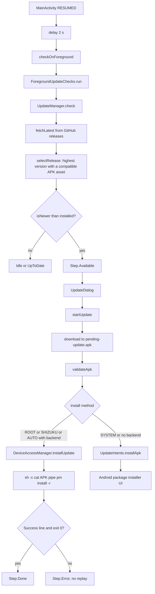

# Update Manager and Install Routes

> Checks GitHub Releases, downloads and verifies a release APK, and installs it through the best available route on the device.

`UpdateManager` is a state machine exposed as `StateFlow<Step>`. It fetches up to 100 releases from the GitHub API, chooses the highest version that has an APK this device can run, stages the file under a fixed name, verifies its signature and architecture, then dispatches to Root, Shizuku, Automatic, or the Android package installer. `UpdateInstallPolicy` holds the pure rules; `UpdateIntents` holds the Activity-independent installer handoff; `ForegroundUpdateChecks` debounces and retries foreground checks; `UpdateDialog` renders the step; `WhatsNewStore` handles the Play-only post-update summary.

## Module Responsibilities

- **`UpdateManager`**: release fetch, version selection, download, checksum, APK validation, route dispatch, persisted install method, and the `Step` flow.
- **`UpdateInstallPolicy`**: shell command construction, success detection, asset URL allowlist, APK size limit, and package, version, signer, and ABI compatibility.
- **`UpdateIntents`**: `FileProvider` content URI to `ACTION_INSTALL_PACKAGE` and the unknown-sources settings hop.
- **`ForegroundUpdateChecks`**: one in-flight check, a 60 second success cooldown, and the 0, 10 s, 30 s retry ladder.
- **`UpdateDialog`**: release notes markdown, download progress, route-specific installing text, retry and dismiss behavior.
- **`UpdateInstallationChoice`**: the settings dropdown that writes `UpdateInstallMethod`.
- **`DeviceAccessManager.installUpdate`**: selects a privileged backend and runs `pm install -r`.
- **`WhatsNewStore` and `WhatsNewDialog`**: one summary per install, gated by `BuildConfig.PLAY_DISTRIBUTION`.

## Architecture and Flow



## Invocation Chain

1. `MainActivity.onCreate` starts a lifecycle-aware coroutine that waits 2 seconds in the RESUMED state and calls `container.updates.checkOnForeground()` ([MainActivity.kt:79](../app/src/main/java/com/androidharness/app/MainActivity.kt)#L79-L84)).
2. `checkOnForeground` delegates to `ForegroundUpdateChecks.run { check() }` ([UpdateManager.kt:94](../app/src/main/java/com/androidharness/app/data/update/UpdateManager.kt)#L94)).
3. `run` takes a `Mutex` with `tryLock`, returns if a success happened less than 60 seconds ago, then delays 0, 10, and 30 seconds between attempts and stops at the first successful check ([ForegroundUpdateChecks.kt:8](../app/src/main/java/com/androidharness/app/data/update/ForegroundUpdateChecks.kt)#L8-L24)).
4. `UpdateManager.check` skips while downloading or installing, rechecks state under the operation mutex, reads the installed `versionName`, sets `Step.Checking`, fetches the newest release, and decides between `Available`, `UpToDate`, `Error`, and `Idle` ([UpdateManager.kt:97](../app/src/main/java/com/androidharness/app/data/update/UpdateManager.kt)#L97-L125)).
5. The dialog's Update button calls `startUpdate` with `UpdateIntents.installApk` and `UpdateIntents.openUnknownSourcesSettings` as callbacks ([MainActivity.kt:192](../app/src/main/java/com/androidharness/app/MainActivity.kt)#L192-L223)).
6. `startUpdate` downloads, validates, and dispatches, then locks the operation mutex for the whole run ([UpdateManager.kt:218](../app/src/main/java/com/androidharness/app/data/update/UpdateManager.kt)#L218-L251)).
7. A confirmed Root or Shizuku install deletes the staged APK and posts `Step.Done`; a system install posts `Step.Installing` and opens the installer activity.

## Release Check and Version Selection

`fetchLatest` requests `https://api.github.com/repos/Sanuu7/AndroidHarness/releases?per_page=100` with `Accept: application/vnd.github+json` and a 20 second call timeout ([UpdateManager.kt:132](../app/src/main/java/com/androidharness/app/data/update/UpdateManager.kt)#L132-L158)). Pre-releases are included on purpose.

`selectRelease` does not trust GitHub ordering ([UpdateManager.kt:294](../app/src/main/java/com/androidharness/app/data/update/UpdateManager.kt)#L294-L305)):

- Drafts are skipped.
- A release must produce a parseable version and at least one compatible APK asset.
- It keeps the candidate that is newer than the current best by `isNewer`, not by list position.
- `parseRelease` strips a leading `v` from the tag, collects `body`, `html_url`, and the first `.apk` asset whose filename either names no known ABI or names one present in `Build.SUPPORTED_ABIS`.
- Known ABI tokens are `arm64-v8a`, `armeabi-v7a`, `x86_64`, and `x86`.
- The asset `digest` field is accepted only if it matches `sha256:<64 hex>`; the prefix is removed.

Version comparison is numeric and conservative ([UpdateManager.kt:269](../app/src/main/java/com/androidharness/app/data/update/UpdateManager.kt)#L269-L292)):

- `parseParts` first looks for a dotted core with `\d+(?:\.\d+)+`. This prevents a date in a release name from being read as the version.
- A single integer with optional `v` or `alpha-v` prefix is also accepted.
- Missing segments count as zero.
- Equal versions return false. Unparsable versions return false, so odd tags never prompt.

`releaseVersion` uses the tag when it parses and otherwise the release name.

## APK Verification

`validateApk` runs before any install and again in `continueSystemInstall` ([UpdateManager.kt:196](../app/src/main/java/com/androidharness/app/data/update/UpdateManager.kt)#L196-L216)). It requires all of the following:

- The candidate archive is readable by `PackageManager.getPackageArchiveInfo`.
- `UpdateInstallPolicy.compatible` passes: same package name, candidate `longVersionCode` at least the installed one, installed signers non-empty.
- Signer rule: when either side has more than one signer, the signer sets must be identical. Otherwise every installed signer must appear in the candidate's certificate history, which allows a signing key rotation.
- Candidate `minSdkVersion` is at most the device API.
- If the APK contains `lib/<abi>/*.so`, at least one of those ABIs is in `Build.SUPPORTED_ABIS`.

Signature digests are SHA-256 over each `Signature` byte array, using `GET_SIGNING_CERTIFICATES` on API 28 and newer and `GET_SIGNATURES` below that.

## Download and Staging

`download` uses a fixed output name, never a release-supplied filename ([UpdateManager.kt:161](../app/src/main/java/com/androidharness/app/data/update/UpdateManager.kt)#L161-L194)):

- Staging directory is `getExternalFilesDir(null)/update`, which the shell UID can read.
- Final file is `pending-update.apk`; the in-progress file is `pending-update.apk.part`.
- `UpdateInstallPolicy.trustedAsset` must accept the URL: HTTPS, host `github.com`, port 443 or default, no user info, path prefix `/Sanuu7/AndroidHarness/releases/download/`, no query, no fragment.
- The declared length and the running byte count must stay at or below `MAX_APK_BYTES`, which is 512 MiB.
- SHA-256 is computed while streaming. A release `digest` must match when present.
- The byte count must equal the HTTP content length when known and must equal the asset size when the asset size is positive.
- `fd.sync()` runs before the rename.
- Cancellation checks the `cancelled` flag and thread interruption on every 64 KiB chunk.
- The `.part` file is deleted in `finally`; the final file is only deleted on a confirmed privileged install.

`dismiss` ignores `Installing`, otherwise sets `cancelled`, cancels `activeCall`, and resets to `Step.Idle` ([UpdateManager.kt:127](../app/src/main/java/com/androidharness/app/data/update/UpdateManager.kt)#L127-L130)).

## Install Routes

The route set matches the user-facing description: Automatic uses an enabled authorized route and falls back to the Android installer, a dispatched install is never retried automatically, and the dialog names the route ([FEATURES.md:149](../FEATURES.md)#L149)).

`UpdateInstallMethod` has four values: `AUTO`, `ROOT`, `SHIZUKU`, and `SYSTEM`. The chosen value is stored in the `update-installation` SharedPreferences file under key `method`, and cannot be changed while downloading or installing ([UpdateManager.kt:75](../app/src/main/java/com/androidharness/app/data/update/UpdateManager.kt)#L75-L81)). The settings dropdown is disabled in the same states ([UpdateInstallationChoice.kt:18](../app/src/main/java/com/androidharness/app/ui/settings/UpdateInstallationChoice.kt)#L18-L38)).

**Root and Shizuku.** `DeviceAccessManager.installUpdate` receives the requested backend and builds a shell command through `UpdateInstallPolicy.command` ([DeviceAccessManager.kt:216](../app/src/main/java/com/androidharness/app/data/env/DeviceAccessManager.kt)#L216-L234)):

```
/system/bin/sh -c "/system/bin/cat '<path>' | /system/bin/pm install -r --user <user> -S <bytes>"
```

The path is single-quoted with embedded quotes escaped. The pipe is required because Android can reject a shared-storage file descriptor sent over Binder. `user` is `Process.myUid() / 100000`, which maps the app UID to its Android user. Root commands run with a 120 second timeout and 4000 output cap; Shizuku uses `runPrivileged` with the same limits. `ROOT` excludes Shizuku and the app shell; `SHIZUKU` requires Shizuku.

`UpdateInstallPolicy.succeeded` requires exit code 0, no timeout, and an output line whose trim equals `Success`. Anything else becomes `Step.Error("Installation was not confirmed...")` and the install is never replayed.

**Automatic.** `AUTO` passes no forced backend. `installUpdate` selects through `DeviceAccessManager.select`, which respects the configured access mode and excludes the normal app shell. If no privileged backend is available, `installUpdate` returns null and `startUpdate` falls through to the system installer. If the user explicitly chose `ROOT` or `SHIZUKU` and it is unavailable, the `check(method == UpdateInstallMethod.AUTO)` guard throws, which becomes an error instead of a silent route change.

**Android installer.** `UpdateIntents.installApk` builds a content URI with authority `${packageName}.update` and the manifest `FileProvider`, then starts `ACTION_INSTALL_PACKAGE` with type `application/vnd.android.package-archive`, read permission, and `FLAG_ACTIVITY_NEW_TASK` ([UpdateIntents.kt:19](../app/src/main/java/com/androidharness/app/data/update/UpdateIntents.kt)#L19-L33)). The provider is declared non-exported with URI grants ([AndroidManifest.xml:146](../app/src/main/AndroidManifest.xml)#L146-L155)). On API 26 and newer, if `canRequestPackageInstalls()` is false, the manager posts `NEED_INSTALL_PERMISSION` and opens `ACTION_MANAGE_UNKNOWN_APP_SOURCES` for the package instead.

## Retry Policy

Two layers retry:

- **Foreground check layer**: `ForegroundUpdateChecks` allows one check at a time, waits 60 seconds after a success, and tries three times at 0, 10, and 30 seconds. Automatic failures stay quiet and `check` returns false. Manual checks report the exception message and return false. An existing `Available` or an `Error` that still carries a release is not overwritten by an automatic check ([UpdateManager.kt:97](../app/src/main/java/com/androidharness/app/data/update/UpdateManager.kt)#L97-L124)).
- **Install layer**: there is no automatic retry. A failed install leaves the release attached to `Step.Error` so the user can retry from the dialog. `UpdateActions` shows Retry, or Try again when the error is exactly `NEED_INSTALL_PERMISSION` ([UpdateDialog.kt:641](../app/src/main/java/com/androidharness/app/ui/update/UpdateDialog.kt)#L641-L655)).

The manual button in Settings calls `check(manual = true)` and is disabled while checking or downloading ([SettingsScreen.kt:3426](../app/src/main/java/com/androidharness/app/ui/settings/SettingsScreen.kt)#L3426-L3432)).

## What's New After a Play Update

The dialog is gated by a generated `BuildConfig` boolean, not by a product flavor. `app/build.gradle.kts` sets `PLAY_DISTRIBUTION` from the `distribution` Gradle property ([app/build.gradle.kts:68](../app/build.gradle.kts)#L68)). `MainActivity` shows the dialog only when that boolean is true and `WhatsNewStore.seen` is false ([MainActivity.kt:183](../app/src/main/java/com/androidharness/app/MainActivity.kt)#L183-L191)).

`WhatsNewStore` uses SharedPreferences file `whats-new` with boolean key `seen`. Marking is permanent for the install, so it does not reappear on later Play updates until the app data is cleared or the install is fresh ([WhatsNewStore.kt:6](../app/src/main/java/com/androidharness/app/ui/whatsnew/WhatsNewStore.kt)#L6-L18)). The dialog lists static resource IDs grouped into Added, Improved, and Fixed ([WhatsNewDialog.kt:41](../app/src/main/java/com/androidharness/app/ui/whatsnew/WhatsNewDialog.kt)#L41-L147)).

## Key State and Data Structures

- **`UpdateManager.Step`**: sealed interface with `Idle`, `Checking`, `UpToDate(current)`, `Available(release)`, `Downloading(release, percent, mb, totalMb)`, `Installing(release, viaShizuku, viaRoot)`, `Done(viaShizuku, viaRoot)`, and `Error(message, release?)`.
- **`LatestRelease`**: `tag`, `name`, `body`, `htmlUrl`, optional `apkUrl`, optional `apkName`, `apkBytes`, optional `apkSha256`.
- **`UpdateManager` fields**: `_step` StateFlow, `operation` Mutex, `cancelled` AtomicBoolean, `@Volatile activeCall`, `installMethod` StateFlow, `foregroundChecks`, and the lazy `updateDir`.
- **`UpdateInstallPolicy` constants**: `MAX_APK_BYTES = 512L * 1024 * 1024`.
- **`ForegroundUpdateChecks`**: `running` Mutex, `lastSuccess`, injected `clock`, and `retryDelays`.

## Boundary Conditions

- A release with no compatible APK, or an unparsable version, is ignored entirely. A manual check then reports "No published release with a compatible APK found."
- HTTP errors, empty bodies, non-success status, and GitHub API failures surface as exceptions during check; automatic checks log `AppUpdater` and return to `Idle`.
- A checksum mismatch deletes the partial file and requires a fresh download.
- A signature rotation is accepted only through the certificate history of the candidate; a completely different signer fails compatibility.
- A lower `versionCode` is rejected even if the displayed marketing version is higher.
- An APK whose native libraries do not match the device ABI is rejected before any install.
- Cancellation during download resets the step to `Idle`; cancellation during install also resets to `Idle` and rethrows.
- `UpdateDialog` cannot be dismissed while `Downloading` or `Installing`, and the install method cannot change during those states.
- Play builds still use this GitHub update path; only the What's New summary is channel-gated.

## Extension Points

- Add a route by extending `UpdateInstallMethod`, the dropdown labels, and the `when` in `startUpdate`.
- Change release policy through `RELEASES_API`, `selectRelease`, and `UpdateInstallPolicy.trustedAsset`.
- The dialog renders any new `Step` by adding a branch in `UpdateBodyContent`, `UpdateActions`, and `titleFor`.
- Retry cadence is injectable through the `ForegroundUpdateChecks` constructor (`clock`, `retryDelays`), which is also what unit tests use.
- The What's New content is a resource list, so shipping a new Play build only requires editing `ADDED`, `IMPROVED`, and `FIXED` in `WhatsNewDialog.kt`.

Sources: [UpdateManager.kt:38-337](../app/src/main/java/com/androidharness/app/data/update/UpdateManager.kt)#L38-L337), [UpdateInstallPolicy.kt:6-26](../app/src/main/java/com/androidharness/app/data/update/UpdateInstallPolicy.kt)#L6-L26), [UpdateIntents.kt:16-44](../app/src/main/java/com/androidharness/app/data/update/UpdateIntents.kt)#L16-L44), [ForegroundUpdateChecks.kt:6-24](../app/src/main/java/com/androidharness/app/data/update/ForegroundUpdateChecks.kt)#L6-L24), [UpdateDialog.kt:77-667](../app/src/main/java/com/androidharness/app/ui/update/UpdateDialog.kt)#L77-L667)

## Source files

- `app/src/main/java/com/androidharness/app/data/update/UpdateManager.kt`
- `app/src/main/java/com/androidharness/app/data/update/UpdateInstallPolicy.kt`
- `app/src/main/java/com/androidharness/app/data/update/UpdateIntents.kt`
- `app/src/main/java/com/androidharness/app/data/update/ForegroundUpdateChecks.kt`
- `app/src/main/java/com/androidharness/app/ui/update/UpdateDialog.kt`
- `app/src/main/java/com/androidharness/app/ui/settings/UpdateInstallationChoice.kt`
- `app/src/main/java/com/androidharness/app/ui/settings/SettingsScreen.kt`
- `app/src/main/java/com/androidharness/app/ui/whatsnew/WhatsNewDialog.kt`
- `app/src/main/java/com/androidharness/app/ui/whatsnew/WhatsNewStore.kt`
- `app/src/main/java/com/androidharness/app/MainActivity.kt`
- `app/src/main/java/com/androidharness/app/HarnessApp.kt`
- `app/src/main/java/com/androidharness/app/data/env/DeviceAccessManager.kt`
- `app/src/main/AndroidManifest.xml`
- `app/build.gradle.kts`
- `FEATURES.md`
