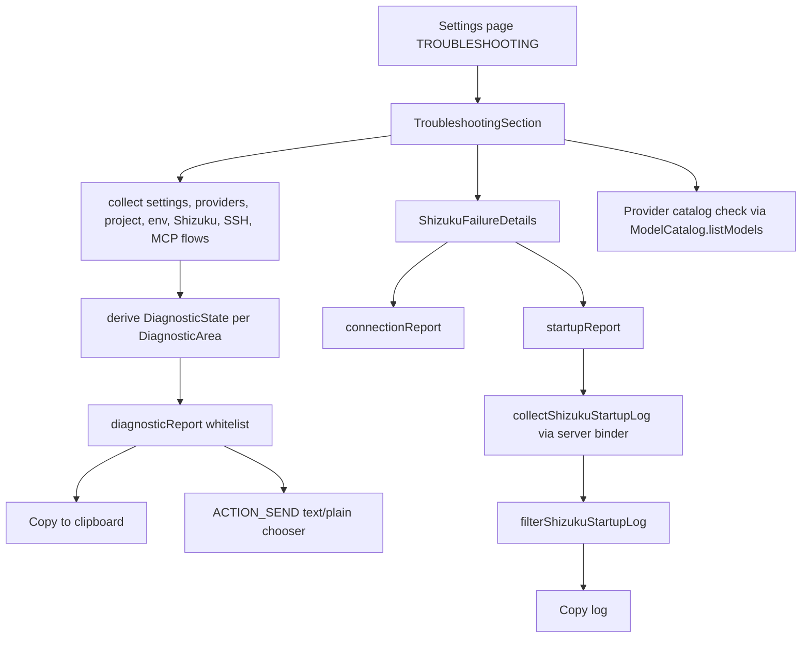

# Troubleshooting and Diagnostics

> Collects the live state of every optional subsystem into one settings page, exports a redacted report, and captures Shizuku startup evidence when the privileged runner fails.

The page implements the user-facing promise of one place to check the provider, storage, workspace, Linux tools, Shizuku, SSH, MCP, and notifications, with an export built from a fixed whitelist ([FEATURES.md:156](../FEATURES.md)#L156)). `TroubleshootingSection` renders one `DiagnosticCard` per subsystem and derives each state from the same flows the rest of the app uses. `diagnosticReport` builds the copy and share text from a fixed whitelist of area and state labels. Shizuku is the only area with a second, explicitly requested artifact: `ShizukuFailureDetails` can copy the connection report and a filtered logcat capture collected through the Shizuku server binder. `DoctorTool` is a separate agent tool for GitHub-specific end-to-end checks.

## Module Responsibilities

- **`TroubleshootingSection`**: gathers provider, storage, workspace, Linux environment, Shizuku, SSH, MCP, and notification state; runs the manual provider catalog check and folder check; offers refresh, copy, and share.
- **`DiagnosticReport`**: the `DiagnosticState`, `DiagnosticArea`, and `CatalogCheck` enums, catalog failure classification, Shizuku state mapping, and the whitelisted export format.
- **`ShizukuFailureDetails`**: failure headline, summary, collapsible detail, Copy error, Copy log, and a recovered variant.
- **`ShizukuConnectionFailure`**: typed failure reason plus a report that includes the timestamp and stack trace detail.
- **`ShizukuStartupLogCollector`**: fixed read-only logcat command through `IShizukuService.newProcess`.
- **`ShizukuStartupLog`**: log line filtering, package-scoped PID and record-token correlation, and bounded stream reads.
- **`ShizukuManager` and `ShizukuServiceBinding`**: state classification, bind timeout, compatibility fallback, and automatic retry.
- **`DoctorTool`**: the `doctor` tool with GitHub API, token file, git transport, and Free-plan protection checks.

## Architecture and Flow

## Checks Performed

`TroubleshootingSection` subscribes to `settings`, `providers`, `workspace.currentProject`, `linuxEnv.state`, `shizuku.state`, `shizuku.serviceState`, `shizuku.connectionFailure`, SSH statuses, MCP servers, MCP tool statuses, and `mcp.configTampered` ([TroubleshootingSection.kt:53](../app/src/main/java/com/androidharness/app/ui/settings/TroubleshootingSection.kt)#L53-L64)).

- **Default provider**: the provider whose ID equals `settings.activeProviderId`. A missing provider is an ISSUE. The catalog check calls `ModelCatalog.listModels` with the effective API key, an OkHttp client with a 20 second call timeout, and an outer 25 second `withTimeout`. `Models` with a non-empty list is REACHABLE, an empty list is EMPTY, and `Failed` is classified by `catalogFailure`: a 401 or 403 becomes AUTH, a 429 becomes RATE_LIMIT, and anything else FAILED. Timeout becomes TIMEOUT. Local providers skip the network button and open the Local models page instead ([TroubleshootingSection.kt:148](../app/src/main/java/com/androidharness/app/ui/settings/TroubleshootingSection.kt)#L148-L168)).
- **Storage access**: READY when `rememberStorageAccess().granted` is true, otherwise ISSUE. The card offers the grant action.
- **Default workspace**: skipped for SSH workspaces. Otherwise `checkFolder` opens `fsFor(project).resolve(".")`, requires `exists`, `isDirectory`, a readable `shellRoot`, and a successful `list()`. Any exception is an ISSUE. SSH workspaces get a manual Check folder action because remote access is not probed automatically ([TroubleshootingSection.kt:81](../app/src/main/java/com/androidharness/app/ui/settings/TroubleshootingSection.kt)#L81-L96)).
- **Linux tools**: maps `EnvState.NotInstalled` to OFF, `Ready` to INSTALLED, `Failed` to ISSUE, and any transitional state to CHECKING ([TroubleshootingSection.kt:104](../app/src/main/java/com/androidharness/app/ui/settings/TroubleshootingSection.kt)#L104-L109)).
- **Shizuku**: `shizukuDiagnostic(granted, ready, binding, failed)` returns OFF when permission is not granted, READY when the service is ready, CHECKING while binding, ISSUE when binding failed, and NOT_CHECKED otherwise ([DiagnosticReport.kt:28](../app/src/main/java/com/androidharness/app/ui/settings/DiagnosticReport.kt)#L28-L33)). The card has a special COMPAT_READY detail for the compatibility runner.
- **SSH workspaces**: no connections is NOT_CHECKED, any `uncertain` status is ISSUE, any connected status is READY, otherwise OFF ([TroubleshootingSection.kt:121](../app/src/main/java/com/androidharness/app/ui/settings/TroubleshootingSection.kt)#L121-L126)).
- **Connected tools**: a tampered MCP config is ISSUE. No enabled servers is OFF. Any server in `failed` or `auth` is ISSUE. Any `connecting` is CHECKING. All connected is READY. Anything else is NOT_CHECKED ([TroubleshootingSection.kt:112](../app/src/main/java/com/androidharness/app/ui/settings/TroubleshootingSection.kt)#L112-L120)).
- **Notifications**: READY when `POST_NOTIFICATIONS` is granted and `NotificationManagerCompat.areNotificationsEnabled()` is true, otherwise OFF. On API 36 and newer a second button opens the Live Update settings resolver ([TroubleshootingSection.kt:214](../app/src/main/java/com/androidharness/app/ui/settings/TroubleshootingSection.kt)#L214-L223)).

On `ON_RESUME` the section calls `storage.refresh()` and `shizuku.refresh()`, rechecks notifications, and increments `revision`, which re-runs the folder check. This is why returning from Android settings updates the cards without leaving the page ([TroubleshootingSection.kt:71](../app/src/main/java/com/androidharness/app/ui/settings/TroubleshootingSection.kt)#L71-L80)).

## Report Whitelist and Redaction

`diagnosticReport` is deliberately narrow ([DiagnosticReport.kt:37](../app/src/main/java/com/androidharness/app/ui/settings/DiagnosticReport.kt)#L37-L49)). It emits:

1. The fixed title `AndroidHarness troubleshooting`.
2. The app version, filtered to letters, digits, `.`, `-`, and `+`, then capped at 40 characters.
3. The Android API level.
4. The fixed scope line `Scope: default provider and default workspace`.
5. One line per area using the English enum labels and state labels.
6. The count of saved providers and the count of enabled MCP servers.
7. Two fixed caveats: catalog access does not confirm generation or quota, and credentials, endpoints, names, paths, chats, and raw logs are excluded.

No provider name, model name, base URL, API key, workspace path, chat title, MCP server name, or raw error string enters this string. The only dynamic values are the filtered version string, the API level, and the two integer counts. The same exact string is used for clipboard and share, so both paths have the same guarantee ([TroubleshootingSection.kt:132](../app/src/main/java/com/androidharness/app/ui/settings/TroubleshootingSection.kt)#L132-L147)).

The Shizuku artifacts are intentionally different and are never included in the general report. `connectionReport` includes package name, Android release and API, manufacturer and model, Shizuku API and server versions, manager app version, state, shell runner state, and the last failure report ([ShizukuManager.kt:302](../app/src/main/java/com/androidharness/app/data/env/ShizukuManager.kt)#L302-L320)). `ShizukuFailureDetails` requires an explicit Copy error or Copy log action, and the expanded detail is a selectable container rather than part of the page report.

`ShizukuConnectionFailure.detail` is a stack trace truncated to 6000 characters. `report()` renders the timestamp, the enum name, the fixed summary, and the optional detail. The comment on the data class states the capture boundary: connection diagnostics only, never commands, environment variables, or shell output ([ShizukuConnectionFailure.kt:20](../app/src/main/java/com/androidharness/app/data/env/ShizukuConnectionFailure.kt)#L20-L37)).

## Shizuku Recovery

Recovery is split between state classification and a single-attempt binder wrapper.

`ShizukuManager.refresh` pings the binder, checks self permission, resolves the installed provider, and sets one of `NOT_INSTALLED`, `NOT_RUNNING`, `RUNNING_NO_PERMISSION`, or `GRANTED`. When granted it calls `bindUserService`; otherwise it clears compatibility, disconnects the binding, and sets service state to `NOT_BOUND` ([ShizukuManager.kt:358](../app/src/main/java/com/androidharness/app/data/env/ShizukuManager.kt)#L358-L381)).

`ShizukuServiceBinding` owns one attempt at a time:

- The default timeout is 15 seconds. On expiry it fails with TIMEOUT and a detail explaining that the server did not provide a startup error and that device logcat is needed.
- A null binder fails with NULL_BINDER. A dead binder fails with DEAD_BINDER. An exception while checking fails with BINDER_CHECK_FAILED. A bind exception fails with BIND_EXCEPTION.
- Disconnect and binding-died callbacks fail with SERVICE_DISCONNECTED and BINDING_DIED.
- Late callbacks from an expired attempt are ignored because every callback compares the attempt identity.
- `onDisconnected` waits 1.5 seconds and calls `refresh()` ([ShizukuServiceBinding.kt:23](../app/src/main/java/com/androidharness/app/data/env/ShizukuServiceBinding.kt)#L23-L112)).

`observeServiceState` chooses the recovery path by reason ([ShizukuManager.kt:222](../app/src/main/java/com/androidharness/app/data/env/ShizukuManager.kt)#L222-L246)):

- BIND_FAILED with TIMEOUT, BIND_EXCEPTION, or NULL_BINDER starts `startCompatibility`, which launches `ShizukuCompatClient.startWithShizuku` as a private pipe-based runner. It is marked COMPAT_READY only after the client is alive and the generation still matches.
- BIND_FAILED with SERVICE_DISCONNECTED, BINDING_DIED, DEAD_BINDER, or BINDER_CHECK_FAILED waits 1.5 seconds and refreshes.
- A subsequent BOUND_READY clears the compatibility runner.

The UI treats COMPAT_READY as recovered. `ShizukuFailureDetails` then shows the standard-error wording and the restored message instead of the red failure text, and the Settings card button reads Recheck status or Retry connection depending on whether the service is ready ([SettingsScreen.kt:2208](../app/src/main/java/com/androidharness/app/ui/settings/SettingsScreen.kt)#L2208-L2227)).

The twelve failure reasons are TIMEOUT, BIND_EXCEPTION, NULL_BINDER, DEAD_BINDER, BINDER_CHECK_FAILED, SERVICE_DISCONNECTED, BINDING_DIED, UNSUPPORTED_VERSION, VERSION_CHECK_FAILED, SERVER_LOST, COMPAT_START_FAILED, and COMPAT_DISCONNECTED ([ShizukuConnectionFailure.kt:5](../app/src/main/java/com/androidharness/app/data/env/ShizukuConnectionFailure.kt)#L5-L17)).

## Startup Log Collection

`startupReport` builds the connection report, chooses a start time, calls the collector, and appends the log with a status line ([ShizukuManager.kt:322](../app/src/main/java/com/androidharness/app/data/env/ShizukuManager.kt)#L322-L330)). The start time is `max(lastFailure - 60 s, now - 300 s)`, so an old failure cannot force a scan of the whole log buffer.

The collector is a fixed, read-only command ([ShizukuStartupLogCollector.kt:19](../app/src/main/java/com/androidharness/app/data/env/ShizukuStartupLogCollector.kt)#L19-L61)):

- Preconditions: `Shizuku.pingBinder()`, permission granted, and `Shizuku.getVersion()` in 11 through 13. Outside that range the collector reports that startup log collection is unavailable.
- The logcat arguments are `/system/bin/logcat -d -v threadtime -T <since> ShizukuServiceStarter:V UserServiceManager:V UserServiceRecord:V AndroidRuntime:E libc:F DEBUG:F *:S`.
- It runs through `IShizukuService.Stub.asInterface(Shizuku.getBinder()).newProcess`, not through HarnessUserService.
- stdout is drained with a 192,000 character tail and stderr with 4,000; both drains run concurrently and continue past the limit so logcat cannot block on a full pipe.
- `waitForTimeout` is 8 seconds. A non-zero exit is an error that includes stderr.
- The process and streams are closed in `finally`.
- Any exception is caught and returned as a report plus the status "Could not collect startup log", except cancellation, which rethrows.

`filterShizukuStartupLog` then correlates entries by PID and package ([ShizukuStartupLog.kt:8](../app/src/main/java/com/androidharness/app/data/env/ShizukuStartupLog.kt)#L8-L32)):

- It parses threadtime headers into PID, tag, and message.
- `helperPids` are PIDs whose `ShizukuServiceStarter` line mentions the package, or whose `AndroidRuntime` message starts with `Process: <package>:`.
- `recordTokens` are parenthesized tokens of at least 20 hex characters found in `UserServiceManager` lines that mention the package.
- It keeps `ShizukuServiceStarter`, `AndroidRuntime`, `libc`, and `DEBUG` lines only for those PIDs, and `UserServiceManager` and `UserServiceRecord` lines only when they mention the package or a known record token. Everything else is dropped.
- Output is capped at the last 60,000 characters.
- An empty result produces an explicit instruction to retry the connection and collect again, plus the status "No startup entries found".

## DoctorTool (GitHub Self-Check)

`DoctorTool` is registered as the `doctor` tool and is read-only ([Tool.kt:115](../app/src/main/java/com/androidharness/app/tools/Tool.kt)#L115)). It accepts one boolean parameter, `github`, defaulting to true. In an SSH workspace it runs a short remote probe and returns the host's git identity instead of local checks ([DoctorTool.kt:53](../app/src/main/java/com/androidharness/app/tools/DoctorTool.kt)#L53-L101)).

Local checks:

- **Token existence**: no token is a failure line that explains public clones still work.
- **API identity**: `GET /user` with a 15 second call timeout. 401 reports the GitHub message, other non-200 reports the HTTP code. Success reports login, account type, and plan ([DoctorTool.kt:123](../app/src/main/java/com/androidharness/app/tools/DoctorTool.kt)#L123-L159)).
- **Scopes**: reads `X-OAuth-Scopes`. Fine-grained tokens that do not report scopes get a warning. Missing `delete_repo`, `gist`, `read:org`, and `workflow` each get a consequence line.
- **Token file**: resolves the live tier, probes the file mode, and requires `600`. Unknown mode is a warning; any other mode is a failure with a repair hint ([DoctorTool.kt:160](../app/src/main/java/com/androidharness/app/tools/DoctorTool.kt)#L160-L175)).
- **Git transport**: runs `git var GIT_SHELL_PATH` with stderr captured, checks that the path is executable, and checks for a `url.*.insteadOf` entry. A config error is a failure because no git command can run; a missing shell or missing rewrite is a warning ([DoctorTool.kt:176](../app/src/main/java/com/androidharness/app/tools/DoctorTool.kt)#L176-L235)).
- **Free-plan trap**: lists the most recently pushed private repo and one org repo, then probes `/repos/<repo>/rulesets`. A 403 is reported as the paywall that leaves branches unprotected while force-pushes succeed. All probes are GET-only ([DoctorTool.kt:237](../app/src/main/java/com/androidharness/app/tools/DoctorTool.kt)#L237-L296)).

The tool returns success only when no line starts with `[fail]`; warning counts are reported in the summary.

## Key State and Data Structures

- **`DiagnosticState`**: READY, ISSUE, OFF, NOT_CHECKED, CHECKING, INSTALLED, REACHABLE, each with an English label.
- **`DiagnosticArea`**: PROVIDER, STORAGE, WORKSPACE, LINUX, SHIZUKU, SSH, MCP, NOTIFICATIONS, in export order.
- **`CatalogCheck`**: NOT_CHECKED, CHECKING, REACHABLE, EMPTY, AUTH, RATE_LIMIT, FAILED, TIMEOUT.
- **`ShizukuStartupReport`**: `report` string and short `status`.
- **`ShizukuConnectionFailure`**: `reason`, `detail` (up to 6000 characters), `occurredAtMillis`.
- **`DoctorTool`**: tool name `doctor`, `isReadOnly = true`, one boolean schema property, and a 15 second HTTP client.

## Boundary Conditions

- The general report can say a provider catalog is reachable only after the user presses the check button; it does not prove generation or quota, and the report states that.
- SSH workspace folders are never checked automatically, and the folder card shows NOT_CHECKED until the user runs the manual check.
- The MCP card treats a tampered config as an issue before looking at individual server states.
- Startup log collection requires Shizuku API 11 to 13 and a granted permission; it fails rather than falling back to an app-UID logcat.
- The logcat filter keeps only this package's helper and service records. A failure with no matching entries returns guidance, not an empty string.
- The log tail is bounded at 60,000 characters to keep clipboard and share payloads manageable.
- `DiagnosticCard` only colors ISSUE as error and READY or REACHABLE as primary; everything else uses the neutral color.
- `DoctorTool` performs network calls from the tool executor and returns a `ToolResult` with success tied to the absence of `[fail]` lines.

## Extension Points

- Add an area by extending `DiagnosticArea` and the `states` map in `TroubleshootingSection`; the export iterates the map, so the new label appears automatically.
- Add a state mapping through `shizukuDiagnostic` or a local `when` expression; the export only reads `state.label`.
- Extend `catalogFailure` to classify a new HTTP status into a new `CatalogCheck`.
- Add log tags or record sources in `filterShizukuStartupLog` when Shizuku changes its startup logging.
- New Shizuku failure modes belong in `ShizukuFailureReason` with a one-line summary and, where recovery differs, in `observeServiceState`.
- `DoctorTool` check sets and scope consequences are local lists, so a new GitHub check does not affect the other diagnostic surfaces.

Sources: [TroubleshootingSection.kt:47-251](../app/src/main/java/com/androidharness/app/ui/settings/TroubleshootingSection.kt)#L47-L251), [DiagnosticReport.kt:3-49](../app/src/main/java/com/androidharness/app/ui/settings/DiagnosticReport.kt)#L3-L49), [ShizukuFailureDetails.kt:23-70](../app/src/main/java/com/androidharness/app/ui/settings/ShizukuFailureDetails.kt)#L23-L70), [ShizukuStartupLogCollector.kt:19-61](../app/src/main/java/com/androidharness/app/data/env/ShizukuStartupLogCollector.kt)#L19-L61), [DoctorTool.kt:27-296](../app/src/main/java/com/androidharness/app/tools/DoctorTool.kt)#L27-L296)

## Source files

- `app/src/main/java/com/androidharness/app/ui/settings/TroubleshootingSection.kt`
- `app/src/main/java/com/androidharness/app/ui/settings/DiagnosticReport.kt`
- `app/src/main/java/com/androidharness/app/ui/settings/ShizukuFailureDetails.kt`
- `app/src/main/java/com/androidharness/app/ui/settings/SettingsScreen.kt`
- `app/src/main/java/com/androidharness/app/data/env/ShizukuConnectionFailure.kt`
- `app/src/main/java/com/androidharness/app/data/env/ShizukuStartupLogCollector.kt`
- `app/src/main/java/com/androidharness/app/data/env/ShizukuStartupLog.kt`
- `app/src/main/java/com/androidharness/app/data/env/ShizukuServiceBinding.kt`
- `app/src/main/java/com/androidharness/app/data/env/ShizukuManager.kt`
- `app/src/main/java/com/androidharness/app/tools/DoctorTool.kt`
- `app/src/main/java/com/androidharness/app/tools/Tool.kt`
- `FEATURES.md`
