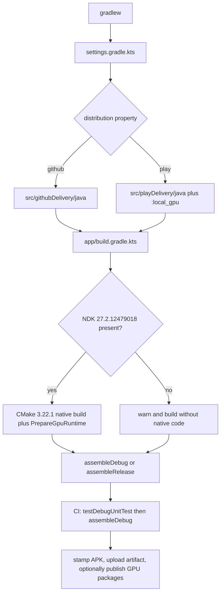

# Build, CI, and Testing

> Defines the Gradle toolchain, the two distribution channels, the signing and native packaging rules, the test source sets, and the GitHub Actions jobs that build and publish artifacts.

AndroidHarness is a single `:app` module plus a conditional `:local_gpu` dynamic feature. There are no Android product flavors. Distribution is selected by the `distribution` Gradle property, which adds a delivery source set and a `PLAY_DISTRIBUTION` BuildConfig field. The build pins AGP 9.3.1, Kotlin 2.4.10, Gradle 9.7.0, SDK 37, and a specific NDK, and both CI workflows use JDK 21 to compile Java 17 bytecode.

## Module Responsibilities

- **Root `build.gradle.kts`**: plugin aliases with `apply false`, plus buildscript dependency constraints that lift known CVEs in AGP tooling.
- **`settings.gradle.kts`**: repositories, root name, and conditional inclusion of `:local_gpu`.
- **`app/build.gradle.kts`**: Android configuration, channel source sets, native build, signing, build types, packaging, dependency graph, and the GPU runtime packaging task.
- **`gradle/libs.versions.toml`**: the version catalog for plugins, libraries, and test libraries.
- **`gradle/wrapper/gradle-wrapper.properties`**: Gradle 9.7.0 binary distribution.
- **`.github/workflows/nightly.yml`**: debug build and unit tests on push, schedule, and dispatch.
- **`.github/workflows/gpu-runtime.yml`**: release APK plus GPU package publication on manual dispatch.
- **`scripts/`**: release APK probing, local model fixtures, editor tool builds, and two standalone database and storage test drivers.

## Build Configuration and Flow

## Invocation Chain

1. `./gradlew :app:assembleDebug` resolves the wrapper, loads `settings.gradle.kts`, and includes `:app`.
2. `settings.gradle.kts` reads the `distribution` property and includes `:local_gpu` only for `play`.
3. `app/build.gradle.kts` evaluates the channel, NDK presence, `defaultConfig`, signing, and build types.
4. AGP creates the variant tasks; with an NDK, `externalNativeBuild` and `prepareGpuRuntime<Variant>` run before JNI merge.
5. `PrepareGpuRuntime` writes assets, content-addressed packages, and the per-ABI stubs.
6. `assembleDebug` or `assembleRelease` packages the APK into `app/build/outputs/apk/<variant>/`.
7. CI runs `:app:testDebugUnitTest` first, then the assemble task, then copies outputs into `dist/` and uploads them.

## Toolchain Versions Actually Declared

| Item | Value | Where |
| --- | --- | --- |
| Gradle | 9.7.0 | `gradle/wrapper/gradle-wrapper.properties:3` |
| Android Gradle Plugin | 9.3.1 | `gradle/libs.versions.toml:2` |
| Kotlin | 2.4.10 | `gradle/libs.versions.toml:3` |
| KSP | 2.3.11 | `gradle/libs.versions.toml:4` |
| Compose BOM | 2026.08.00 | `gradle/libs.versions.toml:5` |
| Material 3 | 1.5.0-alpha26 | `gradle/libs.versions.toml` |
| compileSdk | 37 | `app/build.gradle.kts:48` |
| targetSdk | 36 | `app/build.gradle.kts:64` |
| minSdk | 26 | `app/build.gradle.kts:63` |
| versionCode | 37 | `app/build.gradle.kts:65` |
| versionName | 3.3 | `app/build.gradle.kts:66` |
| Java source and target | 17 | `app/build.gradle.kts:136-139` |
| Kotlin jvmTarget | JVM 17 | `app/build.gradle.kts:141-145` |
| NDK | 27.2.12479018 | `app/build.gradle.kts:23` |
| CMake | 3.22.1 | `app/build.gradle.kts:54` |
| CI JDK | Temurin 21 | both workflows |

`gradle.properties` sets a 4 GB heap, parallel execution, build cache, configuration cache, AndroidX, non-transitive R classes, and `android.suppressUnsupportedCompileSdk=37`. It also disables built-in Kotlin and the new DSL (`android.builtInKotlin=false`, `android.newDsl=false`), so the Kotlin Android plugin remains authoritative.

The NDK block is conditional. `hasNdk` checks `ANDROID_HOME` or `sdk.dir` from `local.properties` for the exact `ndk/27.2.12479018` directory. When absent, the build logs a warning and configures without native code, which is what lets tooling runners without an editable workflow trace Kotlin and Java. `ANDROID_NDK_HOME` is deliberately ignored because AGP resolves pinned NDK versions only from the SDK directory.

## Distribution Channels, Not Flavors

`distributionChannel` defaults to `github` and is validated to be `github` or `play` ([app/build.gradle.kts:30](../app/build.gradle.kts)#L30-L32)). The differences:

- `sourceSets.getByName("main").java.srcDir("src/${distributionChannel}Delivery/java")` adds either `githubDelivery` or `playDelivery` ([app/build.gradle.kts:44](../app/build.gradle.kts)#L44)).
- `PLAY_DISTRIBUTION` is a generated boolean BuildConfig field.
- Play adds the `:local_gpu` dynamic feature (`dynamicFeatures += setOf(":local_gpu")`), adds `com.google.android.play:feature-delivery:2.1.0`, and skips the generated GPU delivery assets because Play authenticates native splits itself.
- `settings.gradle.kts` includes `:local_gpu` only when `distribution=play` ([settings.gradle.kts:16](../settings.gradle.kts)#L16-L17)).

Each delivery source set contains `GpuDeliveryFactory.kt`; the GitHub one also contains `GpuDownloadWorker.kt`. The naming means `./gradlew :app:assembleDebug` builds the GitHub channel by default, and `./gradlew -Pdistribution=play :app:assembleRelease` builds the Play channel.

## Signing, Build Types, and Packaging

`signingConfigs` uses the debug config only. It prefers `signing-keys/debug.keystore` when that file exists, because AGP's default path is machine-dependent and a stray debug key causes signature mismatch on reinstall ([app/build.gradle.kts:81](../app/build.gradle.kts)#L81-L93)). The `signing-keys/` directory is gitignored, so a fresh checkout falls back to AGP's default debug key.

The release type is explicitly a local alpha distribution: it uses the debug signing config, enables R8 minification and resource shrinking, and applies `proguard-android-optimize.txt` plus `proguard-rules.pro` ([app/build.gradle.kts:95](../app/build.gradle.kts)#L95-L118)). Anyone publishing publicly must replace that signing config. Debug adds the `.debug` application ID suffix.

An opt-in `benchmark` build type exists when `-PcardBenchmark` is set. It extends release, adds `.benchmark`, sets `isDebuggable = false`, becomes the `testBuildType`, and reuses the debug Java sources and manifest ([app/build.gradle.kts:108](../app/build.gradle.kts)#L108-L126)). Instrumentation tests for card frame measurements use this window so the test host never enters the release APK.

Packaging excludes `libggml-vulkan.so` and `libharness_gpu_unavailable.so` from the base JNI libraries because they are delivered separately, and excludes common `META-INF` license and notice files. Build features are `buildConfig`, `compose`, `aidl`, and `prefab`; prefab supplies BoringSSL for the wireless ADB pairing code. `bundle { language { enableSplit = false } }` keeps all app languages in the base so the in-app language picker works without a Play download.

Lint has `checkReleaseBuilds = false` because `lintVitalAnalyzeRelease` crashes inside lint's own JavaDoc parser on `HarnessUserService.kt`. This is documented as an AGP or lint bug, not a suppression of findings.

## Native and GPU Packaging

The CMake source is `src/main/cpp/CMakeLists.txt`. When the NDK is present, ABI filters are `armeabi-v7a`, `arm64-v8a`, `x86`, and `x86_64`, and CMake gets `-DANDROID_SUPPORT_FLEXIBLE_PAGE_SIZES=ON` plus a generated GPU output directory.

`PrepareGpuRuntime` runs per variant and produces three outputs ([app/build.gradle.kts:266](../app/build.gradle.kts)#L266-L327)):

- `libharness_gpu_unavailable.so` stubs for `armeabi-v7a` and `x86`, stripped with the pinned NDK's `llvm-strip`.
- `libggml-vulkan.so` for `arm64-v8a` and `x86_64`, either from the native build or from an optional `gpuRuntimePackages` folder whose manifest must contain the pinned ggml core revision.
- Content-addressed `gpu-<abi>-<sha256>.so.gz` files under `outputs/gpuRuntime/<variant>` plus per-ABI JSON manifests under `generated/gpuDelivery/<variant>/assets/gpu-runtime`.

External packages are bounded to 128 MiB during decompression and must match the hash in their filename. The GitHub channel registers the generated assets as a source directory; the Play channel keeps the base APK free of the download manifest.

## Dependencies and Resolution Constraints

The app uses Room with KSP, DataStore, WorkManager, DocumentFile, Browser, WebKit, Security Crypto, Biometric, Fragment, and AppCompat. Networking and protocol layers use OkHttp, kotlinx.serialization, JSch, BouncyCastle, Conscrypt, JavaScriptEngine, and CEL 0.14.0. Privileged integrations use libsu 6.0.0, Dhizuku API 2.6.0, and Shizuku API and provider 13.1.5. The editor is Sora Editor 0.23.6.

Two resolution blocks matter for builds:

- The root buildscript constrains AGP's own classpath to BouncyCastle 1.85, jdom2 2.0.6.1, jose4j 0.9.6, httpclient 4.5.14, commons-lang3 3.18.0, and Guava 33.7.2-jre, each with a CVE reason ([build.gradle.kts:1](../build.gradle.kts)#L1-L24)).
- `app/build.gradle.kts` applies the same Guava constraint to implementation and ksp, and rewrites netty to 4.1.137.Final, BouncyCastle to 1.85, httpclient to 4.5.14, commons-lang3 to 3.18.0, and Guava to 33.7.2-jre for `unified-test-platform*` and `androidLintTool` configurations only ([app/build.gradle.kts:174](../app/build.gradle.kts)#L174-L199)).

## Test Source Sets and Organization

There are 307 Kotlin files under `app/src/test` and 135 under `app/src/androidTest` at HEAD `aae55c4`.

**Unit tests** use JUnit 4.13.2 with plain `@Test`. Packages mirror main (`agent`, `data`, `llm`, `tools`, `ui`, `workspace`, `automation`, `browser`, `chatgpt`, `local`, `telegram`, `repomap`, and others). They cover pure logic such as `LiveUpdateVendorTest`, `LiveUpdateShortTextTest`, `BackgroundSettingsTest`, retry policy, prompt formatting, and settings parsing. The only test resource is `app/src/test/resources/rich-response/comparison-regression.md`. The CI command is `./gradlew :app:testDebugUnitTest`.

**Instrumented tests** run under `androidx.test.runner.AndroidJUnitRunner` ([app/build.gradle.kts:75](../app/build.gradle.kts)#L75-L78)). Classes are named `...DeviceTest`, use `@RunWith(AndroidJUnit4::class)`, and many use `@SdkSuppress` for a minimum API. They drive a real device or emulator: WebView behavior, notification promotion, Shizuku startup and compatibility, update installation, wireless ADB lifecycle, storage access, and Compose UI flows. The instrumentation manifest declares two read-only fixture providers whose `android:enabled` is the `localImportFixtureEnabled` manifest placeholder. That placeholder is true unless `-PcardBenchmark` is set, so the test hosts never enter the benchmark or release build.

Dependencies are `androidx.test:runner:1.6.2`, `androidx.test:core:1.6.1`, and `androidx.test.ext:junit:1.2.1` ([gradle/libs.versions.toml:64](../gradle/libs.versions.toml)#L64-L68)).

## CI Jobs That Exist

There are exactly two workflow files.

**`nightly.yml`, display name "Debug build"** ([nightly.yml:1](../.github/workflows/nightly.yml)#L1-L90)):

- Triggers: cron `0 2 * * *` UTC, `workflow_dispatch`, and pushes to `main` touching `app/**` or the workflow file.
- Permissions: `contents: write`; concurrency group `nightly-build` with cancel in progress.
- Steps: checkout v7, Temurin JDK 21, `gradle/actions/setup-gradle@v6`, install NDK `27.2.12479018`, install `glslc`, run `:app:testDebugUnitTest`, upload the test report on failure, run `:app:assembleDebug`, stamp the APK as `AndroidHarness-<UTC yyyymmdd-HHMM>-<shortsha>-debug.apk`, copy GPU `.gz` outputs into `dist/`, optionally publish the GPU packages to release ID 1 of `Sanuu7/AH-GPU-Runtime` when `GPU_RUNTIME_PUBLISH_TOKEN` is set, and upload `dist/*` as an artifact kept 30 days.

**`gpu-runtime.yml`, display name "Publish GPU runtime packages"** ([gpu-runtime.yml:1](../.github/workflows/gpu-runtime.yml)#L1-L43)):

- Trigger: `workflow_dispatch` only, with `contents: write` and the `gpu-runtime-publication` concurrency group.
- Steps: checkout, JDK 21, Gradle setup, NDK and `glslc` install, `:app:assembleRelease`, upload `app/build/outputs/apk/release/*.apk` and `app/build/outputs/gpuRuntime/release/*.gz` as one artifact, then optionally upload the `.gz` files to release 1 of `Sanuu7/AH-GPU-Runtime`.

Neither workflow runs instrumented tests, publishes to Play, or creates a GitHub release for the app APK. The nightly artifact is the only app artifact produced by a scheduled or push build; the GPU workflow produces its release APK only on manual dispatch.

## Release and Test Scripts

- **`scripts/release-smoke/run.sh`** takes an ADB serial, a release APK, a GGUF fixture, and an optional GPU package. It compiles `ReleaseProbe.java` with the JDK 17 toolchain, dexes it with `d8 --min-api 26`, pushes the probe, APK, and model to `/data/local/tmp`, and runs the probe with `app_process` ([run.sh:1](../scripts/release-smoke/run.sh)#L1-L46)). `ReleaseProbe.java` checks the `EnvState` class labels, optional downloaded GPU backend loading, SPAKE2 pairing construction, SSH key generation, and native library load with and without a Vulkan device. It deliberately runs against the actual APK without adding test entry points or keep rules.
- **`scripts/local-model-smoke/`** contains a Python fixture generator and a `com` tree for local model smoke work.
- **`scripts/editor-tools/`** is a Node package with `node build.mjs` and `node --test engine.test.mjs`, bundling the editor language services with esbuild 0.28.2, prettier 3.9.6, TypeScript 5.9.3, and the VS Code language services.
- **`scripts/test_legacy_storage.sh`** resets the debug app between instrumentation cases and accepts only an API 28 or 29 emulator serial. It refuses physical devices and writes reports under `app/build/reports/android<api>-storage`.
- **`scripts/test_message_truncation.py`** extracts the Room delete query from `Database.kt` and runs it against an in-memory SQLite database, checking ordering behavior that a JVM test cannot reproduce with the real SQL.

## Key State and Data Structures

- **`distributionChannel`**: Gradle property string, `github` or `play`.
- **`hasNdk`**: Boolean computed from the SDK directory and pinned NDK path.
- **`BuildConfig.PLAY_DISTRIBUTION`**: generated boolean used by `MainActivity` and `LocalGpuSupportCard`.
- **`pinnedNdk`**: `27.2.12479018`.
- **`PrepareGpuRuntime`**: task with native, external package, strip tool, asset, package, and feature directory properties.
- **`localImportFixtureEnabled`**: manifest placeholder controlling the two test providers.

## Boundary Conditions

- Building without the exact NDK succeeds but omits native libraries; anything that loads `harness_adb`, `libggml-vulkan.so`, or the local backend must not assume they exist.
- A foreign `ANDROID_NDK_HOME` does not enable native code; only the SDK directory layout does.
- Release builds are debug-signed, so a switch to a real release key changes the signer and breaks in-place updates from earlier builds.
- `-PcardBenchmark` changes `testBuildType`, disables the fixture providers, and adds a non-debuggable benchmark variant. Instrumented runs that depend on fixtures fail in that mode by design.
- Lint release analysis is disabled, so lint findings do not gate release assembly.
- The Play channel requires `:local_gpu`, so `settings.gradle.kts` and the `distribution` property must agree; a missing property defaults to GitHub.
- CI installs `glslc` because the CMake build compiles Vulkan shaders; a runner without it fails the native step, not the Gradle configuration.
- The GPU publication steps exit successfully without a token, leaving the packages only in the workflow artifact.
- Configuration cache is enabled, so new build logic must avoid unsupported Gradle APIs or the build will discard the cache.

## Extension Points

- Add a library through `gradle/libs.versions.toml` and reference it as `libs.<alias>` rather than a literal coordinate.
- Add a delivery-specific class under `app/src/githubDelivery/java` or `app/src/playDelivery/java`; no flavor declaration is needed.
- New build-time flags follow the `PLAY_DISTRIBUTION` pattern: a `buildConfigField` next to the existing fields in `defaultConfig`.
- New instrumentation suites belong under `app/src/androidTest/java` with the `DeviceTest` naming and the AndroidJUnit4 runner; any new fixture provider goes in the instrumentation manifest with the same placeholder gate.
- New CI work should extend the existing workflows rather than add a third file, because both current jobs already own the build and GPU publication paths.
- The release probe is the place to add checks that must run against the packaged APK rather than a test build.

Sources: [app/build.gradle.kts:8-327](../app/build.gradle.kts)#L8-L327), [build.gradle.kts:1-30](../build.gradle.kts)#L1-L30), [settings.gradle.kts:1-17](../settings.gradle.kts)#L1-L17), [gradle/libs.versions.toml:1-75](../gradle/libs.versions.toml)#L1-L75), [.github/workflows/nightly.yml:1-90](../.github/workflows/nightly.yml)#L1-L90), [.github/workflows/gpu-runtime.yml:1-43](../.github/workflows/gpu-runtime.yml)#L1-L43)

## Source files

- `build.gradle.kts`
- `app/build.gradle.kts`
- `local_gpu/build.gradle.kts`
- `settings.gradle.kts`
- `gradle.properties`
- `gradle/wrapper/gradle-wrapper.properties`
- `gradle/libs.versions.toml`
- `.github/workflows/nightly.yml`
- `.github/workflows/gpu-runtime.yml`
- `scripts/release-smoke/run.sh`
- `scripts/release-smoke/ReleaseProbe.java`
- `scripts/editor-tools/package.json`
- `scripts/test_legacy_storage.sh`
- `scripts/test_message_truncation.py`
- `app/src/androidTest/AndroidManifest.xml`
- `app/src/test/java/com/androidharness/app/LiveUpdateVendorTest.kt`
- `app/src/androidTest/java/com/androidharness/app/LiveUpdateDeviceTest.kt`
