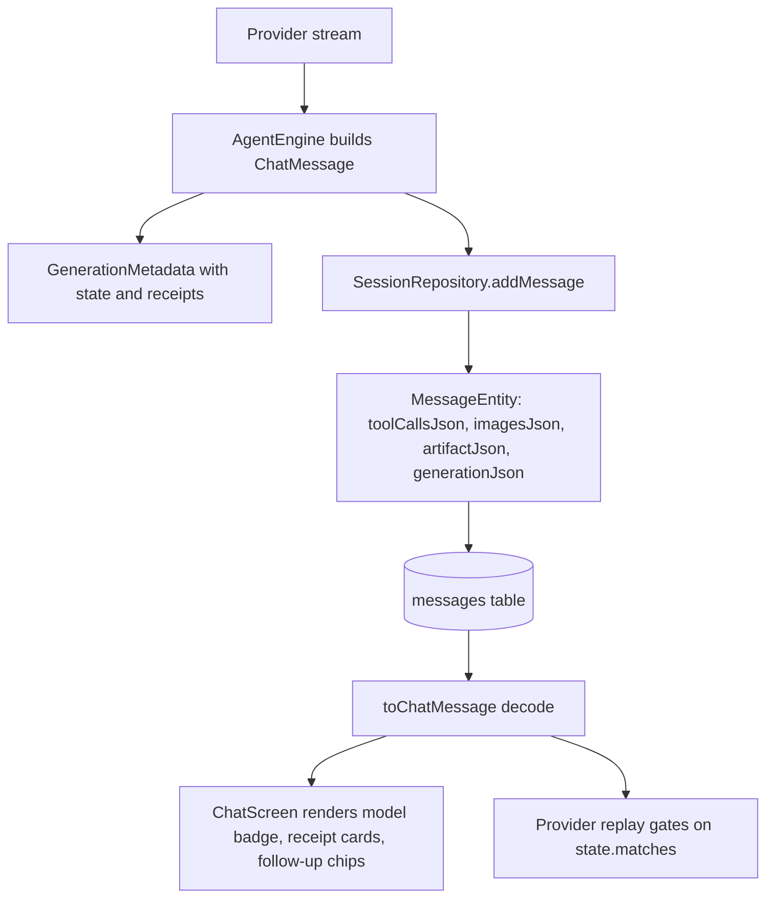

# Shared Core Models and Pure Utilities

> Defines the provider-neutral chat model, the generation metadata that persists with each message, the structured receipt and follow-up types, and the pure text, file-reference, response and launch helpers that every other subsystem imports.

The `core` package is the dependency floor of the app. `Models.kt` holds `ChatMessage`, `ToolCallData` and `ImageRef`; `GenerationMetadata.kt` holds the per-message provenance blob; `*Receipt.kt` holds structured evidence; and the remaining files in `core/` and `core/response/` are stateless parsers and formatters. Almost nothing here touches Android APIs or the database, so these types can be tested and reused from the JVM, and several have dedicated tests such as `ReasoningTextChunksTest` and `ToolOutputTextTest`.

## Module Responsibilities

- **`Models.kt`**: the provider-neutral message graph. `ChatMessage` (line 53), `ToolCallData` (line 8), `ToolCodeChange` (line 23), `ImageRef` (line 27), `ImageData` (line 44) and the `Role` enum (line 5).
- **`GenerationMetadata.kt`**: `ProviderMessageState` (line 10), `SuppliedMemory` (line 44) and `GenerationMetadata` (line 47), with JSON encode/decode at lines 63 and 66.
- **`ResearchReceipt.kt`**: harness-owned research evidence (line 7). **`SettingsReceipt.kt`**: `SettingsReceipt` (line 7), `SettingChange` (line 16), `SettingTodo` (line 20).
- **`FollowUpSuggestions.kt`**: parses and strips the `::followups` directive (line 15).
- **`ChatTurnActions.kt`**: pure turn identity and lookup helpers (line 4).
- **`ChatResponseImages.kt`**: opaque `harness-image:` reference resolution (line 4).
- **`ChangeQuestion.kt`**: builds the "ask about this change" prompt (line 3).
- **`TextLines.kt`**: POSIX-correct `splitLines` (line 18). **`ToolOutputText.kt`**: bounded output chunking (line 5). **`ReasoningTextChunks.kt`**: bounded reasoning chunking plus a streaming cache (line 4).
- **`WorkspaceFileReference.kt`**: parses `path:line` references from Markdown links, inline code and prose (line 7).
- **`LocalPortProbe.kt`**, **`NpmLaunchShell.kt`**, **`ProjectLaunch.kt`**: loopback probing and project launch helpers.
- **`core/response/`**: `RichResponse`, `ChatRichResponse`, `ResponseAttachment`, `UserMessageContent`, `ResponseDiff`, `ResponseTableData` and `CalculatorMath`.

## Architecture and Flow

- `AgentEngine` creates the assistant `ChatMessage` and fills `generation` with `reasoningTokens`, `reasoningSetting`, `suppliedMemories`, `model`, `followUps`, then binds `state` with `responseState?.boundTo(it)`.
- `SessionRepository.addMessage` serializes the message at lines 272 to 304. `GenerationMetadata.encode` returns `null` for a default object, so ordinary messages pay no JSON column cost.
- Reading back, `MessageEntity.toChatMessage` (line 929) decodes `generationJson` at line 944, falls back to `emptyList()` for malformed tool calls or images, and caches by `toolCallsJson + generationJson` at line 924.
- The UI reads `generation.settings` at `ChatScreen.kt:1823`, `generation.followUps` at `ChatScreen.kt:1910`, and `generation.model` at `ChatScreen.kt:1945`.
- `ChatActivityPresentation.kt:107` reads `generation.research` to decide whether a web read was verified.

## Invocation Chain

1. Provider emits `StreamEvent.ResponseState`, providers build `ProviderMessageState.of(config, format, items)` (`OpenAiCompatProvider.kt:110`, `AnthropicProvider.kt:259`, `GeminiProvider.kt:129`, `ChatGptProvider.kt:116`).
2. `AgentEngine` attaches it with `copy(state = responseState?.boundTo(it))`, which stamps `contentDigest` from the committed text and tool call arguments.
3. `SessionRepository.addMessage` calls `GenerationMetadata.encode` (line 299) and writes the `messages` row.
4. `SessionRepository` later calls `GenerationMetadata.decode` (line 944) when loading history.
5. Providers consult `ProviderMessageState.matches(config, format, message)` before replaying native blocks or reasoning items.
6. On the UI side, `RichResponse.parse` is called from `RichResponseContent.kt:60`, and `ChatRichResponse.normalize` from `ChatScreen.kt:1886` and `2260`.
7. `FollowUpSuggestions.extract` runs in `AgentEngine.kt:735` before the assistant message is committed, so the directive never reaches storage.

## Key State and Data Structures

| Type | Shape | Persistence | Invariant |
| --- | --- | --- | --- |
| `ChatMessage` | role, text, toolCalls, toolCallId, toolName, isError, thinking, thinkingMs, outputTokens, generationMs, firstTokenMs, streamMs, images, turnId, id, createdAt, artifact, generation | `messages` columns; `imageData` never persisted | Tool calls live on the ASSISTANT message; results are separate TOOL messages keyed by `toolCallId` |
| `ToolCallData` | id, name, argumentsJson, responseReasoning, responseProviderId, codeChanges, workspaceId, workspaceName | `toolCallsJson` | `codeChanges`, `workspaceId`, `workspaceName` are UI metadata and never sent as tool arguments |
| `ImageRef` | name, mime, imageId, sourceUrl, caption, dimensions, bytes, origin, original* variants | `imagesJson` | Bytes live in `ImageStore` keyed by `name`; only metadata is in the row |
| `ProviderMessageState` | providerId, endpointHash, model, format, items, contentDigest | inside `generationJson` | Bound to one provider, endpoint, model and format; never replayed across endpoints |
| `GenerationMetadata` | state, reasoningTokens, reasoningSetting, suppliedMemories, execution, model, followUps, research, settings | `generationJson` | `null` means the provider reported no separate count; `0` is a real count |
| `ResearchReceipt` | sourcesUsed, sourcesMax, pagesRead, readsRequired, pageUrl, pageRead, backend | inside `GenerationMetadata` | Harness evidence, kept separate from untrusted page text |
| `SettingsReceipt` | changes, needsUser, skipped | inside `GenerationMetadata` | Refused changes are reported, not hidden |
| `WorkspaceFileReference` | path, optional one-based line | not persisted | The line, when present, is greater than zero |

`ChatTurnActions` is pure lookup logic. `answerVersionKey` (line 5) hashes the previous message id plus the question with SHA-256, with a NUL separator, and becomes the `groupKey` for `chat_answer_versions` (`SessionRepository.kt:814`). `userMessageFor` (line 11) returns the last USER message with a matching `turnId`, which regeneration uses.

`ChatResponseImages` defines the `harness-image:img_...` URL scheme. `imageId` (line 7) accepts ids of 1 to 128 characters from a fixed alphabet, `stableId` (line 9) derives `img_` plus 12 hex bytes from a SHA-256 digest, and `available` (line 12) rejects blank names, `.`, `..` and names containing a slash or backslash. `referenced` (line 18) ignores fenced code and inline code so an image URL inside a code sample does not render. `ChangeQuestion.prompt` caps the diff at 16,000 characters, or 8,000 per side for a selected section, and states that the pasted source is untrusted reference data.

`splitLines` (line 18) treats a trailing newline as a terminator, not a separator. It returns `["a","b"]` for `"a\nb\n"`, `[]` for `""`, and `[""]` for `"\n"`. Matching git's line model is what keeps `Diff.kt`, `FileTools.kt`, `PatchTools.kt` and `FuzzyEdit.kt` from seeing a phantom trailing line. `ToolOutputText.chunks` targets 2,048 characters per chunk, prefers to break after the next newline within another 2,048 characters, and never splits a surrogate pair. `ReasoningTextChunks` uses 512 to 1,024 character chunks, preferring newline or space boundaries, and its `Stream` class reuses all completed chunks when text only grows, so the live transcript re-splits only the tail.

`WorkspaceFileReference.parse` rejects inputs over 4,096 characters, control characters and backslashes. It accepts `path:12`, `path:12:4-8`, and `path#L12-L20`, rejects IPv4 `host:port`, rejects URI schemes unless the prefix looks like a known filename or extension, rejects `..` segments, and only links inline code when the basename has a known extension or is in the `names` set. `findInText` (line 32) trims trailing punctuation before parsing.

`LocalPortProbe.COMMON_PORTS` is `3000, 5173, 8000, 8080, 4321, 8081, 5000, 8888, 4200, 9000` (line 15). `probe` runs one `async` per port on `Dispatchers.IO` and defaults to a 60 ms connect timeout. `portOfUrl` falls back to 80 or 443 for loopback URLs, and `normalizeLocalUrl` rewrites a bare port or `localhost:port` to `http://localhost:<port>`.

`ProjectLaunch` parses `scripts` from `package.json`, validates names against `[A-Za-z0-9:_-]{1,80}`, and orders `dev`, `start`, `preview` first. `previewUrl` strips ANSI escapes and rewrites `0.0.0.0` to `127.0.0.1`. `NpmLaunchShell.preload` monkey-patches `child_process.spawn` so npm lifecycle scripts run through the packaged bash and its shims.

In `core/response`, `ResponseAttachment` embeds a serialized selection and context into the user text between `[[harness-response]]` and `[[/harness-response]]` markers. Decode rejects payloads over 12,000 characters, blank titles, titles over 100 characters and contexts over 1,500 characters. `UserMessageContent` composes this with `ArtifactAttachment` for both display and edit. `ResponseDiff.lines` is an LCS diff with a hard cap of 400 lines per side and markers `" "`, `"-"` and `"+"`. `ResponseTableData` classifies pass, fail and unverified status prefixes, filters rows by case-insensitive substring, sorts numbers numerically before text, and exports CSV with CRLF and doubled quotes. `CalculatorMath` parses only arithmetic, parentheses, `min`, `max`, `abs`, `sqrt`, `round`, named variables and `^`, with limits of 300 characters, 128 nodes, 16 nesting levels, finite results and magnitude at most 1e15. `RichResponse` defines the `harness-ui`, `harness-html` and `harness-svg` languages, `MAX_JSON_CHARS` of 96,000 and `MAX_VISUAL_CHARS` of 64,000; `decode` (line 139) returns null on any invalid component, and `parse` (line 95) withholds incomplete fences while streaming. `ChatRichResponse.normalize` recovers components that arrive without a fence, with `type` reordered, or in the line-oriented `::card` directive form.

## Boundary Conditions

- Persisted text, thinking and tool call JSON are clamped to 250,000 characters (`SessionRepository.kt:37`). Oversized `create_artifact` arguments have their `html` replaced, and if the JSON is still too large the column becomes `[]`.
- `GenerationMetadata.decode` uses `ignoreUnknownKeys` and returns a default object on any parse failure, so an older or corrupt column never blocks history loading.
- `ProviderMessageState.matches` fails if the provider id, base URL hash, model or expected format differ, or if the stored `contentDigest` no longer matches the message content.
- Follow-up extraction stops at the first marker outside a code fence and returns the raw text unchanged if the closing `::` is missing. At most 3 items are kept, each truncated to 120 characters, de-duplicated after truncation.
- `ChatResponseImages` returns an empty list rather than an error for unknown ids, and `available` silently omits unsafe image names.
- `ResponseDiff.lines` throws via `require` above 400 lines. `CalculatorMath.evaluate` returns null instead of throwing for invalid expressions or non-finite results.
- `LocalPortProbe.isPortOpen` swallows every exception and reports false. `probe` probes all ports concurrently, so worst case latency is one timeout, not the sum.

## Extension Points

- Add a new generation field by extending `GenerationMetadata`; it is serialized automatically and defaults keep old rows readable.
- Add a rich component by extending `RichResponse.Node` and `Part`, then the decoder switch and `plainText` rendering. `ChatRichResponse.componentTypes` and its header regex must list the new type for unfenced recovery.
- Add a recognized file type by editing `WorkspaceFileReference.extensions` or `names`.
- Add a launch script ordering rule in `ProjectLaunch.scripts`, or a new port in `LocalPortProbe.COMMON_PORTS`.
- Add a suppression or extraction rule for follow-ups in `FollowUpSuggestions.isMarker`.

## Known gaps

- No literal `CORE-3` marker exists anywhere in the repository. The reasoning chunk file described by that label is `ReasoningTextChunks.kt`; its `Stream` usage is in `ChatActivity.kt:76` and `ChatActivity.kt:129`. The mapping of `CORE-3` to this file is inferred from the topic, not from a source comment.
- `ChatThinkingMetrics.kt` in the same package is not part of the requested file list, so its totals and compact formatting are only noted here.

Sources: [app/src/main/java/com/androidharness/app/core/Models.kt](../app/src/main/java/com/androidharness/app/core/Models.kt)#L1-L78), [app/src/main/java/com/androidharness/app/core/GenerationMetadata.kt](../app/src/main/java/com/androidharness/app/core/GenerationMetadata.kt)#L1-L69), [app/src/main/java/com/androidharness/app/data/SessionRepository.kt](../app/src/main/java/com/androidharness/app/data/SessionRepository.kt)#L261-L309)

## Source files

- `app/src/main/java/com/androidharness/app/core/Models.kt`
- `app/src/main/java/com/androidharness/app/core/GenerationMetadata.kt`
- `app/src/main/java/com/androidharness/app/core/ResearchReceipt.kt`
- `app/src/main/java/com/androidharness/app/core/SettingsReceipt.kt`
- `app/src/main/java/com/androidharness/app/core/FollowUpSuggestions.kt`
- `app/src/main/java/com/androidharness/app/core/ChatTurnActions.kt`
- `app/src/main/java/com/androidharness/app/core/ChatResponseImages.kt`
- `app/src/main/java/com/androidharness/app/core/ChangeQuestion.kt`
- `app/src/main/java/com/androidharness/app/core/TextLines.kt`
- `app/src/main/java/com/androidharness/app/core/ToolOutputText.kt`
- `app/src/main/java/com/androidharness/app/core/ReasoningTextChunks.kt`
- `app/src/main/java/com/androidharness/app/core/WorkspaceFileReference.kt`
- `app/src/main/java/com/androidharness/app/core/LocalPortProbe.kt`
- `app/src/main/java/com/androidharness/app/core/NpmLaunchShell.kt`
- `app/src/main/java/com/androidharness/app/core/ProjectLaunch.kt`
- `app/src/main/java/com/androidharness/app/core/response/ResponseAttachment.kt`
- `app/src/main/java/com/androidharness/app/core/response/ResponseDiff.kt`
- `app/src/main/java/com/androidharness/app/core/response/ResponseTableData.kt`
- `app/src/main/java/com/androidharness/app/core/response/CalculatorMath.kt`
- `app/src/main/java/com/androidharness/app/core/response/RichResponse.kt`
- `app/src/main/java/com/androidharness/app/core/response/ChatRichResponse.kt`
- `app/src/main/java/com/androidharness/app/data/db/Database.kt`
- `app/src/main/java/com/androidharness/app/data/SessionRepository.kt`
